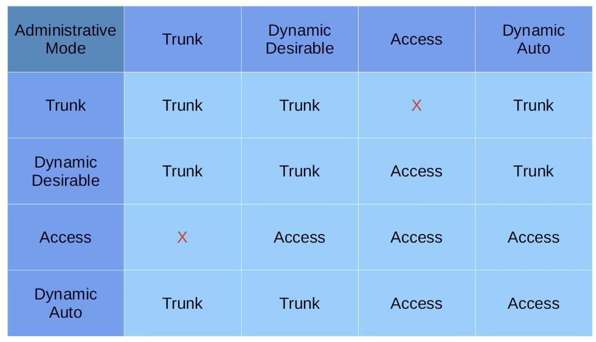
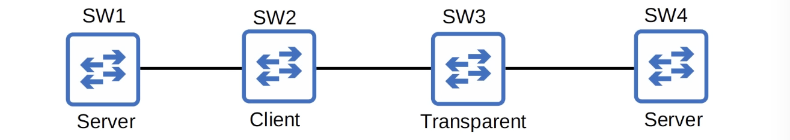

# DTP (Dynamic Trunking Protocol), VTP (VLAN Trunking Protocol)

## DTP (Dynamic Trunking Protocol)

- DTP is a Cisco proprietary protocol that allows switches to negotiate the status of their switchports to be either access ports or trunk ports, without manually configuring them
- DTP is enabled by default on all Cisco switch interfaces
- So far, we have been manually configuring switchorts using these commands:

```
switchport mode access
```

    - OR:

```
switchport mode trunk
```

- For security purposes, manual configuration is recommended
  - DTP should be disabled on all switchports

```
SW2(config-if)#switchport mode ?
  access        Set trunking mode to ACCESS unconditionally
  dot1q-tunnel  set trunking mode to TUNNEL unconditionally
  dynamic       Set trunking mode to dynamically negotiate access or trunk mode
  private-vlan  Set private-vlan mode
  trunk         Set trunking mode to TRUNK unconditionally

SW2(config-if)#switchport mode dynamic ?
  auto          Set trunking mode dynamic negotiation parameter to AUTO
  desirable     Set trunking mode dynamic negotiation parameter to DESIRABLE

```

- A switchport in `dynamic desirable` mode will actively try to form a trunk with other Cisco switches; it will form a trunk if connected to another switchport in the following modes:

```
switchport mode trunk
switchport mode dynamic desirable
switchport mode dynamic auto
```

[1](1.png)

- _Those switches will both agree to operate as trunks_

```
SW1#show interfaces g0/0 switchport
Name: Gi0/0
Switchport: Enabled
Administrative Mode: dynamic desirable
Operational Mode: trunk

```

```
SW2#show interfaces g0/0 switchport
Name: Gi0/0
Switchport: Enabled
Administrative Mode: trunk
Operational Mode: trunk

```

[2](2.png)

- _Those switches will not agree to operate as trunks_

```
SW1#show interfaces g0/0 switchport
Name: Gi0/0
Switchport: Enabled
Administrative Mode: dynamic desirable
Operational Mode: static access
```

- 'static access' means an access port that belongs to a single VLAN that doesn't change (unless we configure a different VLAN)

```
SW2#show interfaces g0/0 switchport
Name: Gi0/0
Switchport: Enabled
Administrative Mode: static access
Operational Mode: static access

```

- A switchport in `dynamic auto` mode will NOT actively try to form a trunk with other Cisco switches, however it will form a trunk if the switch connected to it i actively trying to form a trunk; it will form a trunk with a switchport in the following modes:

```
switchport mode trunk
switchport mode dynamic desirable
```



- DTP will not form a trunk with a router, PC, etc.; the switchport will be in access mode
- On older switches, **`switchport mode dynamic desirable`** is the default administrative mode
- On newer switches, **`swtichport mode dynamic auto`** is the default administrative mode
- We can disable DTP negotiation on an interface with this command:

```
switchport nonegotiate
```

- Configuring an access port with `switchport mode access` also disables DTP negotiation on an interface
- It is recommnended that we disable DTP on all switchports and manually configure them as access or trunk ports
- Switches that support both **802.1Q** and **ISL** trunk encapsulations can use DTP to negotiate the encapsulation they will use
- This negotiation is enables by default, as the default trunk encapsulation mode is: `switchport trunk encapsulation negotiate`
- **ISL** is favored over **802.1Q**, so if both switches support ISL it will be selected
- DTP frames are sent in VLAN1 when using **ISL**, or in the native VLAN when using **802.1Q** (the default native VLAN is VLAN1, however)

```
SW1(config-if)#switchport mode dynamic desirable
SW1(config-if)#do show interfaces g0/0 switchport
Name: Gi0/0
Switchport: Enabled
Administrative Mode: dynamic desirable
Operational Mode: trunk
Administrative Trunking Encapsulation: negotiate
Operational Trunking Encapsulation: isl
Negotiation of Trunking: On

SW2(config-if)#switchport mode dynamic desirable
SW2(config-if)#do show interfaces g0/0 switchport
Name: Gi0/0
Switchport: Enabled
Administrative Mode: dynamic desirable
Operational Mode: trunk
Administrative Trunking Encapsulation: negotiate
Operational Trunking Encapsulation: isl
Negotiation of Trunking: On

```

## VTP (VLAN Trunking Protocol)

- VTP is another Cisco proprietary protocol that allows you to configure VLANs on a central switch, which then acts as a server that other switches can sync to, so we don't have to configure VLANs on every single switch
- VTP allows us to configure VLANs on a central VTP server switch, and other switches (VTP clients) will sync their VLAN database to the server
- It is designed for large networks with many VLANs, so that we don't have to configure each VLAN on every switch
- It is rarely used, and it is recommended that we do not use it
- There are three VTP versions: 1, 2, and 3
- There are three VTP modes: **server**, **client**, and **transparent**
- Cisco switches operate in VTP server mode by default
- VTP servers:
  - Can add/modify/delete VLANs
  - Store the VLAN database in non-volatile RAM (NVRAM)
  - Will increase the **revision number** every time a VLAN is added/modified/deleted
  - Will advertise the latest version of the VLAN database on trunk interfaces, and the VTP clients will sync their VLAN database to it
  - **VTP servers also function as VTP clients**
  - **Therefore, a VTP server will sync to another VTP server with a higher revision number**
- VTP clients:
  - Cannot add/modify/delete VLANs
  - Do not store the VLAN database in NVRAM **(in VTPv3, they do)**
  - Will sync their VLAN database to the server with the highest revision number in their VTP domain
  - Will advertise their VLAN database, and forward VTP advertisements to other clients over their trunk ports
    

```
SW1#show vtp status
VTP Version capable                  : 1 to 3
VTP version running                  : 1
VTP Domain Name                      :
VTP Pruning Mode                     : Disabled
VTP Traps Generation                 : Disabled
Device ID                            : 0c09.f956.1300
Configuration last modified by 0.0.0.0 at 0-0-00 00:00:00
Local updater ID is 0.0.0.0 (no valid interface found)

Feature VLAN:
-------------
VTP Operating Mode                   : Server
Maximum VLANs supported locally      : 1005
Number of existing VLANs             : 5
Configuration Revision               : 0
MD5 digest                           : 0x57 0xCD 0x49 0x65 0x63 0x59 0x47 0xBD
```

```
SW1(config)#vtp domain cisco
Changing VTP domain name from NULL to cisco
SW1(config)#
*May  4 02:14:47.276: %SW_VLAN-6-VTP_DOMAIN_NAME_CHG: VTP domain name changed to cisco.
SW1(config)#vlan 10
SW1(config-vlan)#name engineering
SW1(config-vlan)#exit
```

- _Which results in:_

```
SW1#show vtp status
VTP Version capable                  : 1 to 3
VTP version running                  : 1
VTP Domain Name                      : cisco
VTP Pruning Mode                     : Disabled
VTP Traps Generation                 : Disabled
Device ID                            : 0c09.f956.1300
Configuration last modified by 0.0.0.0 at 5-4-20 02:18:27
Local updater ID is 0.0.0.0 (no valid interface found)

Feature VLAN:
-------------
VTP Operating Mode                   : Server
Maximum VLANs supported locally      : 1005
Number of existing VLANs             : 6
Configuration Revision               : 1
MD5 digest                           : 0x9F 0xE0 0xAB 0x7A 0x78 0x62 0x68 0x70
SW1#

```

- If a switch with no VTP domain (domain NULL) receives a VTP advertisment with a VTP domain name, it will automatically join that VTP domain
- _The advertsments have passed to `SW3` and `SW4` which joined the VTP domain_
- One danger of VTP: if we connect an old switch with a higher revision number to our network (and the VTP domain matches), all switches in the domain will sync their VLAN database to that switch
- VLAN Transparent mode: - Does not partcipate in the VTP domain (does not sync its VLAN database) - Maintains its own VLAN database in NVRAM; it can add/modify/delete VLANs, but they won't be advertised to other switches - Will forward VTP advertisments that are in the same domain as it
  

```
SW2(config)#vtp mode client
Setting device to VTP Client mode for VLANS.
SW2(config)#vlan 20
VTP VLAN configuration not allowed when device is in CLIENT mode.
SW2(config)#
```

```
SW3(config)#vtp mode transparent
Setting device to VTP Transparent mode for VLANS.
SW3(config)#vtp domain juniper
Changing VTP domain name from cisco to juniper
SW3(config)#
```

```
SW1(config)#vlan 20
SW1(config-vlan)#name sales
SW1(config-vlan)#exit
SW1(config)#do show vlan brief
VLAN Name Status Po
--------------------------------------------------------------------------------
1 default active Gi
Gi
Gi
Gi
10 engineering active
20 sales active
1002 fddi-default act/unsup
1003 token-ring-default act/unsup
1004 fddinet-default act/unsup
1005 trnet-default act/unsup
SW1(config)#
```

```
SW1(config)#do show vtp status
VTP Version capable                 : 1 to 3
VTP version running                 : 1
VTP Domain Name                     : cisco
VTP Pruning Mode                    : Disabled
VTP Traps Generation                : Disabled
Device ID                           : 0c09.f956.1300
Configuration last modified by 0.0.0.0 at 5-4-20 03:40:01
Local updater ID is 0.0.0.0 (no valid interface found)

Feature VLAN:
--------------
VTP Operating Mode                  : Server
Maximum VLANs supported locally     : 1005
Number of existing VLANs            : 7
Configuration Revision              : 4
MD5 digest                          : 0x8F 0x9C 0x81 0x4B 0x51
                                      0xE8 0xA3 0x98 0xFD 0xC2
SW1(config)#
```

```
SW2#show vlan brief

VLAN Name                             Status    Ports
-------------------------------------------------------
1   default                           active    Gi...
                                                Gi...
                                                Gi...
                                                Gi...
10  engineering                       active
20  sales                             active
1002 fddi-default                     act/unsup
1003 token-ring-default               act/unsup
1004 fddinet-default                  act/unsup
1005 trnet-default                    act/unsup
SW2#
```

```
SW2#show vtp status
VTP Version capable                 : 1 to 3
VTP version running                 : 1
VTP Domain Name                     : cisco
VTP Pruning Mode                    : Disabled
VTP Traps Generation                : Disabled
Device ID                           : 0c09.f9ab.0800
Configuration last modified by 0.0.0.0 at 5-4-20 03:40:01

Feature VLAN:
--------------
VTP Operating Mode                  : Client
Maximum VLANs supported locally     : 1005
Number of existing VLANs            : 7
Configuration Revision              : 4
MD5 digest                          : 0x8F 0x9C 0x81 0x4B 0x51
SW2#
```

- _On the transparent `SW3`:_

```
SW3#show vlan brief

VLAN Name                             Status    Ports
-------------------------------------------------------
1   default                           active    Gi...
10  engineering                       active
1002 fddi-default                     act/unsup
1003 token-ring-default               act/unsup
1004 fddinet-default                  act/unsup
1005 trnet-default                    act/unsup
SW3#

SW3#show vtp status
VTP Version capable                 : 1 to 3
VTP version running                 : 1
VTP Domain Name                     : juniper
VTP Pruning Mode                    : Disabled
VTP Traps Generation                : Disabled
Device ID                           : 0c09.f9fa.e700
Configuration last modified by 0.0.0.0 at 5-4-20 03:33:08

Feature VLAN:
--------------
VTP Operating Mode                  : Transparent
Maximum VLANs supported locally     : 1005
Number of existing VLANs            : 6
Configuration Revision              : 0
MD5 digest                          : 0xDB 0x6A 0xDB 0x61 0x
                                      0x59 0x73 0x4E 0xF4 0x
SW3#
```

- Changing the VTP domain to an unused domain will reset the revision number to 0
- Changing the VTP mode to transparent will also reset the revision number to 0
- _On `SW4`_

```
SW4#show vlan brief

VLAN Name                             Status    Ports
-------------------------------------------------------
1   default                           active    Gi...
10  engineering                       active
1002 fddi-default                     act/unsup
1003 token-ring-default               act/unsup
1004 fddinet-default                  act/unsup
1005 trnet-default                    act/unsup
SW4#

SW4#show vtp status
VTP Version capable                 : 1 to 3
VTP version running                 : 1
VTP Domain Name                     : cisco
VTP Pruning Mode                    : Disabled
VTP Traps Generation                : Disabled
Device ID                           : 0c09.f972.8700
Configuration last modified by 0.0.0.0 at 5-4-20 03:33:08
Local updater ID is 0.0.0.0 (no valid interface found)

Feature VLAN:
--------------
VTP Operating Mode                  : Server
Maximum VLANs supported locally     : 1005
Number of existing VLANs            : 6
Configuration Revision              : 3
MD5 digest                          : 0xFC 0x05 0xC0 0x82 0x
                                      0xF4 0x35 0x5D 0x76 0x
SW4#

```

```
SW3(config)#vtp domain cisco
Changing VTP domain name from juniper to cisco
SW3(config)#
\*May 4 04:06:00.101: %SW_VLAN-6-VTP_DOMAIN_NAME_CHANGED: VTP domain name changed to cisco.
SW3(config)#

```

```

SW4#show vtp status
VTP Version capable : 1 to 3
VTP version running : 1
VTP Domain Name : cisco
VTP Pruning Mode : Disabled
VTP Traps Generation : Disabled
Device ID : 0c09.f972.8700
Configuration last modified by 0.0.0.0 at 5-4-20 04:15:14
Local updater ID is 0.0.0.0 (no valid interface found)

## Feature VLAN:

VTP Operating Mode : Server
Maximum VLANs supported locally : 1005
Number of existing VLANs : 11
Configuration Revision : 12
MD5 digest : 0xDB 0x14 0xEF 0x30 0x
0xEC 0x6C 0x96 0xAD 0x
SW4#

```

- _Changing the VTP version:_

```
SW1 (Stânga):
SW1(config)#vtp version 2
SW1(config)#do show vtp status
VTP Version capable             : 1 to 3
VTP version running             : 2
VTP Domain Name                 : cisco
VTP Pruning Mode                : Disabled
VTP Traps Generation            : Disabled
Device ID                       : 0c09.f956.1300
Configuration last modified by 0.0.0.0 at 5-4-20 04:19:30
Local updater ID is 0.0.0.0 (no valid interface found)

Feature VLAN:
-------------
VTP Operating Mode              : Server
Maximum VLANs supported locally : 1005
Number of existing VLANs        : 11
Configuration Revision          : 13
MD5 digest                      : 0xE4 0xC9 0x65 0x0A 0x
                                  0x99 0xB2 0x16 0x81 0x
SW1(config)#

SW4 (Dreapta):
SW4#show vtp status
VTP Version capable             : 1 to 3
VTP version running             : 2
VTP Domain Name                 : cisco
VTP Pruning Mode                : Disabled
VTP Traps Generation            : Disabled
Device ID                       : 0c09.f972.8700
Configuration last modified by 0.0.0.0 at 5-4-20 04:19:30
Local updater ID is 0.0.0.0 (no valid interface found)

Feature VLAN:
-------------
VTP Operating Mode              : Server
Maximum VLANs supported locally : 1005
Number of existing VLANs        : 11
Configuration Revision          : 13
MD5 digest                      : 0xE4 0xC9 0x65 0x0A 0x
                                  0x99 0xB2 0x16 0x81 0x
```

- VTP V2 is not much different than VTP V1
  - The major difference is that VTP V2 introduces support for Token Ring VLANs
  - If you use Token Ring VLANs, you must enable VTP V2
  - Otherwise, there is no reason to use VTP V2

## Quiz:

1. SW1 and SW2 are connected, are both new switches, and the connected interfaces are operating as access ports. However, SW2's power supply fails so you temporarily replace SW2 with an old spare switch. You reset the configuration before connecting it to SW1, but when you connect it you notice that a trunk is formed between the two switches. What could be the cause?
   _b) Interfaces on old switches default to `switchport mode dynamic desirable`_

2. SW1 is connected to SW2, and SW2 is connected to SW3. You want SW2 fo forward SW1's VLAN database info to SW3, but you don't want SW2 to sync its VLAN database to SW1. Which command should you use on SW2?
   _a) `vtp mode transparent`_

3. What are two methods to reset a switch's VTP version number to 0? (Choose two. Each answer is a complete solution)
   _a) Change the VTP domain to an unused domain name_
   _b) Change the switch to VTP transparent mode._

4. Select the VLAN trunking operational modes and complete them to the resulting trunking configuration. VLAN trunking operational modes can be used more than once.

- `access`
- `misconfig`
- `trunk`
  | Administrative mode | access | dynamic auto | dynamic desirable | trunk |
  | :--- | :--- | :--- | :--- | :--- |
  | **access** | access | access | access | misconfig |
  | **dynamic auto** | access | access | trunk | trunk |
  | **dynamic desirable** | access | trunk | trunk | trunk |
  | **trunk** | misconfig | trunk | trunk | trunk |
