# Spanning Tree Protocol (Part 1)

## Network Redundancy

- Redundancy is an essential part of network design
- Modern networks are expected to run 24/7/365; even a short downtime can be disastrous for a business
- If one network component fails, you must ensure that other components will take over with little or no downtime
- As much as possible, you must implement redundancy at every possible point in the network

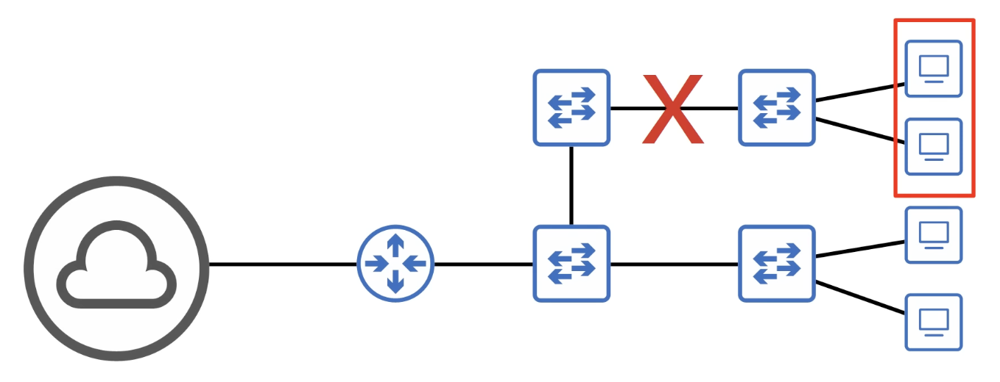
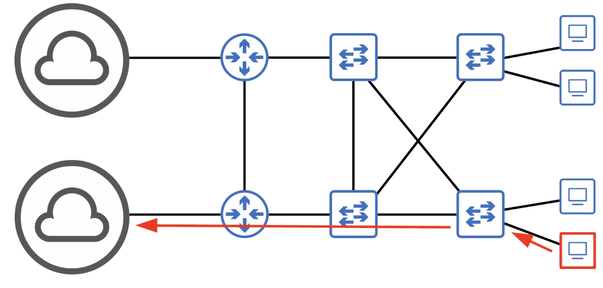

- Most PCs only have a single network interface card (NIC), so they can only be plugged into a single switch; however, important servers typically have multiple NICs, so they can be plugged into multiple switches for redundancy

## Broadcast Storms

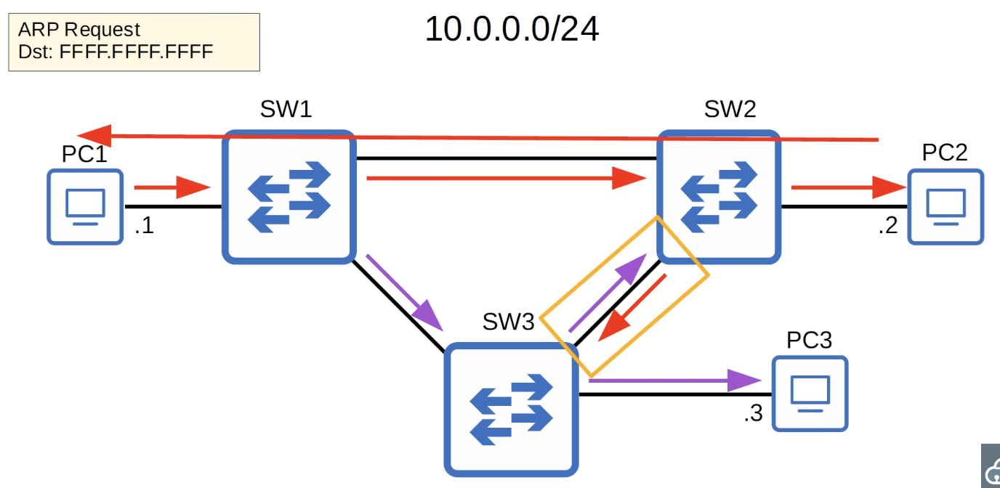

- _Switches keep flooding the network_
- The Ethernet header doesn't have a TTL field
- These broadcast frames will loop around the network indefinitely
- If enough of these looped broadcasts accumulate in the network, the network will be too congested for legitimate traffic to use the network
- This is called a **broadcast storm**
- Network congestion isn't the only problem
- Each time a frame arrives on a switchport, the switch uses the source MAC address field to 'learn' the MAC address and update its MAC address table
- When frames with the same source MAC address repeatedly arrive on different interfaces, the switch is continuosly updating the interface in its MAC address table
- This is known as **MAC Address Flapping**

## Spanning Tree Protocol

- 'Classic Spanning Tree Protocol' is IEEE 802.1D
- Switches from ALL vendors run STP by default
- STP prevents Layer 2 loops by placing redundant ports in blocking state, essentially disabling the interface
- These interfaces act as backups that can enter a forwarding state if an active (=currently forwarding) interface fails
- Interfaces in a forwarding state behave normally; they send an receive all normal traffic
- Interfaces in a blocking state only send or receive STP messages (called BPDUs = Bridge Protocol Data Units)
- 'Bridge' means 'Switch'
  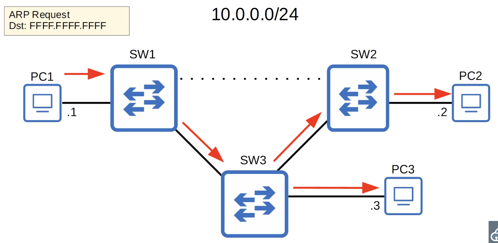
- By selecting which ports are **forwarding** and which ports are **blocking**, STP creates a single path to/from each point in the network; this prevents Layer 2 loops
- There is a set process that STP uses to determine which ports should be forwarding and which should be blocking
- STP-enabled switches send/receive Hello BPDUs out of all interfaces, the default timer is 2 seconds (the switch will send a Hello BPDU out of every interface, once every 2 seconds)
- If a switch receives a Hello BPDU on an interface, it knows that interface is connected to another switch (routers, PCs, etc. do not use STP, so they do not send BPDUs)
  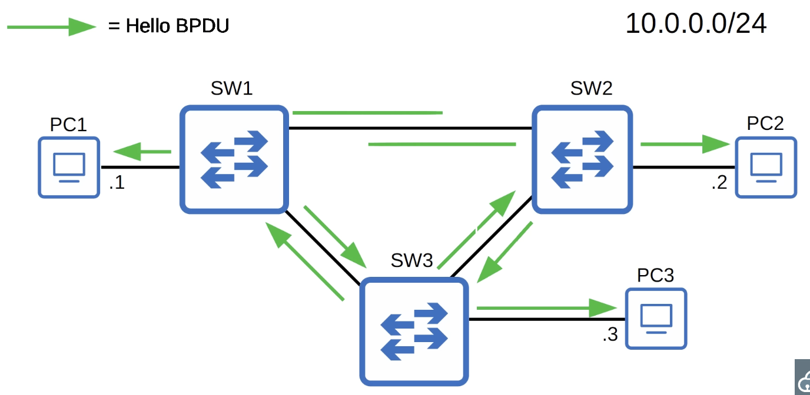
- Switches use one field in the STP BPDU, the **Bridge ID** field, to elect a **root bridge** for the network
- The switch with lowest **Bridge ID** becomes the **root bridge**
- ALL ports on the **root bridge** are put in a forwarding state, and other switches in the topology must have a path to reach the root bridge
  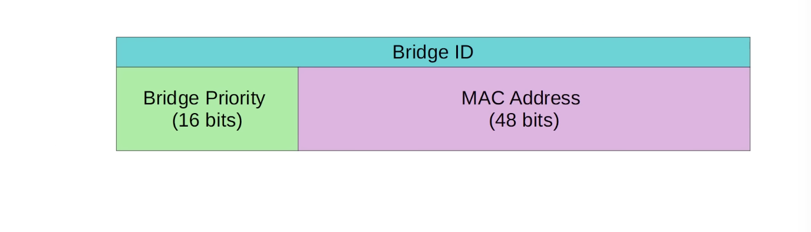
- The default bridge priority is 32768 on all switches, so by default the MAC address is used as the tie-breaker (lowest MAC address becomes the root bridge)
- **The Bridge Priority is compared first; if they tie, the MAC address is then compared**
  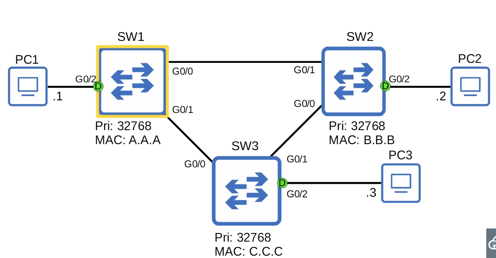
  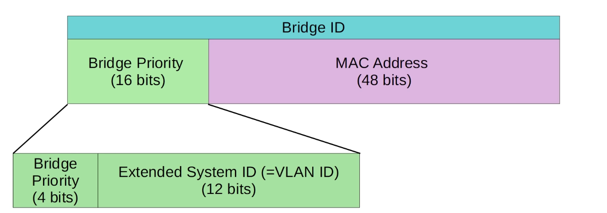
- Cisco switches use a version of STP called **PVST** (Per-VLAN Spanning Tree)
- PVST runs a separate STP 'instance' in each VLAN, so in each VLAN different interfaces can be forwarding/blocking
  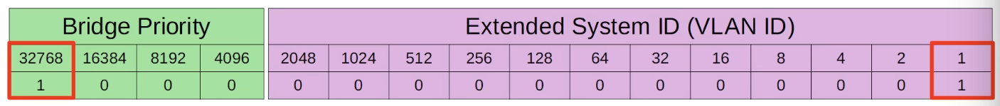
- In the default VLAN of 1, the default bridge priority is actually **32769** (32768 + 1)
- The **bridge priority + extended system ID** is a single field of the bridge ID, however the extended system ID is set and cannot be changed (because it is determined by the VLAN ID)
- Therefore, we can only change the total bridge priority (bridge priority + extended system ID) in units of 4096, the value of the least significant bit of the bridge priority

```
16384 + 8192 + 4096 + 1 = 28673
```

- The STP bridge priority can only be changed in units of 4096
- The valid values we can configure are: 0, 4096, 8192, 12288, 16384, 20480, 24576, 28672, 32768, 36864, 40960, 45056, 49152, 53248, 57344, or 61440
- The Extended System ID will then be added to this number to make the total bridge priority
- All interfaces on the root bridge are **designated ports**; designated ports are in a forwarding state
- When a switch is powered on, it assumes it is the root bridge
- It will only give up its position if it receives a 'superior' BPDU (lower Bridge ID)
- Once the topology has converged and all switches agree on the root bridge, only the root bridge sends BPDUs
- Other switches in the network will forward these BPDUs, but will not generate their own original BPDUs

---

1. The switch with the lowest bridge ID is elected as the root bridge; all ports on the root bridge are **designated ports** (forwarding state)
2. Each remaining switch will select ONE of its interfaces to be its **root port**; the interface with the lowest _root cost_ will be the root port; root ports are also in a forwarding state

| Speed    | STP Cost |
| :------- | :------- |
| 10 Mbps  | 100      |
| 100 Mbps | 19       |
| 1 Gbps   | 4        |
| 10 Gbps  | 2        |

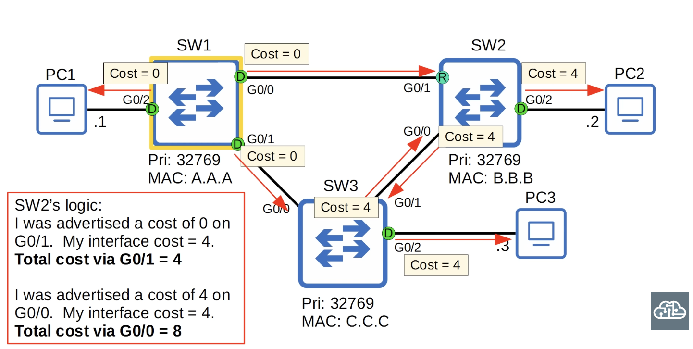

```
SW3's logic:
I was advertised a cost of 0 on G0/0
My interface cost = 4
Total cost via G0/0 = 4

I was advertised a cost of 4 on G0/1
My interface cost = 4
Total cost via G0/1 = 8

```

- The ports connected to another switch's root port MUST be designated
- Because the root port is the switch's path to the root bridge, another switch must not block it

---

1. One switch is elected as the root bridge; all ports on the root bridge are **designated ports** (forwarding state); root bridge selection:
   a) lowest bridge ID
2. Each remaining switch will select ONE of its interfaces to be its **root port** (forwarding state); ports across from the root port are always **designated** ports
   - Root port selection:
     a) lowest root cost
     b) lowest neighbor bridge ID
     c) lowest neighbor port ID
     - The NEIGHBOR switch's port ID is used to break the tie, not the local switch's port ID
     ```
     STP Port ID = port priority (default 128) + port number
     ```
3. Each remaining collision domain will select ONE interface to be a **designated port** (forwarding state); the other port in the collision domain will be **non-designated** (blocking)

- Every collision domain has a single STP designated port

1. The switch with the lowest root cost will make its port designated
2. If the root cost is the same, the switch with the lowest bridge ID will make its port designated _(if bridge ID is the same on both interfaces on the switch, then the criteria will be in terms of Port ID)_
3. The other switch will make its port non-designated (blocking)

## Quiz

1. _In this network of 4 switches, which will become the root bridge?_
   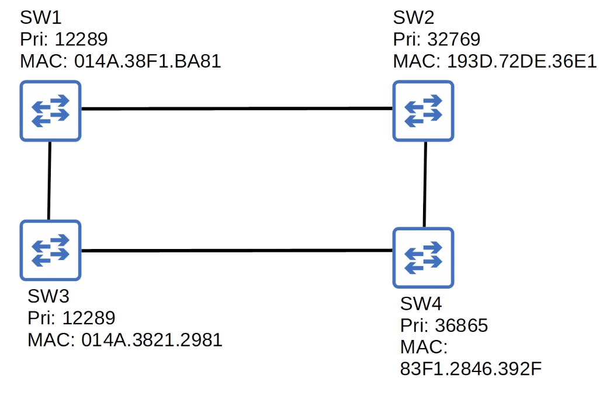
   _SW3_

2. _In this network of 4 switches, which will become the root bridge?_
   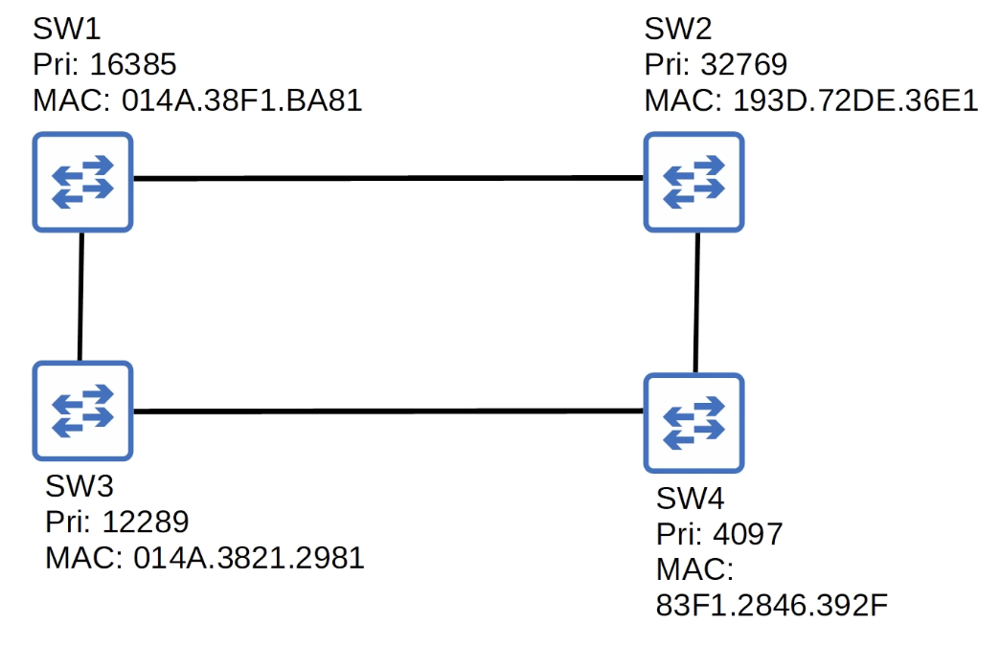
   _SW4_

3. _In this network of 4 switches, which will become the root bridge? Which ports will become root ports? All interfaces are gigabit ethernet so all have a cost of 4. If there is a tie in root cost, the switch will select the interface connected to the neighbor with the lowest bridge ID._
   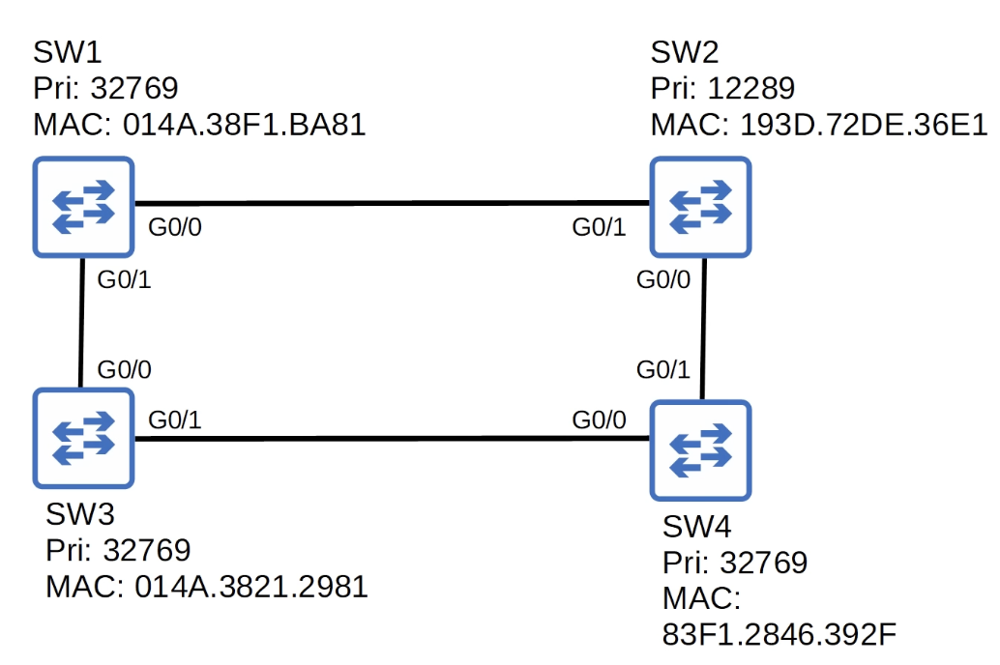
   _SW2_
   _SW2 - G0/1, G0/0_
   _SW1 - G0/0_
   _SW4 - G0/1_
   _SW3 - G0/0_

4. _There are two collections between SW1 and SW3. Which port will SW3 select as the root port?_
   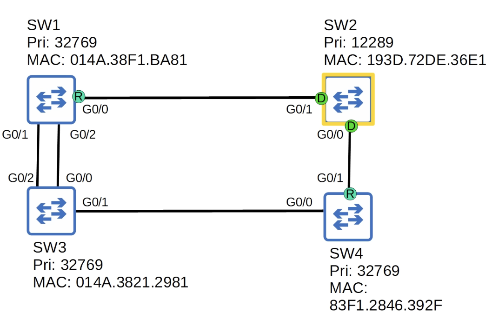
   _G0/2_

5. Identify the root bridge, and the role of each interface on each switch in the network (root/designated/non-designated)
   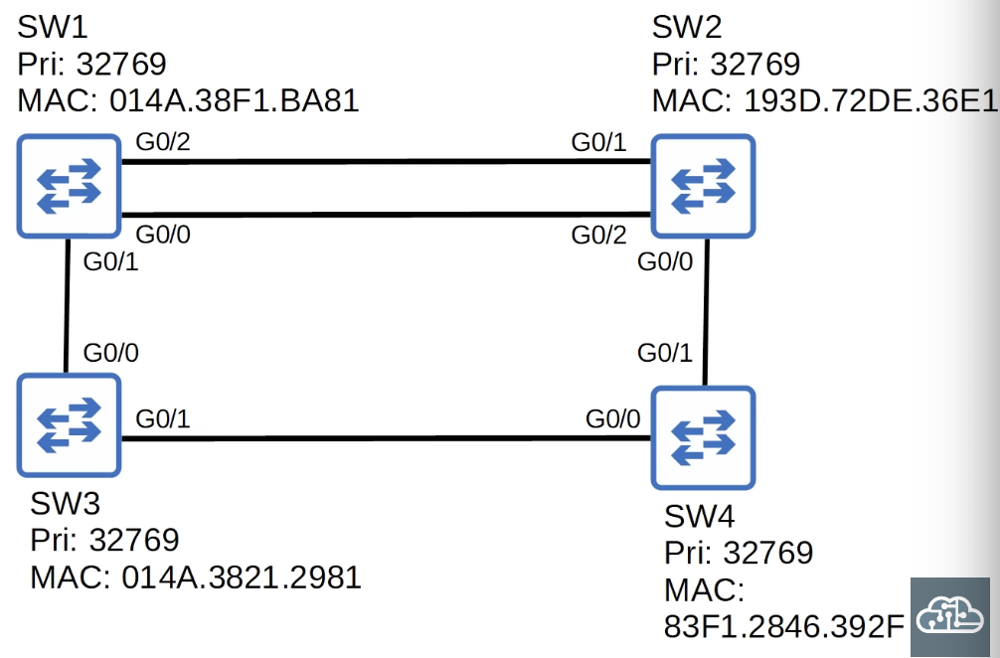

   ```
   Root bridge: SW3
   Designated ports SW3: G0/0, G0/1
   SW1 root port: G0/1
   SW2 root port: G0/2
   SW4 root port: G0/0
   SW1 designated port: G0/2
   SW2 non-designated ports: G0/1, G0/0
   SW4 designated port: G0/1
   ```

6. Identify the root bridge, and the role of each interface on each switch in the network (root/designated/non-designated)
   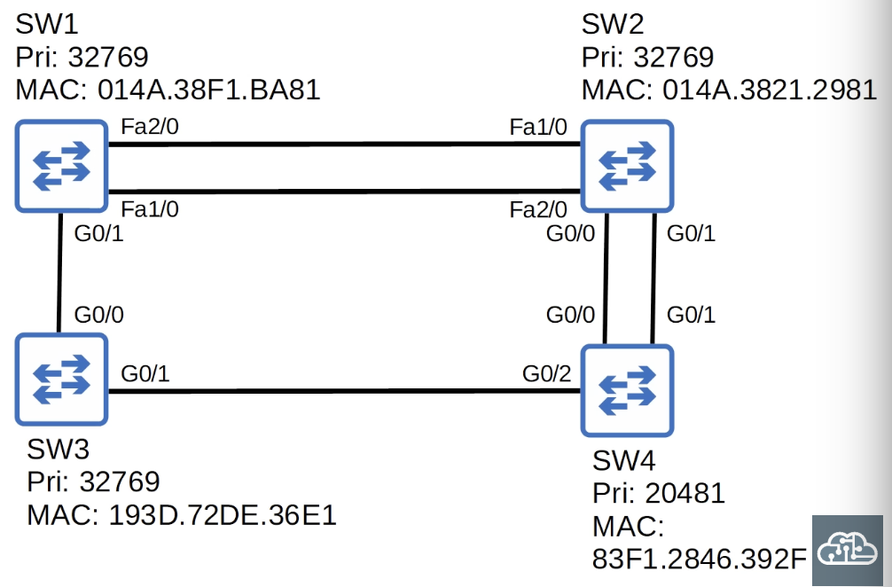

   ```
    Root bridge: SW4
    SW4 designated ports: G0/2, G0/0, G0/1
    SW3 root port: G0/1
    SW2 root port: G0/0
    SW1 root port: G0/1
    SW3 designated port: G0/0
    SW2 non-designated ports: G0/1
    SW2 designated ports: Fa1/0. Fa2/0
    SW1 non-designated ports: Fa2/0, Fa1/0
   ```
