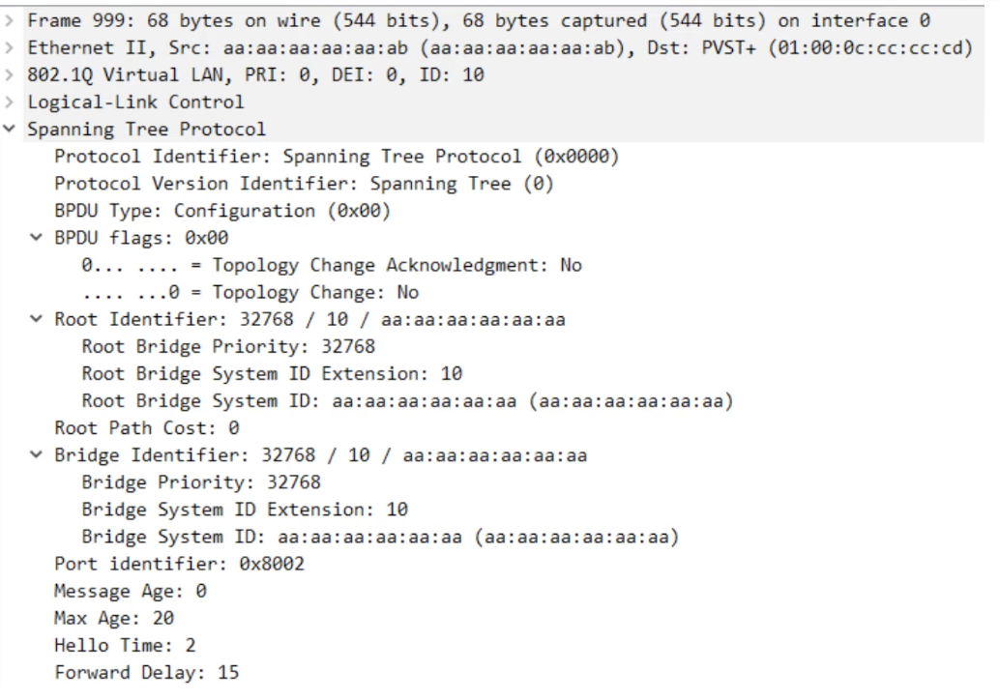
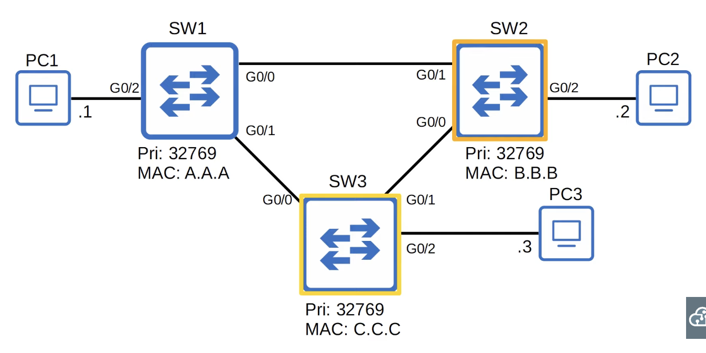
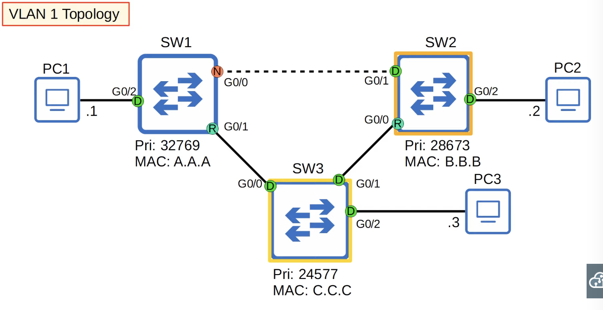
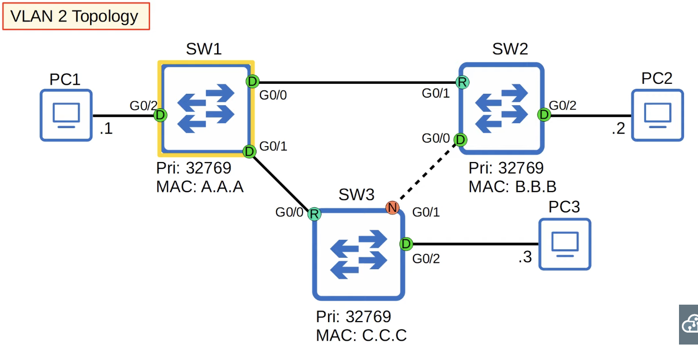
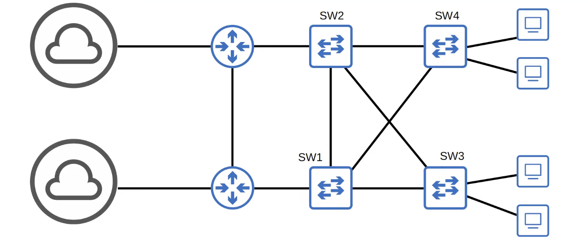

# STP (Spanning Tree Protocol) (Part 2)

## Spanning Tree Port States

| STP Port State | Stable/Transitional |
| :------------- | :------------------ |
| **Blocking**   | Stable              |
| **Listening**  | Transitional        |
| **Learning**   | Transitional        |
| **Forwarding** | Stable              |

- Root/Designated ports remain stable in a **Forwarding** state
- Non-designated ports remain stable in a **Blocking** state
- **Listening** and **Learning** are transitional states which are passed through when an interface is activated, or when a **Blocking** port must transition to a Forwarding state due to a change in the network topology

### _Blocking state_

- Non-designated ports are in a **Blocking** state
- Interfaces in a Blocking state are effectively disabled to prevent loops
- Interfaces in a Blocking state do not send/receive regular network traffic
- Interfaces in a Blocking state receive STP BPDUs
- Interfaces in a Blocking state do NOT forward STP BPDUs
- Interfaces in a Blocking state do NOT learn MAC addresses

### _Listening state_

- After the Blocking state, interfaces with the Designated or Root role enter the **Listening** state
- Only **Designated** or **Root** ports enter the Listening state (Non-designated ports are always Blocking)
- The Listening state is 15 seconds long by default; this is determined by the **Forward delay** timer
- An interface in the Listening state ONLY forwards/receives STP BPDUs
- An interface in the Listening state does NOT send/receive regular traffic
- An interface in the Listening state does NOT learn MAC addresses from regular traffic that arrives on the interface

### _Learning state_

- After the Listening state, a Designated or Root port will enter the **Learning** state
- The Learning state is 15 seconds long by default; this is determined by the **Forward delay** timer (the same timer is used for both the Listening and Learning states)
- An interface in the Learning state ONLY sends/receives STP BPDUs
- An interface in the Learning state does NOT send/receive regular traffic
- An interface in the Learning state **learns** MAC addresses from regular traffic arrives on the interface

### _Forwarding state_

- Root and Deisgnated ports are in a **Forwarding** state
- A port in the Forwarding state operates as normal
- A port in the Forwarding stae sends/receives BPDUs
- A port in the Forwarding state sends/receives normal traffic
- A port in the Forwarding state learns MAC addresses

| STP Port State | Send/Receive BPDUs | Frame forwarding (regular traffic) | MAC address learning | Stable/Transitional |
| :------------- | :----------------: | :--------------------------------: | :------------------: | :-----------------: |
| **Blocking**   |       NO/YES       |                 NO                 |          NO          |       Stable        |
| **Listening**  |      YES/YES       |                 NO                 |          NO          |    Transitional     |
| **Learning**   |      YES/YES       |                 NO                 |         YES          |    Transitional     |
| **Forwarding** |      YES/YES       |                YES                 |         YES          |       Stable        |
| **Disabled**   |       NO/NO        |                 NO                 |          NO          |       Stable        |

## Spanning Tree Timers

| STP Timer         | Purpose                                                                                                          |      Duration      |
| :---------------- | :--------------------------------------------------------------------------------------------------------------- | :----------------: |
| **Hello**         | How often the root bridge sends hello BPDUs                                                                      |        2sec        |
| **Forward delay** | How long the switch will stay in the Listening and Learning states (each state is 15 seconds = total 30 seconds) |       15sec        |
| **Max Age**       | How long an interface will wait <u>after ceasing to receive Hello BDPUs</u> to change the STP topology.          | 20sec (10\* hello) |

- Switches do not forward the BPDUs out of their **root** ports and **non-designated** ports, only their **designated** ports
- If another BPDU is received before the max age timer counts down to 0, the time will reset to 20 seconds and no changes will occur
- If another BPDU is not received, the max age timer counts down to 0 and the switch will reevaluate STP choices, including root bridge, and local root, deisgnated and non-designated ports
- If a non-designated port is selected to become a designated or root port, it will transition from the blocking state to the listening state (15 seconds), learning state (15 seconds), and then finally the forwarding state; so, it can take a total of **50 seconds** for a blocking interface to transition to forwarding
- These timers and transitional states are to make sure that loops aren't accidentally created by an interface moving to forwarding state too soon
- A forwarding interface can move directly to a blocking state (there is no worry about creating a loop by blocking an interface)
- A blocking interface cannot move directly to forwarding stat; it must go through listening and learning states

## Spanning Tree BPDU


PVST = Only ISL trunk encapsulation
PVST+ = Supports 802.1Q

- Regular STP (not Cisco's PVST+) uses a destination MAC address of `0180.c200.0000`
- The STP timers on the root bridge determine the STP timers for the entire network

## Spanning Tree Optional Features (STP Toolkit)

### Portfast

- Portfast allows a port to move immediately to the **Forwarding** state, bypassing **Listening** and **Learning**
- If used, it must be enabled <u>only on ports connected to end hosts</u>
- If enabled on a port connected to another switch it could cause a Layer 2 loop
- _Enabled at the interface level by the following command:_ `spanning-tree portfast`
- We can also enable portfast with the folloing command:

```
SW1(config)# spanning-tree portfast default
```

- This enables portfast on all access ports (not trunk ports)

### BPDU Guard

- If an interface with BPDU Guard enabled receives a BPDU from another switch, the interface will be shut down to prevent a loop from forming

```
SW1(config)#interface g0/2
SW1(config-if)#spanning-tree bpduguard enable
```

- We can also enable BPDU Guard with the following command:

```
SW1(config)# spanning-tree portfast bpduguard defualt
```

- This enables BPDU Guard on all Portfast-enabled interfaces

```
%SPANTREE-2-BLOCK_BPDUGUARD: Received BPDU on port FastEthernet0/1 with BPDU Guard enabled. Disabling port.

%PM-4-ERR_DISABLE: bpduguard error detected on 0/1, putting 0/1 in err-disable state

%LINK-5-CHANGED: Interface FastEthernet0/1, changed state to administratively down

%LINEPROTO-5-UPDOWN: Line protocol on Interface FastEthernet0/1, changed state to down

```

- _To enable a port shut down by a BPDU Guard:_

```
Switch(config-if)#shutdown

%LINK-5-CHANGED: Interface FastEthernet0/1, changed state to administratively down
Switch(config-if)#no shutdown

Switch(config-if)#
%LINK-5-CHANGED: Interface FastEthernet0/1, changed state to up

%LINEPROTO-5-UPDOWN: Line protocol on Interface FastEthernet0/1, changed state to up
```

| Feature        | Description                                                                                                                                                                                                          |
| :------------- | :------------------------------------------------------------------------------------------------------------------------------------------------------------------------------------------------------------------- |
| **Root Guard** | If you enable **root guard** on an interface, even if it receives a superior BPDU (lower bridge ID) on that interface, the switch will not accept the new switch as the root bridge. The interface will be disabled. |
| **Loop Guard** | If you enable **loop guard** on an interface, even if the interface stops receiving BPDUs, it will not start forwarding. The interface will be disabled.                                                             |

## Configure the Spanning Tree mode

```
SW1(config)#spanning-tree mode ?
  mst          Multiple spanning tree mode
  pvst         Per-Vlan spanning tree mode
  rapid-pvst   Per-Vlan rapid spanning tree mode

SW1(config)#spanning-tree mode pvst
SW1(config)#

```

## Configure the Primary Root Bridge



```
SW3(config)#spanning-tree vlan 1 root primary
SW3(config)#do show spanning-tree

VLAN0001
  Spanning tree enabled protocol ieee
  Root ID    Priority    24577
             Address     cccc.cccc.cccc
             This bridge is the root
             Hello Time  2 sec  Max Age 20 sec  Forward Delay 15 sec

  Bridge ID  Priority    24577  (priority 24576 sys-id-ext 1)
             Address     cccc.cccc.cccc
             Hello Time  2 sec  Max Age 20 sec  Forward Delay 15 sec
             Aging Time  15 sec

```

- The **`spanning-tree vlan`** _`vlan-number`_ **`root primary`** command sets the STP priority to 24576
- If another switch already has a priority lower than 24576, it sets this switch's priority to 4096 less than the other switch's priority

## Configure the Secondary Root Bridge

```
SW2(config)#spanning-tree vlan 1 root secondary
SW2(config)#do show spanning-tree

VLAN0001
  Spanning tree enabled protocol ieee
  Root ID    Priority    24577
             Address     cccc.cccc.cccc
             Cost        4
             Port        1 (GigabitEthernet0/0)
             Hello Time  2 sec  Max Age 20 sec  Forward Delay 15 sec

  Bridge ID  Priority    28673  (priority 28672 sys-id-ext 1)
             Address     bbbb.bbbb.bbbb
             Hello Time  2 sec  Max Age 20 sec  Forward Delay 15 sec
             Aging Time  300 sec

```

- The **`spanning-tree vlan`** _`vlan-number`_ **`root secondary`** command sets the STP priority to 28672

## STP Load-Balancing

- _These commands are applied only to 1 VLAN topology_
  
  

## Configure STP Port Settings

```
SW2(config-if)#spanning-tree vlan 1 ?
  cost           Change an interface's per VLAN spanning tree path cost
  port-priority  Change an interface's spanning tree port priority

SW2(config-if)#spanning-tree vlan 1 cost ?
  <1-200000000>  Change an interface's per VLAN spanning tree path cost

SW2(config-if)#spanning-tree vlan 1 cost 200
SW2(config-if)#spanning-tree vlan 1 port-priority ?
  <0-224>  port priority in increments of 32

SW2(config-if)#spanning-tree vlan 1 port-priority 32
SW2(config-if)#
```

## Quiz

1. Two VLANs are active in this network, 10 and 20. By default, SW3 is the root bridge for both VLANs. Configure SW1 as the primary root for VLAN10 and the secondary root for VLAN20. Configure SW2 as the primary root for VLAN20 and the secondary root for VLAN10. Which two commands should you issue on SW1, and which two commands should you issue on SW2?
   
   _SW1 commands:_

```
spanning-tree vlan 10 root primary
spanning-tree vlan 20 root secondary
```

_SW2 commands:_

```
spanning-tree vlan 20 root primary
spanning-tree vlan 10 root secondary
```

2. You connect a PC to a switch, however, for about half a minute you are unable to connect to the network. Which two options could fix this issue and allow you to access the network more quickly? (Choose two. Each answer is a complete solution)
   _a) Enable PortFast on the switch port you connect the PC to._
   _c) Reduce the STP forward delay timer_

3. A packet capture indicates that a switch port has an STP port ID of `0x8002`. What is the STP port priority of this port?
   _c) 128_

4. You want to make sure that a Layer 2 loop will not be caused if a user connects a switch to a switch port. Which spanning tree optional feature achieves this?
   _d) BPDU Guard_

5. You want to decrease the amount of time that it takes for a switch port on SwitchA to begin forwarding. PortFast is not configured on any of the switch ports on SwitchA. You issue the `spanning-tree portfast default` command from global configuration mode. Which of the ports on SwitchA will use PortFast? (Select the best answer.)
   _d) all access ports_
