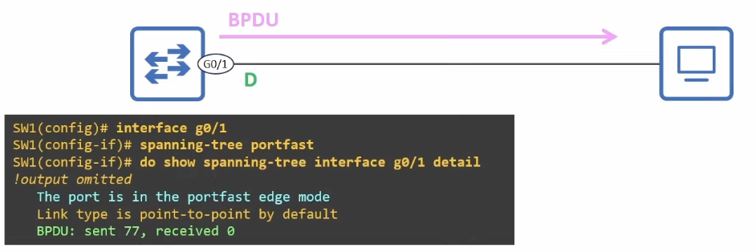
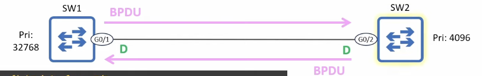
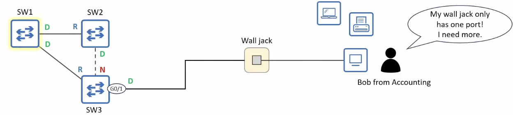
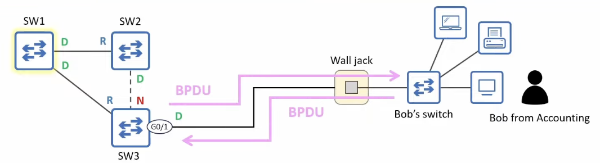
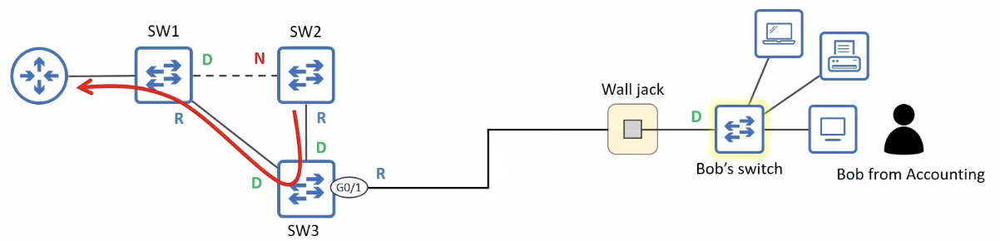
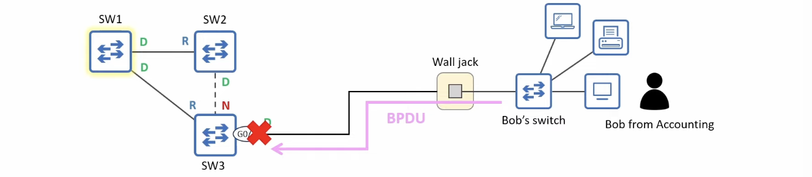
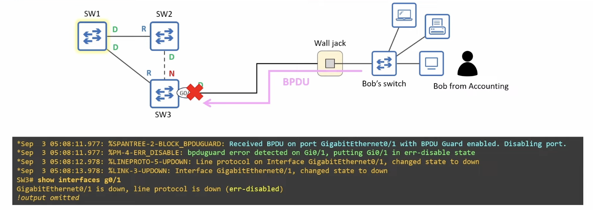
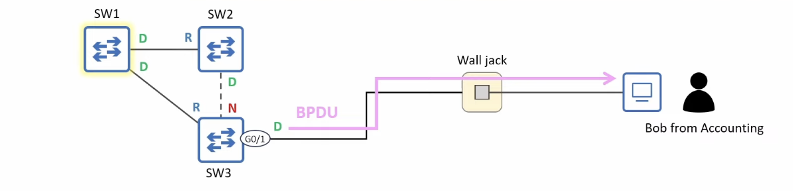

# BPDU Guard & BPDU Filter (STP Toolkit)

## PortFast & BPDU



- **PortFast** makes a port start in the Forwarding state when it is connected, but it doesn't disable STP on the port
  - The port will continue to send BPDUs every 2 seconds
- Because end hosts don't run STP and send BPDUs, a PortFast-enabled port shouldn't receive BPDUs
  - But what if it does?
- If a PortFast-enabled port receives an STP BPDU, it will revert to acting like a regular STP port (without PortFast)



## BPDU Guard - the problem





- PortFast should only be enabled on ports connected to non-switch devices (end hosts, routers)
  - These devices don't send BPDUs
- A PortFast-enabled port still sends BPDUs and will operate like a regular STP port if it receives BPDUs from a neighbor
- If an end user carelessly connects a switch to a port meant for end hosts, it could affect the STP topology
  - **BPDU Guard** acts as a safeguard against this

## BPDU Guard - the solution



- **BPDU Guard** protects the network from unauthorized switches being connected to ports intended for end hosts
- It can be configured separately from **PortFast**, but both features are usually used together
  - They both enhance STP's functionality on ports intended for end hosts
- A BPDU Guard-enabled port continues to send BPDUs, but if it receives a BPDU it enters the **error-disabled** state
  - In effect, this disables the port

## BPDU Guard configuration

- Like **PortFast**, **BPDU Guard** can be configured in two ways:
  - Per-port:

```
SW3(config)# interface g0/1
SW3(config-if)# spanning-tree bpduguard enable
SW3(config-if)# do show spanning-tree interface g0/1 detail
Port 2 (GigabitEthernet0/1) of VLAN0001 is designated forwarding
  Port path cost 4, Port priority 128, Port Identifier 128.2.
  Designated root has priority 24577, address 5254.001a.9d29
  Designated bridge has priority 32769, address 5254.0006.448f
  Designated port id is 128.2, designated path cost 4
  Timers: message age 0, forward delay 0, hold 0
  Number of transitions to forwarding state: 1
  The port is in the portfast edge mode
  Link type is point-to-point by default
  Bpdu guard is enabled
  BPDU: sent 93, received 0
```

- Default:
  - **`spanning-tree portfast [edge] bpduguard default`**
  - When enabled by default, **BPDU Guard** is activated on <u>all Portfast-enabled ports</u>.
  - Use **`spanning-tree bpduguard disable`** in interface config mode to disable it on specific ports.

```
SW3(config)# spanning-tree portfast bpduguard default
SW3(config)# do show spanning-tree interface g0/1 detail
Port 2 (GigabitEthernet0/1) of VLAN0001 is designated forwarding
  Port path cost 4, Port priority 128, Port Identifier 128.2.
  Designated root has priority 24577, address 5254.001a.9d29
  Designated bridge has priority 32769, address 5254.0006.448f
  Designated port id is 128.2, designated path cost 4
  Timers: message age 0, forward delay 0, hold 0
  Number of transitions to forwarding state: 1
  The port is in the portfast edge mode
  Link type is point-to-point by default
  Bpdu guard is enabled by default
  BPDU: sent 165, received 0
```

## ErrDisable



- **ErrDisable** is a Cisco switch feature that disables a port under certain conditions, such as a BPDU Guard violation
- To re-enable an err-disabled port, <u>first solve the underlying issue</u>
  - If you re-enable the port without fixing the issue, it will just be err-disabled again
- You can re-enable an err-disabled port in two ways:
  1. Manual: use **`shutdown`** and **`no shutdown`** to reset the disabled port
  2. Automatic: **ErrDisable Recovery**
- **ErrDisable Recovery** is a feature that automatically re-enables err-disabled ports after a certain period of time
- ErrDisable is disabled by default
- The default recovery timeer is 300 seconds (5 minutes)
  - Err-disabled interfaces will be automatically re-enabled after 5 minutes
- Use `SW1(config)# errdisable recovery interval seconds` to modify the interval

```
SW3# show errdisable recovery
ErrDisable Reason            Timer Status
-------------------          --------------
arp-inspection               Disabled
bpduguard                    Disabled
channel-misconfig (STP)      Disabled
!output omitted

Timer interval: 300 seconds

Interfaces that will be enabled at the next timeout:
```

- Use **`errdisable recovery cause cause`** to enable ErrDisable Recovery for ports disabled by a particular cause
- G0/1 will be automatically re-enabled after 296 seconds

```
SW3(config)# errdisable recovery cause bpduguard
SW3(config)# do show errdisable recovery
ErrDisable Reason            Timer Status
-------------------          --------------
arp-inspection               Disabled
bpduguard                    Enabled
channel-misconfig (STP)      Disabled

Timer interval: 300 seconds

Interfaces that will be enabled at the next timeout:

Interface        Errdisable reason        Time left(sec)
---------        -----------------        --------------
Gi0/1            bpduguard                296
```

## BPDU Filter - the problem



- A switch port connected to an end host continues sending BPDUs every 2 seconds
  - regardless of whether PortFast and/or BPDU Guard are enabled
- If the port doesn't connect to a switch, sending BPDUs is unnecessary and undesirable for a couple of reasons:
  1. Sending BPDUs uses some bandwidth and processing power on the switch (although it's minimal)
  2. BPDUs contain information about the LAN's STP topology
     - If maximum security is a concern, you should avoid sending this info to user devices

## BPDU Filter - the solution

- **BPDU Filter** stops a port from sending BPDUs
  - Unlike BPDU Guard, it does not disable the port if it receives a BPDU
- BPDU Filter can be enabled in two ways:
  - Per-port: `SW3(config-if)# spanning-tree bpdufilter enable`
    - The port will not send BPDUs
    - The port will ignore any BPDUs it receives
    - In effect, this disables STP on the port; **use with caution!**
  - Default: `SW3(config)# spanning-tree portfast [edge] bpdufilter default`
    - BPDU Filter will be activated on <u>all PortFast-enabled ports</u>
      - You can use **`spanning-tree bpdufilter disable`** to disable it on specific ports
    - The port will not send BPDUs
    - If the port receives a BPDU, PortFast and BPDU Filter are disabled, and it operates as a normal STP port
- Recommended use:
  - Enable PortFast and BPDU Guard however you prefer (per-port or by default)
  - Only enable BPDU Filter by default (global config mode)
    - unless you have a very good reason to enable it per-port
  - **BPDU Guard** and **BPDU Filter** can be enabled on the same-port at the same time:
    - If BPDU Filter is enabled in <u>global config mode</u> and the port receives a BPDU:
      1. BPDU Filter will be disabled
      2. BPDU Guard will be triggered (and err-disable the interface)
    - If BPDU Filter is enabled in <u>interface config mode</u> and the port receives a BPDU:
      - The BPDU will be ignored
      - BPDU Guard will **not** be triggered
