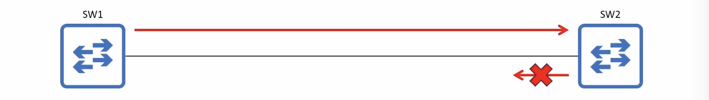
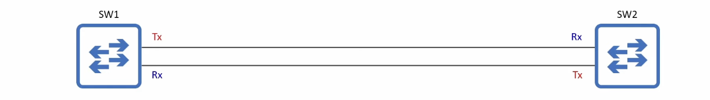
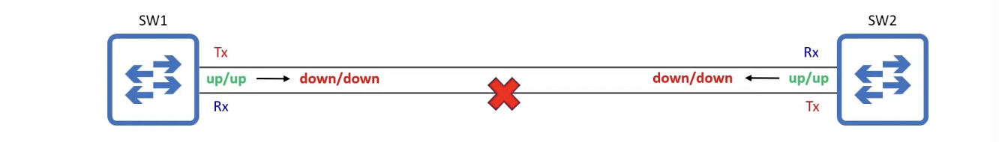
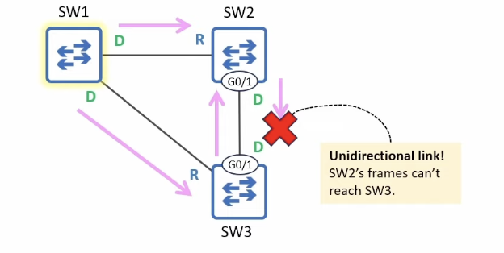
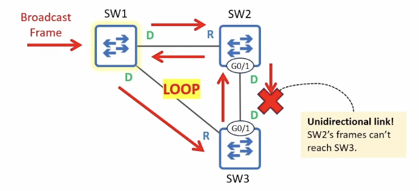
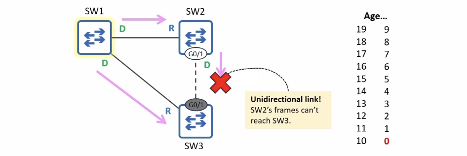
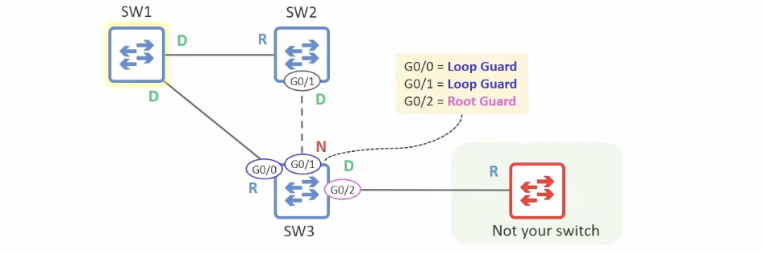

# Loop Guard (STP Toolkit)

- Protects the network from loops by disabling a port if it unexpectedly stops receiving BPDUs, ensuring it does not mistakenly enter the forwarding state

## Unidirectional links



- A **unidirectional link** is a network link where data transmission occurs in only one direction
- Unidirectional links are typically caused by Layer 1 (Physical) issues
  - Damaged cables
  - Faulty connectors or transceivers (e.g. SFP modules)
- Unidirectional links are more common with fiber-optic cables than copper UTP



    - Fiber optic connections typically use two separate fibers
        - If one fiber is damaged, it can disrupt data flow in one direction while the other remains unaffected
    - More vulnerable to physical damage than copper UTP cables



- For a fiber-optic interface to be **up/up**, both fibers must be connected and functional
- If there is a phisical problem with either fiber, the devices <u>should</u> be able to detect it and disable their interfaces
- If the devices fail to detect the physical problem, it could result in a **unidirectional link**

## Loop Guard - the problem



- BPDUs originate from the Root bridge and are forwarded out of Designated ports
- SW3 G0/1 is a **Non-Designated** blocking port because it receives superior BPDUs from SW2
  - i.e. SW2 has a superior root cost or bridge ID
- If the SW2-SW3 link becomes unidirectional and SW2's BPDUs can't reach SW3, what will happen?
  - SW3 G0/1 will become a **Designated** port and start forwarding BPDUs
- Because SW3's BPDUs are inferior to SW2's, SW2 simply ignores SW3's BPDUs
  - SW2 G0/1 and SW3 G0/1 are both in the forwarding state - **SW1-SW3-SW2 loop!**
    

## Loop Guard - the solution



- When a **Loop Guard**-enabled port's Max Age timer counts down to 0, it doesn't become a Designated port and start transitioning to Forwarding
  - It enters the **Broken** (_Loop Inconsistent_) state
  - Like the **Broken** (_Root Inconsistent_) state triggered by a Root Guard violation, this blocks the port
    - _NOTE: In both cases, the port remains up/up, but STP blocks it_
- If the broken port starts receiving BPDUs again, it will be automatically re-enabled
- Loop Guard can be enabled in two ways:
  - Per-port: `SW3(config-if)# spanning-tree guard loop`
  - Default: `SW3(config)# spanning-tree loopguard default`
    - This enables Loop Guard on all ports
    - Use `SW3(config-if)# spanning-tree guard none` to disable it on specific ports if needed
- **Loop Guard** should be enabled on Root and Non-Designated ports (ports that are supposed to receive BPDUs)

## Loop Guard: CLI demonstration

```
SW3(config)# interface g0/1
SW3(config-if)# spanning-tree guard loop
SW3(config-if)# do show spanning-tree interface g0/1 detail
Port 2 (GigabitEthernet0/1) of VLAN0001 is alternate blocking
  Port path cost 4, Port priority 128, Port Identifier 128.2.
  Designated root has priority 1, address 5254.001a.9d29
  Designated bridge has priority 28673, address 5254.0019.f184
  Designated port id is 128.2, designated path cost 4
  Timers: message age 3, forward delay 0, hold 0
  Number of transitions to forwarding state: 0
  Link type is point-to-point by default
  Loop guard is enabled on the port
  BPDU: sent 0, received 359
```

```
SW3(config)# spanning-tree loopguard default
SW3(config)# do show spanning-tree interface g0/1 detail
Port 2 (GigabitEthernet0/1) of VLAN0001 is alternate blocking
  Port path cost 4, Port priority 128, Port Identifier 128.2.
  Designated root has priority 1, address 5254.001a.9d29
  Designated bridge has priority 28673, address 5254.0019.f184
  Designated port id is 128.2, designated path cost 4
  Timers: message age 3, forward delay 0, hold 0
  Number of transitions to forwarding state: 0
  Link type is point-to-point by default
  Loop guard is enabled on the port by default
  BPDU: sent 0, received 359
```

```
%SPANTREE-2-LOOPGUARD_BLOCK: Loop guard blocking port GigabitEthernet0/1 on VLAN0001.

SW3(config-if)# do show spanning-tree
!output omitted
Interface        Role Sts Cost      Prio.Nbr Type
---------------- ---- --- --------- -------- --------------------------------
Gi0/0            Root FWD 4         128.1    P2p
Gi0/1            Desg BKN*4         128.2    P2p *LOOP_Inc
```

- `BKN` = Broken
- `LOOP_Inc` = Loop Inconsistent

```
%SPANTREE-2-LOOPGUARD_UNBLOCK: Loop guard unblocking port GigabitEthernet0/1 on VLAN0001.

SW3(config-if)# do show spanning-tree
!output omitted
Interface        Role Sts Cost      Prio.Nbr Type
---------------- ---- --- --------- -------- --------------------------------
Gi0/0            Root FWD 4         128.1    P2p
Gi0/1            Altn BLK 4         128.2    P2p
```

## Loop Guard & Root Guard



- **Loop Guard** and **Root Guard** are mutually exclusive
  - They can't be enabled on the same port at the same time
  - **Root Guard** is meant to prevent <u>Designated ports</u> from becoming <u>Root ports</u>
  - **Loop Guard** is meant to prevent <u>Non-Designated or Root ports</u> from becoming <u>Designated ports</u>
- If Loop Guard is configured on a port (**`spanning-tree guard loop`**) and you then configure Root Guard (**`spanning-tree guard root`**), Loop Guard will be disabled on the port
  - and vice-versa
- If Loop Guard is enabled by default (**spanning-tree loopguard default`**) and you then configure Root Guard on a port, Loop Guard will be disabled on the port
  - The more specific configuration (interface vs global) takes effect
