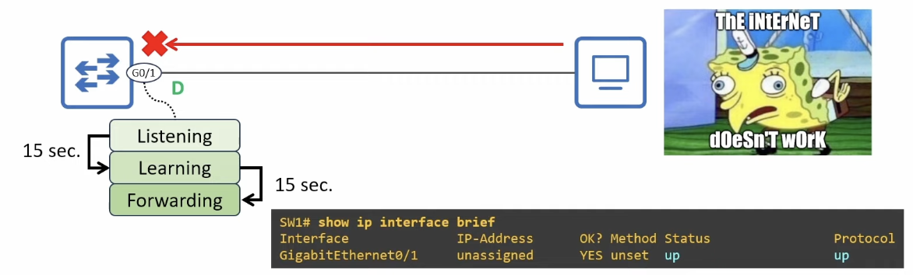
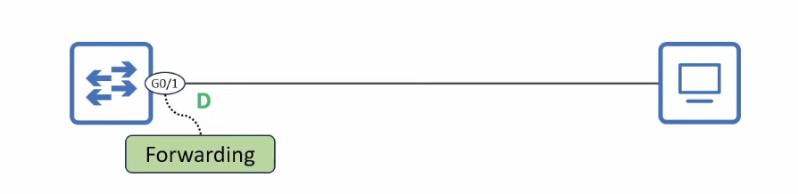
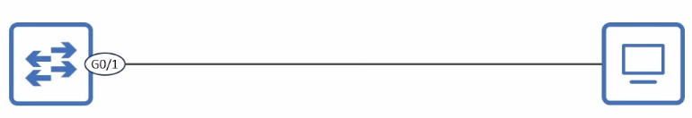
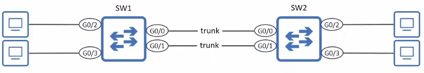
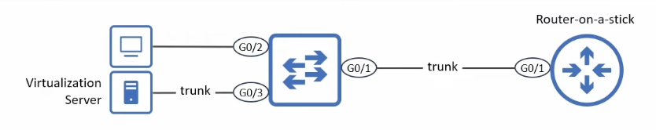

# PortFast

## PortFast - the problem



- When an end host connects to a switch port, the port becomes **up/up** but can't send/receive data yet
  - It is a **Designated port** but will take 30 seconds before it enters the **Forwarding** state
    - 15 seconds in **Listening**
    - 15 seconds in **Learning**
- This leads to poor user experience
  - The user probably doesn't even know STP exists
  - They just know "the internet doesn't work" for 30 seconds when they connect to their computer
  - This wait is unnecessary, because there is no risk of a Layer 2 loop occuring between a switch/PC

## PortFast configuration



- When **PortFast** is configured on a port, the port immediately enters the **Forwarding** state when connected to another device
  - It bypasses **Listening/Learning** and can send/receive data right away
- You can configure PortFast in two ways:
  1. Interface config mode:

     ```
     SW1(config-if)# spanning-tree portfast
     ```

     - This enables PortFast only on the individual interface

  2. Global config mode:

     ```
     SW1(config)# spanning-tree portfast default
     ```

     - This enables PortFast on <u>all access ports</u>
       - Connections between switches are almost always **trunk** links
       - Connections to end hosts are almost always **access** links

### PortFast configuration: per-port



- PortFast should NOT be configured on ports connected to switches or temporary Layer 2 loops can occur
- Even if you configure `spanning-tree portfast` on a trunk port, it won't be active
- `show spanning-tree interface interface-name detail`
- There are two kinds of PortFast:
  - **`edge`**
  - **`network`**
- **`network`** is used for a feature called Bridge Assurance

```
SW1(config)# interface g0/1
SW1(config-if)# spanning-tree portfast
%Warning: portfast should only be enabled on ports connected to a single
host. Connecting hubs, concentrators, switches, bridges, etc... to this
interface when portfast is enabled, can cause temporary bridging loops.
Use with CAUTION

%Portfast has been configured on GigabitEthernet0/1 but will only
have effect when the interface is in a non-trunking mode.

SW1# show spanning-tree interface g0/1 detail
Port 2 (GigabitEthernet0/1) of VLAN0001 is designated forwarding
  Port path cost 4, Port priority 128, Port Identifier 128.2.
  Designated root has priority 32769, address 5254.0016.c410
  Designated bridge has priority 32769, address 5254.0016.c410
  Designated port id is 128.3, designated path cost 0
  Timers: message age 0, forward delay 0, hold 0
  Number of transitions to forwarding state: 1
  The port is in the portfast edge mode
  Link type is point-to-point by default
  BPDU: sent 1272, received 0
```

### PortFast configuration: default



- Access ports only (not trunk ports)
- To disable PortFast on a specific port:
  - `SW1(config-if)# spanning-tree portfast disable`

```
SW1(config)# spanning-tree portfast default
%Warning: this command enables portfast by default on all interfaces. You
should now disable portfast explicitly on switched ports leading to hubs,
switches and bridges as they may create temporary bridging loops.

SW1# show spanning-tree interface g0/2 detail
Port 3 (GigabitEthernet0/2) of VLAN0001 is designated forwarding
  Port path cost 4, Port priority 128, Port Identifier 128.3.
  Designated root has priority 32769, address 5254.0016.c410
  Designated bridge has priority 32769, address 5254.0016.c410
  Designated port id is 128.3, designated path cost 0
  Timers: message age 0, forward delay 0, hold 0
  Number of transitions to forwarding state: 4
  The port is in the portfast edge mode by default
  Link type is point-to-point by default
  BPDU: sent 22, received 0

SW1# show spanning-tree interface g0/1 detail
Port 2 (GigabitEthernet0/1) of VLAN0001 is designated blocking
  Port path cost 4, Port priority 128, Port Identifier 128.2.
  Designated root has priority 32769, address 5254.0016.c410
  Designated bridge has priority 32769, address 5254.0016.c410
  Designated port id is 128.2, designated path cost 0
  Timers: message age 0, forward delay 10, hold 0
  Number of transitions to forwarding state: 0
  Link type is point-to-point by default
  BPDU: sent 17, received 0
```

## PortFast on trunk ports



- The standard PortFast configuration commands only enable PortFast on access ports
  - Per-port: `SW1(config-if)# spanning-tree portfast`
  - Default: `SW1(config)# spanning-tree portfast default`
- In some cases, you might want to enable PortFast on a trunk port:
  - A port connected to a virtualization server with virtual machines (VMs) in different VLANs
  - A port connected to a router via router-on-a-stick (ROAS)
- This can only be configured per-port in interface config mode:
  - `SW1(config-if)# spanning-tree portfast trunk`

```
SW1(config-if)# spanning-tree portfast trunk
%Warning: portfast should only be enabled on ports connected to a single
host. Connecting hubs, concentrators, switches, bridges, etc... to this
interface when portfast is enabled, can cause temporary bridging loops.
Use with CAUTION

SW1# show spanning-tree interface g0/1 detail
!output omitted
  The port is in the portfast edge trunk mode
!output omitted
```

## PortFast edge


- In modern Cisco devices, if you use the commands covered here, the device will automatically add the **edge** keyword to this configuration
  - `SW1(config-if)# spanning-tree portfast`
  - In the running config: **`spanning-tree portfast edge`**
  - `SW1(config-if)# spanning-tree portfast trunk`
  - In the running config: **`spanning-tree portfast edge trunk`**
  - `SW1(config)# spanning-tree portfast default`
  - In the running config: **`spanning-tree portfast edge trunk`**
  - You can use either version of the commands when configuring PortFast
  - The end result is the same: **edge** will always be added in the configuration
  - **`spanning-tree portfast disable`** doesn't use the **edge** keyword
- Use `show running-config interface interface-name` to view the running-config for the specified interface
- _Doesn't work in Packet Tracer_
- Automatically added **edge** to the end of the command

```
SW1(config)# interface g0/1
SW1(config-if)# spanning-tree portfast

SW1# show running-config interface g0/1
Building configuration...

Current configuration : 113 bytes
!
interface GigabitEthernet0/1
  switchport access vlan 10
  switchport mode access
  spanning-tree portfast edge
end
```
