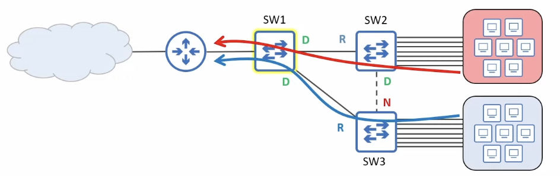
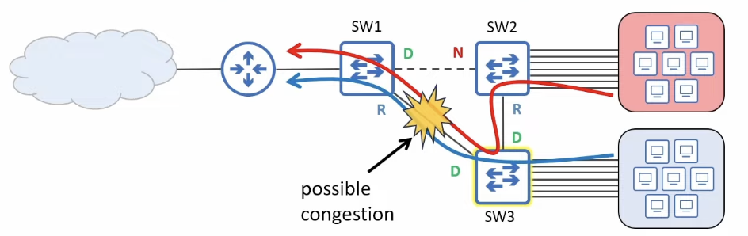
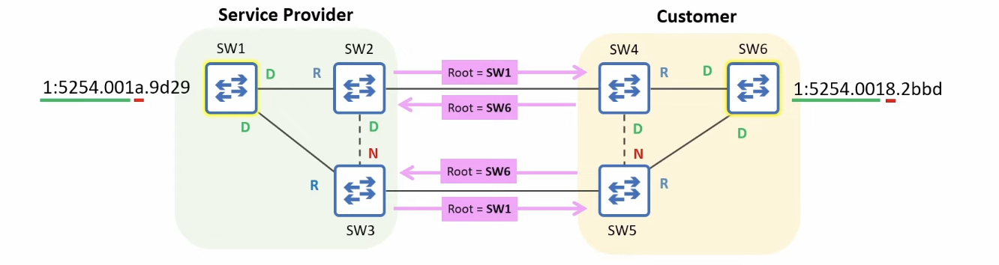
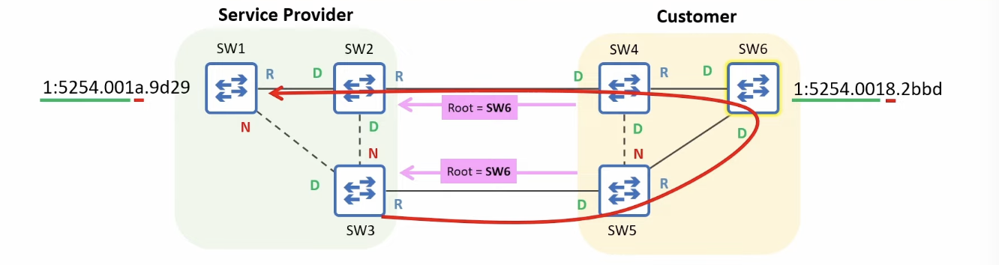
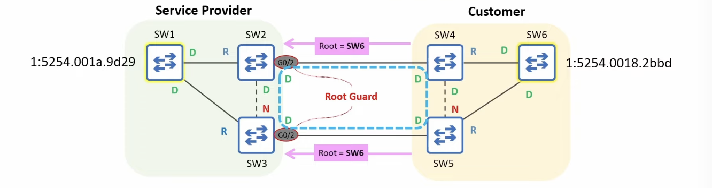

# Root Guard (STP Toolkit)

- Prevents a port from becoming a Root Port by disabling it if superior BPDUs are received, thereby enforcing the current Root Bridge

## Root Bridge placement



- STP prevents loops by electing a root bridge and ensuring that each other switch has only <u>one valid path</u> to reach it
- You shouldn't randomly select the root bridge; some things you should consider include:
  - Optimal traffic flow
    - minimize latency
    - minimize congestion
  - Stability and reliability



## Root Guard: the problem



- Within your own LAN, you can easily control the root bridge by setting its priority to **0**
  - But there are cases where you might connect your LAN to other switches outside of your direct control:
    - A service provider offering **Metro Ethernet** service to customers
      - often used to connect sites within a MAN (Metropolitan Area Network)
- Even if you set your root bridge's priority to 0, its role can be taken by another switch with a lower MAC address



- With no safeguard in place, SW1, SW2, and SW3 accept SW6 as the root bridge, affecting the service provider's STP topology
  - Frames from SW3 to SW1 must take a detour through the customer's LAN
- **Root Guard** can be configured to protect your STP topology by preventing your switches from accepting **superior BPDUs** from switches outside of your control
  - **Superior BPDU** = a BPDU that is superior in the STP algorithm (e.g. claiming a better root bridge ID)

## Root Guard: the solution



- If you want to ensure that the root bridge remains in your LAN, you can configure **Root Guard** on the ports connected to switches outside of your control
  - SW2 G0/2, SW3 G0/2
- Use `SW2(config-if)# spanning-tree guard root` to enable Root Guard on a port
  - There is no command to enable it by default from global config mode
- If a Root Guard-enabled port receives a BPDU, it will enter the **Broken** (_Root Inconsistent_) state, effectively disabling it
  - The port will not be able to forward data frames and will discard any frames it receives
  - SW1, SW2, and SW3 won't accept SW6 as the root bridge


- To re-enable a port disabled by Root Guard, you must solve the issue that disabled the port
  - The disabled port must stop receiving superior BPDUs
  - Tell the customer to increase the priority value of their switch
- Once the superior BPDUs received SW2 G0/2 and SW3 G0/3 age out, the ports will automatically be re-enabled
  - A BPDU's Max Age is 20 seconds by default

## Root Guard: CLI demonstration

```
SW2(config)# interface g0/2
SW2(config-if)# spanning-tree guard root
*Sep 21 08:38:56.314: %SPANTREE-2-ROOTGUARD_CONFIG_CHANGE: Root guard enabled on port GigabitEthernet0/2.
*Sep 21 08:38:56.321: %SPANTREE-2-ROOTGUARD_BLOCK: Root guard blocking port GigabitEthernet0/2 on VLAN0001.
SW2(config-if)# do show spanning-tree
!output omitted
Interface        Role Sts Cost      Prio.Nbr Type
---------------- ---- --- --------- -------- --------------------------------
Gi0/0            Root FWD 4         128.1    P2p 
Gi0/1            Desg FWD 4         128.2    P2p 
Gi0/2            Desg BKN*4         128.3    P2p *ROOT_Inc
```

- `BKN` = Broken
- `ROOT_Inc` = Root Inconsistent

```
*Sep 21 08:54:26.955: %SPANTREE-2-ROOTGUARD_UNBLOCK: Root guard unblocking port GigabitEthernet0/2 on VLAN0001.
SW2(config-if)# do show spanning-tree
!output omitted
Interface        Role Sts Cost      Prio.Nbr Type
---------------- ---- --- --------- -------- --------------------------------
Gi0/0            Root FWD 4         128.1    P2p 
Gi0/1            Desg FWD 4         128.2    P2p 
Gi0/2            Desg FWD 4         128.3    P2p 
```


