# Rapid Spanning Tree Protocol

## Spanning Tree Versions

| Feature / Aspect             | Industry standards (IEEE)                                                                                                                                                                                                 | Cisco versions                                                                                                                                                                            |
| :--------------------------- | :------------------------------------------------------------------------------------------------------------------------------------------------------------------------------------------------------------------------ | :---------------------------------------------------------------------------------------------------------------------------------------------------------------------------------------- |
| **Original / Standard STP**  | **Spanning Tree Protocol (802.1D)**<br>• The original STP<br>• All VLANs share one STP instance<br>• Therefore, cannot load balance                                                                                       | **Per-VLAN Spanning Tree Plus (PVST+)**<br>• Cisco's upgrade to 802.1D<br>• Each VLAN has its own STP instance<br>• Can load balance by blocking different ports in each VLAN             |
| **Rapid STP**                | **Rapid Spanning Tree Protocol (802.1w)**<br>• Much faster at converging/adapting to network changes than 802.1D<br>• All VLANs share one STP instance<br>• Therefore, cannot load balance                                | **Rapid Per-VLAN Spanning Tree Plus (Rapid PVST+)**<br>• Cisco's upgrade to 802.1w<br>• Each VLAN has its own STP instance<br>• Can load balance by blocking different ports in each VLAN |
| **Multiple / Grouped VLANs** | **Multiple Spanning Tree Protocol (802.1s)**<br>• Uses modified RSTP mechanics<br>• Can group multiple VLANs into different instances (i.e., VLANs 1-5 in instance 1, VLANs 6-10 in instance 2) to perform load balancing | _(Uses IEEE 802.1s standard / MST)_                                                                                                                                                       |

## Rapid Spanning Tree Protocol

- Cisco's summary: "RSTP is not a timer-based spanning tree algorithm like 802.1D. Therefore, RSTP offers an improvement over the 30 seconds or more that 802.1D takes to move a link to forwarding. The heart of the protocol is a new bridge-bridge handshake mechanism, which allows ports to move directly to forwarding."

- Similarities between STP and RSTP:
  - RSTP serves the same purpose as STP, blocking specific ports to prevent Layer 2 loops
  - RSTP elects a root bridge with the same rules as STP
  - RSTP elects root ports with the same rules as STP
  - RSTP elects designated ports with the same rules as STP

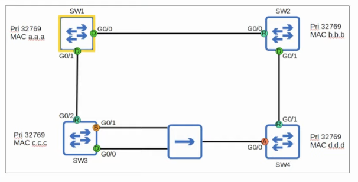
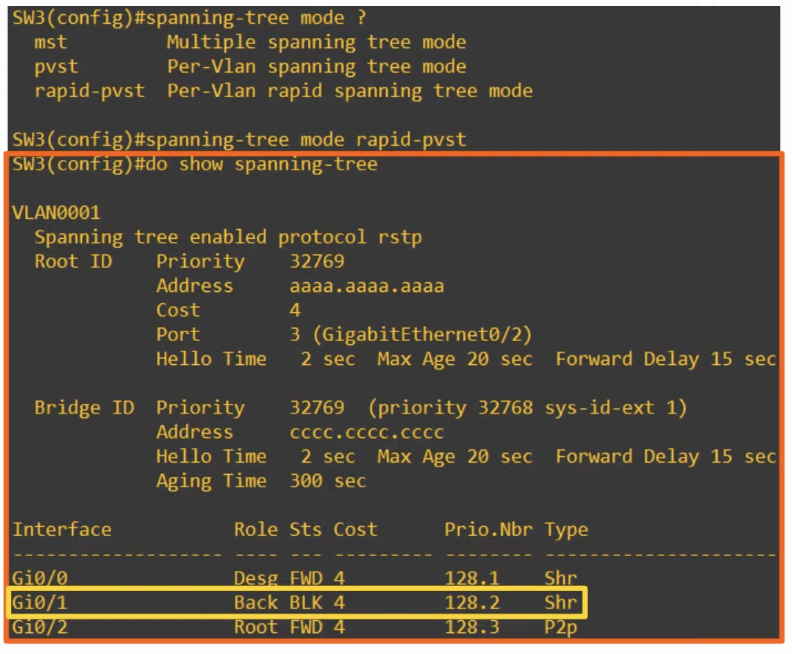
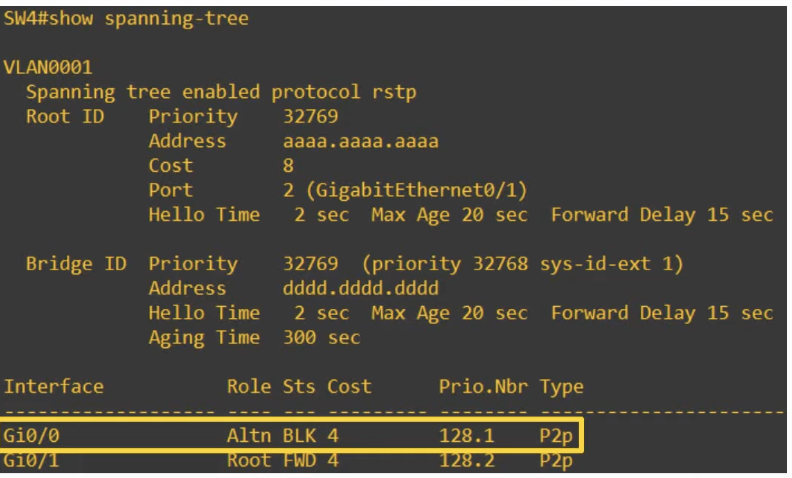

- Rapid STP <u>is</u> compatible with Classic STP
- The interface(s) on the rapid STP-enabled switch connected to the Classic STP-enabled switch will operate in Classic STP mode (timers, blocking -> listening -> learning -> forwarding process, etc.)
- All switches running Rapid STP send their own BPDUs every hello time (2 seconds)
- Switches 'age' the BPDU information much more quickly; in classic STP, a switch waits 10 hello intervals (20 seconds); in rapid STP, a switch considers a neighbor lost if it misses 3 BPDUs (6 seconds); it will then 'flush' all MAC addresses learned on that interface
  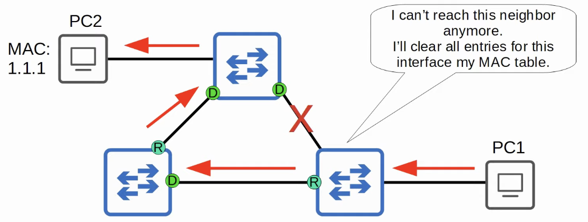

### Spanning Tree Protocol Costs

| Speed        | STP Cost | RSTP Cost |
| :----------- | :------: | :-------: |
| **10 Mbps**  |   100    | 2,000,000 |
| **100 Mbps** |    19    |  200,000  |
| **1 Gbps**   |    4     |  20,000   |
| **10 Gbps**  |    2     |   2,000   |
| **100 Gbps** |    X     |    200    |
| **1 Tbps**   |    X     |    20     |

### Spanning Tree Port States

| STP Port State | Send/Receive BPDUs | Frame forwarding (regular traffic) | MAC address learning | Stable/Transitional |
| :------------- | :----------------: | :--------------------------------: | :------------------: | :-----------------: |
| **Blocking**   |       NO/YES       |                 NO                 |          NO          |       Stable        |
| **Listening**  |      YES/YES       |                 NO                 |          NO          |    Transitional     |
| **Learning**   |      YES/YES       |                 NO                 |         YES          |    Transitional     |
| **Forwarding** |      YES/YES       |                YES                 |         YES          |       Stable        |
| **Disabled**   |       NO/NO        |                 NO                 |          NO          |       Stable        |

### Rapid Spanning Tree Port States

| RSTP Port State | Send/Receive BPDUs | Frame forwarding (regular traffic) | MAC address learning | Stable/Transitional |
| :-------------- | :----------------: | :--------------------------------: | :------------------: | :-----------------: |
| **Discarding**  |       NO/YES       |                 NO                 |          NO          |       Stable        |
| **Learning**    |      YES/YES       |                 NO                 |         YES          |    Transitional     |
| **Forwarding**  |      YES/YES       |                YES                 |         YES          |       Stable        |

- If a port is administratively disabled (**`shutdown`** command) = discarding state
- If a port is enabled but blocking traffic to prevent Layer 2 loops = discarding state

### Rapid Spanning Tree Port Roles

- The **root port** role remains unchanged in RSTP
  - The port that is closest to the root bridge becomes the root port for the switch
  - The root bridge is the only switch that doesn't have a root port
- The **designated port** role remains unchanged in RSTP
  - The port on a segment (collision domain) that sends the best BPDU is that segment's designated port (only one per segment)
- The **non-designated port** role is split into two separate roles in RSTP:
  - the **alternate port** role
  - the **backup port** role

### RSTP: Alternate port role

- The RSTP **alternate** port role is a discarding port that receives a superior BPDU from another switch
- This is the same as what you've learned about **blocking** ports in classic STP
  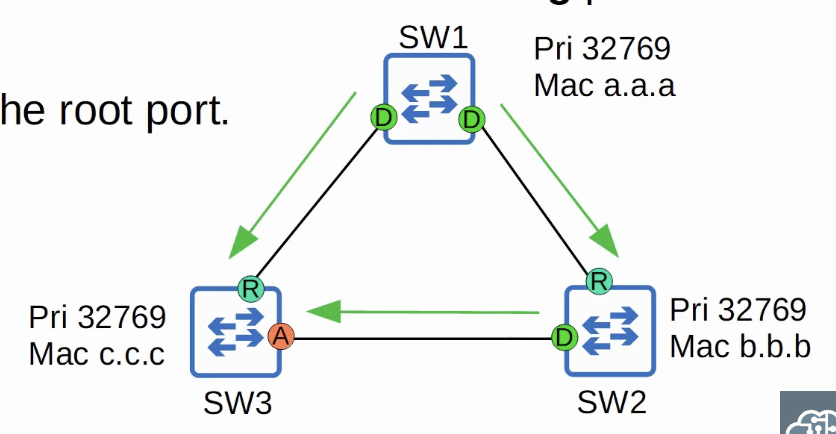
- Functions as a backup to the root port
- If the root port fails, the switch can immediately move its best alternate port to forwarding
  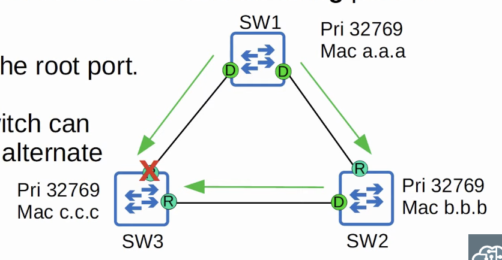
- This immediate move to forwarding state functions like a classic STP optional feature called UplinkFast; because it is built into RSTP, you do not need to activate UplinkFast when using RSTP/Rapid PVST+

### RSTP: BackboneFast functionality

- One more STP optional feature that was built into RSTP is **BackboneFast**
  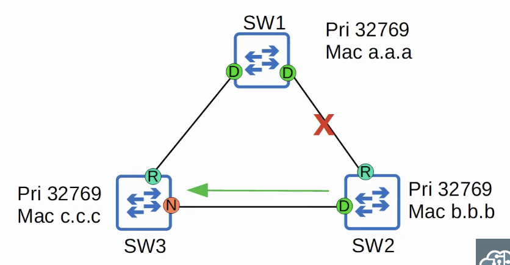
  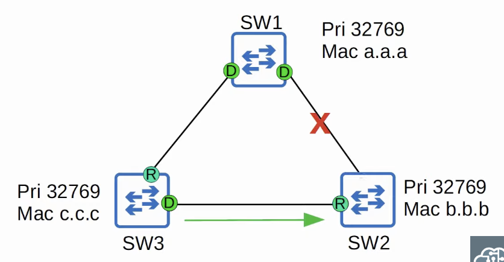
- BackboneFast allows SW3 to expire the made age timers on its interface and rapidly forward the superior BPDUs to SW3
- This functionality is built into RSTP, so it does not need to be configured

### RSTP: Backup port role

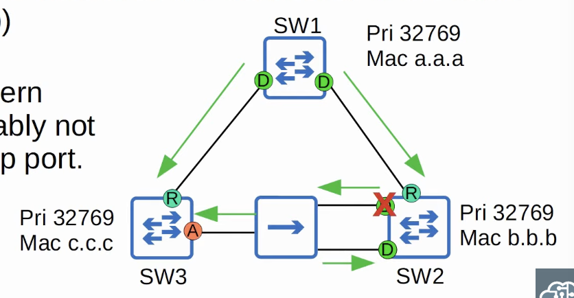

- The RSTP **backup** port role is a discarding port that receives a superior BPDU from <u>another interface on the same switch</u>
- This only happens when two interfaces are connected to the same collision domain (via a hub)
- Hubs are not used in modern networks, so you will probably not encounter an RSTP backup port
- Function as a backup for a designated port
- The interface with the lowest port ID will be selected as the designated port, and the other will be the backup port

### Rapid Spanning Tree BPDU

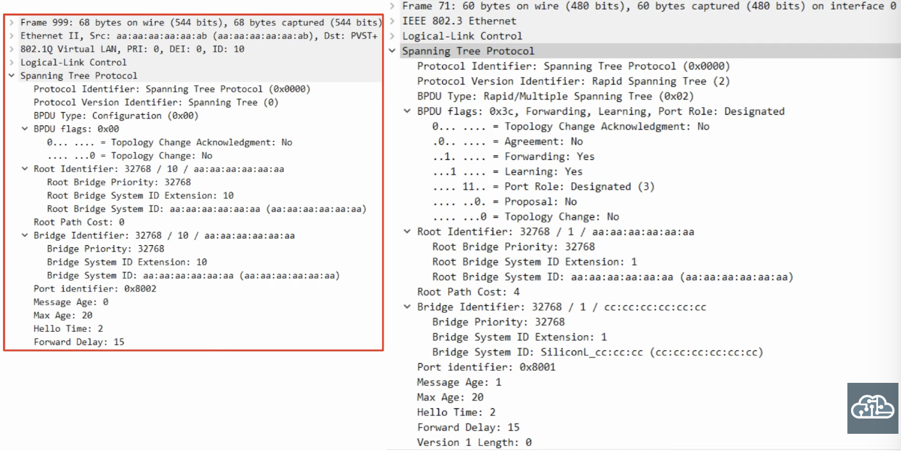

- In classic STP, only the root bridge originated BPDUs, and other switches just forwarded the BPDUs they received
- In rapid STP, ALL switches originate and send their own BPDUs from their designated ports

### RSTP Link Types

- RSTP distinguishes between three different 'link types'
- **Edge:** a port that is connected to an end host; moves directly to forwarding, without negotiation

```
SW1(config-if)# spanning-tree portfast
```

- **Point-to-point:** a direct connection between two switches
  - They function in full-duplex
  - Automatically detected

```
SW1(config-if)# spanning-tree link-type point-to-point
```

- **Shared:** a connection to a hub; must operate in half-duplex mode
  - Automatically detected

```
SW1(config-f)# spanning-tree link-type shared
```

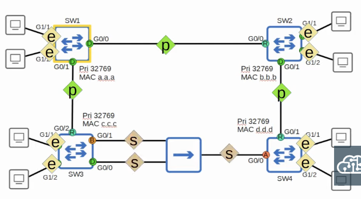

## Quiz

1. _Identify the root bridge, and the RSTP port role of each switch interface in this network:_
   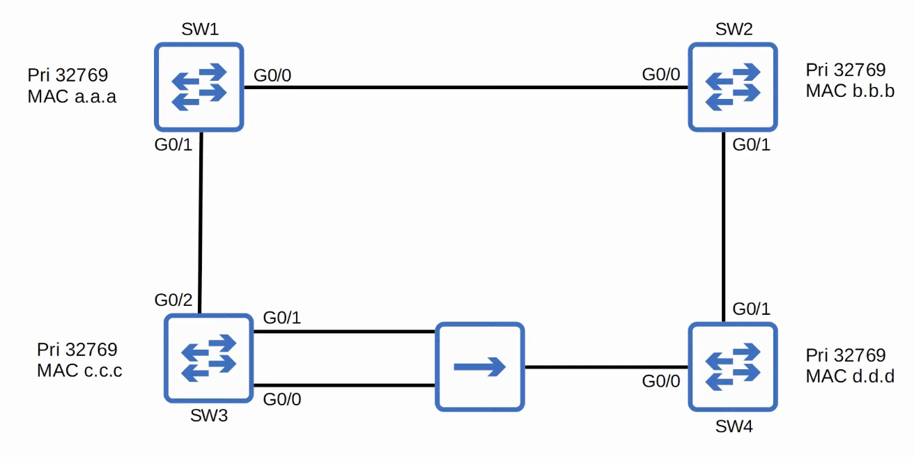
   _Root bridge: SW1_
   _SW1 designated ports: G0/1, G0/0_
   _SW2 root port: G0/0_
   _SW3 root port: G0/2_
   _SW4 root port: G0/1_
   _SW2 designated ports: G0/1_
   _SW3 designated ports: G0/0_
   _SW3 backup ports: G0/1_
   _SW4 alternate ports: G0/0_

2. Which IEEE 802.1D optional features were built in to the IEEE 802.1w standard, and allow ports to move rapidly to the forwarding state?
   _b) PortFast_
   _d) UplinkFast_
   _e) BackboneFast_

3. You want to configure an 802.1w edge port, so that hosts connected to the interface can begin sending traffic over the network immediately. Which command should you use?
   _`SW1(config-if)# spanning-tree portfast`_

4. Identify the root bridge in this network. What is the RSTP port role of each switch port? What is the appropriate RSTP link type of each connection between devices?
   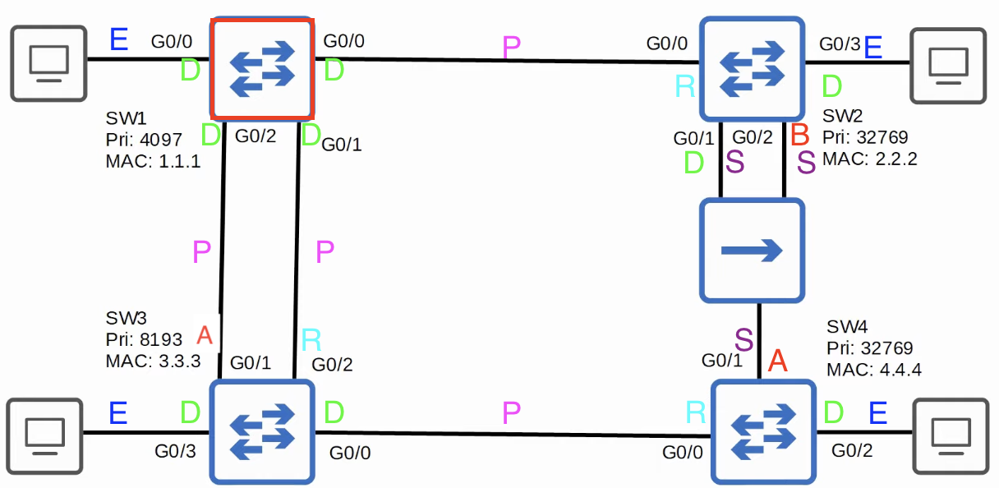

5. Which of the following optional STP features reduces convergence time by immediately placing edge ports into a forwarding state?
   _c) PortFast_
