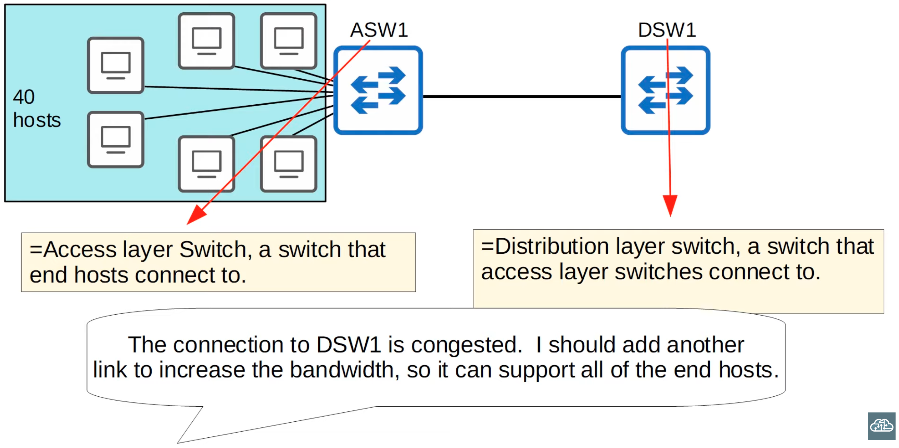
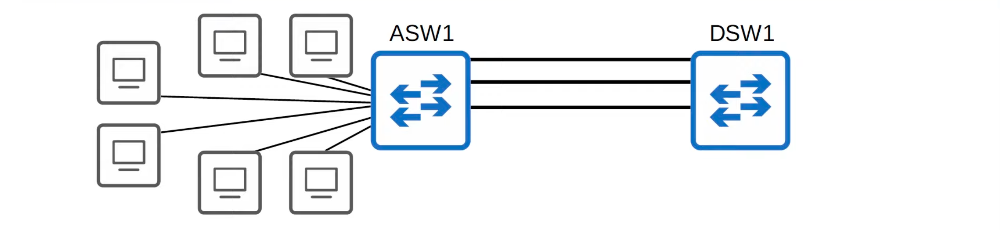
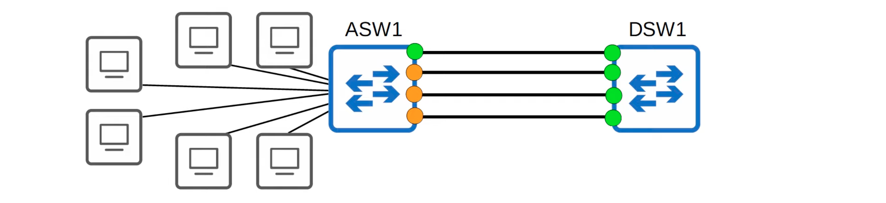
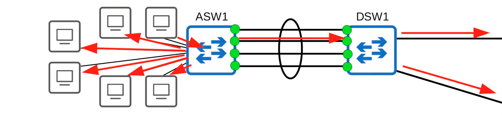
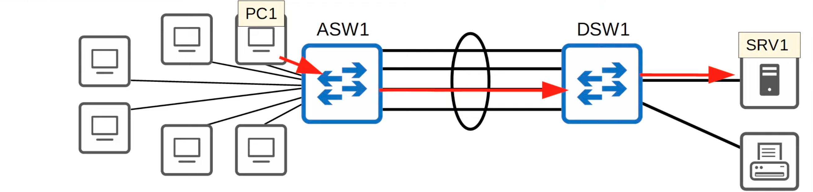
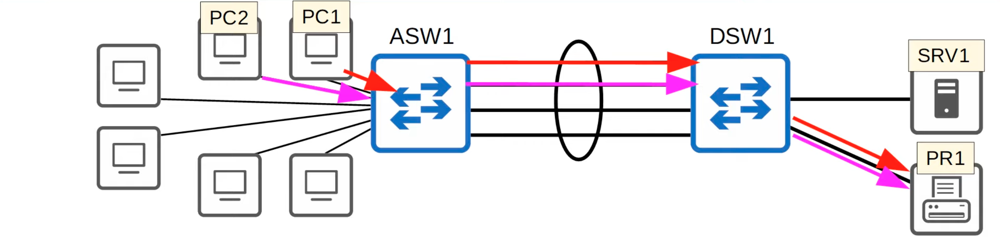
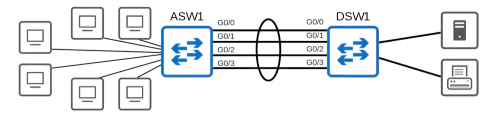
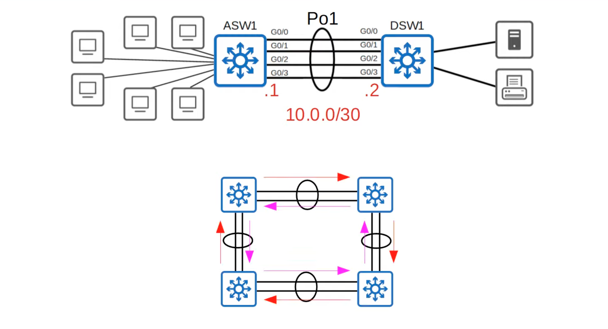

# EtherChannel



- The connection to DSW1 is still connected; I'll add another link



- The connection to DSW1 is still congested; I guess I should add another link...



- If you connect two switches together with multiple links, all except one will be disabled by spanning tree
- If all of ASW1's interfaces were forwarding, Layer 2 loops would form between ASW1 and DSW1, leading to broadcast storms
- Other links will be unused unless the active link fails; in that case, one of the inavtive links will start forwarding



- EtherChannel groups multiple interfaces together to act as a single interface
- STP will treat this group as a single interface
- Traffic using the EtherChannel will be load balanced among the physical interfaces in the group; an algorithm is used to determine which traffic will use which physical interface
- Some other names for an EtherChannel are:
  - PortChannel
  - LAG (Link Aggregation Group)

## EtherChannel Load-Balancing



- EtherChannel load balances based on 'flows'
- A flow is a communication between two nodes in the network
- Frames in the same flow will be forwarded using the same physical interface
- If frames in the same flow were forwarded using different physical interfaces, some frames may arrive at the destination out of order, which can cause problems



- You can change the inputs used in the interface selection calculation
- Inputs that can be used:
  - Source MAC
  - Destination MAC
  - Source AND Destination MAC
  - Source IP
  - Destination IP
  - Source AND Destination IP

- `SW# show etherchannel load-balance`
- `SW(config)# port-channel load-balance method`

```
ASW1#show etherchannel load-balance
EtherChannel Load-Balancing Configuration:
        src-dst-ip

EtherChannel Load-Balancing Addresses Used Per-Protocol:
Non-IP: Source XOR Destination MAC address
  IPv4: Source XOR Destination IP address
  IPv6: Source XOR Destination IP address
```

```
ASW1#conf t
Enter configuration commands, one per line.  End with CNTL/Z.
ASW1(config)#port-channel load-balance ?
  dst-ip       Dst IP Addr
  dst-mac      Dst Mac Addr
  src-dst-ip   Src XOR Dst IP Addr
  src-dst-mac  Src XOR Dst Mac Addr
  src-ip       Src IP Addr
  src-mac      Src Mac Addr

ASW1(config)#port-channel load-balance src-dst-mac
ASW1(config)#do show etherchannel load-balance

EtherChannel Load-Balancing Configuration:
        src-dst-mac

EtherChannel Load-Balancing Addresses Used Per-Protocol:
Non-IP: Source XOR Destination MAC address
  IPv4: Source XOR Destination MAC address
  IPv6: Source XOR Destination MAC address

ASW1(config)#
```

## EtherChannel Configuration

- There are three methods of EtherChannel configuration on Cisco switches:
  - PAgP (Port Aggregation Protocol)
    - Cisco proprietary protocol
    - Dynamically negotiates the creation/maintenaance of the EtherChannel (like DTP does for trunks)
  - **LACP (Link Aggregation Protocol)**
    - Industry standard protocol (IEEE 802.3ad)
    - Dynamically negotiates the creation/maintenaance of the EtherChannel (like DTP does for trunks)
  - Static EtherChannel
    - A protocol isn't used to determine if an EtherChannel should be formed
    - Interfaces are statically configured to form an EtherChannel
- Up to 8 interfaces can be formed into a single EtherChannel (LACP allows up to 16, but only 8 will be active, the other 8 will be in standby mode, waiting for an active interface to fail)

### PAgP Configuration



- `SW(config-if)# channel-group number mode mode`

```
ASW1(config)#interface range g0/0 - 3
ASW1(config-if-range)#channel-group 1 mode ?
  active     Enable LACP unconditionally
  auto       Enable PAgP only if a PAgP device is detected
  desirable  Enable PAgP unconditionally
  on         Enable Etherchannel only
  passive    Enable LACP only if a LACP device is detected

ASW1(config-if-range)#channel-group 1 mode desirable
Creating a port-channel interface Port-channel 1
```

auto + auto = no EtherChannel
desirable + auto = EtherChannel
desirable + desirable = EtherChannel

- The channel-group number has to match for member interfaces on the same switch
- Howecer, it **doesn't** have to match the channel-group number on the other switch (**channel-group 1** on ASW1 can form an EtherChannel with **channel-group 2** on DSW1)

```
ASW1(config)#do show ip interface brief
Interface                  IP-Address      OK? Method Status                Protocol
GigabitEthernet0/0         unassigned      YES unset  up                    up
GigabitEthernet0/1         unassigned      YES unset  up                    up
GigabitEthernet0/2         unassigned      YES unset  up                    up
GigabitEthernet0/3         unassigned      YES unset  up                    up
GigabitEthernet1/0         unassigned      YES unset  up                    up
GigabitEthernet1/1         unassigned      YES unset  up                    up
GigabitEthernet1/2         unassigned      YES unset  up                    up
GigabitEthernet1/3         unassigned      YES unset  up                    up
GigabitEthernet2/0         unassigned      YES unset  up                    up
GigabitEthernet2/1         unassigned      YES unset  up                    up
GigabitEthernet2/2         unassigned      YES unset  up                    up
GigabitEthernet2/3         unassigned      YES unset  up                    up
GigabitEthernet3/0         unassigned      YES unset  up                    up
GigabitEthernet3/1         unassigned      YES unset  up                    up
GigabitEthernet3/2         unassigned      YES unset  up                    up
GigabitEthernet3/3         unassigned      YES unset  up                    up
Port-channel1              unassigned      YES unset  up                    up
ASW1(config)#
```

### LACP Configuration

```
ASW1(config-if-range)#channel-group 1 mode ?
  active     Enable LACP unconditionally
  auto       Enable PAgP only if a PAgP device is detected
  desirable  Enable PAgP unconditionally
  on         Enable Etherchannel only
  passive    Enable LACP only if a LACP device is detected

ASW1(config-if-range)#channel-group 1 mode active
Creating a port-channel interface Port-channel 1
```

passive + passive = no EtherChannel
active + passive = EtherChannel
active + active = EtherChannel

### Static EtherChannel Configuration

```
ASW1(config-if-range)#channel-group 1 mode ?
  active     Enable LACP unconditionally
  auto       Enable PAgP only if a PAgP device is detected
  desirable  Enable PAgP unconditionally
  on         Enable Etherchannel only
  passive    Enable LACP only if a LACP device is detected

ASW1(config-if-range)#channel-group 1 mode on
Creating a port-channel interface Port-channel 1
```

- **On** mode only works with **on** mode (**on + desirable** or **on + active** will not work)

### Manually Configure the Negotiation Protocol

```
ASW1(config-if-range)#channel-protocol ?
  lacp  Prepare interface for LACP protocol
  pagp  Prepare interface for PAgP protocol

ASW1(config-if-range)#channel-protocol lacp
ASW1(config-if-range)#channel-group 1 mode desirable
Command rejected (Channel protocol mismatch for interface Gi0/0 in group 1): the interface can not be added to the channel group

% Range command terminated because it failed on GigabitEthernet0/0
ASW1(config-if-range)#channel-group 1 mode on
Command rejected (Channel protocol mismatch for interface Gi0/0 in group 1): the interface can not be added to the channel group

% Range command terminated because it failed on GigabitEthernet0/0
ASW1(config-if-range)#channel-group 1 mode active
Creating a port-channel interface Port-channel 1

ASW1(config-if-range)#
```

---

```
ASW1(config)#interface port-channel 1
ASW1(config-if)#switchport trunk encapsulation dot1q
ASW1(config-if)#switchport mode trunk
ASW1(config-if)#do show interfaces trunk

Port        Mode             Encapsulation  Status        Native vlan
Po1         on               802.1q         trunking      1

Port        Vlans allowed on trunk
Po1         1-4094

Port        Vlans allowed and active in management domain
Po1         1

Port        Vlans in spanning tree forwarding state and not pruned
Po1         none
```

- _Output of `show running-config`:_

```
interface Port-channel1
 switchport trunk encapsulation dot1q
 switchport mode trunk
!
interface GigabitEthernet0/0
 switchport trunk encapsulation dot1q
 switchport mode trunk
 media-type rj45
 negotiation auto
 channel-protocol lacp
 channel-group 1 mode active
!
interface GigabitEthernet0/1
 switchport trunk encapsulation dot1q
 switchport mode trunk
 media-type rj45
 negotiation auto
 channel-protocol lacp
 channel-group 1 mode active
!
interface GigabitEthernet0/2
 switchport trunk encapsulation dot1q
 switchport mode trunk
 media-type rj45
 negotiation auto
 channel-protocol lacp
 channel-group 1 mode active
!
interface GigabitEthernet0/3
 switchport trunk encapsulation dot1q
 switchport mode trunk
 media-type rj45
 negotiation auto
 channel-protocol lacp
 channel-group 1 mode active
!
```

- Member interfaces must have matching configurations
  - Same duplex (full/half)
  - Same speed
  - Same switchport mode (access/trunk)
  - Same allowed VLANs/native VLAN (for trunk interfaces)
- If an interface's configuration do not match the others, it will be excluded from the EtherChannel

## `show etherchannel summary`

```
ASW1#show etherchannel summary
Flags:  D - down          P - bundled in port-channel
        I - stand-alone   s - suspended
        H - Hot-standby (LACP only)
        R - Layer3        S - Layer2
        U - in use        N - not in use, no aggregation
        f - failed to allocate aggregator

        M - not in use, minimum links not met
        m - not in use, port not aggregated due to minimum links not met
        u - unsuitable for bundling
        w - waiting to be aggregated
        d - default port

        A - formed by Auto LAG


Number of channel-groups in use: 1
Number of aggregators:           1

Group  Port-channel  Protocol    Ports
------+-------------+-----------+-----------------------------------------------
1      Po1(SU)         LACP      Gi0/0(P)    Gi0/1(P)    Gi0/2(P)
                                 Gi0/3(P)
```

```
ASW1(config)#interface po1
ASW1(config-if)#shutdown
ASW1(config-if)#do show etherchannel summary
Flags:  D - down          P - bundled in port-channel
        I - stand-alone   s - suspended
        H - Hot-standby (LACP only)
        R - Layer3        S - Layer2
        U - in use        N - not in use, no aggregation
        f - failed to allocate aggregator

        M - not in use, minimum links not met
        m - not in use, port not aggregated due to minimum links not met
        u - unsuitable for bundling
        w - waiting to be aggregated
        d - default port

        A - formed by Auto LAG


Number of channel-groups in use: 1
Number of aggregators:           1

Group  Port-channel  Protocol    Ports
------+-------------+-----------+-----------------------------------------------
1      Po1(SD)         LACP      Gi0/0(D)    Gi0/1(D)    Gi0/2(D)
                                 Gi0/3(D)
```

```
ASW1(config)#interface g0/0
ASW1(config-if)#switchport mode access
ASW1(config-if)#do show etherchannel summary
Flags:  D - down          P - bundled in port-channel
        I - stand-alone   s - suspended
        H - Hot-standby (LACP only)
        R - Layer3        S - Layer2
        U - in use        N - not in use, no aggregation
        f - failed to allocate aggregator

        M - not in use, minimum links not met
        m - not in use, port not aggregated due to minimum links not met
        u - unsuitable for bundling
        w - waiting to be aggregated
        d - default port

        A - formed by Auto LAG


Number of channel-groups in use: 1
Number of aggregators:           1

Group  Port-channel  Protocol    Ports
------+-------------+-----------+-----------------------------------------------
1      Po1(SU)         LACP      Gi0/0(s)    Gi0/1(P)    Gi0/2(P)
                                 Gi0/3(P)
```

## `show etherchannel port-channel`

```
ASW1#show etherchannel port-channel
                Channel-group listing:
                ----------------------

Group: 1
----------
                Port-channels in the group:
                ---------------------------

Port-channel: Po1    (Primary Aggregator)

------------

Age of the Port-channel   = 0d:00h:36m:48s
Logical slot/port   = 16/0          Number of ports = 4
HotStandBy port = null
Port state          = Port-channel Ag-Inuse
Protocol            =   LACP
Port security       = Disabled

Ports in the Port-channel:

Index   Load   Port     EC state        No of bits
------+------+------+------+------------------+-----------
  0     00     Gi0/0    Active              0
  0     00     Gi0/1    Active              0
  0     00     Gi0/2    Active              0
  0     00     Gi0/3    Active              0

Time since last port bundled:    0d:00h:00m:02s    Gi0/0
Time since last port Un-bundled: 0d:00h:08m:42s    Gi0/0
```

## `show spanning-tree`

```
ASW1#show spanning-tree

VLAN0001
  Spanning tree enabled protocol rstp
  Root ID    Priority    32769
             Address     0c04.cf10.ea00
             This bridge is the root
             Hello Time   2 sec  Max Age 20 sec  Forward Delay 15 sec

  Bridge ID  Priority    32769  (priority 32768 sys-id-ext 1)
             Address     0c04.cf10.ea00
             Hello Time   2 sec  Max Age 20 sec  Forward Delay 15 sec
             Aging Time  300 sec

Interface           Role Sts Cost      Prio.Nbr Type
------------------- ---- --- --------- -------- --------------------------------
Po1                 Desg FWD 3         128.65   Shr
```

## Layer 3 EtherChannel




```
ASW1(config)#int range g0/0 - 3
ASW1(config-if-range)#no switchport
ASW1(config-if-range)#channel-group 1 mode active
Creating a port-channel interface Port-channel 1
```

```
interface Port-channel1
 no switchport
 no ip address
!
interface GigabitEthernet0/0
 no switchport
 no ip address
 negotiation auto
 channel-group 1 mode active
!
interface GigabitEthernet0/1
 no switchport
 no ip address
 negotiation auto
 channel-group 1 mode active
!
interface GigabitEthernet0/2
 no switchport
 no ip address
 negotiation auto
 channel-group 1 mode active
!
interface GigabitEthernet0/3
 no switchport
 no ip address
 negotiation auto
 channel-group 1 mode active
!
```

```
ASW1(config-if-range)#int po1
ASW1(config-if)#ip address 10.0.0.1 255.255.255.252
ASW1(config-if)#
```

```
ASW1(config-if)#do sh etherch sum
Flags:  D - down          P - bundled in port-channel
        I - stand-alone   s - suspended
        H - Hot-standby (LACP only)
        R - Layer3        S - Layer2
        U - in use        N - not in use, no aggregation
        f - failed to allocate aggregator

        M - not in use, minimum links not met
        m - not in use, port not aggregated due to minimum links not met
        u - unsuitable for bundling
        w - waiting to be aggregated
        d - default port

        A - formed by Auto LAG


Number of channel-groups in use: 1
Number of aggregators:           1

Group  Port-channel  Protocol    Ports
------+-------------+-----------+-----------------------------------------------
1      Po1(RU)         LACP      Gi0/0(P)    Gi0/1(P)    Gi0/2(P)
                                 Gi0/3(P)
```

```
ASW1#show ip interface brief
Interface                  IP-Address      OK? Method Status                Protocol
GigabitEthernet0/0         unassigned      YES manual up                    up
GigabitEthernet0/1         unassigned      YES manual up                    up
GigabitEthernet0/2         unassigned      YES manual up                    up
GigabitEthernet0/3         unassigned      YES manual up                    up
GigabitEthernet1/0         unassigned      YES unset  up                    up
GigabitEthernet1/1         unassigned      YES unset  up                    up
GigabitEthernet1/2         unassigned      YES unset  up                    up
GigabitEthernet1/3         unassigned      YES unset  up                    up
GigabitEthernet2/0         unassigned      YES unset  up                    up
GigabitEthernet2/1         unassigned      YES unset  up                    up
GigabitEthernet2/2         unassigned      YES unset  up                    up
GigabitEthernet2/3         unassigned      YES unset  up                    up
GigabitEthernet3/0         unassigned      YES unset  up                    up
GigabitEthernet3/1         unassigned      YES unset  up                    up
GigabitEthernet3/2         unassigned      YES unset  up                    up
GigabitEthernet3/3         unassigned      YES unset  up                    up
Port-channel1              10.0.0.1        YES NVRAM  up                    up
ASW1#
```

## Quiz

1. Which of the following **channel-group mode** combiniations will result in an operational EtherChannel? (choose three)
   _a) on - on_
   _c) desirable - auto_
   _g) active - active_

2. In the output of the **`show etherchannel summary`** command, you notice that the physical interfaces in the EtherChannel you configured have the flag **`(P)`** next to them. What does this mean?
   _b) The interfaces are bundled in the port-channel_

3. Which of the following member interface parameters need to match to form an EtherChannel? (choose two)
   _c) Interface speed_
   _d) Switchport mode (access/trunk)_

4. You issue the following commands on SwitchA:

```
SwitchA(config)#interface port-channel 1
SwitchA(config-if)#interface range fastethernet 0/5 - 6
SwitchA(config-if-range)#channel-protocol lacp
SwitchA(config-if-range)#channel-group 1 mode on
```

You then issue the following commands on SwitchB:

```
SwitchB(config)#interface port-channel 1
SwitchB(config-if)#interface range fastethernet 0/5 - 6
SwitchB(config-if-range)#channel-protocol pagp
SwitchB(config-if-range)#channel-group 1 mode on
```

Which of the following statements is true about the resulting EtherChannel link between SwitchA and SwitchB?
_b) No link is formed_
