# Dynamic Routing

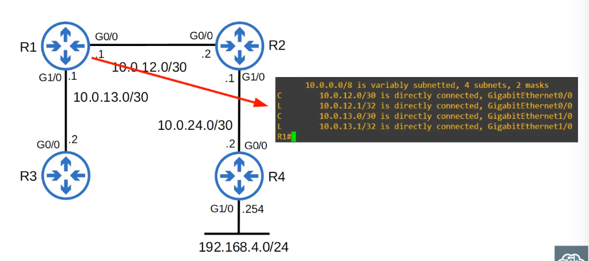

- **Network route**: A route to a network/subnet (mask length < /32) _`(C)`_
- **Host route**: A route to a specific host (/32 mask) _`(L)`_

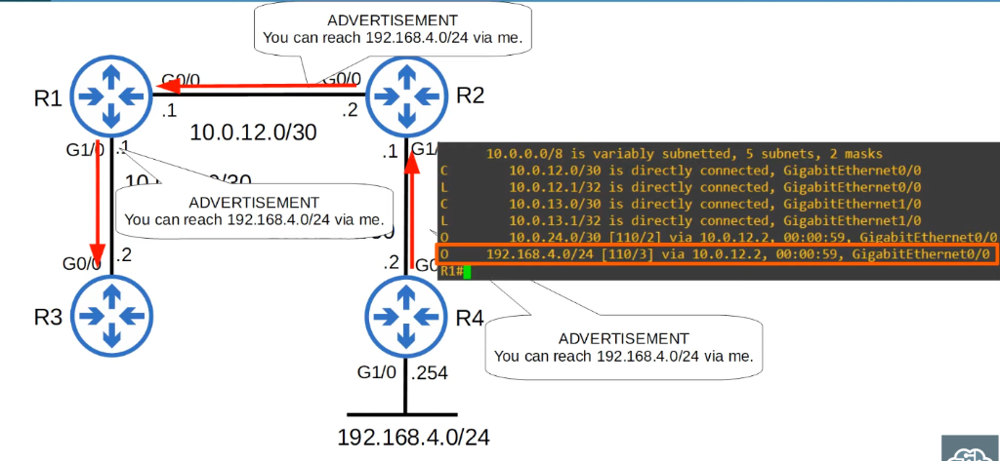
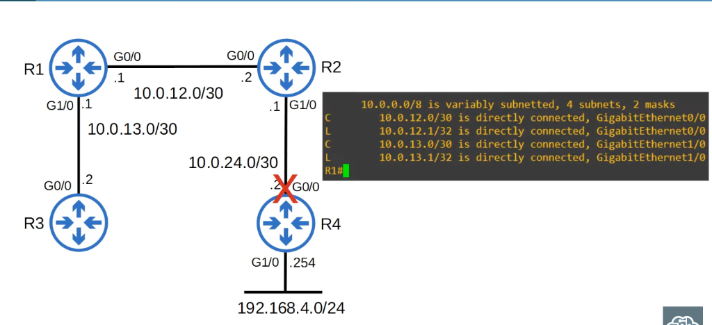

## Static Routing

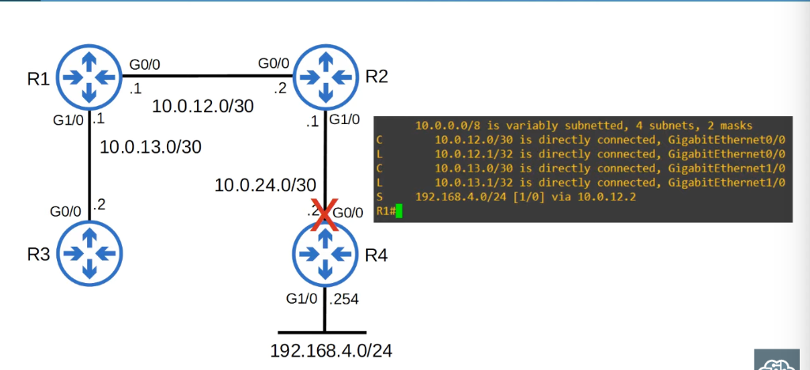

## Dynamic Routing

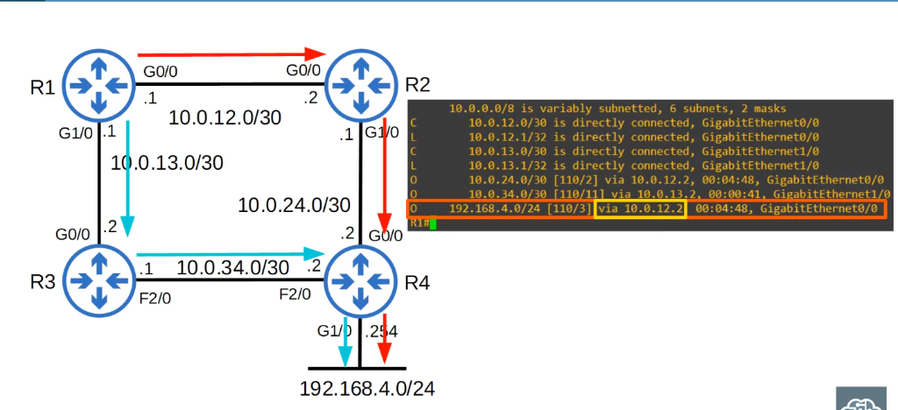
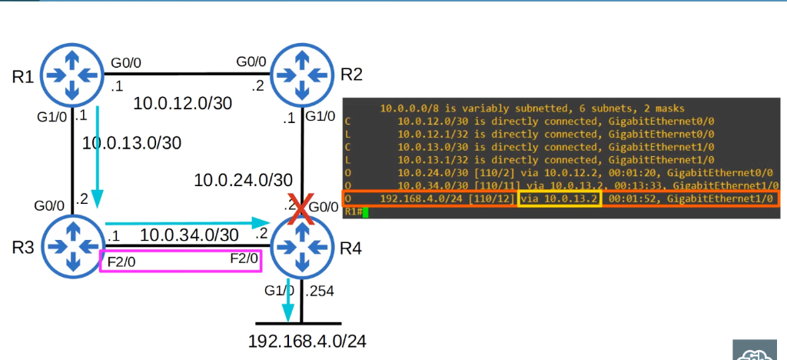

- Routers can use dynamic routing protocols to advertise information about the routes they know to other routers
- They form 'adjacencies' / 'neighbor relationships' / 'neighborships' with adjacent routers to excheange this information
- If multiple routes to a destination are learned, the router determines which route is superior and adds it to the routing table; ir uses the 'metric' of the route to decide which is superior (lower metric = superior)

## Types of Dynamic Routing Protocols

- Dynamic routing protocols can be divided into two main categories:
  - **IGP (Interior Gateway Protocol)**: used to share routes within a single _autonomous system_ (AS), which is a single organization (e.g. a company)
  - **EGP (Exterior Gateway Protocol)**: used to share routes _between_ different autonomous systems

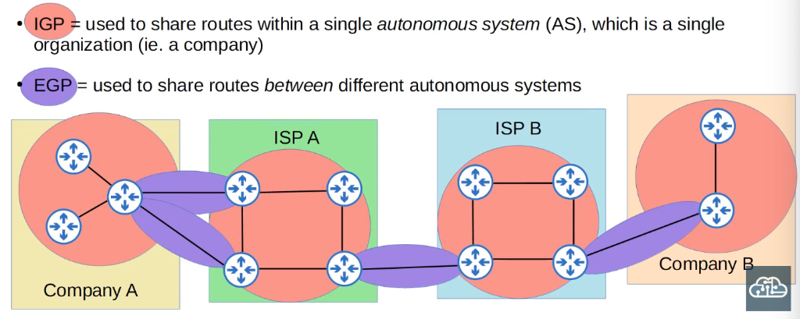
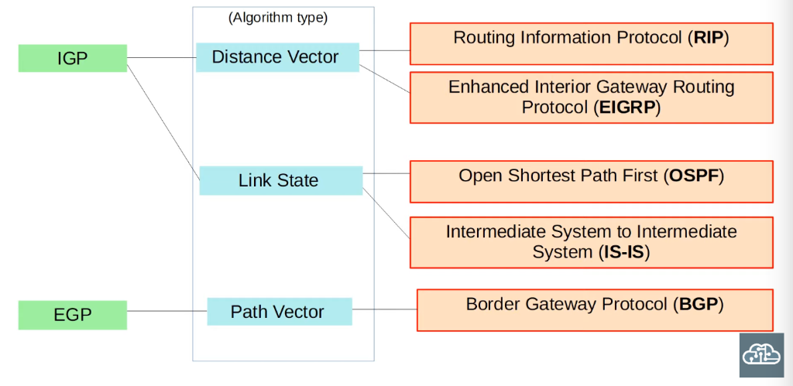

## Distance Vector Routing Protocols

- Distance vector protocols were invented before link state protocols
- Early examples are **RIPv1** and Cisco's proprietary protocol **IGRP** (which was updated to **EIGRP**)
- Distance vector protocols operate by sending the following to their directly connected neighbors:
  - their known destination networks
  - their metric to reach their known destination networks
- This method of sharing route information is often called 'routing by rumor'
- This is because the router doesn't know about the network beyond its neighbors; it only knows the information that its neighbors tell it
- Called 'distance vector' because the routers only learn the 'distance' (metric) and 'vector' (direction, the next-hop router) of each route

## Link State Routing Protocols

- When using a **link state** routing protocol, every router creates a 'connectivity map' of the network
- To allow this, each router advertises information about its interfaces (connected networks) to its neighbors; these advertisments are passed along to other routers, until all routers in the network develop the same map of the network
- Each router independently uses this map to calculate the best routes to each destination
- Link state protocols use more resources (CPU) on the router, because more information is shared
- However, link state protocols tend to be faster in reacting to changes in the network than distance vector protocols

## Dynamic Routing Protocol Metrics

- A router's route table contains the best route to each destination network it knows about
- If a router using a dynamic routing protocol learns two different routes to the same destination, how does it determine which is 'best'?
- It uses the **metric** value of the routes to determine which is best; a lower metric = better
- Each routing protocol uses a different metric to determine which route is the best

| IGP       | Metric                                         | Explanation                                                                                                                                                                    |
| :-------- | :--------------------------------------------- | :----------------------------------------------------------------------------------------------------------------------------------------------------------------------------- |
| **RIP**   | Hop count                                      | Each router in the path counts as one 'hop'. The total metric is the total number of hops to the destination.<br>**Links of all speeds are equal.**                            |
| **EIGRP** | Metric based on bandwidth & delay (by default) | Complex formula that can take into account many values. By default, the bandwidth of the **slowest link in the route** and the total delay of all links in the route are used. |
| **OSPF**  | Cost                                           | The cost of each link is calculated based on bandwidth. The total metric is the total cost of each link in the route.                                                          |
| **IS-IS** | Cost                                           | The total metric is the total cost of each link in the route. The cost of each link is **not** automatically calculated by default. All links have a cost of 10 by default.    |

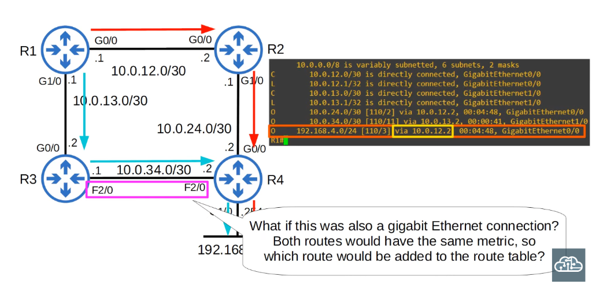
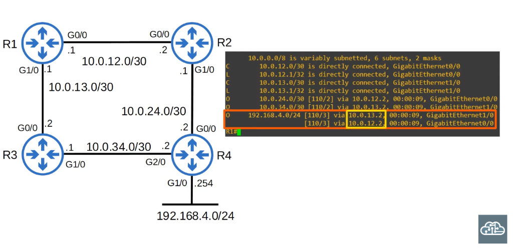
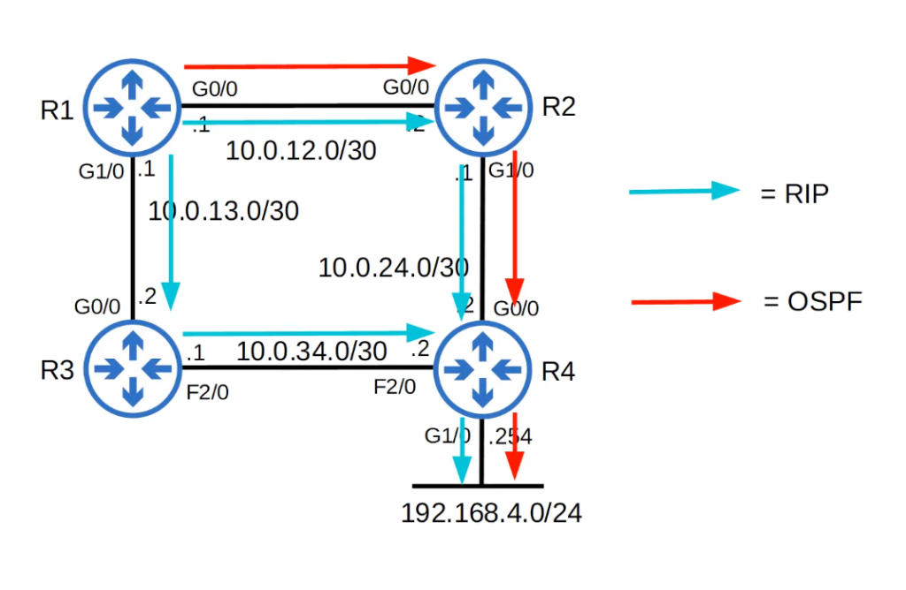

- If a router learns two (or more) routes via the **same routing protocol** to the **same destination** (same network address, same subnet mask) with the **same metric**, both will be added to the routing table; traffic will be load-balanced over both routers; ECMP (Equal Cost Multi-Path)

### ECMP with Static Routes

```
R1(config)#ip route 192.168.4.0 255.255.255.0 10.0.12.2
R1(config)#ip route 192.168.4.0 255.255.255.0 10.0.13.2
R1(config)#do show ip route
Codes: L - local, C - connected, S - static, R - RIP, M - mobile, B - BGP
       D - EIGRP, EX - EIGRP external, O - OSPF, IA - OSPF inter area
       N1 - OSPF NSSA external type 1, N2 - OSPF NSSA external type 2
       E1 - OSPF external type 1, E2 - OSPF external type 2
       i - IS-IS, su - IS-IS summary, L1 - IS-IS level-1, L2 - IS-IS level-2
       ia - IS-IS inter area, * - candidate default, U - per-user static route
       o - ODR, P - periodic downloaded static route, H - NHRP, l - LISP
       + - replicated route, % - next hop override

Gateway of last resort is not set

      10.0.0.0/8 is variably subnetted, 4 subnets, 2 masks
C        10.0.12.0/30 is directly connected, GigabitEthernet0/0
L        10.0.12.1/32 is directly connected, GigabitEthernet0/0
C        10.0.13.0/30 is directly connected, GigabitEthernet1/0
L        10.0.13.1/32 is directly connected, GigabitEthernet1/0
S     192.168.4.0/24 [1/0] via 10.0.13.2
                     [1/0] via 10.0.12.2
R1(config)#
```

## Administrative Distance

- In most cases a company will only use a single IGP - usually OSPF or EIGRP
- However, in some rare cases they might use two; for example, if two companies connect their networks to share information, two different routing protocols might be in use
- Metric is used to compare routes <u>learned via the same routing protocol</u>
- Different routing protocols use totally different metrics, so they cannot be compared
- For example, an OSPF route to 192.168.4.0/24 might have a metric of 30, while an EIGRP route to the same destination might have a metric of 33280; which route is better?, which route should the router put in the route table?
- The **administrative distane** (AD) is used to determine which routing protocol is preferred
- A lower AD is preferred, and indicates that the routing protocol is considered more 'trustworthy' (more likely to select good routes)

| Route protocol/type     | AD  | Route protocol/type     | AD  |
| :---------------------- | :-: | :---------------------- | :-: |
| **Directly connected**  |  0  | **IS-IS**               | 115 |
| **Static**              |  1  | **RIP**                 | 120 |
| **External BGP (eBGP)** | 20  | **EIGRP (external)**    | 170 |
| **EIGRP**               | 90  | **Internal BGP (iBGP)** | 200 |
| **IGRP**                | 100 | **Unusable route**      | 255 |
| **OSPF**                | 110 |                         |     |

- If the administrative distance is 255, the router does not believe the source of that route and does not install the route in the routing table

- You can change the AD of a routing protocol
- You can also change the AD of a static route:

```
R1(config)#ip route 10.0.0.0 255.0.0.0 10.0.13.2 ?
  <1-255>    Distance metric for this route
  multicast  multicast route
  name       Specify name of the next hop
  permanent  permanent route
  tag        Set tag for this route
  track      Install route depending on tracked item
  <cr>

R1(config)#ip route 10.0.0.0 255.0.0.0 10.0.13.2 100
R1(config)#do show ip route
Codes: L - local, C - connected, S - static, R - RIP, M - mobile, B - BGP
       D - EIGRP, EX - EIGRP external, O - OSPF, IA - OSPF inter area
       N1 - OSPF NSSA external type 1, N2 - OSPF NSSA external type 2
       E1 - OSPF external type 1, E2 - OSPF external type 2
       i - IS-IS, su - IS-IS summary, L1 - IS-IS level-1, L2 - IS-IS level-2
       ia - IS-IS inter area, * - candidate default, U - per-user static route
       o - ODR, P - periodic downloaded static route, H - NHRP, l - LISP
       + - replicated route, % - next hop override

Gateway of last resort is not set

      10.0.0.0/8 is variably subnetted, 6 subnets, 3 masks
S        10.0.0.0/8 [100/0] via 10.0.13.2
C        10.0.12.0/30 is directly connected, GigabitEthernet0/0
L        10.0.12.1/32 is directly connected, GigabitEthernet0/0
C        10.0.13.0/30 is directly connected, GigabitEthernet1/0
L        10.0.13.1/32 is directly connected, GigabitEthernet1/0
D        10.0.24.0/30 [90/3072] via 10.0.12.2, 00:06:35, GigabitEthernet0/0
R1(config)#
```

- By changing the AD of a static route, you can make it less preferred than routes learned by a dynamic routing protocol to the same destination (make sure the AD is higher than the routing protocol's AD!)
- This is called a 'floating static route'
- The route will be inactive (not in the routing table) unless the route learned by the dynamic routing protocol is removed (for example, the remote router stops advertising it for some reason, or an interface failure causes an adjacency with a neighbor to be lost)

## Quiz

1. The following routes to the destination network 10.1.1.0/24 are learned: - next hop 192.168.1.1, learned via RIP, metric 5 - next hop 192.168.2.1, learned via RIP, metric 3 - next hop 192.168.3.1, learned via OSPF, metric 10
   Which route to 10.1.1.0/24 will be added to the route table? - next hop 192.168.3.1, learned via OSPF, metric 10

2. R1 learns four routes to 192.168.1.0/24 through multiple routing protocols: RIP, EIGRP, OSPD, and IS-IS. Which route/routes will be added to the route table?
   _b) EIGRP route only_

3. Which type of routing protocol is also known as 'routing by rumor'?
   _c) Distance vector protocols_

4. R1 learns two routes to 172.16.0.0/16 via RIP, one via 10.0.0.1 and other via 10.1.0.1. Both routes are 5 hops away. Which route/routes will be entered into the routing table?
   _a) Both routes_

5. You issue the **`show ip route`** command on RouterA and receive the following partial output:

```
S 10.20.0.0/22 ［1/0］ via 192.168.10.2
R 10.20.0.0/24
[120/3] via 192.168.10.3, 00:33:38, Serial0/3
D 10.20.0.0/26 [90/2809856] via 192.168.10.4, 00:02:14,
Serial0/4
• 10.20.0.0/28 ［110/64］ via 192.168.10.1, 00:02:38, Seria10/1
```

RoaterA receives a packet that is destined for 10.20.0.14.
Which of the following routes will RouterA use to send the packet?
_b) the OSPF route, because it is the route with the longest prefix length_
