# RIP & EIGRP

## RIP

- **Routing Information Protocol** (industry standard)
- Distance vector IGP (uses routing-by-rumor logic to learn/share routes)
- Uses hop count as its metric; one router = one hop (bandwidth is irrelevant!)
- The maximum hop count is **15** (anything more than that is considered unreachable)
- Has three versions:
  - **RIPv1** and **RIPv2**, used for IPv4
  - **RIPng** (RIP Next Generation), used for IPv6
- Uses two message types:
  - **Request**: To ask RIP-enabled neighbor routers to send their routing table
  - **Response**: To send the local router's routing table to neighboring routers
- By default, RIP-enabled routers will share their routing table every 30 seconds

### RIPv1 and RIPv2

- **RIPv1:**
  - Only advertises _classful_ addresses (Class A, Class B, Class C)
  - Doesn't support VLSM, CIDR
  - Doesn't include subnet mask information in advertisments (Respone messages)
    - 10.1.1.0/24 will become 10.0.0.0 (Class A address, so assumed to be /8)
    - 172.16.192.0/18 will become 172.16.0.0 (Class B address, so assumed to be /16)
    - 192.168.1.4/30 will become 192.168.1.0 (Class C address, so assumed to be /24)
  - Messages are broadcast to 255.255.255.255
- **RIPv2:**
  - Supports VLSM, CIDR
  - Includes subnet mask information in advertisments
  - Messages are **multicast** to 224.0.0.9
- **Broadcast** messages are delivered to all devices on the local network
- **Multicast** messages are delivered only to devices that have joined that specific _multicast group_

## RIP Configuration

- The RIP 'network' command is classful, it will automatically convert to classful networks
- For example, even if you enter the command **`network 10.0.12.0`**, it will be converted to **`network 10.0.0.0`** (a class A network)
- There is no need to enter the network mask

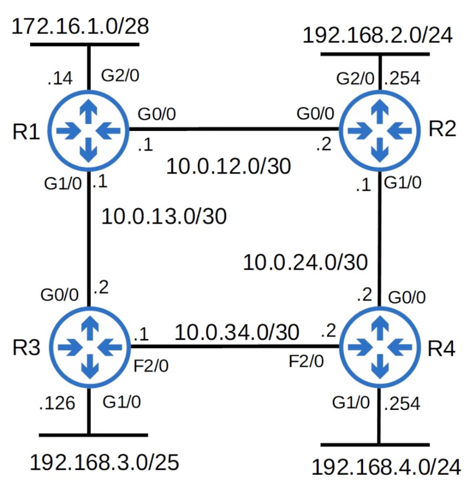

```
R1(config)#router rip
R1(config-router)#version 2
R1(config-router)#no auto-summary
R1(config-router)#network 10.0.0.0
R1(config-router)#network 172.16.0.0
```

### The `network` command

- The **`network`** command tells the router to:
  - look for interfaces with an IP address that is in the specified range
  - active RIP on the interfaces that fall in the range
  - form adjacencies with connected RIP neighbors
  - advertise **the network prefix of the interface** (NOT the prefix in the **`network`** command)
- The OSPF and EIGRP **`network`** commands operate in the same way

```
R1(config-router)#network 10.0.0.0
```

- Because the **`network`** command is classful, 10.0.0.0 is assumed to be 10.0.0.0/8
- R1 will look for any interfaces with an IP address that matches 10.0.0.0/8 (because it is /8 it only needs to match the first 8 bits)
- 10.0.12.1 and 10.0.13.1 both match, so RIP is activated on G0/0 and G1/0
- R1 forms adjacencies with its neighbors R2 and R3
- R1 advertises 10.0.12.0/30 and 10.0.13.0/30 (NOT 10.0.0.0/8) to its RIP neighbors
- The **network** command doesn't tell the router which networks to advertise; it tells the router which interfaces to activate RIP on, and then the router will advertise the network prefix of those interfaces

```
R1(config-router)#network 172.16.0.0
```

- Because the **`network`** command is classful, 172.16.0.0 is assumed to be 172.16.0.0/16
- R1 will look for any interfaces with an IP address that matches 172.16.0.0/16
- 172.16.1.14 matches, so R1 will activate RIP on G2/0
- There are no RIP neighbors connected to G2/0, so no adjecencies are formed
- R1 advertises 172.16.1.0/28 (NOT 172.16.0.0/16) to its RIP neighbors
- Although there are no RIP neighbors connected to G2/0, R1 will continuosly send RIP advertisments out of G2/0; this is unnecessary, so G2/0 should be configured as a **passive interface**

### The `passive-interface` command

```
R1(config-router)#passive-interface g2/0

```

- The **passive-interface** command tells the router to stop sending RIP advertisments out of the specified interface (G2/0)
- However, the router will continue to advertise the network prefix of the interface (172.16.1.0/28) to tis RIP neighbors (R2, R3)
- You should always use this command on interfaces which don't have any RIP neighbors
- EIGRP and OSPF both have the same passive interface functionality, using the same command

### Advertise a default route into RIP

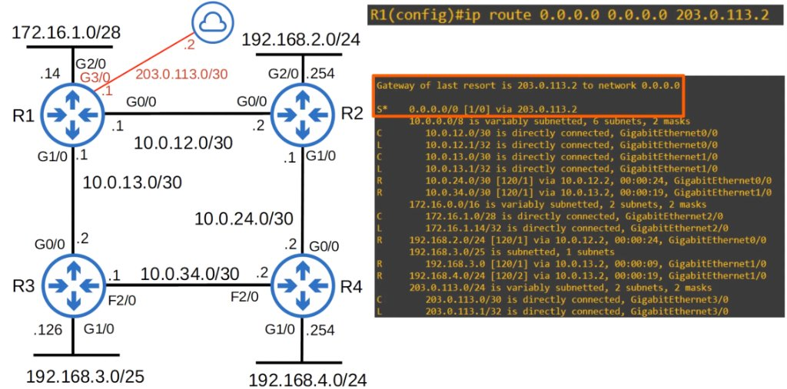

```
R1(config)#ip route 0.0.0.0 0.0.0.0 203.0.113.2
```

#### The `default-information originate` command

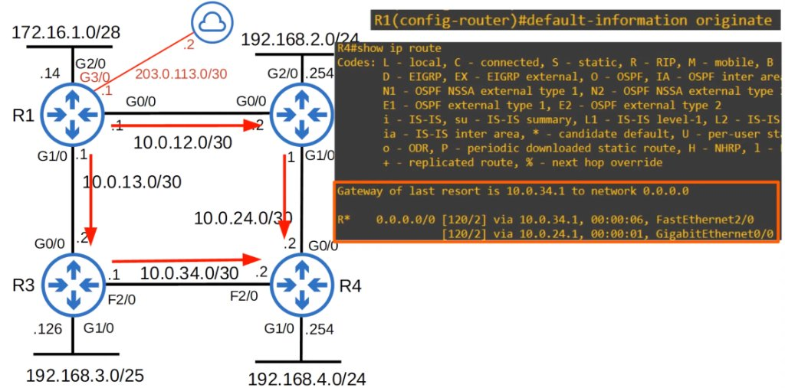

```
R1(config-router)#default-information originate
```

## `show ip protocols`

```
R1#show ip protocols
*** IP Routing is NSF aware ***

Routing Protocol is "rip"
  Outgoing update filter list for all interfaces is not set
  Incoming update filter list for all interfaces is not set
  Sending updates every 30 seconds, next due in 28 seconds
  Invalid after 180 seconds, hold down 180, flushed after 240
  Redistributing: rip
  Default version control: send version 2, receive version 2
    Interface             Send  Recv  Triggered RIP  Key-chain
    GigabitEthernet0/0    2     2
    GigabitEthernet1/0    2     2
  Automatic network summarization is not in effect
  Maximum path: 4
  Routing for Networks:
    10.0.0.0
    172.16.0.0
  Passive Interface(s):
    GigabitEthernet2/0
  Routing Information Sources:
    Gateway         Distance      Last Update
    10.0.12.2            120      00:00:21
    10.0.13.2            120      00:00:06
  Distance: (default is 120)
```

```
R1(config-router)#maximum-paths ?
  <1-32>  Number of paths

R1(config-router)#maximum-paths 8
```

```
R1(config-router)#distance ?
  <1-255>  Administrative distance

R1(config-router)#distance 85
```

```
R1#show ip protocols
*** IP Routing is NSF aware ***

Routing Protocol is "eigrp 1"
  Outgoing update filter list for all interfaces is not set
  Incoming update filter list for all interfaces is not set
  Default networks flagged in outgoing updates
  Default networks accepted from incoming updates
  EIGRP-IPv4 Protocol for AS(1)
    Metric weight K1=1, K2=0, K3=1, K4=0, K5=0
    NSF-aware route hold timer is 240
    Router-ID: 172.16.1.14
    Topology : 0 (base)
      Active Timer: 3 min
      Distance: internal 90 external 170
      Maximum path: 4
      Maximum hopcount 100
      Maximum metric variance 1

  Automatic Summarization: disabled
  Maximum path: 4
  Routing for Networks:
    10.0.0.0
    172.16.1.0/28
  Passive Interface(s):
    GigabitEthernet2/0
  Routing Information Sources:
    Gateway         Distance      Last Update
    10.0.12.2             90      00:00:23
    10.0.13.2             90      00:00:23
  Distance: internal 90 external 170
```

```
R1(config-router)#eigrp router-id ?
  A.B.C.D  EIGRP Router-ID in IP address format

R1(config-router)#eigrp router-id 1.1.1.1
```

```
    Metric weight K1=1, K2=0, K3=1, K4=0, K5=0
    NSF-aware route hold timer is 240
    Router-ID: 1.1.1.1
    Topology : 0 (base)
```

- Router ID order of priority:
  1. Manual configuration
  2. Highest IP address on a loopback interface
  3. Highest IP address on a physical interface

## EIGRP

- **Enhanced Interior Gateway Routing Protocol**
- Was Cisco proprietary, but Cisco has now published it openly so other vendors can implement it on their equipment
- Considered an 'advanced' / 'hybrid' distance vector routing protocol
- Much faster than RIP in reacting to changes in the network
- Does not have the 15 'hop-count' limit of RIP
- Sends messages using multicast address 224.0.0.10
- Is the only IGP that can perform **unequal**-cost load-balancing (by default it performs ECMP load-balancing over 4 paths like RIP)

### EIGRP Configuration


```
R1(config)#router eigrp 1
R1(config-router)#no auto-summary
R1(config-router)#passive-interface g2/0
R1(config-router)#network 10.0.0.0
R1(config-router)#network 172.16.1.0 0.0.0.15
```

- The AS (Autonomous System) number must match between routers, or they will not form an adjacency and share route information
- Auto-summary might be enabled or disabled by default, depending on the router/IOS version; it it's enabled, disable it
- The **`network`** command will assume a classful address if you don't specifiy the mask
- EIGRIP uses a _wildcard mask_ instead of a regular subnet mask

#### Wildcard masks

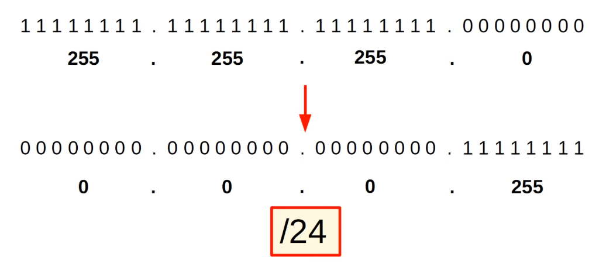

- A wildcard mask is basically an 'inverted' subnet mask
- All 1s in the subnet mask are 0 in the equivalent wildcard mask; all 0s in the subnet mask are 1 in the equivalent wildcard mask

```
11111111.11111111.11111111.10000000 = 255.255.255.128
00000000.00000000.00000000.01111111 = 0.0.0.127
=> /25
```

```
11111111.11111100.00000000.00000000 = 255.255.0.0
00000000.00000011.11111111.11111111 = 0.3.255.255
=> /14
```

```
11111111.11111111.11100000.00000000 = 255.255.224.0
00000000.00000000.00011111.11111111 = 0.0.31.255
=> /19
```

- A shortcut is to subtract each octet of the subnet mask from 255

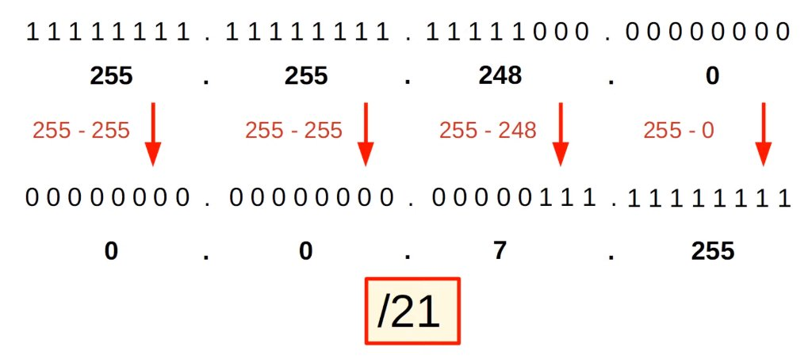

- '0' in the wildcard mask = must match
- '1' in the wildcard mask = don't have to match

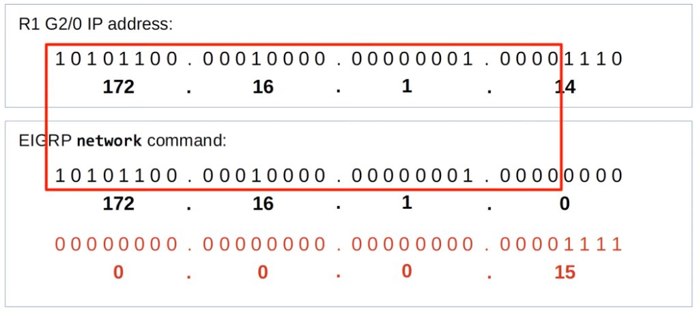

- Match! EIGRP will be activated on the interface

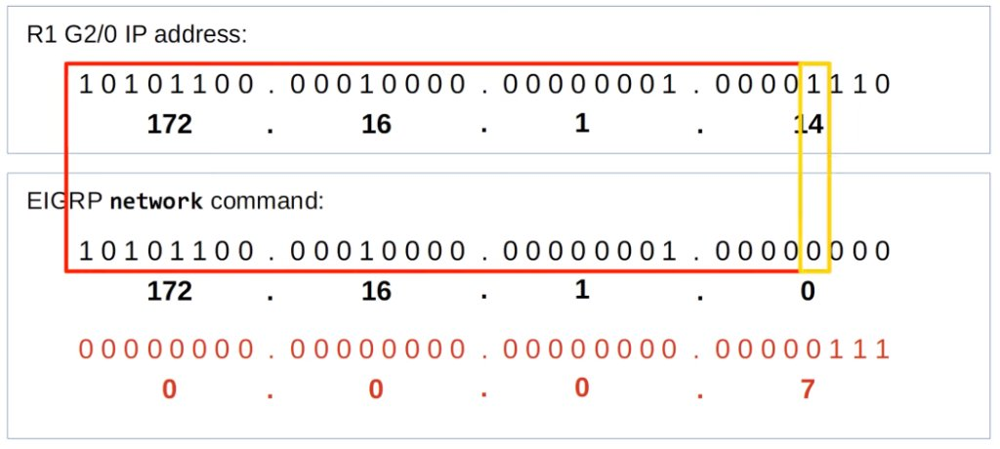

- No match! EIGRP will **not** be activated on the interface

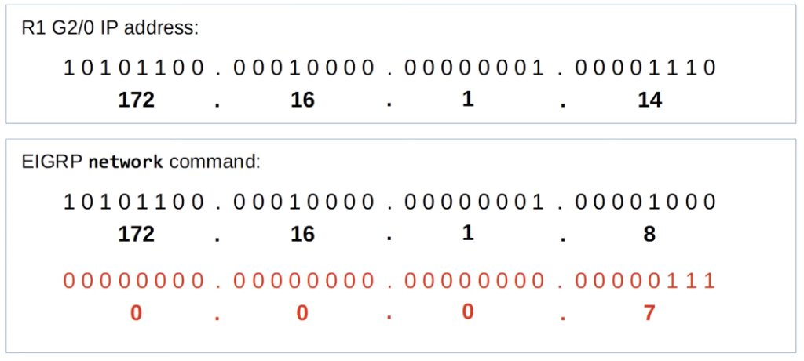

- Match! EIGRP will be activated on the interface

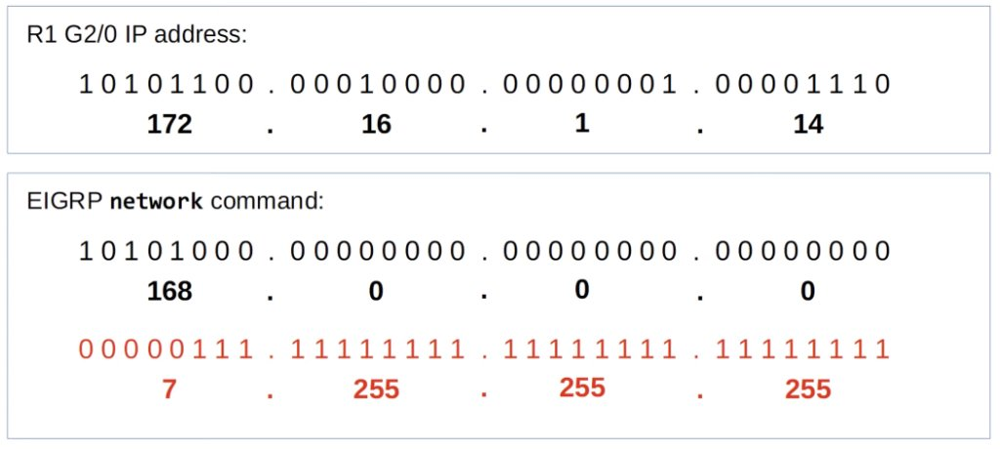

- Match! EIGRP will be activated on the interface

### `show ip route`

```
R1#show ip route
Codes: L - local, C - connected, S - static, R - RIP, M - mobile, B - BGP
       D - EIGRP, EX - EIGRP external, O - OSPF, IA - OSPF inter area
       N1 - OSPF NSSA external type 1, N2 - OSPF NSSA external type 2
       E1 - OSPF external type 1, E2 - OSPF external type 2
       i - IS-IS, su - IS-IS summary, L1 - IS-IS level-1, L2 - IS-IS level-2
       ia - IS-IS inter area, * - candidate default, U - per-user static route
       o - ODR, P - periodic downloaded static route, H - NHRP, l - LISP
       + - replicated route, % - next hop override

Gateway of last resort is not set

      10.0.0.0/8 is variably subnetted, 6 subnets, 2 masks
C        10.0.12.0/30 is directly connected, GigabitEthernet0/0
L        10.0.12.1/32 is directly connected, GigabitEthernet0/0
C        10.0.13.0/30 is directly connected, GigabitEthernet1/0
L        10.0.13.1/32 is directly connected, GigabitEthernet1/0
D        10.0.24.0/30 [90/3072] via 10.0.12.2, 00:11:09, GigabitEthernet0/0
D        10.0.34.0/30 [90/28416] via 10.0.13.2, 00:11:09, GigabitEthernet1/0
      172.16.0.0/16 is variably subnetted, 2 subnets, 2 masks
C        172.16.1.0/28 is directly connected, GigabitEthernet2/0
L        172.16.1.14/32 is directly connected, GigabitEthernet2/0
D     192.168.2.0/24 [90/3072] via 10.0.12.2, 00:11:09, GigabitEthernet0/0
      192.168.3.0/25 is subnetted, 1 subnets
D        192.168.3.0 [90/3072] via 10.0.13.2, 00:11:10, GigabitEthernet1/0
D     192.168.4.0/24 [90/3328] via 10.0.12.2, 00:11:09, GigabitEthernet0/0
```

### EIGRP Metric

- By default, EIGRP uses **bandwidth** and **delay** to calculate metric
- `([K1 * bandwidth] + (K2 * bandwidth) / (256 - load) + K3 * delay] * [K5 / (reliability + K4)]) * 256`
- The default 'K' values are K1 = 1, K2 = 0, K4 = 0, K5 = 0
- You can simplify the formula like this: metric = bandwidth + delay
- Bandwidth of the **slowest link** + the delay of **all links**

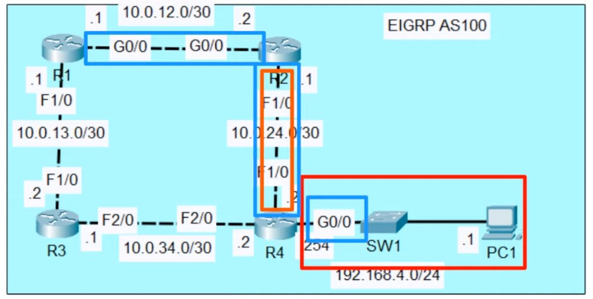

### EIGRP Terminology

- **Feasible Distance** = This router's metric value to the route's destination
- **Reported Distance** (aka Advertised Distance) = The neighbor's metric value to the route's destination

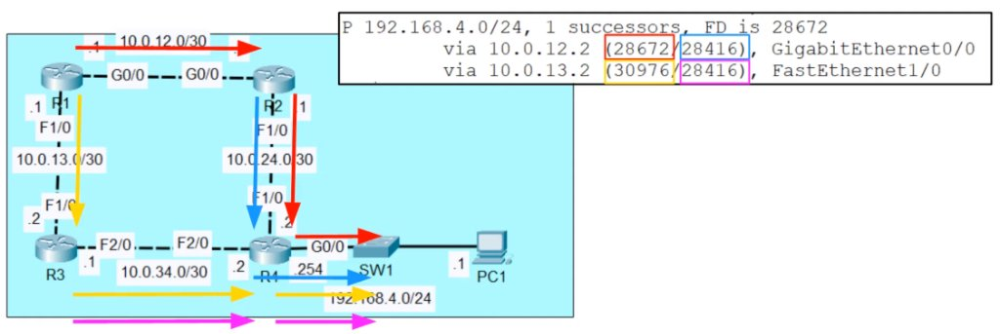

- **Successor** = the route with the lowest metric to the destination (the best route)
- **Feasible Successor** = an alternate route to the destination (not the best route) <u>which meets the _feasibility condition_</u>

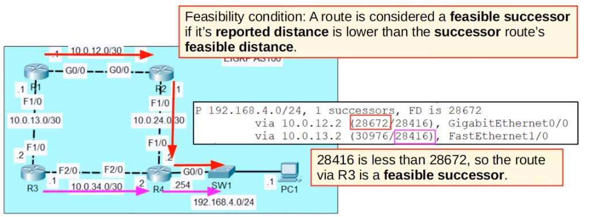

### EIGRP Unequal-Cost Load-Balancing

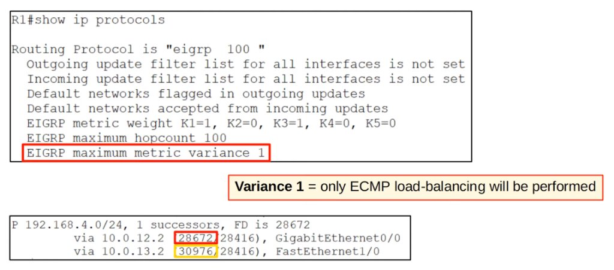
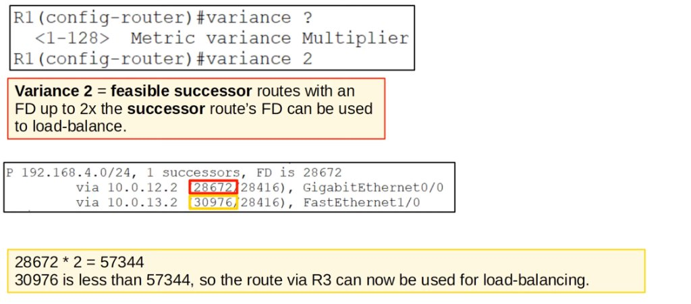

- EIGRP will only perform unequal-cost load-balancing over **feasible successor** routes; if a route doesn't meet the feasibility requirement, it will NEVER be selected for load-balancing, regardless of the **variance**

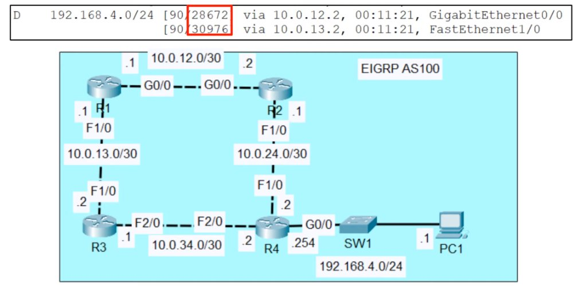

## Quiz

1. R1 and R2 both use RIP to share routes. R1 has a default route to the internet that you want to advertise to R2. Which command should you use?
   _a) `R1(config-router)# default-information originate`_

2. R1's G1/0 interface has an IP address of 172.20.20.17 and its G2/0 interface has an IP address of 172.26.20.12. Which of the following **network** commands will activate EIGRP on both interfaces?
   _a) `R1(config-router)# network 128.0.0.0 127.255.255.255`_

3. What is the correct order of priority when determining the EIGRP router ID?
   _d) Manual configuration, highest loopback interface address, highest physical interface address_

4. In which of the following situations does a router use AD values to determine route selection?
   _d) When multiple routes to the same destination network are received, and each of these routes is received from a different routing protocol_

5. Select the following EIGRP terms from the left, and connect them to the right, placing them over the corresponding definitions.
   _Advertised Distance <-> The metric that the next-hop router has calculated_
   _Feasible Successor <-> A backup path that is guaranteed to be loop-free_
   _Successor <-> The best path to a destination network_
   _Feasible Distance <-> The best metric along a path_
