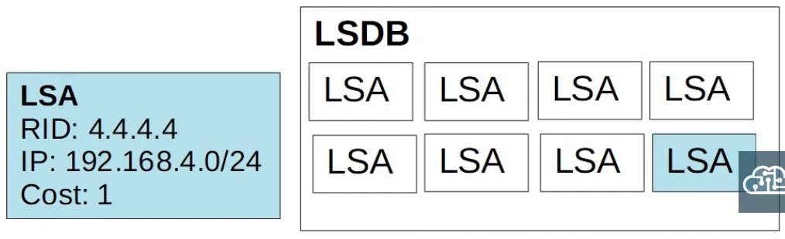
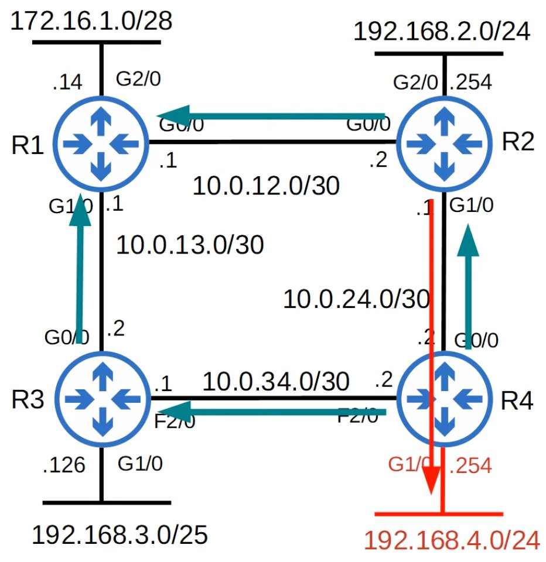
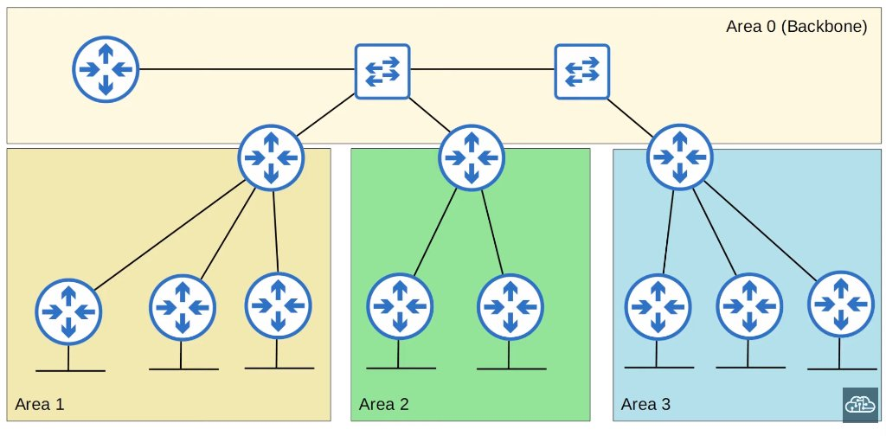
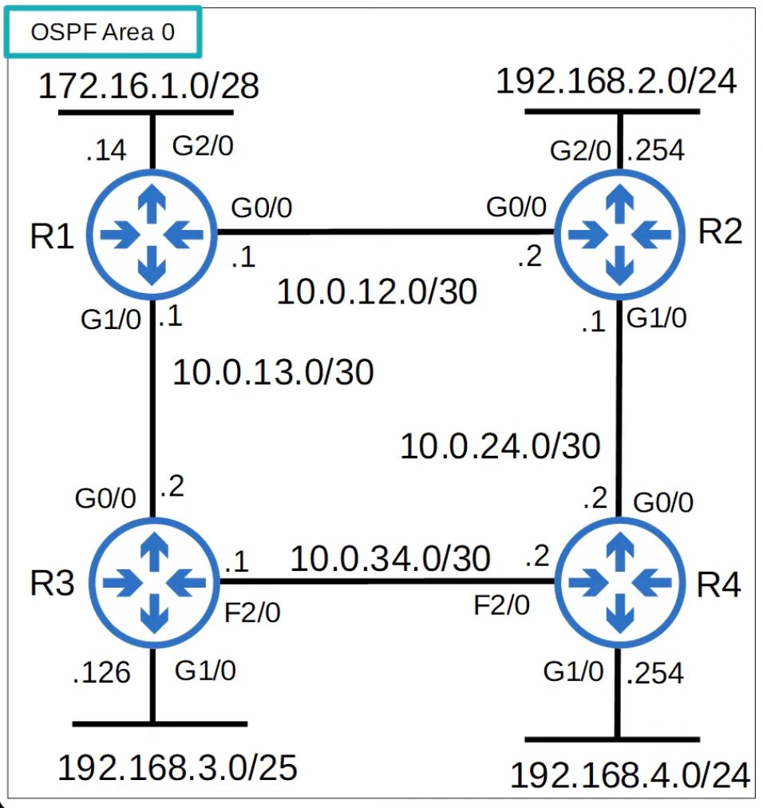
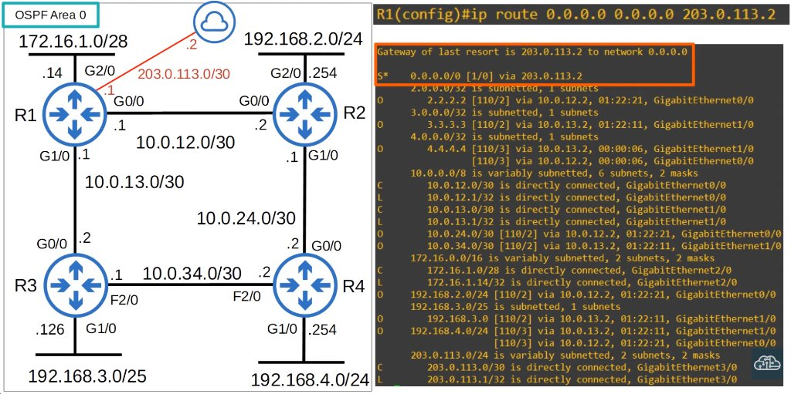
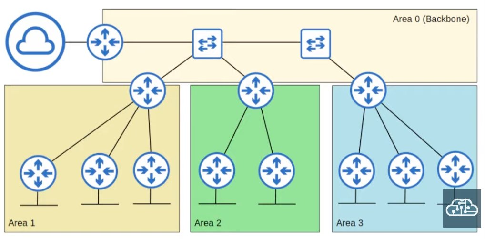

# OSPF Part 1

- Stands for **Open Shortest Path First**
- Uses the **Shortest Path First** algorithm of Dutch computer scientist Edsger Dijkstra (aka **Dijkstra's algorithm**)
- Three versions:
  - OSPFv1 (1989): OLD, not in use anymore
  - OSPFv2 (1998): Used for IPv4
  - OSPFv3 (2008): Used for IPv6 (can also be used for IPv4, but usually v2 is used)
- Routers store information about the network in LSAs (Link State Advertisments), which are organized in a structure called the LSDB (Link State Database)

## LSA Flooding

- OSPF is enabled on R4's G1/0 interface
- R4 creates an LSA to tell its neighbors about the network on G1/0
- The LSA is flooded throughout the network until all routers have received it
- This results in all routers sharing the same LSDB
- Each router then uses the SPF algorithm to calculate its best route to 192.168.4.0/24
- Each LSA has an aging timer (30 min by default); the LSA will be flooded again after the timer expires





---

- In OSPF, there are three main steps in the process of sharing LSAs and determining the best route to each destination in the network

1. **Become neighbors** with other routers connected to the same segment
2. **Exchange LSAs** with neighbor routers
3. **Calculate the best routes** to each destination, and insert them into the routing table

## OSPF Areas

- OSPF uses **areas** to divide up the network
- Small networks can be _single-area_ without any negative effects on performance
- In larger networks, a single-area design can have negative effects:
  - the SPF algorithm takes more time to calculate routes
  - the SPF algorithm requires exponentially more processing power on the routers
  - the larger LSDB takes up more memory on the routers
  - any small change in the network causes every router to flood LSAs and run the SPF algorithm again
- By dividing a large OSPF network into several smaller araes, you can avoid the above negative effects



- An **area** is a set of routers and links that share the same LSDB
- The **backbone area** (area 0) is an area that all other areas must connect to
- Routers with all interfaces in the same area are called **internal routers**
- Routers with interfaces in multiple areas are called **area border routers (ABRs)**
  - ABRs maintain a separate LSDB for each area they are connected to; it is recommended that you connect an ABR to a maximum of 2 areas; connecting an ABR to 3+ areas can overburden the router
- Routers connected to the backbone area (area 0) are called **backbone routers**
- An **intra-area route** is a route to a destination inside the same OSPF area
- An **inter-area route** is a route to a destination in a different OSPF area
- OSPF areas should be _contigous_
- All OSPF areas must have at least one ABR connected to the backbone area
- OSPF interfaces in the same subnet must be in the same area

## Basic OSPF Configuration



```cisco
R1(config)#router ospf ?
  <1-65535>  Process ID

R1(config)#router ospf 1
R1(config-router)#network 10.0.12.0 0.0.0.3
% Incomplete command.

R1(config-router)#network 10.0.12.0 0.0.0.3 area 0
R1(config-router)#network 10.0.13.0 0.0.0.3 area 0
R1(config-router)#network 172.16.1.0 0.0.0.15 area 0
R1(config-router)#
```

- The OSPF _process ID_ is **locally significant**; routers with different process IDs can become OSPF neighbors
- The OSPF **`network`** command requires you to specify the **`area`**
- The **`network`** command tells OSPF to...
  - look for any interfaces with an IP address contained in the range specified in the **`network`** command
  - activate OSPF on the interface in the specified **`area`**
  - the router will then try to become OSPF neighbors with other OSPF-activated neighbor routers

```cisco
R1(config-router)#passive-interface g2/0
```

- You already know this command from RIP and EIGRP
- The **passive-interface** command tells the router to stop sending OSPF 'hello' messages out of the interface
- However, the router will continue to send LSAs informing its neighbors about the subnet configured on the interface
- You should always use this command on interfaces which don't have any OSPF neighbors

## Advertise a default route into OSPF

- Configure a default static route to the internet/next-hop on the edge router:

```cisco
R1(config)#ip route 0.0.0.0 0.0.0.0 203.0.113.2
```



```cisco
R1(config-router)#default-information originate
```

```cisco
R2#show ip route
...
Gateway of last resort is 10.0.12.1 to network 0.0.0.0

O*E2  0.0.0.0/0 [110/1] via 10.0.12.1, 00:01:38, GigabitEthernet0/0
```

## `show ip protocols`

- Router ID order of priority:
  1. Manual configuration
  2. Highest IP address of a loopback interface
  3. Highest IP address on a physical interface

```cisco
R1#show ip protocols
*** IP Routing is NSF aware ***

Routing Protocol is "ospf 1"
  Outgoing update filter list for all interfaces is not set
  Incoming update filter list for all interfaces is not set
  Router ID 172.16.1.14
  It is an autonomous system boundary router
  Redistributing External Routes from,
  Number of areas in this router is 1. 1 normal 0 stub 0 nssa
  Maximum path: 4
  Routing for Networks:
    10.0.12.0 0.0.0.3 area 0
    10.0.13.0 0.0.0.3 area 0
    172.16.1.0 0.0.0.15 area 0
  Passive Interface(s):
    GigabitEthernet2/0
  Routing Information Sources:
    Gateway         Distance      Last Update
    4.4.4.4              110      00:00:08
    2.2.2.2              110      00:01:07
    3.3.3.3              110      00:01:07
    192.168.4.254        110      00:02:29
  Distance: (default is 110)
```

```cisco
R1(config-router)#router-id ?
  A.B.C.D  OSPF router-id in IP address format

R1(config-router)#router-id 1.1.1.1
% OSPF: Reload or use "clear ip ospf process" command, for this to take effect

R1#clear ip ospf process
Reset ALL OSPF processes? [no]: yes
R1#show ip protocols
*** IP Routing is NSF aware ***

Routing Protocol is "ospf 1"
  Outgoing update filter list for all interfaces is not set
  Incoming update filter list for all interfaces is not set
  Router ID 1.1.1.1
```

- An **autonomous system boundary router** (ASBR) is an OSPF router that connects the OSPF network to an external network
- R1 is connected to the internet; by using the **default-information originate** command, R1 becomes an ASBR

```cisco
R1(config-router)#maximum-paths ?
  <1-32>  Number of paths

R1(config-router)#maximum-paths 8
```

```cisco
R1(config-router)#distance ?
  <1-255>  Administrative distance

R1(config-router)#distance 85
```

## Quiz

1. Which of the following statements about OSPF are **not true**? (select two)
   _b) Single-area OSPF must use area 0_
   _f) The OSPF process ID must match the area number_

2. You want to activate OSPF on R1's G0/1 and G0/2 interfaces with a single command.

```
G0/1 IP: 10.0.12.1/28
G0/2 IP: 10.0.13.1/26
```

Which of the following commands should you use on R1?
_c) `R1(config-router)# network 10.0.12.0 0.0.1.255 area 0`_

3. Answer the following questions about the OSPF network below:



a) How many backbone routers are there?
_4_
b) How many ABRs are there?
_3_
c) How many ASBRs are there?
_1_

4. Which of the following commands will make R1 an OSPF ASBR?

_b)_

```cisco
R1(config)# ip route 0.0.0.0 0.0.0.0 203.0.113.2
R1(config)# router ospf 1
R1(config-router)# default-information originate
```

5. Which command can be used to manually configure the OSPF router ID?
   _a) `R1(config-router)# router-id 1.1.1.1`_

6. You administer the OSPF network below. You issue the **`default-information originate`** command on RouterA. Which of the following statements are true?


_a) OSPF will advertise RouterA's gateway of last resort_
_d) RouterA will become the OSPF ASBR_
