# OSPF Part 2

## OSPF Cost

- OSPF's metric is called **cost**
- It is automatically calculated based on the bandwidth (speed) of the interface
- It is calculated by dividing a **reference bandwidth** value by the interface's bandwidth
- The default reference badnwidth is 100 mbps
  - **Reference:** 100 mbps / **Interface:** 10 mbps = cost of <u>10</u>
  - **Reference:** 100 mbps / **Interface:** 100 mbps = cost of <u>1</u>
  - **Reference:** 100 mbps / **Interface:** 1000 mbps = cost of <u>1</u>
  - **Reference:** 100 mbps / **Interface:** 10000 mbps = cost of <u>1</u>
- All values less than 1 will be converted to 1
- Therefore FastEthernet, Gigabit Ethernet, 10Gig Ethernet, etc. are equal and all have a cost of 1 by default

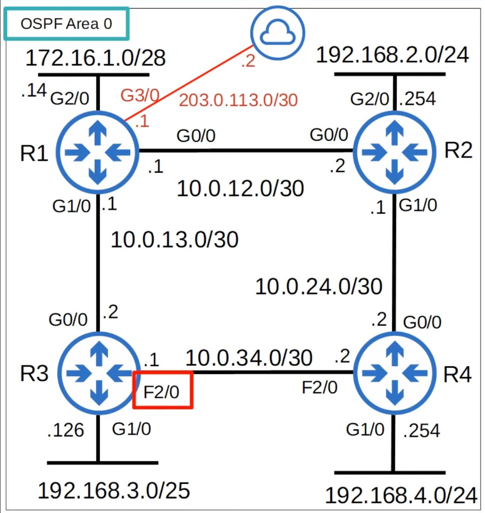

```cisco
R3#show ip ospf interface f2/0
FastEthernet2/0 is up, line protocol is up
  Internet Address 10.0.34.1/30, Area 0, Attached via Network Statement
  Process ID 1, Router ID 3.3.3.3, Network Type BROADCAST, Cost: 1
  Topology-MTID    Cost    Disabled    Shutdown      Topology Name
        0           1         no          no            Base
  Transmit Delay is 1 sec, State BDR, Priority 1
  Designated Router (ID) 4.4.4.4, Interface address 10.0.34.2
  Backup Designated router (ID) 3.3.3.3, Interface address 10.0.34.1
  Timer intervals configured, Hello 10, Dead 40, Wait 40, Retransmit 5
    oob-resync timeout 40
    Hello due in 00:00:08
  Supports Link-local Signaling (LLS)
  Cisco NSF helper support enabled
  IETF NSF helper support enabled
  Index 3/3, flood queue length 0
  Next 0x0(0)/0x0(0)
  Last flood scan length is 1, maximum is 1
  Last flood scan time is 0 msec, maximum is 0 msec
  Neighbor Count is 1, Adjacent neighbor count is 1
    Adjacent with neighbor 4.4.4.4  (Designated Router)
  Suppress hello for 0 neighbor(s)
R3#
```

- You can (and should!) change the reference bandwidth with this command:

```
R1(config-router)# auto-cost reference-bandwidth megabits-per-second
```

```cisco
R3(config-router)#auto-cost reference-bandwidth ?
  <1-4294967>  The reference bandwidth in terms of Mbits per second

R3(config-router)#auto-cost reference-bandwidth 100000
% OSPF: Reference bandwidth is changed.
        Please ensure reference bandwidth is consistent across all routers.
R3(config-router)#
```

- The command is entered in megabits per second (default is 100)
- 100000 / 100 = cost of 1000 for FastEthernet
  100000 / 100 = cost of 100 for Gig Ethernet
- You should configure a reference bandwidth greater than the fastest links in your network (to allow for future upgrades)
- You should configure the same reference bandwidth on all OSPF routers in the network

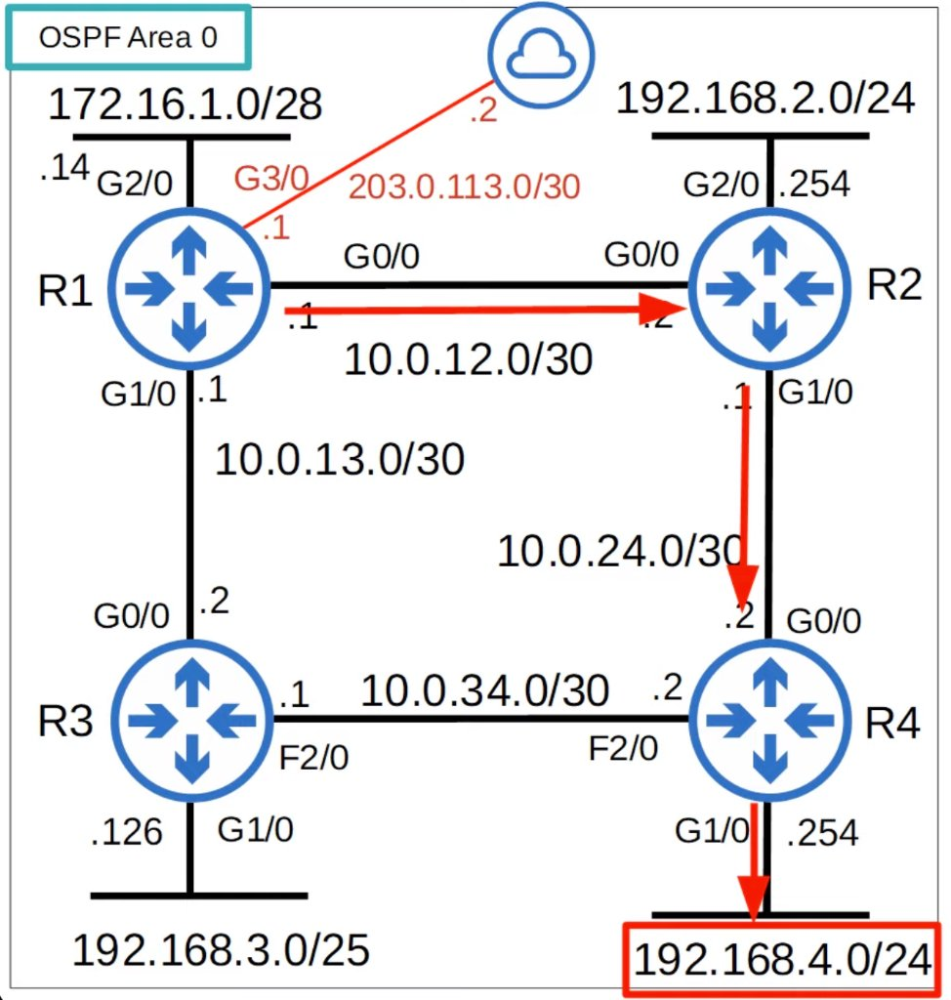

- The OSPF cost to a destination is the total cost of the 'outgoing/exit interfaces'
- For example, R1's cost to reach <u>192.168.4.0/24</u> is:
  100 (R1 G0/0) + 100 (R2 G1/0) + 100 (R4 G1/0) = 300
- Loopback interfaces have a cost of 1

```cisco
R1(config)#interface g0/0
R1(config-if)#ip ospf cost ?
  <1-65535>  Cost

R1(config-if)#ip ospf cost 10000
R1(config-if)#do show ip ospf interface g0/0
GigabitEthernet0/0 is up, line protocol is up
  Internet Address 10.0.12.1/30, Area 0, Attached via Network Statement
  Process ID 1, Router ID 1.1.1.1, Network Type BROADCAST, Cost: 10000
  Topology-MTID    Cost    Disabled    Shutdown      Topology Name
        0         10000       no          no            Base
  Transmit Delay is 1 sec, State BDR, Priority 1
  Designated Router (ID) 2.2.2.2, Interface address 10.0.12.2
  Backup Designated router (ID) 1.1.1.1, Interface address 10.0.12.1
  Timer intervals configured, Hello 10, Dead 40, Wait 40, Retransmit 5
    oob-resync timeout 40
    Hello due in 00:00:01
  Supports Link-local Signaling (LLS)
  Cisco NSF helper support enabled
  IETF NSF helper support enabled
  Index 1/1, flood queue length 0
  Next 0x0(0)/0x0(0)
  Last flood scan length is 1, maximum is 1
  Last flood scan time is 0 msec, maximum is 4 msec
  Neighbor Count is 1, Adjacent neighbor count is 1
    Adjacent with neighbor 2.2.2.2  (Designated Router)
  Suppress hello for 0 neighbor(s)
```

- One more option to change the OSPF cost of an interface is to change the bandwidth of the interface with the **`bandwidth`** command
- The formula to calculate OSPF cost is **reference bandwidth / interface bandwidth**
- Although the bandwidth matches the interface speed by default, changing the interface bandwidth <u>doesn't actually change the speed at which the interface operates</u>
- The bandwidth is just a value that is used to calculate OSPF cost, EIGRP metric, etc.
- To change the speed at which the interface operates, use the **`speed`** command
- Because the bandwidth value is used in other calculations, it is not recommended to change this value to alter the interface's OSPF cost
- It is recommended that you change the reference bandwidth, and then the **ip ospf cost** command to change the cost of individual interfaces if you want

```cisco
R1(config-if)#bandwidth ?
  <1-10000000>  Bandwidth in kilobits
  inherit       Specify how bandwidth is inherited
  qos-reference Reference bandwidth for QOS test
  receive       Specify receive-side bandwidth
```

```cisco
R3#show ip ospf interface brief
Interface    PID   Area            IP Address/Mask    Cost  State Nbrs F/C
Lo0          1     0               3.3.3.3/32         1     LOOP  0/0
Gi1/0        1     0               192.168.3.126/25   100   DR    0/0
Fa2/0        1     0               10.0.34.1/30       1000  BDR   1/1
Gi0/0        1     0               10.0.13.2/30       100   DR    1/1
```

## OSPF Neighbors

- Making sure that routers successfully become OSPF neighbors is the main task in configuring and troubleshooting OSPF
- Once routers become neighbors, they automatically do the work of sharing network information, calculating routes, etc.
- When OSPF is activated on an interface, the router starts sending OSPF **hello** messages out of the interface at regular intervals (determined by the **hello timer**); these are used to introduce the router to potential OSPF neighbors
- The default hello timer is 10 seconds on an Ethernet connection
- Hello messages are multicast to 224.0.0.5 (multicast address for all OSPF routers)
- OSPF messages are encapsulated in an IP header, with a value of 89 in the Protocol field

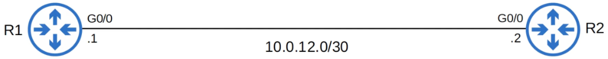

### Down State

- OSPF is activated on R1's G0/0 interface
- It sends an OSPF hello message to 224.0.0.5
- It doesn't know about any OSPF neighbors yet, so the current neighbor state is **Down**.

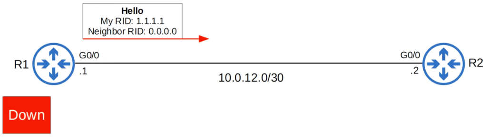

### Init State

- When R2 receives the Hello packet, it will add an entry for R1 to its OSPF neighbor table
- In R2's neighbor table, the relationship with R1 is now in the **Init** state
- **Init** state = Hello packet received, but own router ID is not in the hello packet

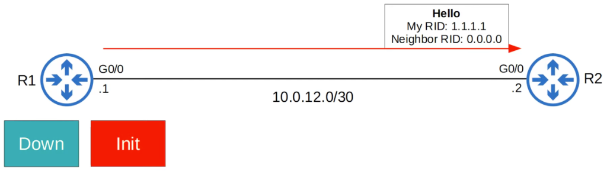

### 2-way State

- R2 will send a Hello packet containing the RID of both routers
- R1 will insert R2 into its OSPF neighbor table in the **2-way** state
- R1 will send another Hello message, this time containing R2's RID
- Now both routers are in the **2-way** state
- The 2-way state means the router has received a Hello packet with its own RID in it
- If both routers reach the 2-way state, it means that all of the conditions have been met for them to become OSPF neighbors; they are now ready to share LSAs to build a common LSDB
- In some network types, a DR (Designated Router) and BDR (Backup Designated Router) will be elected at this point

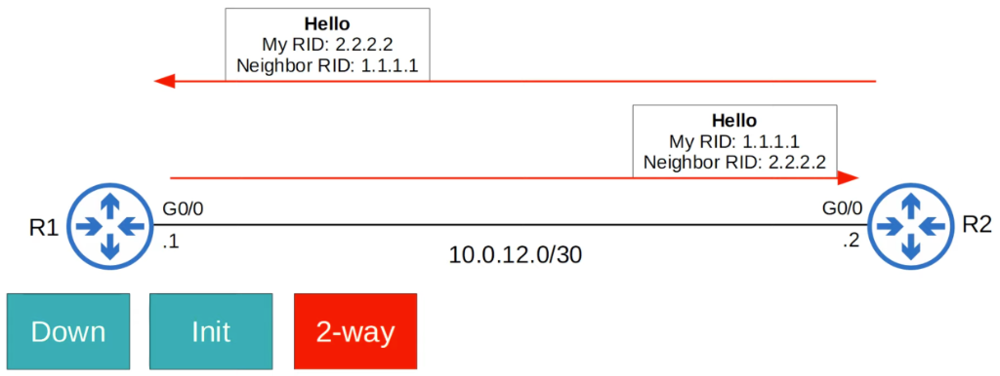

### Exstart State

- The two routers will now prepare to exchange information about their LSDB
- Before that, they have to choose which one will start the exchange
- They do this in the **Exstart** state
- The router with the higher RID will become the **Master** and initiate the exchange; the router with the lower RID will become the **Slave**
- To decide the Master and Slave, they exchange DBD (Database Description) packets

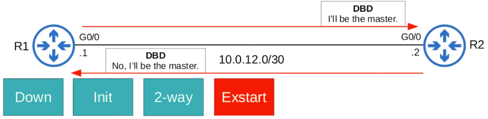

### Exchange State

- In the **Exchange** state, the routers exchange DBDs which contain a list of the LSAs in their LSDB
- These DBDs do not include detailed information about the LSAs, just basic information
- The routers compare the information in the DBD they received to the information in their own LSDB to determine which LSAs they must receive from their neighbor

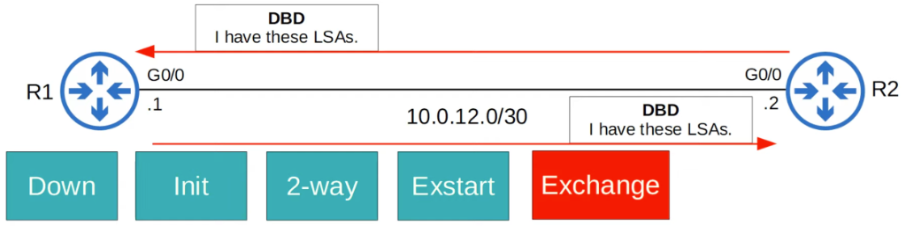

### Loading State

- In the **Loading** state, routers send Link State Request (LSR) messages to request that their neighbors send them any LSAs they don't have
- LSAs are sent in Link State Update (LSU) messages
- The routers send LSAck messages to acknowledge that they received the LSAs

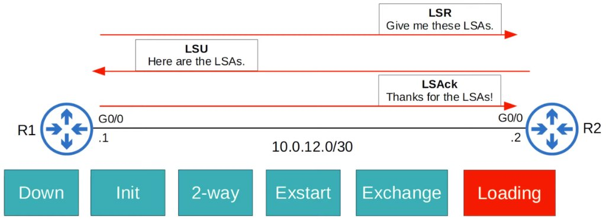

### Full State

- In the **Full** state, the routers have a full OSPF adjacency and identical LSDBs
- They continue to send and listen for Hello packets (every 10 seconds by default) to maintain the neighbor adjacency
- Every time a Hello packet is received, the 'Dead' timer (40 seconds by default) is reset
- If the Dead timer counts down to 0 and no Hello message is received, the neighbor is removed
- The routers will continue to share LSAs as the network changes to make sure each router has a complete and accurate map of the network (LSDB)

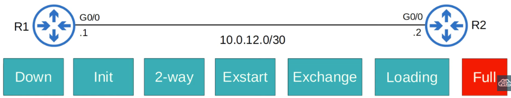

---

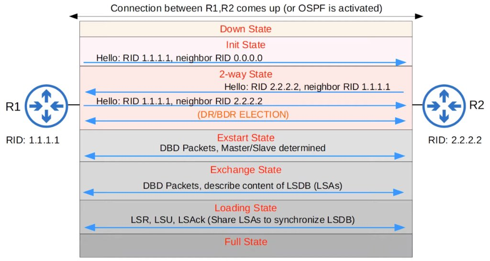

| Type | Name                                   | Purpose                                                                                  |
| :--- | :------------------------------------- | :--------------------------------------------------------------------------------------- |
| 1    | **Hello**                              | Neighbor discovery and maintenance.                                                      |
| 2    | **Database Description (DBD)**         | Summary of the LSDB of the router. Used to check if the LSDB of each router is the same. |
| 3    | **Link-State Request (LSR)**           | Requests specific LSAs from the neighbor.                                                |
| 4    | **Link-State Update (LSU)**            | Sends specific LSAs to the neighbor.                                                     |
| 5    | **Link-State Acknowledgement (LSAck)** | Used to acknowledge that the router received a message.                                  |

---

```cisco
R1#show ip ospf neighbor

Neighbor ID     Pri   State           Dead Time   Address         Interface
3.3.3.3           1   FULL/DR         00:00:39    10.0.13.2       GigabitEthernet1/0
2.2.2.2           1   FULL/DR         00:00:31    10.0.12.2       GigabitEthernet0/0
```

```cisco
R1#show ip ospf interface g0/0
GigabitEthernet0/0 is up, line protocol is up
  Internet Address 10.0.12.1/30, Area 0, Attached via Network Statement
  Process ID 1, Router ID 1.1.1.1, Network Type BROADCAST, Cost: 1
  Topology-MTID    Cost    Disabled    Shutdown      Topology Name
        0           1         no          no            Base
  Transmit Delay is 1 sec, State BDR, Priority 1
  Designated Router (ID) 2.2.2.2, Interface address 10.0.12.2
  Backup Designated router (ID) 1.1.1.1, Interface address 10.0.12.1
  Timer intervals configured, Hello 10, Dead 40, Wait 40, Retransmit 5
    oob-resync timeout 40
    Hello due in 00:00:07
  Supports Link-local Signaling (LLS)
  Cisco NSF helper support enabled
  IETF NSF helper support enabled
  Index 1/1, flood queue length 0
  Next 0x0(0)/0x0(0)
  Last flood scan length is 1, maximum is 1
  Last flood scan time is 0 msec, maximum is 4 msec
  Neighbor Count is 1, Adjacent neighbor count is 1
    Adjacent with neighbor 2.2.2.2  (Designated Router)
  Suppress hello for 0 neighbor(s)
```

## OSPF Configuration

```cisco
R1(config)#int g0/0
R1(config-if)#ip ospf 1 area 0
R1(config-if)#int g1/0
R1(config-if)#ip ospf 1 area 0
R1(config-if)#int g2/0
R1(config-if)#ip ospf 1 area 0
R1(config-if)#int l0
R1(config-if)#ip ospf 1 area 0
```

- You can activate OSPF directly on an interface with this command:

```
R1(config-if)#ip ospf process-id area area
```

```cisco
R1(config-if)#router ospf 1
R1(config-router)#passive-interface default
R1(config-router)#no passive-interface g0/0
R1(config-router)#no passive-interface g1/0
```

- Configure ALL interfaces as OSPF passive interfaces:

```
R1(config-router)#passive-interface default
```

- Then configure specific interfaces as active:

```
R1(config-router)#no passive-interface int-id
```

## Quiz

1. Put the OSPF neighbor states in the correct order:
   _1) Down_
   _2) Init_
   _3) 2-way_
   _4) Exstart_
   _5) Exchange_
   _6) Loading_
   _7) Full_

2. Which statement about OSPF's default cost is correct?
   _c) FastEthernet, Gigabit Ethernet, and 10Gig Ethernet interfaces have the same cost_

3. In which OSPF neighbor state are the Master and Slave roles decided?
   _a) Exstart_

4. Which of these commands can be used to make a FastEthernet interface have an OSPF cost of 100?
   _c) `R1(config-router)# auto-cost reference bandwidth 10000_

5. What are the default OSPF Hello / Dead timers on an Ethernet connection?
   _b) Hello 10, Dead: 40_

6. You administer the OSPF network shown in the diagram above. The **`auto-cost reference-bandwidth 1000`** command has been issued on every router in the network. What is the cost of the route from RouterA to RouterC?

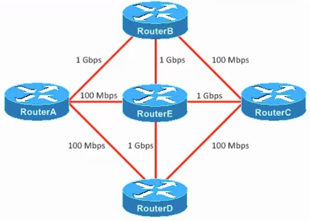

_b) 3_
