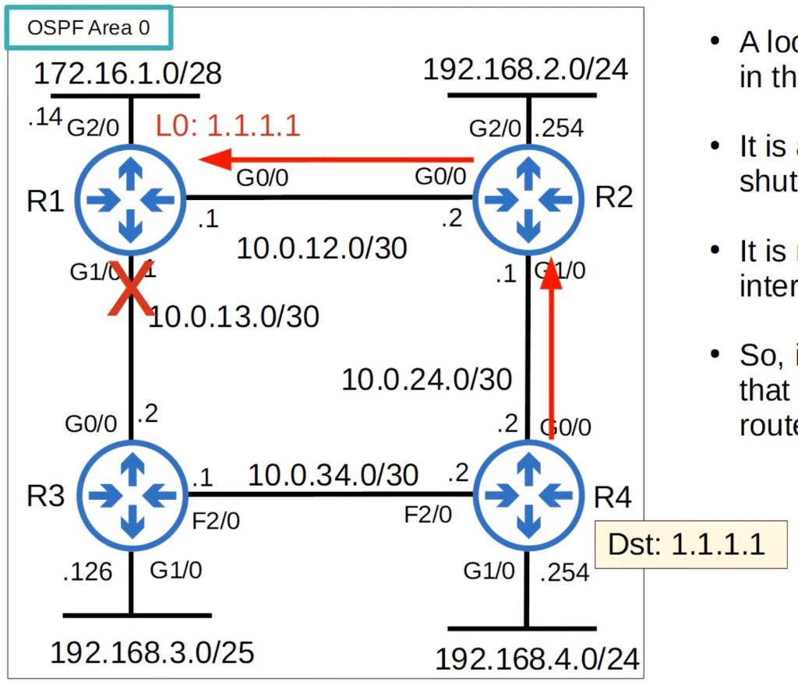
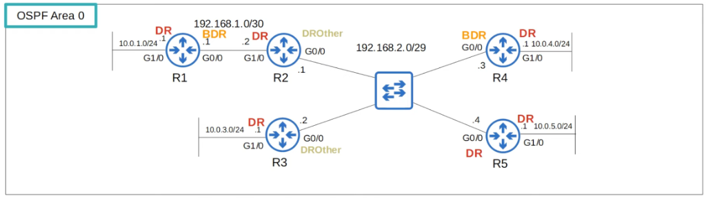
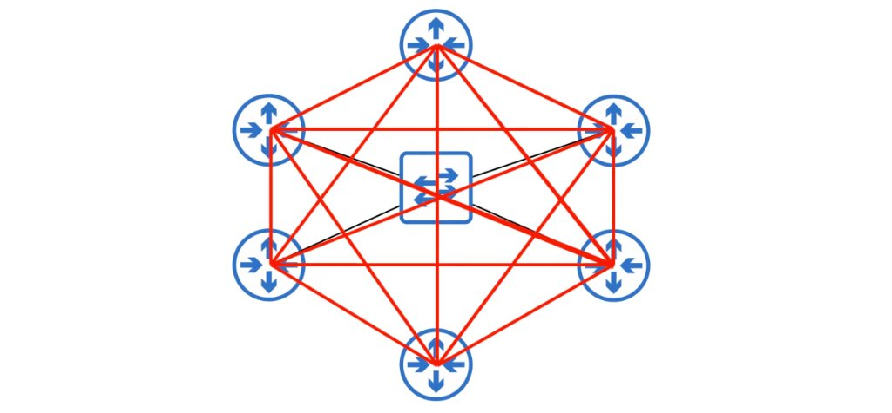
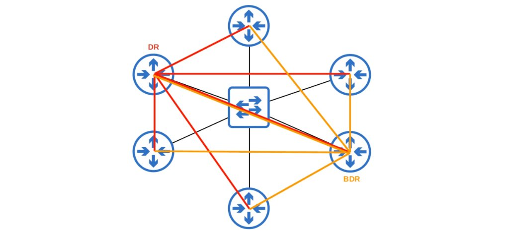
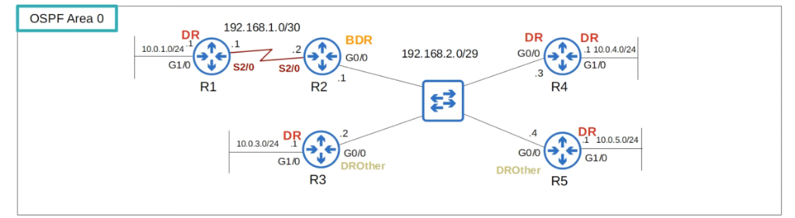
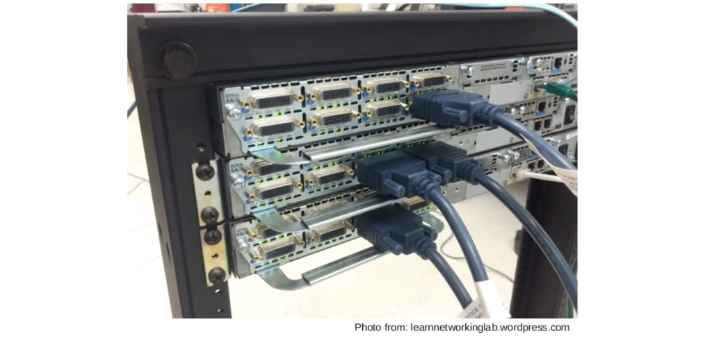
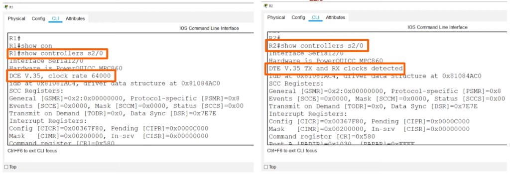
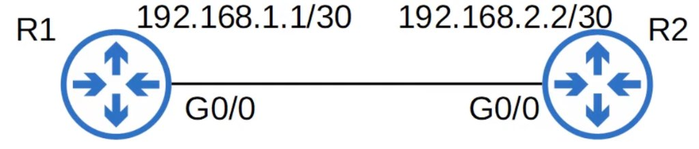
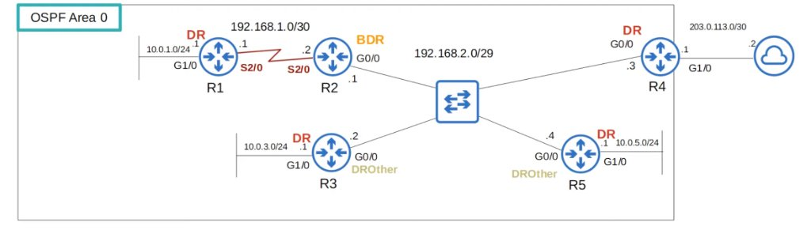

# OSPF Part 3

## Loopback Interfaces

- A loopback interface is a virtual interface in the router
- It is always up/up (unless you manually shut it down)
- It is not dependent on a physical interface
- So, it provides a consistent IP address that can be used to reach/identify the router



## OSPF Network Types

- The OSPF 'network type' refers to the type of connection between OSPF neighbors (Ethernet, etc)
- There are three main OSPF network types:
  - <u>Broadcast</u>
    - Enabled by default on **Ethernet** and **FDDI** (Fiber Distributed Data Interfaces) interfaces
  - <u> Point-to-point</u>
    - Enabled by default on **PPP** (Point-to-point protocol) and **HDLC** (High-Level data link control) interfaces
  - <u>Non-broadcast</u>
    - Enabled by default on **Frame Relay** and **X.25** interfaces

### OSPF Broadcast Network Type

- Enabled on **Ethernet** and **FDDI** interfaces by default
- Routers _dynamically discover_ neighbors by sending/listening for OSPF Hello messages using multicast address 224.0.0.5
- A **DR** (designated router) and **BDR** (backup designated router) must be elected on each subnet (only DR if there are no OSPF neighbors, ie. R1's G1/0 interface)
- Routers which aren't the DR or BDR become a **DROther**
- The DR/BDR election order of priority:
  1. Highest **OSPF interface priority**
  2. Highest OSPF Router ID
- 'First place' becomes the DR for the subnet, 'second place' becomes the BDR
- The default OSPF interface priority is 1 on all interfaces



```cisco
R5#show ip ospf interface g0/0
GigabitEthernet0/0 is up, line protocol is up
  Internet Address 192.168.2.4/29, Area 0, Attached via Network Statement
  Process ID 1, Router ID 5.5.5.5, Network Type BROADCAST, Cost: 1
  Topology-MTID    Cost    Disabled    Shutdown      Topology Name
        0           1         no          no            Base
  Transmit Delay is 1 sec, State DR, Priority 1
  Designated Router (ID) 5.5.5.5, Interface address 192.168.2.4
  Backup Designated router (ID) 4.4.4.4, Interface address 192.168.2.3
```

```cisco
R2#show ip ospf int g0/0
GigabitEthernet0/0 is up, line protocol is up
  Internet Address 192.168.2.1/29, Area 0, Attached via Network Statement
  Process ID 1, Router ID 2.2.2.2, Network Type BROADCAST, Cost: 1
  Topology-MTID    Cost    Disabled    Shutdown      Topology Name
        0           1         no          no            Base
  Transmit Delay is 1 sec, State DROTHER, Priority 1
  Designated Router (ID) 5.5.5.5, Interface address 192.168.2.4
  Backup Designated router (ID) 4.4.4.4, Interface address 192.168.2.3
```

```cisco
R5#show ip ospf interface g0/0
GigabitEthernet0/0 is up, line protocol is up
  Internet Address 192.168.2.4/29, Area 0, Attached via Network Statement
  Process ID 1, Router ID 5.5.5.5, Network Type BROADCAST, Cost: 1
  Topology-MTID    Cost    Disabled    Shutdown      Topology Name
        0           1         no          no            Base
  Transmit Delay is 1 sec, State DR, Priority 1
  Designated Router (ID) 5.5.5.5, Interface address 192.168.2.4
  Backup Designated router (ID) 4.4.4.4, Interface address 192.168.2.3
```

```cisco
R2#show ip ospf int g0/0
GigabitEthernet0/0 is up, line protocol is up
  Internet Address 192.168.2.1/29, Area 0, Attached via Network Statement
  Process ID 1, Router ID 2.2.2.2, Network Type BROADCAST, Cost: 1
  Topology-MTID    Cost    Disabled    Shutdown      Topology Name
        0           1         no          no            Base
  Transmit Delay is 1 sec, State DROTHER, Priority 1
  Designated Router (ID) 5.5.5.5, Interface address 192.168.2.4
  Backup Designated router (ID) 4.4.4.4, Interface address 192.168.2.3
```

```cisco
R2(config)#int g0/0
R2(config-if)#ip ospf priority ?
  <0-255>  Priority

R2(config-if)#ip ospf priority 255
```

- If you set the OSPF interface priority to 0, the router CANNOT be the DR/BDR for the subnet

```cisco
R2#show ip ospf int g0/0
GigabitEthernet0/0 is up, line protocol is up
  Internet Address 192.168.2.1/29, Area 0, Attached via Network Statement
  Process ID 1, Router ID 2.2.2.2, Network Type BROADCAST, Cost: 1
  Topology-MTID    Cost    Disabled    Shutdown      Topology Name
        0           1         no          no            Base
  Transmit Delay is 1 sec, State DROTHER, Priority 255
  Designated Router (ID) 5.5.5.5, Interface address 192.168.2.4
  Backup Designated router (ID) 4.4.4.4, Interface address 192.168.2.3
```

- The DR/BDR election is 'non-preemptive'; once the DR/BDR are selected they will keep their role until OSPF is reset, the interface fails/is shut down, etc.

```cisco
R5#clear ip ospf process
Reset ALL OSPF processes? [no]: yes
R5#
*Aug 22 04:25:05.307: %OSPF-5-ADJCHG: Process 1, Nbr 2.2.2.2 on GigabitEthernet0/0 from FULL to DOWN, Neighbor Down: Interface down or detached
*Aug 22 04:25:05.311: %OSPF-5-ADJCHG: Process 1, Nbr 3.3.3.3 on GigabitEthernet0/0 from FULL to DOWN, Neighbor Down: Interface down or detached
*Aug 22 04:25:05.311: %OSPF-5-ADJCHG: Process 1, Nbr 4.4.4.4 on GigabitEthernet0/0 from FULL to DOWN, Neighbor Down: Interface down or detached
R5#
*Aug 22 04:25:13.903: %OSPF-5-ADJCHG: Process 1, Nbr 2.2.2.2 on GigabitEthernet0/0 from LOADING to FULL, Loading Done
*Aug 22 04:25:13.907: %OSPF-5-ADJCHG: Process 1, Nbr 4.4.4.4 on GigabitEthernet0/0 from LOADING to FULL, Loading Done
R5#show ip ospf neighbor

Neighbor ID     Pri   State           Dead Time   Address         Interface
2.2.2.2         255   FULL/BDR        00:00:37    192.168.2.1     GigabitEthernet0/0
3.3.3.3           1   2WAY/DROTHER    00:00:37    192.168.2.2     GigabitEthernet0/0
4.4.4.4           1   FULL/DR         00:00:39    192.168.2.3     GigabitEthernet0/0
```

- **R4 became the DR, not R2; R2 became the BDR**
  - When the DR goes down, the BDR becomes the new DR; then an election is held for the next BDR
- **R3 is a DROther, and is stable in the 2-way state**
  - DROthers (R3 and R5 in this subnet) will only move to the FULL state with the DR and BDR; the neighbor state with other DROthers will be 2-way
- In the broadcast network type, routers will only form a full OSPF adjacency with the DR and BDR of the segment
- Therefore, routers only exchange LSAs, with the DR and BDR; DROthers will not exchange LSAs with each other
- All routers will still have the same LSDB, but this reduces the amount of LSAs flooding the network



- Messages to the DR/BDR are multicast using address 224.0.0.6
  

```cisco
R3#show ip ospf interface brief
Interface    PID   Area            IP Address/Mask    Cost  State Nbrs F/C
Gi0/0        1     0               192.168.2.2/29     1     DROTH 2/3
Gi1/0        1     0               10.0.3.1/24        1     DR    0/0
```

```cisco
R3#show ip ospf interface g0/0
GigabitEthernet0/0 is up, line protocol is up
  Internet Address 192.168.2.2/29, Area 0, Attached via Network Statement
  Process ID 1, Router ID 3.3.3.3, Network Type BROADCAST, Cost: 1
  Topology-MTID    Cost    Disabled    Shutdown      Topology Name
        0           1         no          no            Base
  Transmit Delay is 1 sec, State DROTHER, Priority 1
  Designated Router (ID) 4.4.4.4, Interface address 192.168.2.3
  Backup Designated router (ID) 2.2.2.2, Interface address 192.168.2.1
  Timer intervals configured, Hello 10, Dead 40, Wait 40, Retransmit 5
    oob-resync timeout 40
    Hello due in 00:00:09
  Supports Link-local Signaling (LLS)
  Cisco NSF helper support enabled
  IETF NSF helper support enabled
  Index 2/2, flood queue length 0
  Next 0x0(0)/0x0(0)
  Last flood scan length is 0, maximum is 1
  Last flood scan time is 0 msec, maximum is 4 msec
  Neighbor Count is 3, Adjacent neighbor count is 2
    Adjacent with neighbor 2.2.2.2  (Backup Designated Router)
    Adjacent with neighbor 4.4.4.4  (Designated Router)
  Suppress hello for 0 neighbor(s)
```

### OSPF Point-to-Point Network Type



- Enabled on **serial** interfaces using the **PPP** or **HDLC** encapsulations by default
- Routers _dynamically discover_ neighbors by sending/listening for OSPF Hello messages using multicast address 224.0.0.5
- A DR and BDR are **not** elected
- These encapsulations are used for 'point-to-point' connections
- Therefore there is no point in electing a DR and BDR
- The two routers will form a Full adjacency with each other

```cisco
R2#show ip ospf neighbor

Neighbor ID     Pri   State           Dead Time   Address         Interface
1.1.1.1           0   FULL/  -        00:00:31    192.168.1.1     Serial2/0
3.3.3.3           1   2WAY/DROTHER    00:00:39    192.168.2.2     GigabitEthernet0/0
4.4.4.4           1   FULL/DR         00:00:38    192.168.2.3     GigabitEthernet0/0
5.5.5.5           1   FULL/BDR        00:00:31    192.168.2.4     GigabitEthernet0/0
```

#### Serial Interfaces




```cisco
R1(config)#interface s2/0
R1(config-if)#clock rate ?
  With the exception of the following standard values not subject to rounding,

        1200 2400 4800 9600 14400 19200 28800 38400
        56000 64000 128000 2015232

  accepted clockrates will be bestfitted (rounded) to the nearest value
  supportable by the hardware.

  <246-8064000>  DCE clock rate (bits per second)

R1(config-if)#clock rate 64000
R1(config-if)#ip address 192.168.1.1 255.255.255.0
R1(config-if)#no shut
```

- One side of a serial connection functions as DCE (Data Communications Equipment)
- The other side functions as DTE (Data Terminal Equipment)
- The DCE side needs to specify the _clock rate_ (speed) of the connection
- Ethernet interfaces use the **speed** command to configure the interface's operating speed; serial interfaces use the **clock rate** command

```cisco
R1#show interface s2/0
Serial2/0 is up, line protocol is up
  Hardware is M4T
  Internet address is 192.168.1.1/24
  MTU 1500 bytes, BW 1544 Kbit/sec, DLY 20000 usec,
     reliability 255/255, txload 1/255, rxload 1/255
  Encapsulation HDLC, crc 16, loopback not set
```

```cisco
R1(config)#int s2/0
R1(config-if)#encapsulation ppp
R1(config-if)#do show interface s2/0
Serial2/0 is up, line protocol is up
  Hardware is M4T
  Internet address is 192.168.1.1/24
  MTU 1500 bytes, BW 1544 Kbit/sec, DLY 20000 usec,
     reliability 255/255, txload 1/255, rxload 1/255
  Encapsulation PPP, LCP Open
```

- The default encapsulation on a serial interface is HDLC (actually cHDLC - Cisco HDLC)
- If you change the encapsulation, it must match on both ends or the interface will go down

```cisco
R1#show running-config interface s2/0
Building configuration...

Current configuration : 126 bytes
!
interface Serial2/0
 ip address 192.168.1.1 255.255.255.0
 encapsulation ppp
 serial restart-delay 0
 clock rate 64000
end
```



### Configure the OSPF Network Type

- You can configure the OSPF network type on an interface with **`ip ospf network type`**
- For example, if two routers are directly connected with an Ethernet link, there is no need for a DR/BDR; you can configure the point-to-point network type in this case
- NOTE: Not all network types work on all link types (for example, a serial link cannot use the broadcast network type)


```cisco
R1(config-if)#ip ospf network ?
  broadcast            Specify OSPF broadcast multi-access network
  non-broadcast        Specify OSPF NBMA network
  point-to-multipoint  Specify OSPF point-to-multipoint network
  point-to-point       Specify OSPF point-to-point network
```

| Broadcast                                    | Point-to-point                                   |
| :------------------------------------------- | :----------------------------------------------- |
| Default on **Ethernet**, **FDDI** interfaces | Default on **HDLC**, **PPP** (serial) interfaces |
| DR/BDR elected                               | No DR/BDR                                        |
| Neighbors dynamically discovered             | Neighbors dynamically discovered                 |
| Default timers: Hello 10, Dead 40            | Default timers: Hello 10, Dead 40                |

(**Non-broadcast** network type default timers = Hello 30, Dead 120)

## OSPF Neighbor Requirements


1. Area number must match

```cisco
R1#show running-config | section ospf
router ospf 1
 network 192.168.1.0 0.0.0.3 area 0

R1#show ip ospf neighbor
R1#
```

```cisco
R2#show running-config | section ospf
router ospf 1
 network 192.168.1.0 0.0.0.3 area 1

R2#show ip ospf neighbor
R2#
```

```cisco
R1#show running-config | section ospf
router ospf 1
 network 192.168.1.0 0.0.0.3 area 0

R2#show running-config | section ospf
router ospf 1
 network 192.168.1.0 0.0.0.3 area 0

R1#show ip ospf neighbor

Neighbor ID     Pri   State           Dead Time   Address         Interface
192.168.1.2       1   FULL/BDR        00:00:34    192.168.1.2     GigabitEthernet0/0
R1#

R2#show ip ospf neighbor

Neighbor ID     Pri   State           Dead Time   Address         Interface
192.168.1.1       1   FULL/DR         00:00:39    192.168.1.1     GigabitEthernet0/0
R2#
```

2. Interfaces must be in the same subnet



```cisco
R1#show running-config | section ospf
router ospf 1
 network 192.168.1.0 0.0.0.3 area 0
R1#

R1#show ip ospf neighbor
R1#
```

```cisco
R2#show running-config | section ospf
router ospf 1
 network 192.168.2.0 0.0.0.3 area 0
R2#

R2#show ip ospf neighbor
R2#
```

```cisco
R1#show running-config | section ospf
router ospf 1
 network 192.168.1.0 0.0.0.3 area 0
R1#

R2#show running-config | section ospf
router ospf 1
 network 192.168.1.0 0.0.0.3 area 0
R2#

R1#show ip ospf neighbor

Neighbor ID     Pri   State           Dead Time   Address         Interface
192.168.1.2       1   FULL/BDR        00:00:34    192.168.1.2     GigabitEthernet0/0
R1#

R2#show ip ospf neighbor

Neighbor ID     Pri   State           Dead Time   Address         Interface
192.168.1.1       1   FULL/DR         00:00:39    192.168.1.1     GigabitEthernet0/0
R2#
```


```cisco
R1#show running-config | section ospf
router ospf 1
 network 192.168.1.0 0.0.0.3 area 0
R1#

R1#show ip ospf neighbor
R1#
```

```cisco
R2#show running-config | section ospf
router ospf 1
 network 192.168.2.0 0.0.0.3 area 0
R2#

R2#show ip ospf neighbor
R2#
```

```cisco
R1#show running-config | section ospf
router ospf 1
 network 192.168.1.0 0.0.0.3 area 0
R1#

R2#show running-config | section ospf
router ospf 1
 network 192.168.1.0 0.0.0.3 area 0
R2#

R1#show ip ospf neighbor

Neighbor ID     Pri   State           Dead Time   Address         Interface
192.168.1.2       1   FULL/BDR        00:00:34    192.168.1.2     GigabitEthernet0/0
R1#

R2#show ip ospf neighbor

Neighbor ID     Pri   State           Dead Time   Address         Interface
192.168.1.1       1   FULL/DR         00:00:39    192.168.1.1     GigabitEthernet0/0
R2#
```

3. The OSPF process must not be **`shutdown`**


```cisco
R2(config)#router ospf 1
R2(config-router)#shutdown
R2(config-router)#
*Aug 23 03:43:31.719: %OSPF-5-ADJCHG: Process 1, Nbr 192.168.1.1 on GigabitEthernet0/0 from FULL to DOWN, Neighbor Down: Interface down or detached
R2(config-router)#do show ip ospf neighbor
R2(config-router)#
```

```cisco
R2(config-router)#no shutdown
R2(config-router)#
*Aug 23 03:49:52.931: %OSPF-5-ADJCHG: Process 1, Nbr 192.168.1.1 on GigabitEthernet0/0 from LOADING to FULL, Loading Done
R2(config-router)#do show ip ospf neighbor

Neighbor ID     Pri   State           Dead Time   Address         Interface
192.168.1.1       1   FULL/DR         00:00:38    192.168.1.1     GigabitEthernet0/0
R2(config-router)#
```

4. The OSPF Router IDs must be unique

```cisco
R2(config-router)#router-id 192.168.1.1
% OSPF: Reload or use "clear ip ospf process" command, for this to take effect
R2(config-router)#end
R2#clear ip
*Aug 23 03:57:58.835: %SYS-5-CONFIG_I: Configured from console by console
R2#clear ip ospf process
Reset ALL OSPF processes? [no]: yes
R2#
*Aug 23 03:58:04.055: %OSPF-5-ADJCHG: Process 1, Nbr 192.168.1.1 on GigabitEthernet0/0 from FULL to DOWN, Neighbor Down: Interface down or detached
R2#
*Aug 23 03:58:06.495: %OSPF-4-DUP_RTRID_NBR: OSPF detected duplicate router-id 192.168.1.1 from 192.168.1.1 on interface GigabitEthernet0/0
R2#show ip ospf neighbor
R2#
```

```cisco
R2(config-router)#no router-id
R2(config-router)#
*Aug 23 04:10:10.207: %OSPF-5-ADJCHG: Process 1, Nbr 192.168.1.1 on GigabitEthernet0/0 from LOADING to FULL, Loading Done
R2(config-router)#do show ip ospf neighbor

Neighbor ID     Pri   State           Dead Time   Address         Interface
192.168.1.1       1   FULL/DR         00:00:35    192.168.1.1     GigabitEthernet0/0
R2(config-router)#
```

5. Hello and Dead timers must match

```cisco
R2(config-if)#ip ospf hello-interval ?
  <1-65535>  Seconds

R2(config-if)#ip ospf hello-interval 5
R2(config-if)#ip ospf dead-interval ?
  <1-65535>  Seconds
  minimal    Set to 1 second

R2(config-if)#ip ospf dead-interval 20
R2(config-if)#
*Aug 23 04:29:30.623: %OSPF-5-ADJCHG: Process 1, Nbr 192.168.1.1 on GigabitEthernet0/0 from FULL to DOWN, Neighbor Down: Dead timer expired
R2(config-if)#do show ip ospf neighbor
R2(config-if)#
```

```cisco
R2(config-if)#no ip ospf hello-interval
R2(config-if)#no ip ospf dead-interval
R2(config-if)#
*Aug 23 04:31:32.727: %OSPF-5-ADJCHG: Process 1, Nbr 192.168.1.1 on GigabitEthernet0/0 from LOADING to FULL, Loading Done
R2(config-if)#do show ip ospf neighbor

Neighbor ID     Pri   State           Dead Time   Address         Interface
192.168.1.1       1   FULL/BDR        00:00:35    192.168.1.1     GigabitEthernet0/0
R2(config-if)#
```

6. Authentication settings must match

```cisco
R2(config-if)#ip ospf authentication-key jeremy
R2(config-if)#ip ospf authentication
R2(config-if)#
*Aug 23 04:56:28.435: %OSPF-5-ADJCHG: Process 1, Nbr 192.168.1.1 on GigabitEthernet0/0 from FULL to DOWN, Neighbor Down: Dead timer expired
R2(config-if)#do show ip ospf neighbor
R2(config-if)#
```

```cisco
R2(config-if)#no ip ospf authentication
R2(config-if)#no ip ospf authentication-key jeremy
*Aug 23 04:59:37.315: %OSPF-5-ADJCHG: Process 1, Nbr 192.168.1.1 on GigabitEthernet0/0 from LOADING to FULL, Loading Done
R2(config-if)#do show ip ospf neighbor

Neighbor ID     Pri   State           Dead Time   Address         Interface
192.168.1.1       1   FULL/BDR        00:00:34    192.168.1.1     GigabitEthernet0/0
R2(config-if)#
```

7. IP MTU settings must match
   - Can become OSPF neighbors, but OSPF doesn't operate properly

```cisco
R2(config-if)#ip mtu ?
  <68-1500>  MTU (bytes)

R2(config-if)#ip mtu 1400
R2(config-if)#do show ip ospf neighbor

Neighbor ID     Pri   State           Dead Time   Address         Interface
192.168.1.1       1   FULL/BDR        00:00:34    192.168.1.1     GigabitEthernet0/0
R2(config-if)#do clear ip ospf process
Reset ALL OSPF processes? [no]: yes
R2#
*Aug 23 05:16:07.474: %OSPF-5-ADJCHG: Process 1, Nbr 192.168.1.1 on GigabitEthernet0/0 from FULL to DOWN, Neighbor Down: Interface down or detached
R2(config-if)#do show ip ospf neighbor

Neighbor ID     Pri   State           Dead Time   Address         Interface
192.168.1.1       1   EXSTART/DR      00:00:38    192.168.1.1     GigabitEthernet0/0
```

```cisco
*Aug 23 05:21:12.946: %OSPF-5-ADJCHG: Process 1, Nbr 192.168.1.1 on GigabitEthernet0/0 from EXSTART to DOWN, Neighbor Down: Too many retransmissions
R2(config-if)#
*Aug 23 05:22:12.946: %OSPF-5-ADJCHG: Process 1, Nbr 192.168.1.1 on GigabitEthernet0/0 from DOWN to DOWN, Neighbor Down: Ignore timer expired
```

```cisco
R2(config-if)#no ip mtu
R2(config-if)#
*Aug 23 05:25:49.362: %OSPF-5-ADJCHG: Process 1, Nbr 192.168.1.1 on GigabitEthernet0/0 from LOADING to FULL, Loading Done
```

8. OSPF Network Type must match

```cisco
R2(config)#interface l0
R2(config-if)#
*Aug 23 05:52:53.898: %LINK-3-UPDOWN: Interface Loopback0, changed state to up
*Aug 23 05:52:54.898: %LINEPROTO-5-UPDOWN: Line protocol on Interface Loopback0, changed state to up
R2(config-if)#ip address 2.2.2.2 255.255.255.255
R2(config-if)#router ospf 1
R2(config-router)#network 2.2.2.2 0.0.0.0 area 0
R2(config-router)#interface g0/0
R2(config-if)#ip ospf network point-to-point
R2(config-if)#
*Aug 23 05:53:34.818: %OSPF-5-ADJCHG: Process 1, Nbr 192.168.1.1 on GigabitEthernet0/0 from FULL to DOWN, Neighbor Down: Interface down or detached
*Aug 23 05:53:34.914: %OSPF-5-ADJCHG: Process 1, Nbr 192.168.1.1 on GigabitEthernet0/0 from LOADING to FULL, Loading Done
R2(config-if)#do show ip ospf neighbor

Neighbor ID     Pri   State           Dead Time   Address         Interface
192.168.1.1       0   FULL/  -        00:00:36    192.168.1.1     GigabitEthernet0/0
R2(config-if)#
```

```cisco
R1#show ip ospf neighbor

Neighbor ID     Pri   State           Dead Time   Address         Interface
192.168.1.2       1   FULL/BDR        00:00:31    192.168.1.2     GigabitEthernet0/0
R1#show ip route
Codes: L - local, C - connected, S - static, R - RIP, M - mobile, B - BGP
       D - EIGRP, EX - EIGRP external, O - OSPF, IA - OSPF inter area
       N1 - OSPF NSSA external type 1, N2 - OSPF NSSA external type 2
       E1 - OSPF external type 1, E2 - OSPF external type 2
       i - IS-IS, su - IS-IS summary, L1 - IS-IS level-1, L2 - IS-IS level-2
       ia - IS-IS inter area, * - candidate default, U - per-user static route
       o - ODR, P - periodic downloaded static route, H - NHRP, l - LISP
       + - replicated route, % - next hop override

Gateway of last resort is not set

      192.168.1.0/24 is variably subnetted, 2 subnets, 2 masks
C        192.168.1.0/30 is directly connected, GigabitEthernet0/0
L        192.168.1.1/32 is directly connected, GigabitEthernet0/0
R1#
```

## OSPF LSA Types



- The OSPF LSDB is made up of LSAs
- There are 11 types of LSA, but there are only 3 main ones:
  - Type 1 (Router LSA)
  - Type 2 (Network LSA)
  - Type 5 (AS External LSA)

- **Type 1 (Router LSA)**
  - Every OSPF router generates this type of LSA
  - It identifies the router using its router ID
  - It also lists networks attached to the router's OSPF-activated interfaces
- **Type 2 (Network LSA)**
  - Generated by the DR of each 'multi-access' network (ie. the **broadcast** network type)
  - Lists the routers which are attached to the multi-access network
- **Type 5 (AS-External LSA)**
  - Generated by ASBRs to describe routes to destinations outside of the AS (OSPF domain)

```cisco
R1#show ip ospf database

            OSPF Router with ID (1.1.1.1) (Process ID 1)

                Router Link States (Area 0)

Link ID         ADV Router      Age         Seq#       Checksum Link count
1.1.1.1         1.1.1.1         1396        0x80000002 0x00FE8D 4
2.2.2.2         2.2.2.2         932         0x80000005 0x00753F 4
3.3.3.3         3.3.3.3         974         0x80000004 0x00AD70 2
4.4.4.4         4.4.4.4         975         0x80000005 0x004CC2 2
5.5.5.5         5.5.5.5         976         0x80000004 0x00D212 3

                Net Link States (Area 0)

Link ID         ADV Router      Age         Seq#       Checksum
192.168.2.3     4.4.4.4         932         0x80000002 0x00740D

                Type-5 AS External Link States

Link ID         ADV Router      Age         Seq#       Checksum Tag
0.0.0.0         4.4.4.4         273         0x80000002 0x00C0E0 1
R1#
```

## Quiz

1. Which option states a characteristic of the OSPF **point-to-point** network type that is different than the OSPF **broadcast** network type?
   _b) DR/BDR elections are not held_

2. There is an OSPF broadcast network with 5 connected routers. R1 is the DR on its G0/0 interface. How many **FULL** OSPF adjacencies does R1 have on the interface?
   _c) 4, with all neighbors_

3. Which of the following are requirements for routers to become OSPF neighbors?
   _a) Hello and Dead timers must match_
   _d) Interfaces must be in the same area_

4. Which of the following OSPF LSA types is generated only by the DR of a multi-access network, such as the **broadcast** network type?
   _b) Type 2_

5. R1 is connected to an OSPF Broadcast network on its G0/0 interface. R4 is the DR of the segment and R3 is the BDR. All routers on the segment have the default OSPF priority. You issue the **`ip ospf priority 100`** command on R1's G0/0 to make it the DR. Which of the following statements are true about the network after you issue the command? (Select two)
   _d) If you issue the **`clear ip ospf process`** command on R4, R1 will become the BDR_
   _f) The DR and BDR of the network are unchanged_

6. You issue the **`show ip ospf interface fastethernet 0/1`** command on Router1 and receive the following output:

```cisco
Router1#show ip ospf interface fastethernet 0/0
FastEthernet0/1 is up, line protocol is up
  Internet Address 10.2.16.43/24, Area 0
  Process ID 1, Router ID 10.0.0.4, Network Type BROADCAST, Cost: 1
  Transmit Delay is 1 sec, State DROTHER, Priority 50
  Designated Router (ID) 10.0.0.7, Interface Address 10.2.16.1
  Backup Designated router (ID) 10.0.0.11, Interface Address 10.2.16.17
  Timer intervals configured, Hello 10, Dead 40, Wait 40, Retransmit 5
    Hello due in 00:00:04
  Neighbor Count is 5, Adjacent neighbor count is 2
    Adjacent with neighbor 10.0.0.7  (Designated Router)
    Adjacent with neighbor 10.0.0.11  (Backup Designated Router)
  Suppress hello for 0 neighbor(s)
```

_d) Router1 can establish adjacencies with only two routers on this interface_
