# First Hop Redundancy Protocols

- A first hop redundancy protocol (FHRP) is a computer networking protocol which is designed to protect the default gateway used on a subnetwork by allowing two or more routers to provide backup for that address; in the event of failure of an active router, the backup router will take over the address

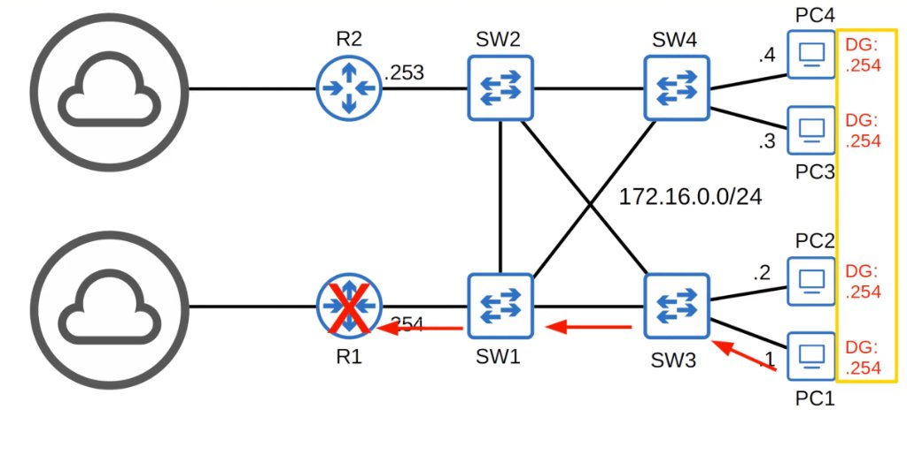

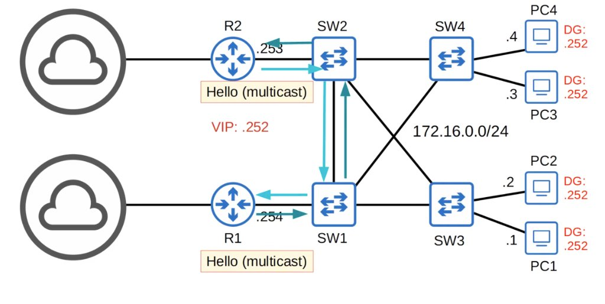

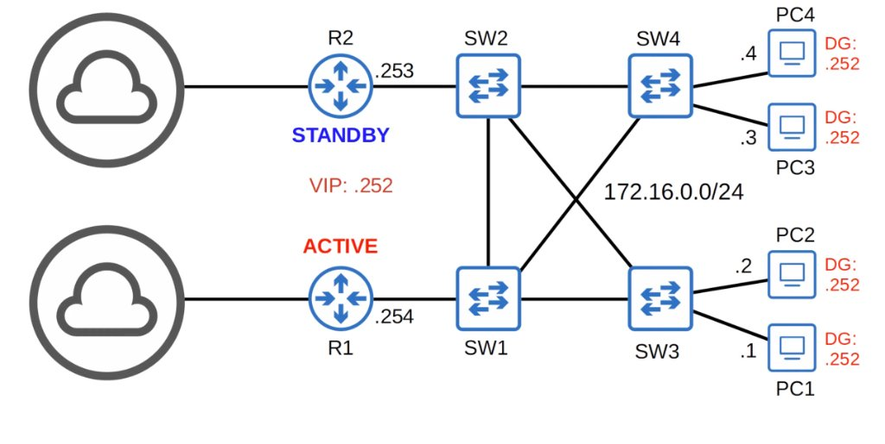

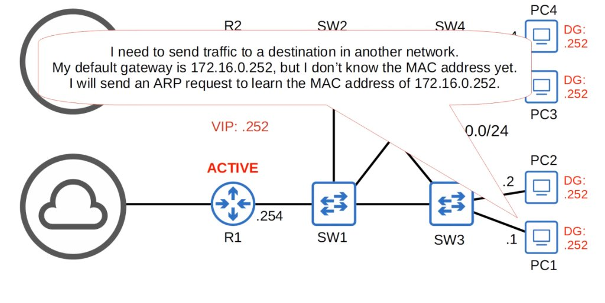

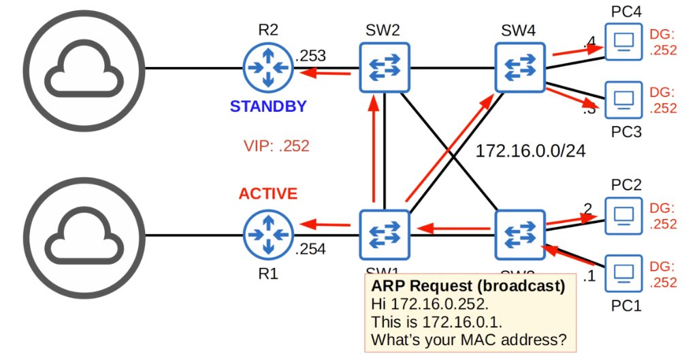

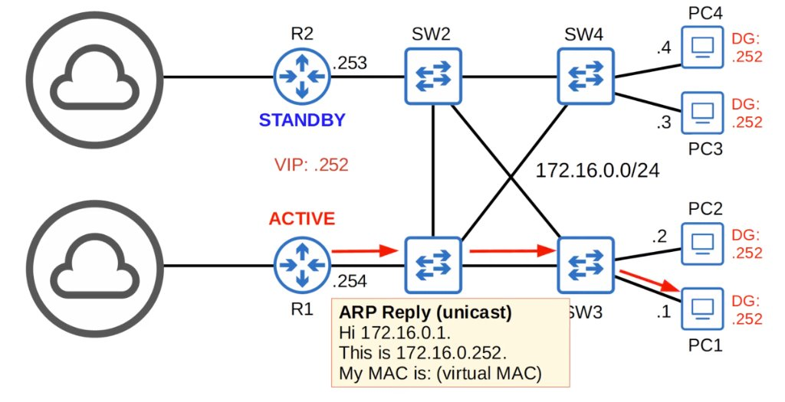

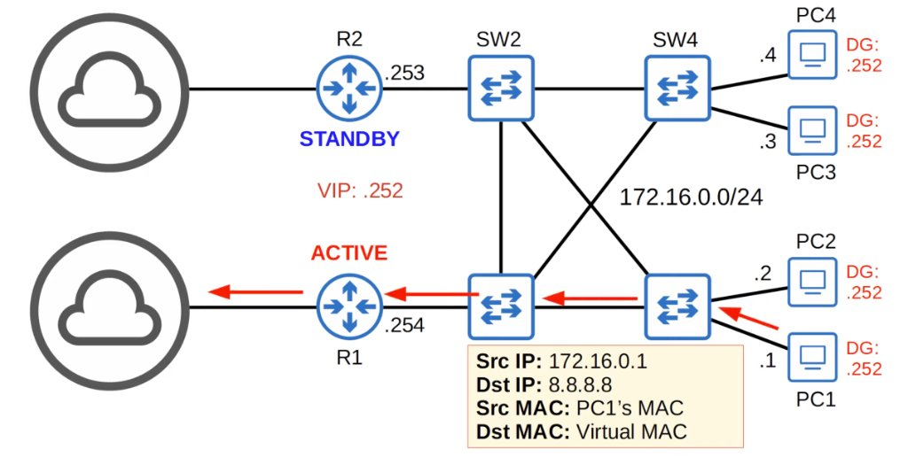

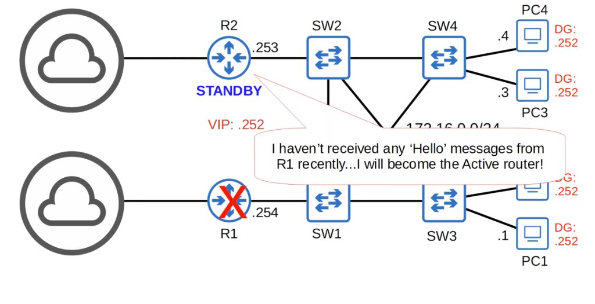

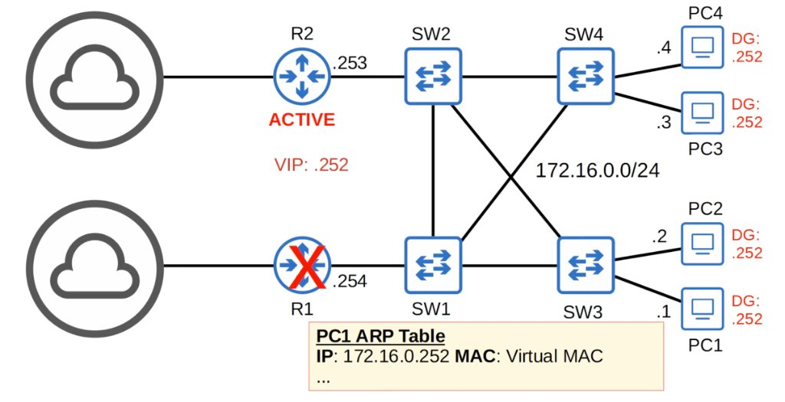

- **Gratuitous ARP**: ARP replies sent without being requested (no ARP request was received)
  \*the frames are broadcast to FFFF.FFFF.FFFF (normail ARP replies are unicast)

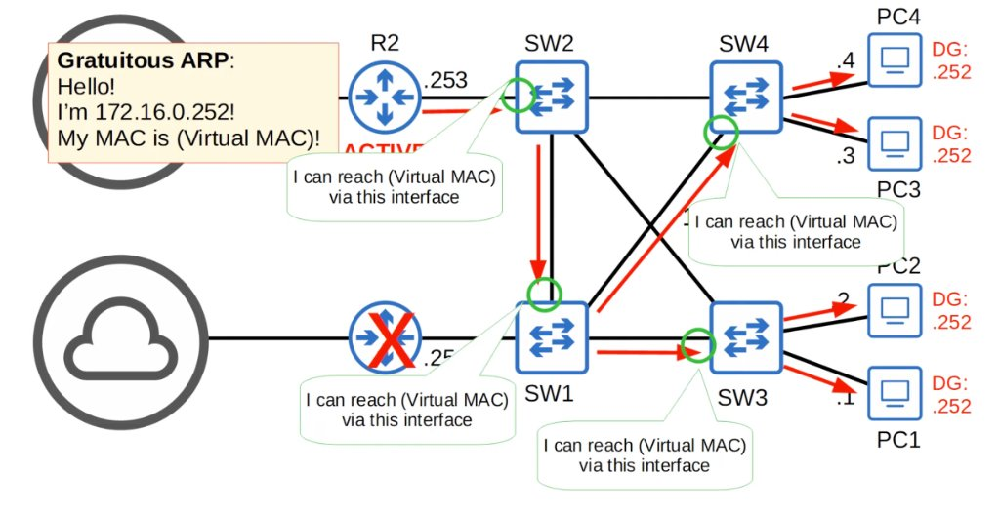

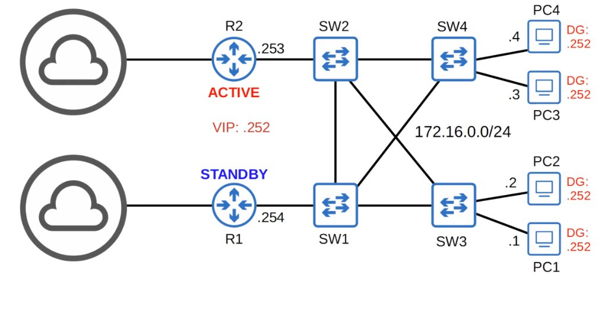

- FHRPs are 'non-preemptive'; the current active router will not automatically give up its role, even if the former active router returns
  \*you can change this setting to make R1 'preempt' R2 and take back its active role automatically

---

- A **virtual IP** is configured on the two routers, and a **virtual MAC** is generated for the virtual IP (each FHRP uses a different format for the virtual MAC)
- An **active** router and a **standby** router are elected (different FHRPs use different terms)
- End hosts in the network are configured to use the virtual IP as their default gateway
- The active router replies to ARP requests using the virtual MAC address, so traffic destined for other networks will be sent to it
- If the active router fails, the standby becomes the next active router; the new active router will send **gratuitous ARP** messages so that switches will update their MAC address tables; it now functions as the default gateway
- If the old active router comes back online, by default it won't take back its role as the active router; it will become the standby router
- You can configure 'preemption', so that the old active router does take back its old role

## HSRP (Hot Standby Router Protocol)

- Cisco proprietary
- An **active** and **standby** router are elected
- There are two versions: **version 1** and **version 2**
  - Version 2 adds IPv6 support and increases the number of _groups_ that can be configured
- Multicast IPv4 address:

```
v1 = 224.0.0.2
v2 = 224.0.0.102
```

- Virtual MAC address:

```
v1 = 0000.0c07.acXX (XX = HSRP group number)
v2 = 0000.0c9f.fXXX (XXX - HSRP group number)
```

- In a situation with multiple subnets/VLANs, you can configure a different active router in each subnet/VLAN to load balance

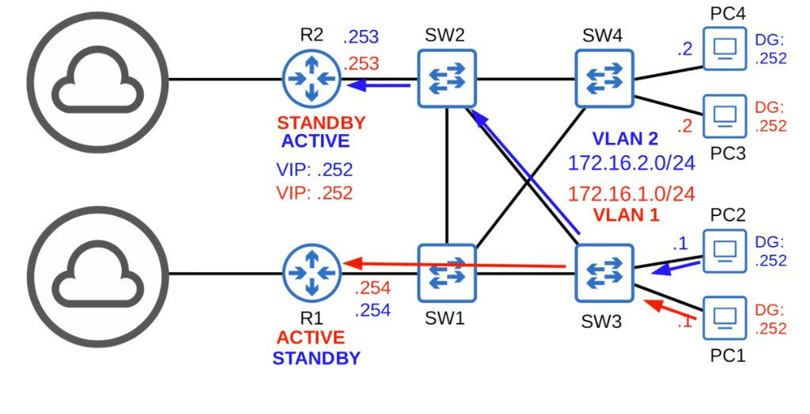

## VRRP (Virtual Router Redundancy Protocol)

- Open standard
- A **master** and **backup** router are elected
- Multicast IPv4 addressL 224.0.0.18
- Virtual MAC address: 0000.5e00.01**XX** (**XX** = VRRP group number)
- In a situation with multiple subnets/VLANs, you can configure a different master router in each subnet/VLAN to load balance


## GLBP (Gateway Load Balancing Protocol)

- Cisco proprietary
- Load balances among multiple routers <u>within a single subnet</u>
- An **AVG (Active Virtual Gateway)** is elected
- Up to four **AVFs (Active Virtual Forwarders)** are assigned by the AVG (the AVG itself can be an AVF, too)
- Each AVF acts as the default gateway for a portion of the hosts in the subnet
- Multicast IPv4 address: 224.0.0.102
- Virtual MAC address: 0007.b400.**XXYY** (**XX** = GLBP group number, **YY** = AVF number)

## Comparing FHRPs

| FHRP     | Terminology    | Multicast IP                         | Virtual MAC                                  | Cisco proprietary? |
| :------- | :------------- | :----------------------------------- | :------------------------------------------- | :----------------- |
| **HSRP** | Active/Standby | v1: `224.0.0.2`<br>v2: `224.0.0.102` | v1: `0000.0c07.acXX`<br>v2: `0000.0c9f.fXXX` | Yes                |
| **VRRP** | Master/Backup  | `224.0.0.18`                         | `0000.5e00.01XX`                             | No                 |
| **GLBP** | AVG / AVF      | `224.0.0.102`                        | `0007.b400.XXYY`                             | Yes                |

## Configuring HSRP

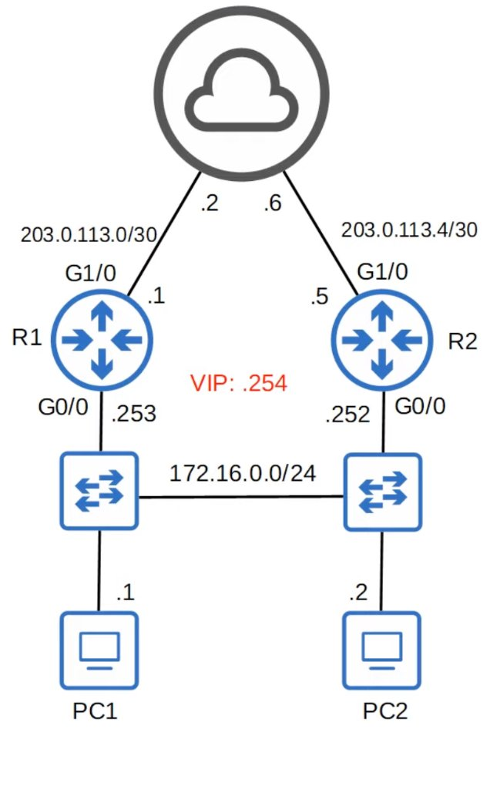

```cisco
R1(config)#interface g0/0
R1(config-if)#standby ?
  <0-255>         group number
  authentication  Authentication
  bfd             Enable HSRP BFD

R1(config-if)#standby version 2
R1(config-if)#standby ?
  <0-4095>        group number
  authentication  Authentication
  bfd             Enable HSRP BFD

R1(config-if)#standby 1 ?
  authentication  Authentication
  follow          Name of HSRP group to follow
  ip              Enable HSRP IPv4 and set the virtual IP address
  ipv6            Enable HSRP IPv6
  mac-address     Virtual MAC address
  name            Redundancy name string
  preempt         Overthrow lower priority Active routers
  priority        Priority level
  timers          Hello and hold timers
  track           Priority tracking
```

```cisco
R1(config-if)#standby 1 ip 172.16.0.254
R1(config-if)#
R1(config-if)#standby 1 priority ?
  <0-255>  Priority value

R1(config-if)#standby 1 priority 200
R1(config-if)#
R1(config-if)#standby 1 preempt
R1(config-if)#
```

- The **active router** is determined in this order:
  1. Highest priority (default 100)
  2. Highest IP address
- **Preempt** causes the router to take the role of active router, even if another router already has the role
- Only necessary on the router you want to become active

```cisco
R2(config-if)#standby version 2
R2(config-if)#
R2(config-if)#standby 1 ip 172.16.0.254
R2(config-if)#
R2(config-if)#standby 1 priority 50
R2(config-if)#
R2(config-if)#standby 1 preempt
```

- HSRP version 1 and version 2 are not compatible; if R1 uses version 2, R2 must use version 2 also

```cisco
R1#show standby
GigabitEthernet0/0 - Group 1 (version 2)
  State is Active
    2 state changes, last state change 00:16:30
  Virtual IP address is 172.16.0.254
  Active virtual MAC address is 0000.0c9f.f001
    Local virtual MAC address is 0000.0c9f.f001 (v2 default)
  Hello time 3 sec, hold time 10 sec
    Next hello sent in 1.536 secs
  Preemption enabled
  Active router is local
  Standby router is 172.16.0.252, priority 50 (expires in 9.280 sec)
  Priority 200 (configured 200)
  Group name is "hsrp-Gi0/0-1" (default)
R1#
```

```cisco
R2#show standby
GigabitEthernet0/0 - Group 1 (version 2)
  State is Standby
    1 state change, last state change 00:17:05
  Virtual IP address is 172.16.0.254
  Active virtual MAC address is 0000.0c9f.f001
    Local virtual MAC address is 0000.0c9f.f001 (v2 default)
  Hello time 3 sec, hold time 10 sec
    Next hello sent in 1.472 secs
  Preemption enabled
  Active router is 172.16.0.253, priority 200 (expires in 10.160 sec)
    MAC address is 0c9f.6041.8800
  Standby router is local
  Priority 50 (configured 50)
  Group name is "hsrp-Gi0/0-1" (default)
R2#
```

## Quiz

1. Which of the following is an HSRP version 1 virtual MAC address?
   _d) 0000.0c07.acab_

2. Which of the following is a VRRP virtual MAC address?
   _a) 0000.5e00.010a_

3. Which of the following are valid VRRP router roles? (select two)
   _b) backup_
   _d) master_

4. When the HSRP standby router becomes the new active router, what kind of messages does it send? (select the best answer)
   _b) Gratuitious ARP_

5. Which of the following statements accurately descibres HSRP?
   _c) It provides a redundant default gateway address for hosts in a subnet_

6. Which of the following statements are true regarding HSRP? (select 2 choices)
   _c) One router is elected as the active router, and another router is elected as the standby router_
   _d) In an HSRP group, only one virtual IP address and one virtual MAC address is used_
