# TCP & UDP

## Functions of Layer 4 (Transport Layer)

- Provides transparent transfer of data between end hosts

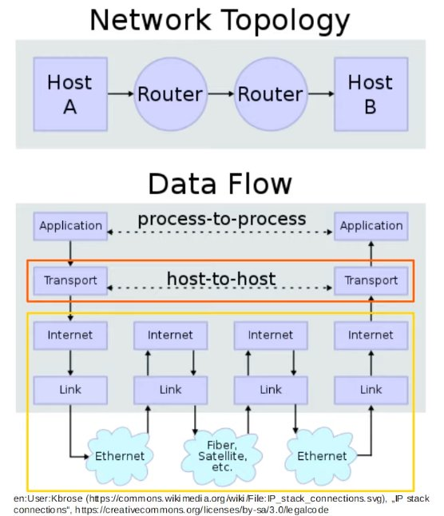

- Provides (or doesn't provide) various services to applications:
  - reliable data transfer
  - error recovery
  - data sequencing
  - flow control
- Provides Layer 4 addressing (**port** numbers) - NOT the physical interfaces/ports on network devices
  - Identify the Application Layer protocol
  - Provides session multiplexing

- The following ranges have been designated by IANA (Internet Assigned Numbers Authority)
  - **Well-known** port numbers: 0 - 1023
  - **Registered** port numbers: 1024 - 49151
  - **Ephemeral/private/dynamic** port numbers: 49152 - 65535

## Port Numbers / Session Multiplexing

- A session is is an exchange of data between two or more communicating devices

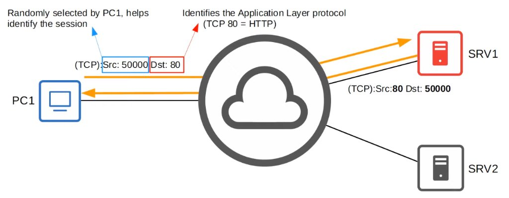

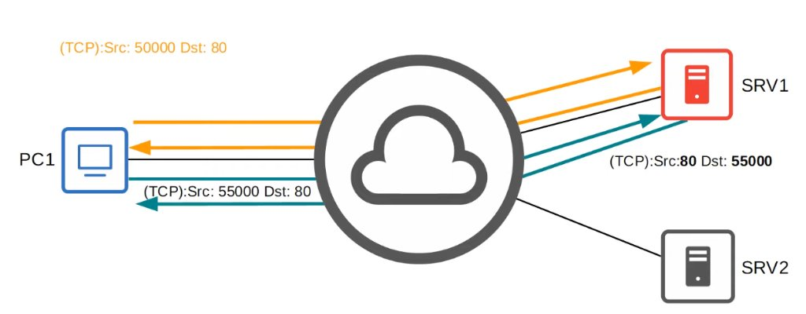

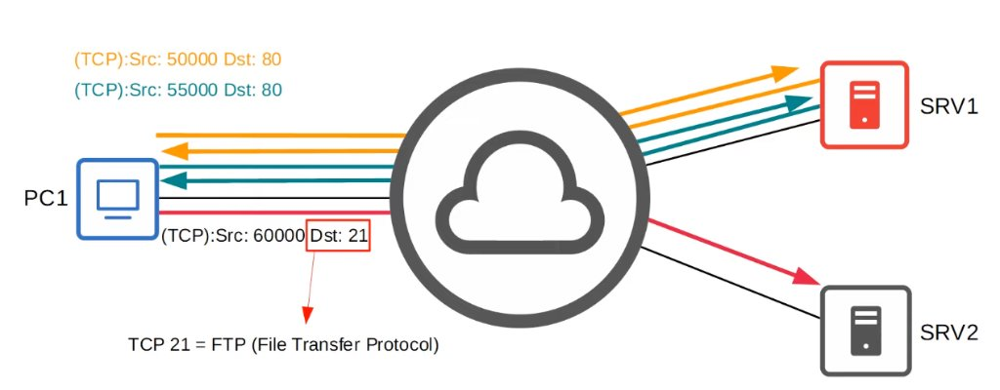

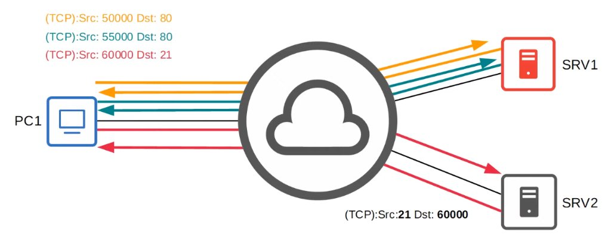

## TCP (Transmission Control Protocol)

- TCP is connection-oriented
  - Before actually sending data to the destination host, the two hosts communicate to establish a connection; once the connection is established, the data exchange begins
- TCP provides provides reliable communication
  - The destination host must acknowledge that it received each TCP segment
  - If a segment isn't acknowledged, it is sent again
- TCP provides sequencing
  - Sequence numbers in the TCP header allow destination hosts to put segments in the correct order even if they arrive out of order
- TCP provides flow control
  - The destination host can tell the source host to increase/decrease the rate that data is sent

### TCP Header

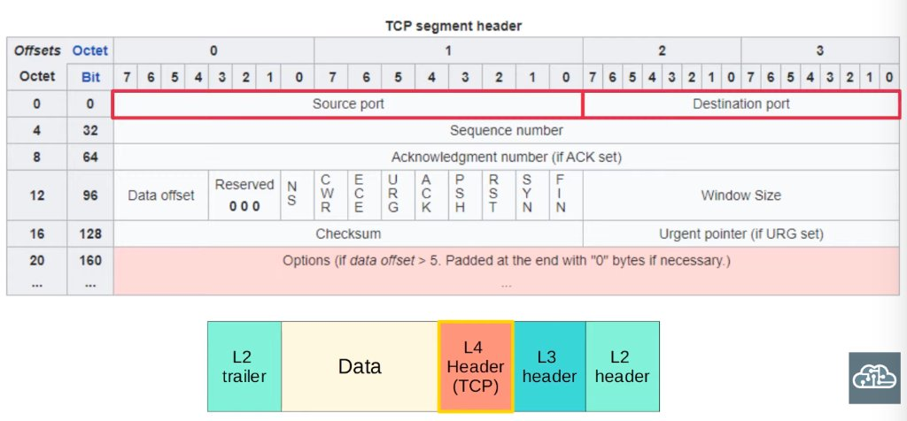

- The window size is used for flow control

### Establishing Connections: Three-Way Handshake

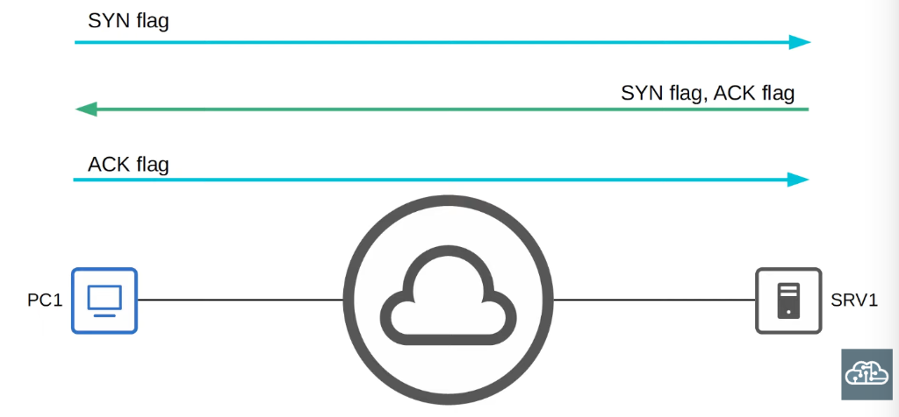

### Terminating Connections: Four-Way Handshake

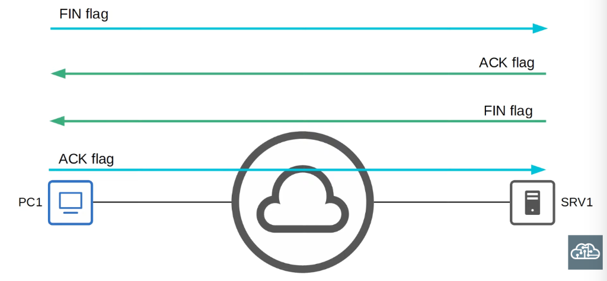

### TCP: Sequencing / Acknowledgement

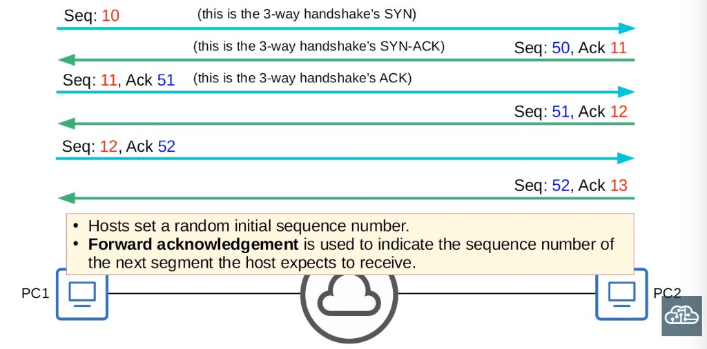

### TCP Retransmission

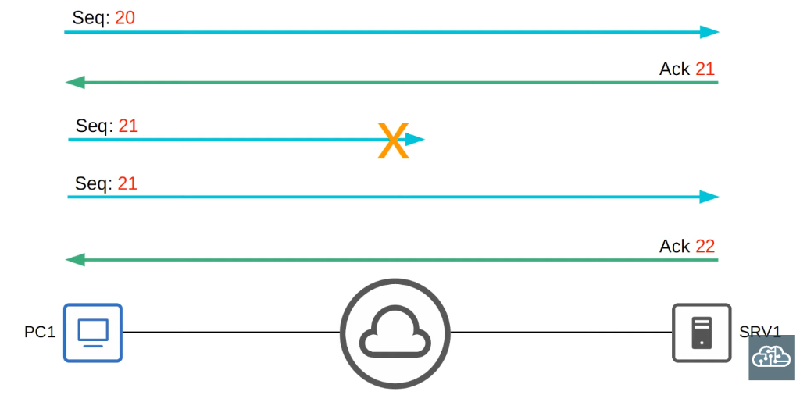

### TCP Flow Control: Window Size

- Acknowledging every single segment, no matter what size, is inefficient
- The TCP header's **Window Size** field allows more data to be sent before an acknowledgment is required
- A 'sliding window' can be used to dynamically adjust how large the window size is

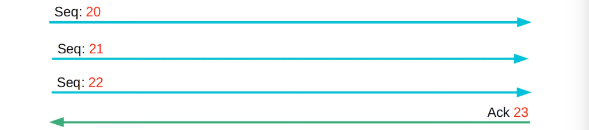

## UDP (User Datagram Protocol)

- UDP is **not** connection-oriented
  - The sending host does not establish a connection with the destination host before sending data; the data is simply sent
- UDP **does not** provide reliable communication
  - When UDP is used, acknowledgments are not sent for received segments; if a segment is lost, UDP has no mechanism to re-transmit it; segments are sent 'best-effort'
- UDP **does not** provide sequencing
  - There is no sequence number field in the UDP header; if segments arrive out of order, UDP has no mechanism to put them back in order
- UDP **does not** provide flow control
  - UDP has no mechanism like TCP's window size to control the flow of data

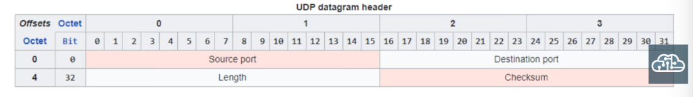

## Comparing TCP & UDP

- TCP provides more features than UDP, but at the cost of additional **overhead**
- For applications that require reliable communications (for example downloading a file), TCP is preferred
- For applications like real-time voice and video, UDP is preferred
- There are some applications that use UDP, but provide reliability within the application
- Some applications use both TCP & UDP, depending on the situation

| TCP                                  | UDP                            |
| :----------------------------------- | :----------------------------- |
| Connection-oriented                  | Connectionless                 |
| Reliable                             | Unreliable                     |
| Sequencing                           | No sequencing                  |
| Flow control                         | No flow control                |
| Use for downloads, file sharing, etc | Used for VoIP, live video, etc |

## Port Numbers

| TCP              | UDP                | TCP & UDP |
| :--------------- | :----------------- | :-------- |
| FTP data (20)    | DHCP server (67)   | DNS (53)  |
| FTP control (21) | DHCP client (68)   |           |
| SSH (22)         | TFTP (69)          |           |
| Telnet (23)      | SNMP agent (161)   |           |
| SMTP (25)        | SNMP manager (162) |           |
| HTTP (80)        | Syslog (514)       |           |
| POP3 (110)       |                    |           |
| HTTPS (443)      |                    |           |

## Quiz

1. Which of the following is a well-known port number, as defined by IANA?
   _a) 1010_

2. According to IANA specifications, what range of port numbers should hosts select from when randomly selecting a source Layer 4 port number?
   _c) Ephemeral_

3. Which of the following are features of TCP but not UDP? (select three)
   _b) Error recovery_
   _d) Flow control_
   _e) Sequencing_

4. Which of the following Application Layer protocols use TCP to provide reliable communications? (select three)
   _a) SMTP_
   _c) HTTPS_
   _f) SSH_

5. PC1 and SRV1 have an active TCP connection. SRV1 receives a TCP segment from PC1 with a sequence number of 27. When SRV1 acknowledges the segment, what will the value of the Acknowledgment field in the TCP header be? Assume a TCP window size of 1.
   _c) 28_

6. Select the Application layer protocols to the corresponding Transport layer protocol. All application layer protocols will be used.
   _TCP: TCP, HTTP, SMTP_
   _UDP: DHCP, SNMP, TFTP_
   _TCP & UDP: DNS_
