# IPv6 Part 1

## What about IPv5?

- 'Internet Stream Protocol' was developed in the late 1970s, but never actually introduced for public use
- It was never called 'IPv5', but it used a value of 5 in the Version field of the IP header
- So, when the successor to IPv4 was being developed, it was named IPv6

## Hexadecimal

- Binary / Base 2 / 0b: 0, 1
  10 <- Is that decimal 10? Or binary 10 (=decimal 2)? Or hexadecimal (=deciaml 16)?
- Decimal / Base 10 / 0d: 0, 1, 2, 3, 4, 5, 6, 7, 8, 9
- Hexadecimal / Base 16 / 0x: 0, 1, 2, 3, 4, 5, 6, 7, 8, 9, A, B, C, D, E, F

| Decimal | Binary | Hexadecimal |
| :------ | :----- | :---------- |
| 0       | `0000` | `0`         |
| 1       | `0001` | `1`         |
| 2       | `0010` | `2`         |
| 3       | `0011` | `3`         |
| 4       | `0100` | `4`         |
| 5       | `0101` | `5`         |
| 6       | `0110` | `6`         |
| 7       | `0111` | `7`         |
| 8       | `1000` | `8`         |
| 9       | `1001` | `9`         |
| 10      | `1010` | `A`         |
| 11      | `1011` | `B`         |
| 12      | `1100` | `C`         |
| 13      | `1101` | `D`         |
| 14      | `1110` | `E`         |
| 15      | `1111` | `F`         |

### Binary -> Hexadecimal 1

0b11011011 = 0x??

- Split the number into 4-bit groups
- Convert each 4-bit group to decimal
- Convert each decimal number to hexadecimal
- That's the answer

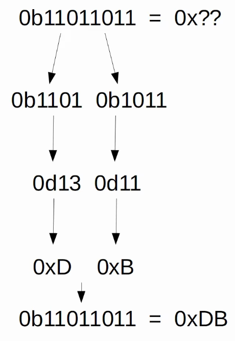

### Binary -> Hexadecimal 2

0b00101111 = 0x??

```
0b0010 = 0d2 = 0x2
0b1111 = 0d15 = 0xF
=> 0b00101111 = 0x2F
```

### Binary -> Hexadecimal 3

0b10000001 = 0x??

```
0b1000 = 0d8 = 0x8
0b0001 = 0d1 = 0x1
=> 0b00101111 = 0x81
```

### Hexadecimal -> Binary 1

0xEC = 0b??

- Split up the hexadecimal digits
- Convert each hexadecimal digit to decimal
- Convert each decimal number to binary
- That's the answer

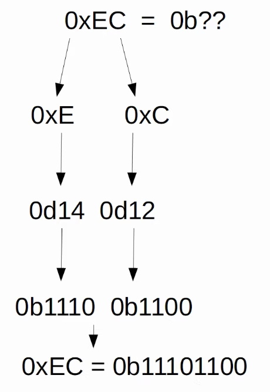

### Hexadecimal -> Binary 2

0x2B = 0b??

```
0x2 = 0d2 = 0b0010
0xB = 0d11 = 0b1011
=> 0x2B = 0b00101011
```

### Hexadecimal -> Binary 3

0xD7 = 0b??

```
0xD = 0d13 = 0b1101
0x7 = 0d7 = 0b0111
=> 0xD7 = 0b11010111
```

## Why IPv6?

- The main reason is that **there simply aren't enough IPv4 addresses available!**
- There are 4,294,967,296 (2^32) IPv4 addresses available
- When IPv4 was being designed 30 years ago, the creators had no idea the Internet would be as large as it is today
- VLSM, private IPv4 addresses, and NAT have been used to conserve the use of IPv4 address space
- Those are short-term solutions
- The long-term solution is IPv6
- IPv4 adress assignments are controlled by IANA (Internet Assigned Numbers Authority)
- IANA distributes IPv4 address space to various RIRs (Regional Internet Registries), which then assign them to companies that need them

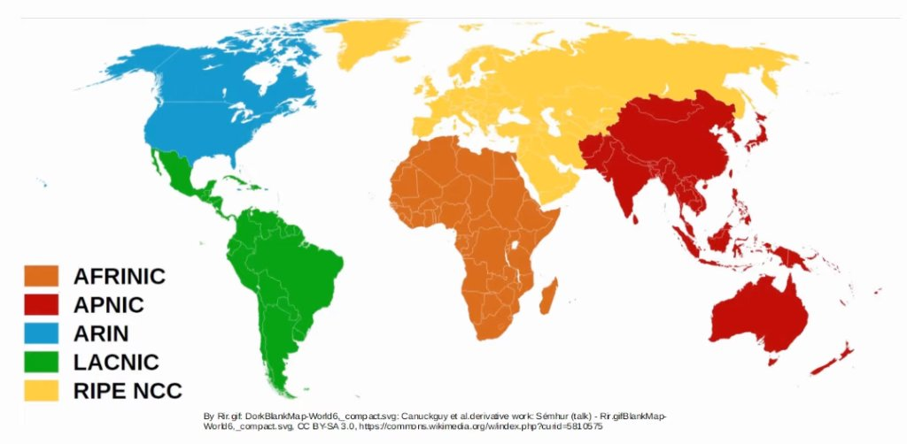

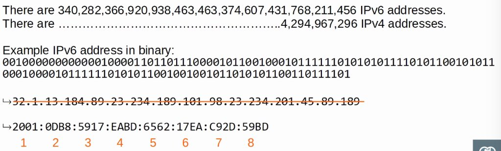

- On 24 September 2015 ARIN declared exhaustion of the ARIN IPv4 addresses pool
- On 21 August 2020, LACNIC announced that it had made its final IPv4 allocation

## IPv6

- An IPv6 address is **128 bits**
- 4 _ the bits of an IPv4 address = 4 _ the number of possible addresses? NO
- Every additional bit **doubles** the number of possible addresses


### Shortening (abbreviating) IPv6 addresses

- **Leading 0s** can be removed

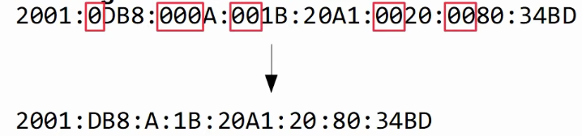

- **Consecutive quartets of all 0s** can be replaced with a double colon (::)

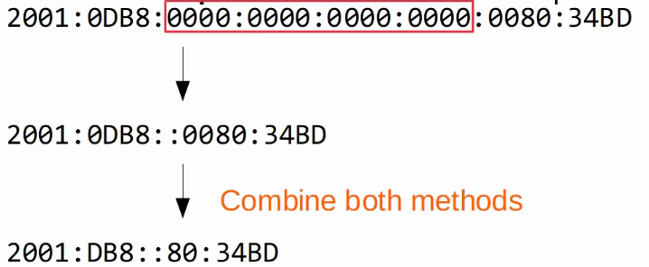

- <u>Consecutive quartets of 0s can only be abbreviated once in an IPv6 address</u>

[IPv6 Single Double Colon Rule](ipv6_single_double_colon_rule.jpg)

| Full IPv6 Address                         | Shortened IPv6 Address            |
| :---------------------------------------- | :-------------------------------- |
| `2000:AB78:0020:01BF:ED89:0000:0000:0001` | `2000:AB78:20:1BF:ED89::1`        |
| `FE80:0000:0000:0000:0002:0000:0000:FBE8` | `FE80::2:0:0:FBE8`                |
| `AE89:2100:01AC:00F0:0000:0000:0000:020F` | `AE89:2100:1AC:F0::20F`           |
| `2001:0DB8:8B00:1000:0002:0BC0:0D07:0099` | `2001:DB8:8B00:1000:2:BC0:D07:99` |
| `2001:0DB8:0000:0000:0000:0000:0000:1000` | `2001:DB8::1000`                  |

### Expanding shortened IPv6 addresses

- Put leading 0s where needed (all quartets should have 4 hexadecimal characters)

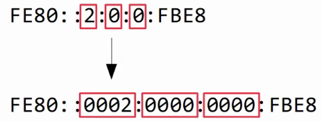

- If a double colon is used, replace it with all-0 quartets; make sure there are 8 quartets in total

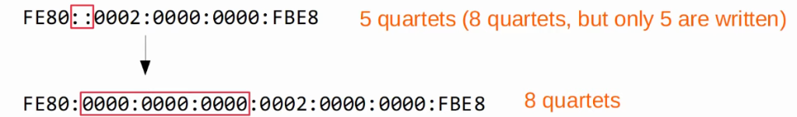

| Full IPv6 Address                         | Shortened IPv6 Address    |
| :---------------------------------------- | :------------------------ |
| `FE80:0000:0000:0000:1010:02FC:0000:0009` | `FE80::1010:2FC:0:9`      |
| `2001:0DB8:0001:0B23:2309:0000:0000:00C1` | `2001:DB8:1:B23:2309::C1` |
| `FD00:0000:0000:0000:1000:0689:9000:0CDF` | `FD00::1000:689:9000:CDF` |
| `FF02:0000:0000:0000:0000:0000:0000:0002` | `FF02::2`                 |
| `0000:0000:0000:0000:0000:0000:0000:0001` | `::1`                     |

### Finding the IPv6 prefix (global unicast addresses)

- Typically, an enterprise requesting IPv6 addresses from their ISP will receive a /48 block
- Typically, IPv6 subnets use a /64 prefix length
- That means an enterprise has 16 bits to use to make subnets
- The remaining 64 bits can be used for hosts

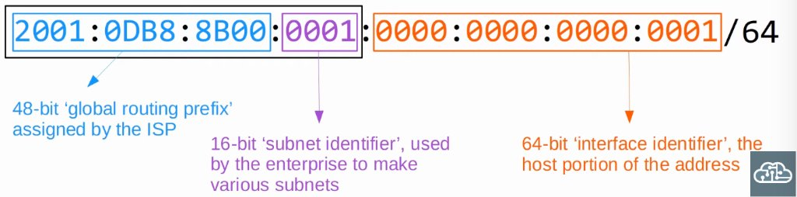

### Finding the IPv6 prefix

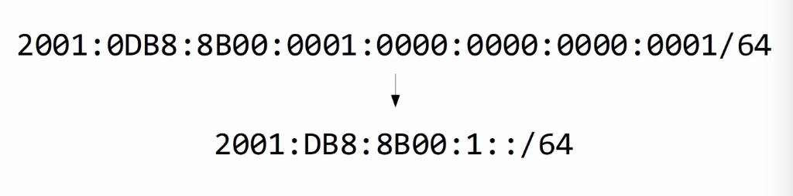

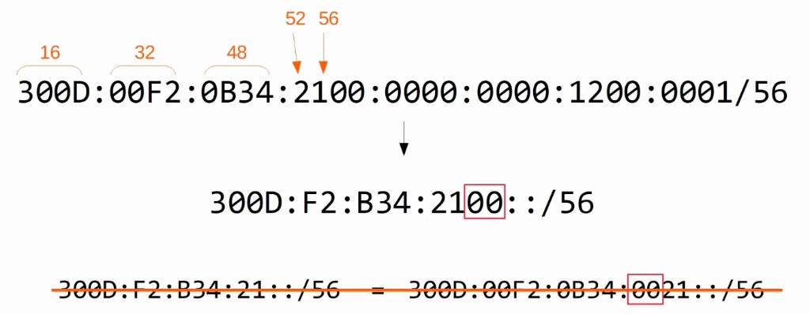

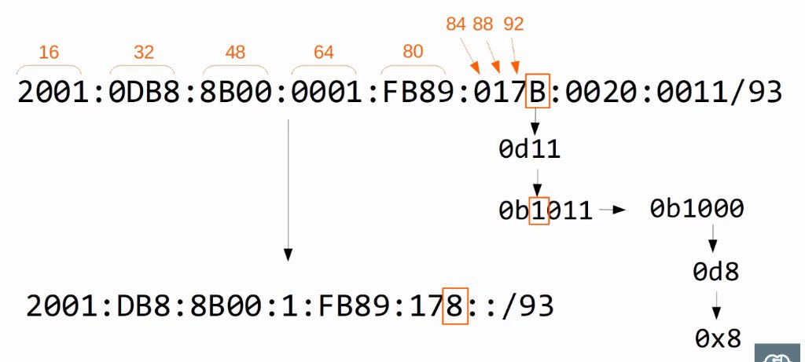

| Host Address                                 | Prefix                          |
| :------------------------------------------- | :------------------------------ |
| `FE80:0000:0000:0000:4c2c:e2ed:6a89:2a27/9`  | `FE80::/9`                      |
| `2001:0DB8:0001:0B23:BA89:0020:0000:00C1/64` | `2001:0DB8:0001:0B23::/64`      |
| `2001:0DB8:0BAD:CAFE:1300:0689:9000:0CDF/71` | `2001:0DB8:0BAD:CAFE:1200::/71` |
| `2001:0DB8:0000:FEED:0DAD:018F:6001:0DA3/62` | `2001:0DB8:0000:FEEC::/62`      |
| `2001:0DB8:9BAD:BABE:0DE8:AB78:2301:0010/63` | `2001:0DB8:9BAD:BABE::/63`      |

### Configuring IPv6 addresses

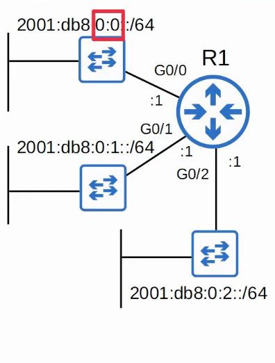

```cisco
R1(config)#
R1(config)#ipv6 unicast-routing
R1(config)#
R1(config)#int g0/0
R1(config-if)#ipv6 address 2001:db8:0:0::1/64
R1(config-if)#no shutdown
R1(config-if)#
R1(config-if)#int g0/1
R1(config-if)#ipv6 address 2001:db8:0:1::1/64
R1(config-if)#no shutdown
R1(config-if)#
R1(config-if)#int g0/2
R1(config-if)#ipv6 address 2001:0db8:0000:0002:0000:0000:0000:0001/64
R1(config-if)#no shutdown
R1(config-if)#
```

```cisco
R1#show ipv6 interface brief
GigabitEthernet0/0         [up/up]
    FE80::EF8:22FF:FE36:8500
    2001:DB8::1
GigabitEthernet0/1         [up/up]
    FE80::EF8:22FF:FE36:8501
    2001:DB8:0:1::1
GigabitEthernet0/2         [up/up]
    FE80::EF8:22FF:FE36:8502
    2001:DB8:0:2::1
GigabitEthernet0/3         [administratively down/down]
    unassigned
R1#
```

## Quiz

1. Which of the following are valid IPv6 addresses? (select three)

_a) `2000:AB78:20:1BF:ED89::1`_
_b) `FE80:0000:0000:0000:0002:0000:0000:FBE8`_
_e) `2001:0DB8::1000`_

2. Which of the following is a correctly-abbreviated version of the IPv6 address below?
   `2001:0DB8:0101:0B23:BA89:0020:0AB0:00C1`
   _d) `2001:DB8:101:B23:BA89:20:AB0:C1`_

3. Which of the following ust be used to enable a router to perform IPv6 routing?
   _b) `R1(config)# ipv6 unicast-routing`_

4. What command would you issue on RouterA so that traffic can be routed to RouterC?


_b) `ipv6 route 2001:DB8:2::/64 2001:DB8:1::2_
