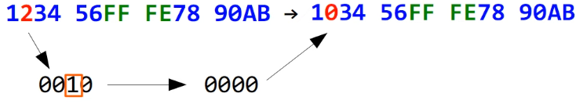
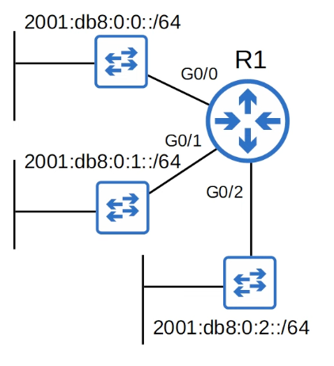
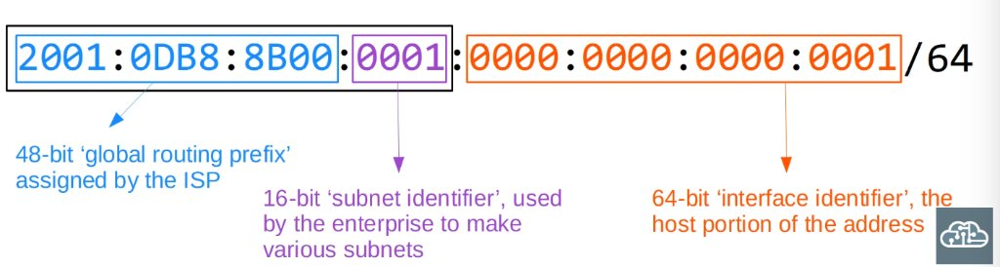
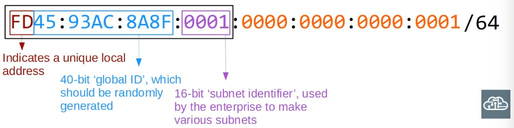
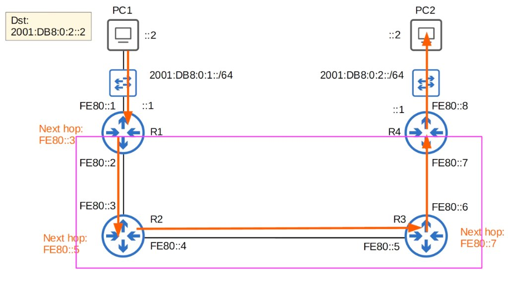
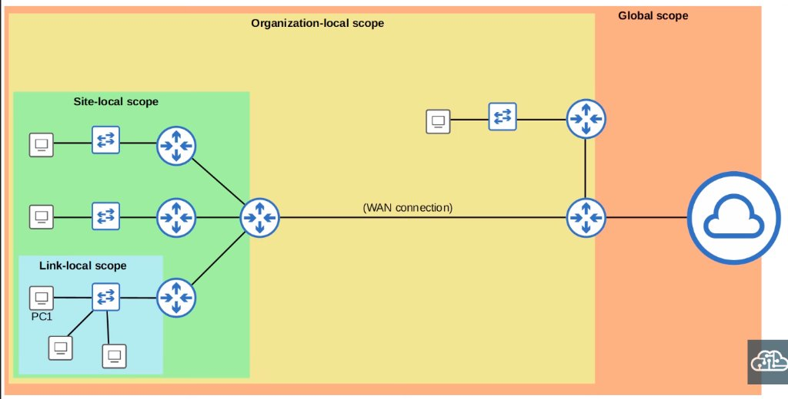
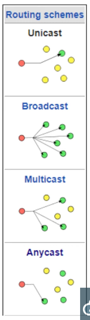
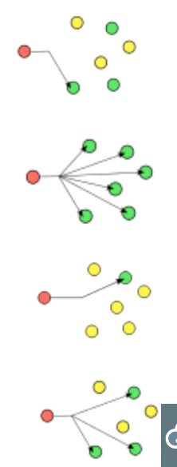

# IPv6 Part 2

## Configuring IPv6 addresses (EUI-64)

- EUI stands for Extended Unique Identifier
- (Modified) EUI-64 is a method of converting a MAC address (48 bits) into a 64-bit interface identifier
- This interface identifier can then become the 'host portion' of a /64 IPv6 address
- How to convert the MAC address:
  1. Divide the MAC address in half

  ```
  1234 5678 90AB -> 1234 56 | 78 90AB
  ```

  2. Insert FFFE in the middle

  ```
  1234 56FF FE78 90AB
  ```

  3. Invert the 7th bit



| MAC Address      | EUI-64 Interface Identifier |
| :--------------- | :-------------------------- |
| `782B CBAC 0867` | `7A2B CBFF FEAC 0867`       |
| `0200 4C4F 4F50` | `0000 4CFF FE4F 4F50`       |
| `0050 56C0 0001` | `0250 56FF FEC0 0001`       |
| `00FF 6BA6 F456` | `02FF 6BFF FEA6 F456`       |
| `96AB 6D6B 98AE` | `94AB 6DFF FE6B 98AE`       |



```cisco
R1(config)#int g0/0
R1(config-if)#ipv6 address 2001:db8::/64 eui-64
R1(config-if)#no shutdown
R1(config-if)#
R1(config-if)#int g0/1
R1(config-if)#ipv6 address 2001:db8:0:1::/64 eui-64
R1(config-if)#no shutdown
R1(config-if)#
R1(config-if)#int g0/2
R1(config-if)#ipv6 address 2001:db8:0:2::/64 eui-64
R1(config-if)#no shutdown
```

```cisco
R1#show interfaces g0/0
GigabitEthernet0/0 is administratively down, line protocol is down
  Hardware is iGbE, address is 0cf8.2236.8500 (bia 0cf8.2236.8500)

R1#show interfaces g0/1
GigabitEthernet0/1 is administratively down, line protocol is down
  Hardware is iGbE, address is 0cf8.2236.8501 (bia 0cf8.2236.8501)

R1#show interfaces g0/2
GigabitEthernet0/2 is administratively down, line protocol is down
  Hardware is iGbE, address is 0cf8.2236.8502 (bia 0cf8.2236.8502)
```

```cisco
R1(config-if)#do show ipv6 interface brief
GigabitEthernet0/0         [up/up]
    FE80::EF8:22FF:FE36:8500
    2001:DB8::EF8:22FF:FE36:8500
GigabitEthernet0/1         [up/up]
    FE80::EF8:22FF:FE36:8501
    2001:DB8:0:1:EF8:22FF:FE36:8501
GigabitEthernet0/2         [up/up]
    FE80::EF8:22FF:FE36:8502
    2001:DB8:0:2:EF8:22FF:FE36:8502
GigabitEthernet0/3         [administratively down/down]
    unassigned
```

### Why invert the 7th bit?

- MAC addresses can be divided into two types:
  - **UAA** (Universally Administered Address)
    - Uniquely assigned to the device by the manufacturer
  - **LAA** (Locally Administered Address)
    - Manually assigned by an admin (with the `mac-address` command on the interface) or protocol; doesn't have to be globally unique
  - You can identify a UAA or LAA by the 7th bit of the MAC address, called the U/L bit (Universal/Local bit):
    - U/L bit set to **0** = **UAA**
    - U/L bit set to **1** = **LAA**
  - In the context of IPv6 addresses/EUI-64, the meaning of the U/L bit is reversed:
    - U/L bit set to **0** = The MAC address the EUI-64 interface ID was made from an **LAA**
    - U/L bit set to **1** = The MAC address the EUI-64 interface ID was made from was **UAA**

## Global unicaast addresses

- **Global unicast** IPv6 addresses are public addressses which can be used over the Internet
- Must register to use them; because they are public addresses, it is expected that they are globally unique
- Originally defined as the `2000::/3` block (`2000::` to `3FFF:FFFF:FFFF:FFFF:FFFF:FFFF:FFFF:FFFF`)
- Now defined as all addresses which aren't reserved for other purposes



## Unique local addresses

- **Unique local** IPv6 addresses are _private_ addresses which **cannot be used over the Internet**
- You do not need to register to use them; they can be used freely within internal networks and don't need to be globally unique (\*); can't be routed over the internet
- Uses the address block `FC00::/7` (`FC00::` to `FDFF:FFFF:FFFF:FFFF:FFFF:FFFF:FFFF:FFFF`)
- However, a later update requires the 8th bit to be set to 1, so the first two digits must be FD
- \*The global ID should be unique so that addresses don't overlap when companies merge



## Link local addresses

- **Link-local** IPv6 addresses are automatically generated on IPv6-enabled interfaces
- Use command `R1(config-if)# ipv6 enable` on an interface to enable IPv6 on an interface
- Uses the address block `FE80::/10` (`FE80::` to `FEBF:FFFF:FFFF:FFFF:FFFF:FFFF:FFFF:FFFF`)
- However, the standard states that the 54 bits after the `FE80/10` should be all 0, so you won't see link local addresses beginning with `FE9`, `FEA`, or `FEB`; only `FE8`
- The interface ID is generated using EUI-64 rules
- _Link-local_ means that these addresses are used for communication within a single link (subnet); routers **will not** route packets with a link-local destination IPv6 address
- Common uses of link-local addresses:
  - routing protocol peerings (OSPFv3 uses link-local addresses for neighbor adjacencies)
  - next-hop addresses for static routes
  - _Neighbor Discovery Protocol_ (NDP, IPv6's replacement for ARP) uses link-local addresses to function



## Multicast addresses

- **Unicast** addresses are one-to-one
  - One source to one destination
- **Broadcast** addresses are one-to-all
  - One source to all destinations (within the subnet)
- **Multicast** addresses are one-to-many
  - One source to multiple destinations (that have joined the specific _multicast group_)
- IPv6 uses range `FF00::/8` for multicast (`FF00::` to `FFFF:FFFF:FFFF:FFFF:FFFF:FFFF:FFFF:FFFF`)
- **IPv6 doesn't use broadcast** (there is no 'broadcast address' in IPv6)

| Purpose                                    | IPv6 Address | IPv4 Address |
| :----------------------------------------- | :----------- | :----------- |
| All nodes/hosts (functions like broadcast) | `FF02::1`    | `224.0.0.1`  |
| All routers                                | `FF02::2`    | `224.0.0.2`  |
| All OSPF routers                           | `FF02::5`    | `224.0.0.5`  |
| All OSPF DRs/BDRs                          | `FF02::6`    | `224.0.0.6`  |
| All RIP routers                            | `FF02::9`    | `224.0.0.9`  |
| All EIGRP routers                          | `FF02::A`    | `224.0.0.10` |

### Multicast address scopes

- IPv6 defines multiple multicast 'scopes' which indicate how far the packet should be forwarded
- The addresses in the table above all use the 'link-local' scope (`FF02`), which stays in the local subnet
- IPv6 multicast scopes:
  - **Interface-local** (`FF01`): The packet doesn't leave the local device; can be used to send traffic to a service within the local device
  - **Link-local** (`FF02`): The packet remains in the local subnet; routers will not route the packet between subnets
  - **Site-local** (`FF05`): The packet can be forwarded by routers; should be limited to a single physical location (not forwarded over a WAN)
  - **Organization-local** (`FF08`): Wider in scope than site-local (an entire company/organization)
  - **Global** (`FF0E`): No boundaries; possible to be routed over the internet



---

```cisco
R1#sh ipv6 int g0/0
GigabitEthernet0/0 is up, line protocol is up
  IPv6 is enabled, link-local address is FE80::EF8:22FF:FE36:8500
  No Virtual link-local address(es):
  Global unicast address(es):
    2001:DB8::EF8:22FF:FE36:8500, subnet is 2001:DB8::/64 [EUI]
  Joined group address(es):
    FF02::1
    FF02::2
    FF02::1:FF36:8500
  MTU is 1500 bytes
  ICMP error messages limited to one every 100 milliseconds
  ICMP redirects are enabled
  ICMP unreachables are sent
  ND DAD is enabled, number of DAD attempts: 1
  ND reachable time is 30000 milliseconds (using 30000)
  ND advertised reachable time is 0 (unspecified)
  ND advertised retransmit interval is 0 (unspecified)
  ND router advertisements are sent every 200 seconds
  ND router advertisements live for 1800 seconds
  ND advertised default router preference is Medium
  Hosts use stateless autoconfig for addresses.
```


```cisco
R1#sh ipv6 int g0/0
GigabitEthernet0/0 is up, line protocol is up
  IPv6 is enabled, link-local address is FE80::EF8:22FF:FE36:8500
  No Virtual link-local address(es):
  Global unicast address(es):
    2001:DB8::EF8:22FF:FE36:8500, subnet is 2001:DB8::/64 [EUI]
  Joined group address(es):
    FF02::1
    FF02::2
    FF02::1:FF36:8500
  MTU is 1500 bytes
  ICMP error messages limited to one every 100 milliseconds
  ICMP redirects are enabled
  ICMP unreachables are sent
  ND DAD is enabled, number of DAD attempts: 1
  ND reachable time is 30000 milliseconds (using 30000)
  ND advertised reachable time is 0 (unspecified)
  ND advertised retransmit interval is 0 (unspecified)
  ND router advertisements are sent every 200 seconds
  ND router advertisements live for 1800 seconds
  ND advertised default router preference is Medium
  Hosts use stateless autoconfig for addresses.
```

## Anycast addresses

- **Anycast** is a new feature of IPv6
- Anycast is 'one-to-one-of-many'
- Multiple routers are configured with the same IPv6 address
  - They use a routing protocol to advertise the address
  - When hosts sends packets to that destination address, routers will forward it to the nearest router configured with that IP address (based on routing metric)
  - There is no specific address range for anycast addresses; use a regular unicast address (global unicast, unique local) and specify it as an anycast address:
  ```
  R1(config-if)# ipv6 address 2001:db8:1:1::99/128 anycast
  ```



### Anycast address configuration

```cisco
R1(config)#int g0/0
R1(config-if)#ipv6 address 2001:db8:1:1::99/128 anycast
R1(config-if)#
R1(config-if)#do show ipv6 interface g0/0
GigabitEthernet0/0 is up, line protocol is up
  IPv6 is enabled, link-local address is FE80::EF8:22FF:FE36:8500
  No Virtual link-local address(es):
  Global unicast address(es):
    2001:DB8::EF8:22FF:FE36:8500, subnet is 2001:DB8::/64 [EUI]
    2001:DB8:1:1::99, subnet is 2001:DB8:1:1::99/128 [ANY]
  Joined group address(es):
    FF02::1
    FF02::2
    FF02::1:FF00:99
    FF02::1:FF36:8500
  MTU is 1500 bytes
  ICMP error messages limited to one every 100 milliseconds
  ICMP redirects are enabled
  ICMP unreachables are sent
  ND DAD is enabled, number of DAD attempts: 1
  ND reachable time is 30000 milliseconds (using 30000)
  ND advertised reachable time is 0 (unspecified)
```

## Other IPv6 Addresses

- `::` = The _unspecified_ IPv6 address
  - Can be used when a device doesn't yet know its IPv6 address
  - IPv6 default routes are configured to `::/0`
  - IPv4 equivalent: `0.0.0.0`
- `::1` = The loopback address
  - Used to test the protocol stack on the actual device
  - Messages sent to this address are processed within the local device, but not sent to other devices
  - IPv4 equivalent: `127.0.0.0/8` address range

## Quiz

1. R1's G0/1 interface has a MAC address of `0D2A.4FA3.00B1`. What will G0/1's IPv6 address be after issuing the following command?

```
R1(config-if)# ipv6 address 2001:db8:0:1::/64 eui-64
```

_d) `2001:db8:0:1:F2A:4FFF:FEA3:B1`_

2. Which portion of the IPv6 address below is the 'global ID'?
   `FD89:3B12:3794:0020:0000:0000:2347:0001/64`
   _b) `...89:3B12:3794...`_

3. R3 sent an IPv6 multicast message to all other routers on the local subnet. What was the destination IPv6 address of that message?
   _d) `FF02::2`_

4. What kind of IPv6 address is automatically configured on an interface when the following command is used? (select the best answer)

```
R1(config-if)# ipv6 enable
```

_c) Link-local_

5. The diagrams below visualize different IPv6 message types. Match them with the correct message type.



_1 - Anycast_
_2 - Broadcast_
_3 - Unicast_
_4 - Multicast_

6. Which of the following IPv6 address prefixes are not routable? (select 2 choices)
   _b) `FE80::/10`_
   _e) `FF02::/16`_
