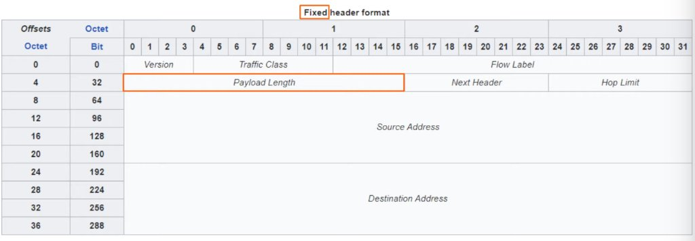
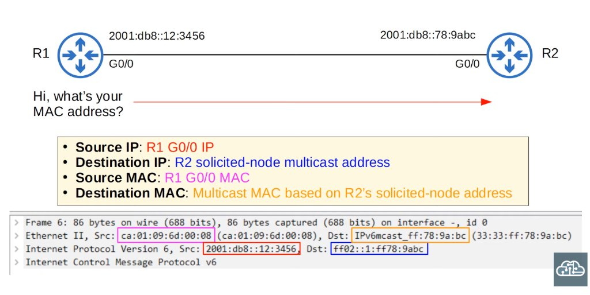
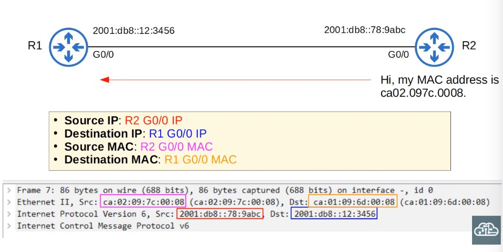
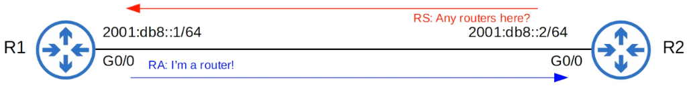
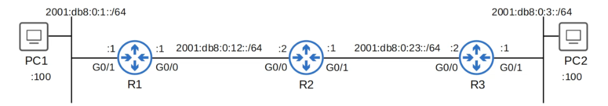

# IPv6 Part 3

## IPv6 Address Representation

- An RFC (Request for Comments) is a publication from the ISOC (Internet Society) and associated organizations like the IETF (Internet Engineering Task Force), and are the official documents of Internet specifications, protocols, procedures, etc.
- RFC 5952 is '**A Reccomendation for IPv6 Address Text Representation**'
- Before this RFC, IPv6 address representation was more flexible
  - You could remove leading 0s, or leave them
  - You could replace all-o quartets with ::, or leave them
  - You could use upper-case 0xA,B,C,D,E,F or lowe-case 0xa,b,c,d,e,f
- RFC 5952 suggests standardizing IPv6 address representation
- Leading 0s MUST be removed
  `2001:0db8:0000:0001:0f2a:4fff:fea3:00b1` -> `2001:db8:0:1:f2a:4fff:fea3:b1`
- `::` MUST be used to shorten the longest string of all-o quartets (if there is only one all-0 quartet, don't use `::`)
  `2001:0000:0000:0000:0f2a:0000:0000:00b1` -> `2001:db8::f2a:0:0:b1`
- Hexadecimal characters 'a', 'b', 'c', 'd', 'e', and 'f' MUST be written using lower-case, NOT upper-case A B C D E F

## IPv6 Header



### IPv6 Header - Version

- Length: 4 bits
- Indicates the version of IP that is used
- Fixed value of 6 (`0b0110`) to indicate IPv6

### IPv6 Header - Traffic Class

- Length: 8 bits
- Used for QoS (Quality of Service), to indicate high-priority traffic
- For example IP phone traffic, live video calls, etc, will have a Traffic Class value which gives them priority over other traffic

### IPv6 Header - Flow Label

- Length: 20 bits
- Used to identify specific traffic 'flows' (communications between a specific source and destination)

### IPv6 Header - Payload Length

- Length: 16 bits
- Indicates the length of the payload (the encapsulated Layer 4 segment) <u>in bytes</u>
- The length of the IPv6 header itself isn't included, because it's always 40 bytes

### IPv6 Header - Next Header

- Length: 8 bits
- Indicates the type of the 'next header' (header of the encapsulated segment), for example TCP or UDP
- Same function as the IPv4 header's 'Protocol' field

### IPv6 Header - Hop Limit

- Length: 8 bits
- The value in this field is decremented by 1 by each router that forwards it; if it reaches 0, the packet is discarded
- Same function as the IPv4 header's 'TTL' field

### IPv6 Header - Source / Destination

- Length: 128 bits each
- These fields contain the IPv6 addresses of the packet's source and the packet's intended destination

## Solicited-Node Multicast Address

- An IPv6 solicited-node multicast address is calculated from a unicast address
  `ff02:0000:0000:0000:0000:0001:ff` + `Last 5 hex digits of unicast address`
  `2001:0db8:0000:8001:0f2a:4fff:fea3:00b1` -> `ff02::1:ffa3:b1`
  `2001:0db8:0000:0001:0489:4eda:073a:12b8` -> `ff02::1:ff3a:12b8`

```cisco
R1#sh ipv6 int g0/0
GigabitEthernet0/0 is up, line protocol is up
  IPv6 is enabled, link-local address is FE80::EF8:22FF:FE36:8500
  No Virtual link-local address(es):
  Global unicast address(es):
    2001:DB8::EF8:22FF:FE36:8500, subnet is 2001:DB8::/64 [EUI]
  Joined group address(es):
    FF02::1
    FF02::2
    FF02::1:FF36:8500
  MTU is 1500 bytes
  ICMP error messages limited to one every 100 milliseconds
  ICMP redirects are enabled
  ICMP unreachables are sent
  ND DAD is enabled, number of DAD attempts: 1
  ND reachable time is 30000 milliseconds (using 30000)
  ND advertised reachable time is 0 (unspecified)
  ND advertised retransmit interval is 0 (unspecified)
  ND router advertisements are sent every 200 seconds
  ND router advertisements live for 1800 seconds
  ND advertised default router preference is Medium
  Hosts use stateless autoconfig for addresses.
```

## Neighbor Discovery Protocol

- Neighbor Discovery Protocol (NDP) is a protcol used with IPv6
- It has various functions, and one of those functions is to replace ARP, which is no longer used in IPv6
- The ARP-like function of NDP uses ICMPv6 and solicited-node multicast addresses to learn the MAC address of other hosts
  \*(ARP in IPv4 uses broadcast messages)
- Two message types are used:
  1. Neighbor Solicitation (NS) = ICMPv6 Type 135
  2. Neighbor Advertisement (NA) = ICMPv6 Type 136

### Neighbor Solicitation (NS)



### Neighbor Advertisement (NA)



### IPv6 Neighbor Table

```cisco
R1#show ipv6 neighbor
IPv6 Address                              Age Link-layer Addr State Interface
FE80::C802:9FF:FE7C:8                       0 ca02.097c.0008  REACH Gi0/0
2001:DB8::78:9ABC                           0 ca02.097c.0008  REACH Gi0/0
```

```cisco
R2#show ipv6 neighbor
IPv6 Address                              Age Link-layer Addr State Interface
FE80::C801:9FF:FE6D:8                       0 ca01.096d.0008  REACH Gi0/0
2001:DB8::12:3456                           0 ca01.096d.0008  REACH Gi0/0
```

---

- Another function of NDP allows hosts to automatically discover routers on the local network
- Two messages are used for this process:
  1. Router Solicitation (RS) = ICMPv6 Type 133
     - Sent to multicast address FF02::2 (all routers)
     - Asks all routers on the local link to identify themselves
     - Sent when an interface is enabled/host is connected to the network
  2. Router Advertisement (RA) = ICMPv6 Type 134
     - Sent to multicast address FF02::1 (all nodes)
     - The router announces its presence, as well as other information about the link
     - These messages are sent in response to RS messages
     - They are also sent periodically, even if the router hasn't received an RS



### SLAAC

- Stands for **Stateless Address Auto-configuration**
- Hosts use the RS/RA messages to learn the IPv6 prefix of the local link (ie. `2001:db8::/64`), and then automatically generate an IPv6 address
- Using the `ipv6 address prefix/prefix-length eui-64` command, you need to manually enter the prefix
- Using the `ipv6 address autoconfig` command, you don't need to enter the prefix; the device uses NDP to learn the prefix used on the local link
- The device will use EUI-64 to generate the interface ID, or it will be randomly generated (depending on the device/maker)

```cisco
R2(config)#int g0/0
R2(config-if)#ipv6 address autoconfig
R2(config-if)#do show ipv6 interface brief
GigabitEthernet0/0         [up/up]
    FE80::EF8:22FF:FE56:A600
    2001:DB8::EF8:22FF:FE56:A600
GigabitEthernet0/1         [administratively down/down]
    unassigned
GigabitEthernet0/2         [administratively down/down]
    unassigned
GigabitEthernet0/3         [administratively down/down]
    unassigned
```

### Duplicate Address Detection (DAD)

- Duplicate Address Detection (DAD) allows hosts to check if other devices on the local link are using the same IPv6 address
- Any time an IPv6-enabled interface initializes (**`no shutdown`** command), or an IPv6 address is configured on an interface (by any method: manual, SLAAC, etc.), it performs DAD
- DAD uses two messages from earlier: NS and NA
- The host will send an NS to its own IPv6 address; it it doesn't get a reply, it knows the address is unique
- If it gets a reply, it means another host on the network is already using the address

```cisco
*Oct 31 11:28:48.318: %IPv6_ND-4-DUPLICATE: Duplicate address 2001:DB8::1 on GigabitEthernet0/0
```

## IPv6 Static Routing

- IPv6 routing works the same as IPv4 routing
- However, the two processes are separate on the router, and the two routing tables are separate as well
- IPv4 routing is enabled by default
- IPv6 routing is disabled by default, and must be enabled with **`ipv6 unicast-routing`**
- If IPv6 routing is disabled, the router will be able to send and receive IPv6 traffic, but will not _route_ IPv6 traffic (=will not forward it between networks)



```cisco
R1#show ipv6 route
IPv6 Routing Table - default - 5 entries
Codes: C - Connected, L - Local, S - Static, U - Per-user Static route
       B - BGP, HA - Home Agent, MR - Mobile Router, R - RIP
       H - NHRP, I1 - ISIS L1, I2 - ISIS L2, IA - ISIS interarea
       IS - ISIS summary, D - EIGRP, EX - EIGRP external, NM - NEMO
       ND - ND Default, NDp - ND Prefix, DCE - Destination, NDr - Redirect
       RL - RPL, O - OSPF Intra, OI - OSPF Inter, OE1 - OSPF ext 1
       OE2 - OSPF ext 2, ON1 - OSPF NSSA ext 1, ON2 - OSPF NSSA ext 2
       la - LISP alt, lr - LISP site-registrations, ld - LISP dyn-eid
       lA - LISP away, a - Application
C   2001:DB8:0:1::/64 [0/0]
     via GigabitEthernet0/1, directly connected
L   2001:DB8:0:1::1/128 [0/0]
     via GigabitEthernet0/1, receive
C   2001:DB8:0:12::/64 [0/0]
     via GigabitEthernet0/0, directly connected
L   2001:DB8:0:12::1/128 [0/0]
     via GigabitEthernet0/0, receive
L   FF00::/8 [0/0]
     via Null0, receive
```

- A connected _network route_ is automatically added for each connected network
- A local _host route_ is automatically added for each address configured on the router
- Routes for link-local addresses are not added to the routing table

```
ipv6 route destination/prefix-length {next-hop | exit-interface [next-hop]} [ad]
```

- **Directly attached** static route: Only the exit interface is specified
  - `ipv6 route destination/prefix-length exit-interface`

  ```
  R1(config)# ipv6 route 2001:db8:0:3::/64 g0/0
  ```

  - In IPv6, you CAN'T use directly attached static routes if the interface is an Ethernet interface

- **Recursive** static route: Only the next hop is specified
  - `ipv6 route destination/prefix-length next-hop`
  ```
  R1(config)# ipv6 route 2001:db8:0:3::/64 2001:db8:0:12::2
  ```

```cisco
C   2001:DB8:0:1::/64 [0/0]
     via GigabitEthernet0/1, directly connected
L   2001:DB8:0:1::1/128 [0/0]
     via GigabitEthernet0/1, receive
S   2001:DB8:0:3::/64 [1/0]
     via 2001:DB8:0:12::2
C   2001:DB8:0:12::/64 [0/0]
     via GigabitEthernet0/0, directly connected
L   2001:DB8:0:12::1/128 [0/0]
     via GigabitEthernet0/0, receive
```

- **Fully specified** static route: Both the exit interface and next hop are specified
  - `ipv6 route destination/prefix-length exit-interface next-hop`

  ```
  R1(config)# ipv6 route 2001:db8:0:3::/64 g0/0 2001:db8:0:12::2
  ```

- **Network route:**

```
R1(config)# ipv6 route 2001:db8:0:3::/64 2001:db8:0:12::2
```

- **Host route:**

```
R2(config)# ipv6 route 2001:db8:0:1::100/128 2001:db8:0:12::1
R2(config)# ipv6 route 2001:db0:0:3::100/128 2001:db8:0:23::2
```

- **Default route:**

```
R3(config)# ipv6 route ::/0 2001:db8:23::1
```

### Link-Local Next-Hops

```cisco
R1(config)#ipv6 route 2001:db8:0:3::/64 FE80::EF8:22FF:FEE6:D300
% Interface has to be specified for a link-local nexthop
R1(config)#
R1(config)#ipv6 route 2001:db8:0:3::/64 g0/0 FE80::EF8:22FF:FEE6:D300
R1(config)#do show ipv6 route
IPv6 Routing Table - default - 6 entries
Codes: C - Connected, L - Local, S - Static, U - Per-user Static route
       B - BGP, HA - Home Agent, MR - Mobile Router, R - RIP
       H - NHRP, I1 - ISIS L1, I2 - ISIS L2, IA - ISIS interarea
       IS - ISIS summary, D - EIGRP, EX - EIGRP external, NM - NEMO
       ND - ND Default, NDp - ND Prefix, DCE - Destination, NDr - Redirect
       RL - RPL, O - OSPF Intra, OI - OSPF Inter, OE1 - OSPF ext 1
       OE2 - OSPF ext 2, ON1 - OSPF NSSA ext 1, ON2 - OSPF NSSA ext 2
       la - LISP alt, lr - LISP site-registrations, ld - LISP dyn-eid
       lA - LISP away, a - Application
C   2001:DB8:0:1::/64 [0/0]
     via GigabitEthernet0/1, directly connected
L   2001:DB8:0:1::1/128 [0/0]
     via GigabitEthernet0/1, receive
S   2001:DB8:0:3::/64 [1/0]
     via FE80::EF8:22FF:FEE6:D300, GigabitEthernet0/0
C   2001:DB8:0:12::/64 [0/0]
     via GigabitEthernet0/0, directly connected
L   2001:DB8:0:12::1/128 [0/0]
     via GigabitEthernet0/0, receive
L   FF00::/8 [0/0]
     via Null0, receive
```

## Quiz

1. R2 sends a message to R1, to tell R1 about the MAC address on R2's G0/0 interface. What kind of message does R2 send to R1?
   _b) NA_

2. You configure an IPv6 address on R1's G0/0 interface. What kind of message will it send to perform DAD?
   _d) NS_

3. R1 sends an RA message to devices on the local link to inform them about R1's presence, the prefix of the network, etc. What IPv6 address does R1 send the message to?
   _c) `FF02::1`_

4. You configure the following IPv6 static route:

```
R1(config)# ipv6 route 2001:db8:0:1::/64 g0/0 fe80::ef8:22ff:fe36:8502
```

What kind of static route is this? (select two)
_a) Fully specified_
_b) Network_

5. Which of the following commands configures a recursive host route?
   _c) `R1(config)# ipv6 route 2001:db8:1:1::1/128 2001:db8::2`_

6. You issue the **`ipv6 route 2001:DB8:2::/64 2001:DB8:1::2`** command on RouterA so that traffic can be routed to RouterC. When you attempt to ping the GigabitEthernet0/1 interface of RouterC by issuing the **`ping ipv6 2001:DB8:2::2`** command on RouterA, the ping fails. Which of the following is most likely the problem?


_c) RouterC does not have a route to the `2001:db8:1::/64` network_
