# Standard ACLs

## What are ACLs?

- ACLs (Access Control Lists) have multiple uses
- ACLs function as a packet filter, instructing the router to permit or discard specific traffic
- ACLs can filter traffic based on source/destination IP addresses, source/destination Layer 4 ports, etc.

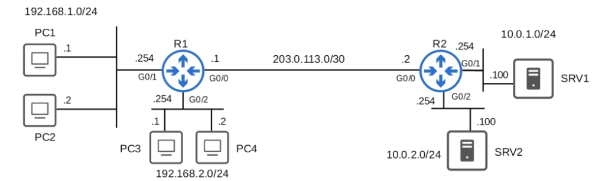

## How ACLs work

- REQUIREMENT:
  - Hosts in 192.168.1.0/24 can access the 10.0.1.0/24 network
  - Hosts in 192.168.2.0/24 cannot access the 10.0.1.0/24 network
- ACLs are configured globally on the router (global config mode)
- They are an ordered sequence of ACEs (Access Control Entries)

```
ACL 1:
1: if source IP = 192.168.1.0/24, then permit
2: if source IP = 192.168.2.0/24, then deny
3: if source IP = any, then permit
```


- Configuring an ACL in global config mode will not make the ACL take effect
- The ACL must be applied to an interface
- ACLs are applied either inbound or outbound

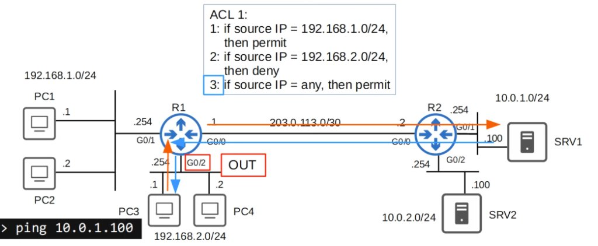

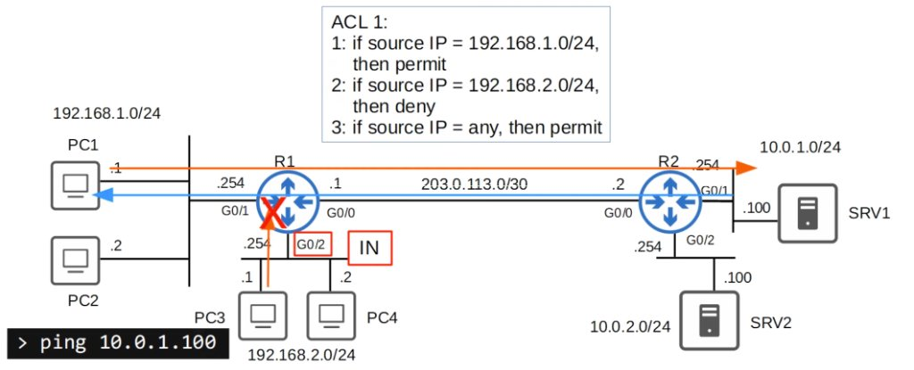

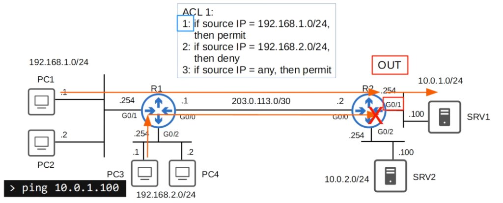

- ACLs are made up of one or more ACEs
- When the router checks a packet against the ACL, it processes the ACEs in order, from top to bottom
- If the packet matches one of the ACEs in the ACL, the router takes the action and stops processing the ACL; all entries below the matching entry will be ignored

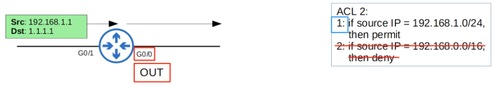

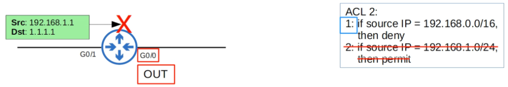

- A maximum of one ACL can be applied to a single interface <u>per direction</u>
  - **Inbound**: Maximum one ACL
  - **Outbound**: Maximum one ACL

## Implicit deny

- What will happen if a packet doesn't match any of the entries in an ACL?
- There is an 'implicit deny' at the end of all ACLs
- The implicit deny tells the router to deny all traffic that doesn't match any of the configured entries in the ACL

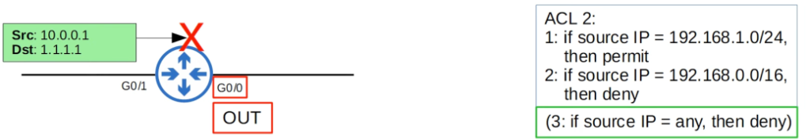

## ACL Types

- Standard ACLs: Match based on \*\*Source IP address <u>only</u>
  - Standard Numbered ACLs
  - Standard Named ACLs
- Extended ACLs: Match based on **Source/Destination IP, Source/Destination port**, etc.
  - Extended Numbered ACLs
  - Extended Named ACLs

## Standard Numbered ACLs

- Standard ACLs match traffic based only on the source IP address of the packet
- Numbered ACLs are identified with a number (ie. ACL 1, ACL 2, etc)
- Different types of ACLs have a different range of numbers that can be used
  - Standard ACLs can use 1-99 and 1300-1999
- The basic command to configure a standard numbered ACL is:

```
R1(config)# access-list number {deny | permit} ip wildcard-mask
```

```cisco
R1(config)# access-list 1 deny 1.1.1.1 0.0.0.0
R1(config)# access-list 1 deny 1.1.1.1
R1(config)# access-list 1 deny host 1.1.1.1

R1(config)# access-list 1 permit any
R1(config)# access-list 1 permit 0.0.0.0 255.255.255.255

R1(config)# access-list 1 remark ## BLOCK BOB FROM ACCOUNTING ##
```

```cisco
R1(config)#access-list 1 deny 1.1.1.1 0.0.0.0
R1(config)#access-list 1 permit 0.0.0.0 255.255.255.255
R1(config)#access-list 1 remark ## BLOCK BOB FROM ACCOUNTING ##
R1(config)#
R1(config)#do show access-lists
Standard IP access list 1
    10 deny   1.1.1.1
    20 permit any
R1(config)#
R1(config)#do show ip access-lists
Standard IP access list 1
    10 deny   1.1.1.1
    20 permit any
R1(config)#
R1(config)#do show running-config | include access-list
access-list 1 deny   1.1.1.1
access-list 1 permit any
access-list 1 remark ## BLOCK BOB FROM ACCOUNTING ##
R1(config)#
```

- Apply to an interface:

```
R1(config-if)# ip access-group number {in | out}
```

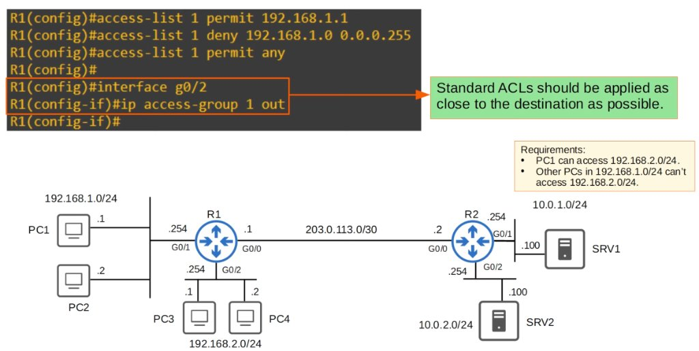

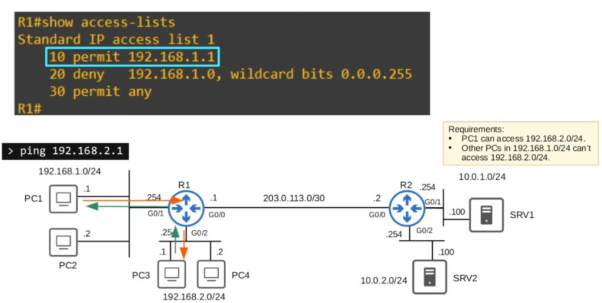

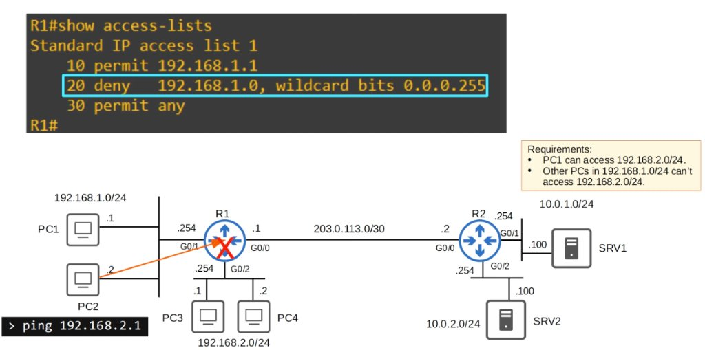

## Standard Named ACLs

- Standard ACLs match traffic based only on the source IP address of the packet
- Named ACLs are identified with a name (ie. 'BLOCK_BOB')
- Standard named ACLs are configured by entering 'standard named ACL config mode', and then configuring each entry within that config mode

```cisco
R1(config)# ip access-list standard acl-name
R1(config-std-nacl)# [entry-number] {deny | permit} ip wildcard-mask
```

```cisco
R1(config)#ip access-list standard BLOCK_BOB
R1(config-std-nacl)#5 deny 1.1.1.1
R1(config-std-nacl)#10 permit any
R1(config-std-nacl)#remark ## CONFIGURED NOV 21 2020 ##
R1(config-std-nacl)#interface g0/0
R1(config-if)#ip access-group BLOCK_BOB in
```

```cisco
R1#show access-lists
Standard IP access list BLOCK_BOB
    5 deny   1.1.1.1
    10 permit any
R1#
R1#show running-config | section access-list
ip access-list standard BLOCK_BOB
 deny   1.1.1.1
 permit any
 remark ## CONFIGURED NOV 21 2020 ##
R1#
```

```cisco
R1(config)# ip access-list standard acl-name
R1(config-std-nacl)# [entry-number] {deny | permit} ip wildcard-mask
```

```cisco
R1(config)#ip access-list standard BLOCK_BOB
R1(config-std-nacl)#5 deny 1.1.1.1
R1(config-std-nacl)#10 permit any
R1(config-std-nacl)#remark ## CONFIGURED NOV 21 2020 ##
R1(config-std-nacl)#interface g0/0
R1(config-if)#ip access-group BLOCK_BOB in
```

```cisco
R1#show access-lists
Standard IP access list BLOCK_BOB
    5 deny   1.1.1.1
    10 permit any
R1#
R1#show running-config | section access-list
ip access-list standard BLOCK_BOB
 deny   1.1.1.1
 permit any
 remark ## CONFIGURED NOV 21 2020 ##
R1#
```

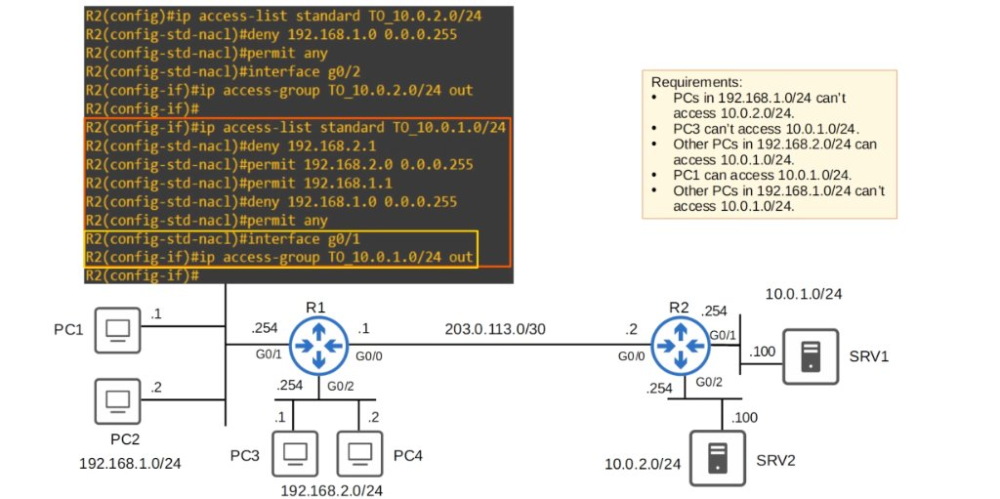

```cisco
R2#show ip access-lists
Standard IP access list TO_10.0.1.0/24
    30 permit 192.168.1.1
    10 deny   192.168.2.1
    20 permit 192.168.2.0, wildcard bits 0.0.0.255
    40 deny   192.168.1.0, wildcard bits 0.0.0.255
    50 permit any
Standard IP access list TO_10.0.2.0/24
    10 deny   192.168.1.0, wildcard bits 0.0.0.255
    20 permit any
R2#
```

- The router may re-order the /32 entries
- This improves the efficiency of processing the ACL
- It **does not** change the effect of the ACL
- This applies to both standard and standard numbered ACLs
- _Packet Tracer does not do this_

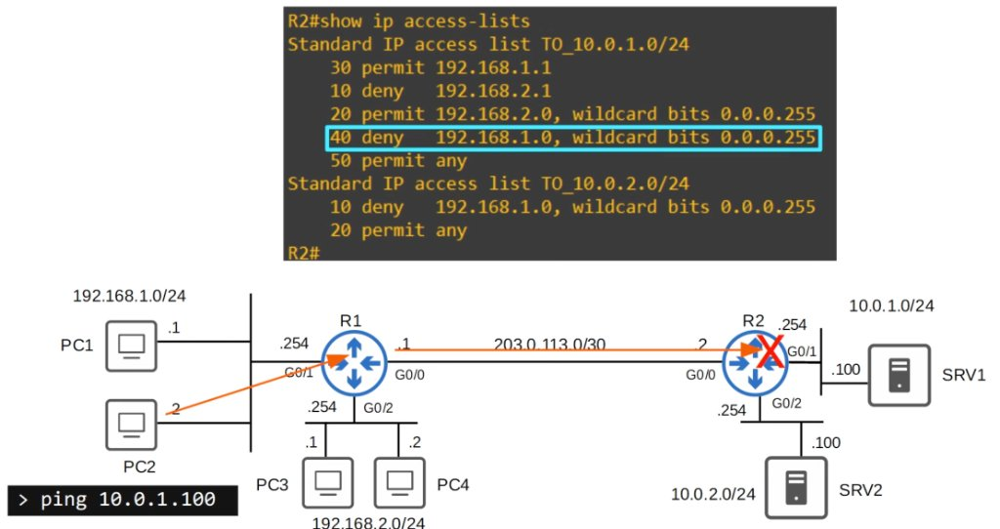

## Quiz


1. Which ACL, when applied outbound on R2's G0/1, permits ONLY PC1 and PC4 to access 10.0.1.0/24?

```cisco
Standard IP access list 1
    10 permit 192.168.1.1
    20 permit 192.168.2.2
```

2. Which interface should the following ACL be applied to, and in which direction, to fulfill the requirement?

```
Requirement:
- Only PC3 can reach SRV2
```

```cisco
Standard IP access list ALLOW_PC3
    10 permit 192.168.2.1
    20 deny   any
```

_Interface: R2 G0/2_
_Direction: Outbound_

3. You issue the following commands on R2. Which statement about the effect of the configurations is correct?

```cisco
R2(config)#access-list 10 deny 10.0.0.0 0.0.0.255
R2(config)#access-list 10 permit any
R2(config)#access-list 20 deny 172.16.0.0 0.0.0.255
R2(config)#access-list 20 permit any
R2(config)#access-list 30 deny 192.168.0.0 0.0.0.255
R2(config)#access-list 30 permit any
R2(config)#access-list 40 deny 0.0.0.0 255.255.255.255
R2(config)#interface g0/0
R2(config-if)#ip access-group 40 out
R2(config-if)#ip access-group 30 out
R2(config-if)#ip access-group 20 out
R2(config-if)#ip access-group 10 out
```

_b) Traffic from the 10.0.0.0/24 network will be denied_

4. If this ACL is applied inbound on R1 G0/0, which PCs will be able to ping SRV2?

```cisco
Standard IP access list TO_10.0.2.0/24
    20 permit 192.168.1.1
    10 permit 192.168.1.2
    40 deny   192.168.2.1
    30 deny   192.168.1.0, wildcard bits 0.0.0.255
    50 permit 192.168.2.0, wildcard bits 0.0.0.255
    60 permit 192.168.0.0, wildcard bits 0.0.255.255
    70 permit any
```

_d) All PCs_

5. What happens if a packet doesn't match any entries of an ACL?
   _c) The packet will be dropped_

6. Which of the following statements is true regarding ACLs?
   _b) ACLs are processed from the first entry in the list to the last entry_
