# Extended ACLs

## Configuring numbered ACLs with subcommands

- In modern IOS you can configure numbered ACLs in the exact same way as named ACLs:

```cisco
R1(config)# ip access-list standard 1
R1(config-std-nacl)# deny 192.168.1.1
R1(config-std-nacl)# permit any
```

- This is just a different way of configuring numbered ACLs; however, in the running-config the ACL will display as if it was configured using the traditional method

```cisco
R1(config)#ip access-list standard ?
  <1-99>       Standard IP access-list number
  <1300-1999>  Standard IP access-list number (expanded range)
  WORD         Access-list name

R1(config)#ip access-list standard 1
R1(config-std-nacl)#deny 192.168.1.1
R1(config-std-nacl)#permit any
R1(config-std-nacl)#
R1(config-std-nacl)#do show running-config | section access-list
access-list 1 deny   192.168.1.1
access-list 1 permit any
R1(config-std-nacl)#
```

## Advantages of named ACL config mode

- You can easily delete individual entries in the ACL with `no entry-number`

```cisco
R1(config-std-nacl)#do show access-lists
Standard IP access list 1
    10 deny   192.168.1.1
    20 deny   192.168.1.2
    30 deny   192.168.3.0, wildcard bits 0.0.0.255
    40 permit any
R1(config-std-nacl)#
R1(config-std-nacl)#no 30
R1(config-std-nacl)#
R1(config-std-nacl)#do show access-lists
Standard IP access list 1
    10 deny   192.168.1.1
    20 deny   192.168.1.2
    40 permit any
R1(config-std-nacl)#
```

```cisco
R1(config)#do show access-lists
Standard IP access list 1
    10 deny   192.168.1.1
    20 deny   192.168.1.2
    30 deny   192.168.3.0, wildcard bits 0.0.0.255
    40 permit any
R1(config)#do show running-config | section access-list
access-list 1 deny   192.168.1.1
access-list 1 deny   192.168.1.2
access-list 1 deny   192.168.3.0 0.0.0.255
access-list 1 permit any
R1(config)#no access-list 1 deny 192.168.3.0 0.0.0.255
R1(config)#do show access-lists
R1(config)#do show running-config | section access-list
R1(config)#
```

- When configuring/editing numbered ACLs from global config mode, <u>you can't delete individul entries, you can only delete the entire ACL!</u>
- You can easily delete individual entries in the ACL with `no sequence-number`
- You can insert new entries in between other entries by specifying the sequence number

```cisco
R1(config-std-nacl)#do show access-lists
Standard IP access list 1
    10 deny   192.168.1.1
    20 deny   192.168.1.2
    40 permit any
R1(config-std-nacl)#
R1(config-std-nacl)#30 deny 192.168.2.0 0.0.0.255
R1(config-std-nacl)#
R1(config-std-nacl)#do show access-lists
Standard IP access list 1
    10 deny   192.168.1.1
    20 deny   192.168.1.2
    30 deny   192.168.2.0, wildcard bits 0.0.0.255
    40 permit any
R1(config-std-nacl)#
R1(config-std-nacl)#do show running-config | section access-list
access-list 1 deny   192.168.1.1
access-list 1 deny   192.168.1.2
access-list 1 deny   192.168.2.0 0.0.0.255
access-list 1 permit any
```

## Resequencing ACLs

- There is a _resequencing_ function that helps edit ACLs
- The command is `ip access-list resequence acl-id starting-seq-num increment`

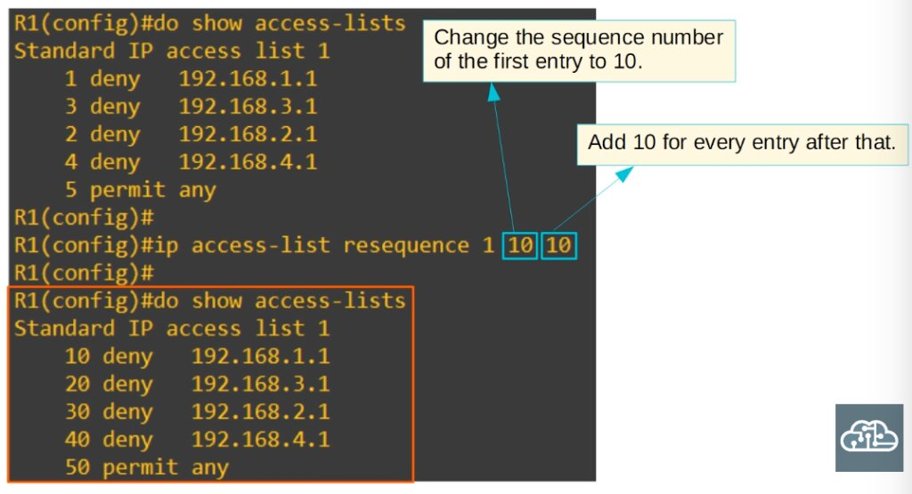

## Extended ACLs

- Extended ACLs function mostly the same as standard ACLs
- They can be numbered or named, just like standard ACLs
  - Numbered ACLs use the following ranges: 100 - 199, 2000 - 2699
- They are processed from top to bottom, just like standard ACLs
- However, they can match traffic based on more parameters, so they are more precise (and more complex) than standard ACLs
- We will focus on matching based on these main parameters: **Layer 4 protcol/port, source address**, and **destination address**

```cisco
R1(config)# access-list number [permit | deny] protocol src-ip dest-ip

R1(config)# ip access-list extended {name | number}
R1(config-ext-nacl)# [seq-num] [permit | deny] protocol src-ip dest-ip
```

### Matching the protocol

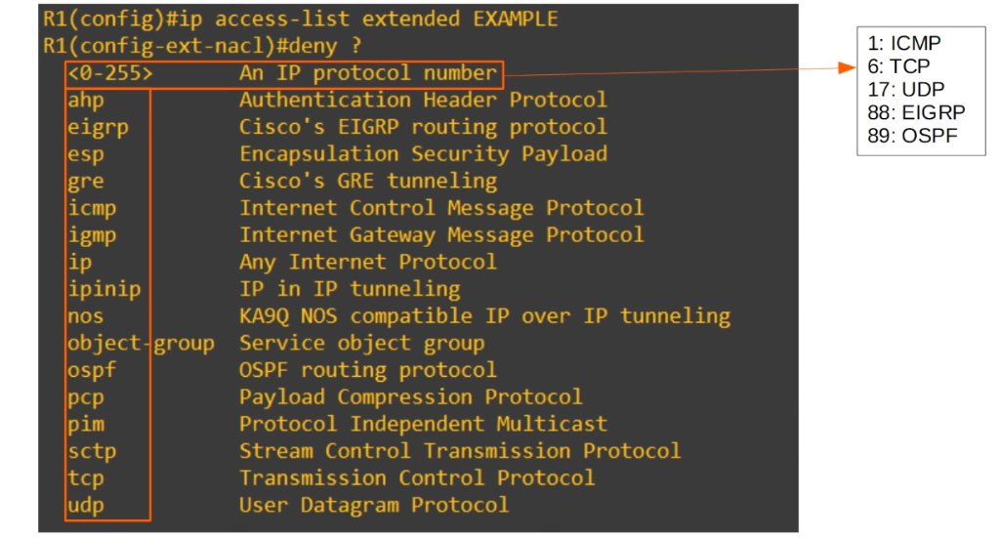

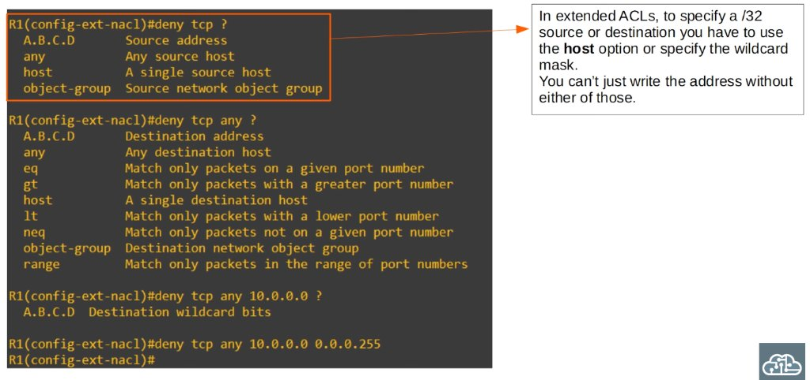

- Deny all packets that encapsulate a TCP segment, from any source to destination 10.0.0.0/24

### Extended ACL entry practice (1)

| Requirement / Command                                                    |
| :----------------------------------------------------------------------- |
| 1. Allow all traffic                                                     |
| `R1(config-ext-nacl)#permit ip any any`                                  |
| 2. Prevent 10.0.0.0/16 from sending UDP traffic to 192.168.1.1/32        |
| `R1(config-ext-nacl)#deny udp 10.0.0.0 0.0.255.255 host 192.168.1.1`     |
| 3. Prevent 172.16.1.1/32 from pinging hosts in 192.168.0.0/24            |
| `R1(config-ext-nacl)#deny icmp 172.16.1.1 0.0.0.0 192.168.0.0 0.0.0.255` |

### Matching the TCP/UDP port numbers

- When matching TCP/UDP, you can optionally specify the source and/or destination port numbers to match

```cisco
R1(config-ext-nacl)#deny tcp src-ip {eq | gt | lt | neq | range} src-port-num dest-ip {eq | gt | lt | neq | range} dst-port-num
```

- `eq 80` = equal to port 80
- `gt 80` = greater than 80 (81 and greater)
- `lt 80` = less than 80 (79 and less)
- `neq 80` = NOT 80
- `range 80 100` = from port 80 to port 100

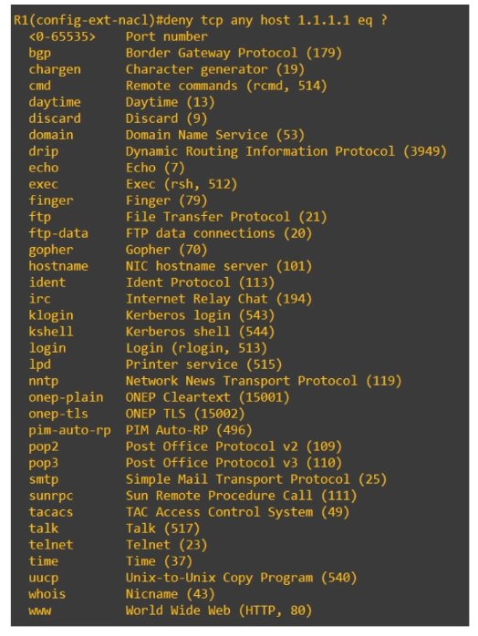

```
R1(config-std-nacl)#deny tcp any host 1.1.1.1 eq 80
```

    - Deny all packets destined for IP address 1.1.1.1/32, TCP port 80

- After the destination IP address and/or destination port numbers, there are many more options you can use to match; some examples:
  - `ack`: match the TCP ACK flag
  - `fin`: match the TCP FIN flag
  - `syn`: match the TCP SYN flag
  - `ttl`: match packets with a specific TTL value
  - `dscp`: match packets with a specific DSCP value
- If you specify the protocol, source IP, source port, destination IP, destination port, etc, a packet must match ALL of those values to match the ACL entry
  - Even if it matches all except one of the paramaters the packet won't match that entry for the ACL

### Extended ACL entry practice (2)

| Requirement / Command                                                                                                                  |
| :------------------------------------------------------------------------------------------------------------------------------------- |
| 1. Allow traffic from 10.0.0.0/16 to access the server at 2.2.2.2/32 using HTTPS.                                                      |
| `R1(config-ext-nacl)#permit tcp 10.0.0.0 0.0.255.255 host 2.2.2.2 eq 443`                                                              |
| 2. Prevent all hosts using source UDP port numbers from 20000 to 30000 from accessing the server at 3.3.3.3/32.                        |
| `R1(config-ext-nacl)#deny udp any range 20000 30000 host 3.3.3.3`                                                                      |
| 3. Allow hosts in 172.16.1.0/24 using a TCP source port greater than 9999 to access all TCP ports on server 4.4.4.4/32 except port 23. |
| `R1(config-ext-nacl)#permit tcp 172.16.1.0 0.0.0.255 gt 9999 host 4.4.4.4 neq 23`                                                      |

---

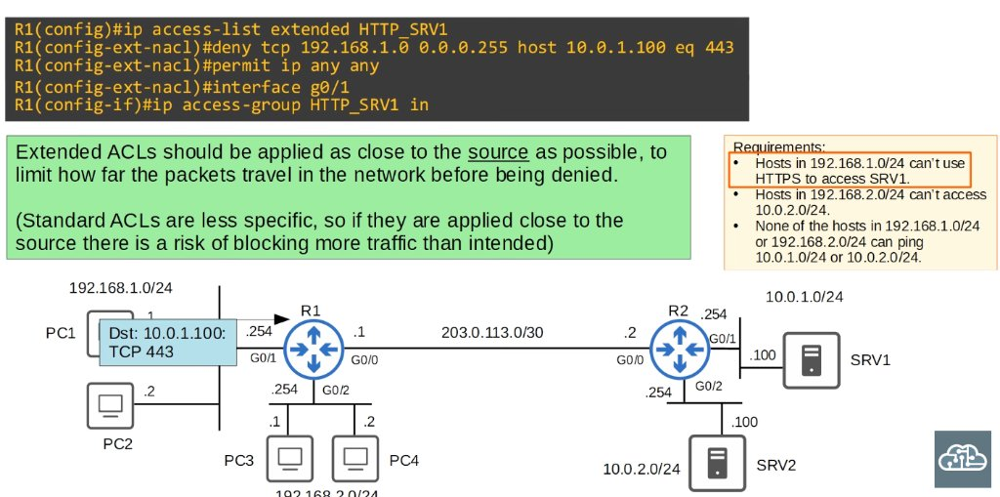

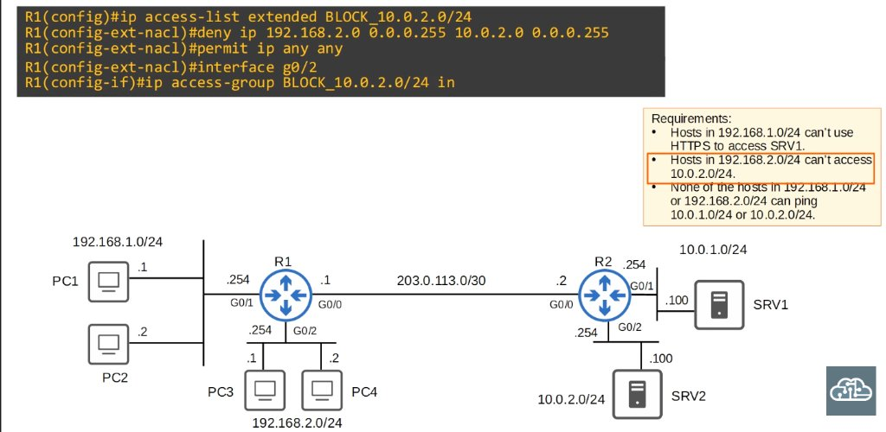

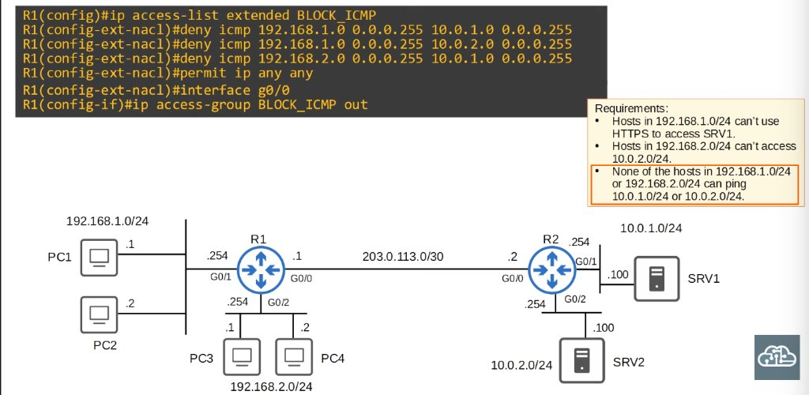

```cisco
R1#show access-lists
Extended IP access list BLOCK_10.0.2.0/24
    10 deny ip 192.168.2.0 0.0.0.255 10.0.2.0 0.0.0.255
    20 permit ip any any
Extended IP access list BLOCK_ICMP
    10 deny icmp 192.168.1.0 0.0.0.255 10.0.1.0 0.0.0.255
    20 deny icmp 192.168.1.0 0.0.0.255 10.0.2.0 0.0.0.255
    30 deny icmp 192.168.2.0 0.0.0.255 10.0.1.0 0.0.0.255
    40 permit ip any any
Extended IP access list HTTP_SRV1
    10 deny tcp 192.168.1.0 0.0.0.255 host 10.0.1.100 eq 443
    20 permit ip any any
```

```cisco
R1#show ip interface g0/0
GigabitEthernet0/0 is up, line protocol is up
  Internet address is 203.0.113.1/30
  Broadcast address is 255.255.255.255
  Address determined by non-volatile memory
  MTU is 1500 bytes
  Helper address is not set
  Directed broadcast forwarding is disabled
  Outgoing access list is BLOCK_ICMP
  Inbound  access list is not set
  Proxy ARP is enabled
  Local Proxy ARP is disabled
  Security level is default
  Split horizon is enabled
  ICMP redirects are always sent
  ICMP unreachables are always sent
  ICMP mask replies are never sent
```

## Quiz

1. Which ACL, when applied outbound on R1's G0/0, permits only PC1 to access the TFTP server on SRV1?

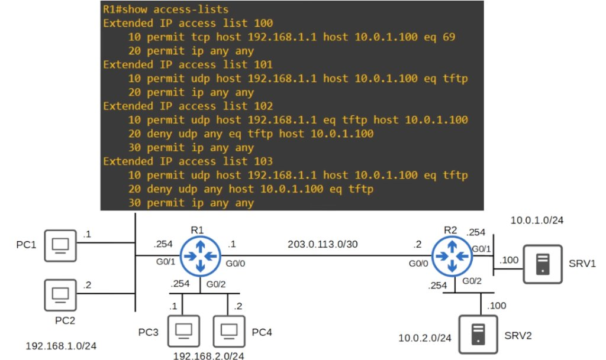

_`Extended IP access list 103`_

2. What effect will the following command have on ACL 1?

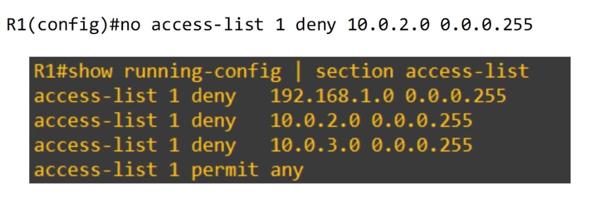

_b) ACL 1 will be deleted_

3. Which command was used to resequence ACL 199?

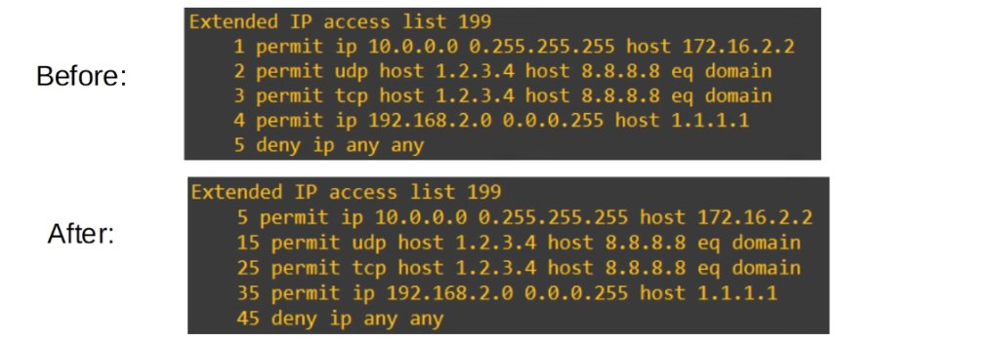

_c) `R1(config)#ip access-list resequence 199 5 10`_

4. Which of the following ACLs would prevent R1 from forwarding OSPF packets out of G0/2?

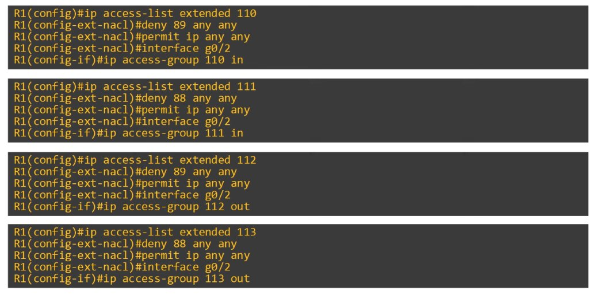

_ACL 112_

5. ACL 150 isn't having the intended effect. How can it be fixed to deny HTTP and HTTPS traffic from 192.168.1.0/24 to 10.0.2.0/24, but allow other traffic?

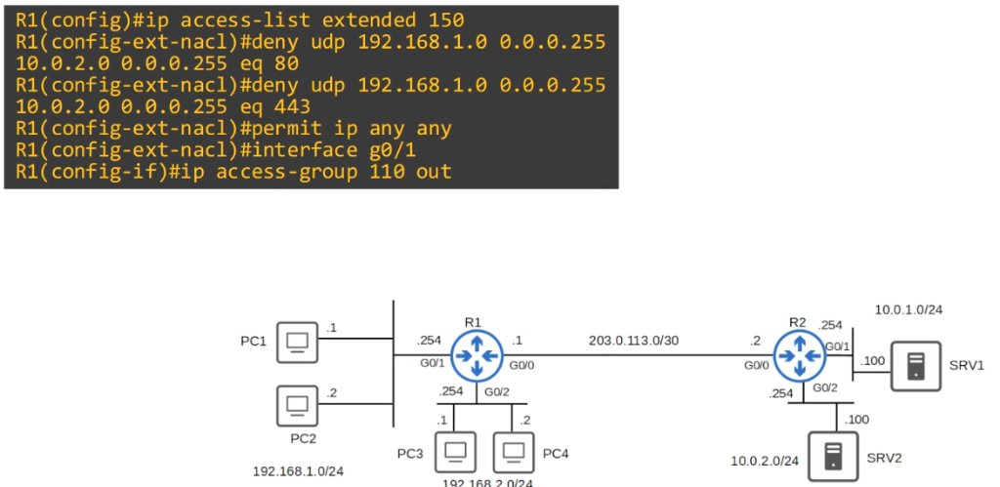

_c) Apply the ACL inbound on G0/1, not outbound_
_e) The protocol should be TCP, not UDP_

6. You have been hired as a consultant for Music World Corp. You need to limit access from the Internet to the music download servers, Music Server1 and Music Server2. These two servers should allow only FTP connections from the Internet. The web server is not subject to this policy and should not be restricted. Other servers on the 10.10.10.0/24 subnet should not allow any connections from the Internet. You have already issued the `access-list 101 permit tcp any host 10.10.10.20` command and applied the access list outbound the Fa0/0 interface.

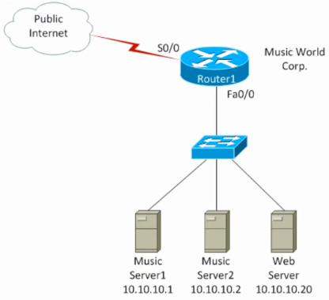

Which of the following access lists should you use?

_a) `access-list 101 permit tcp any 10.10.10.0 0.0.0.3 eq ftp`_
