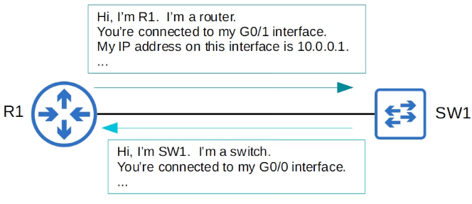
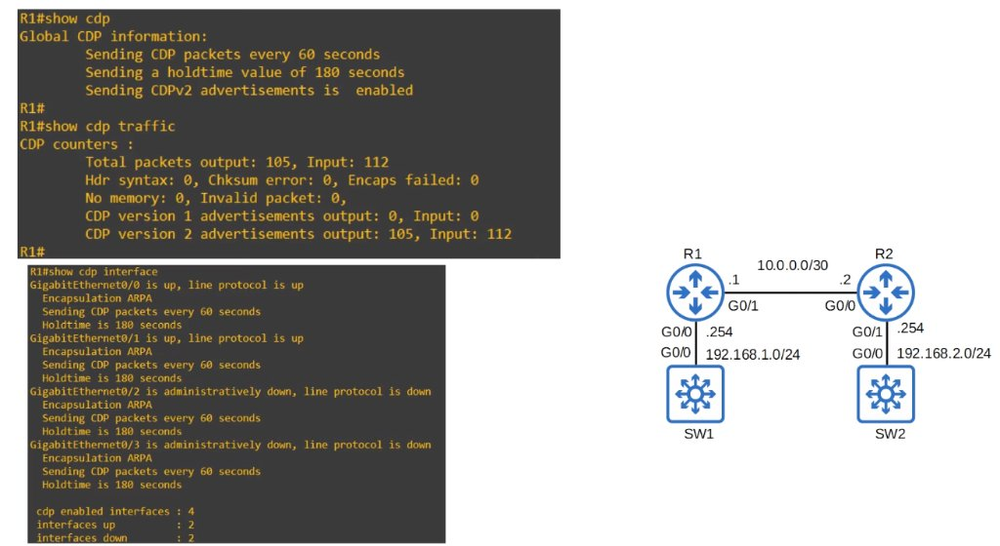
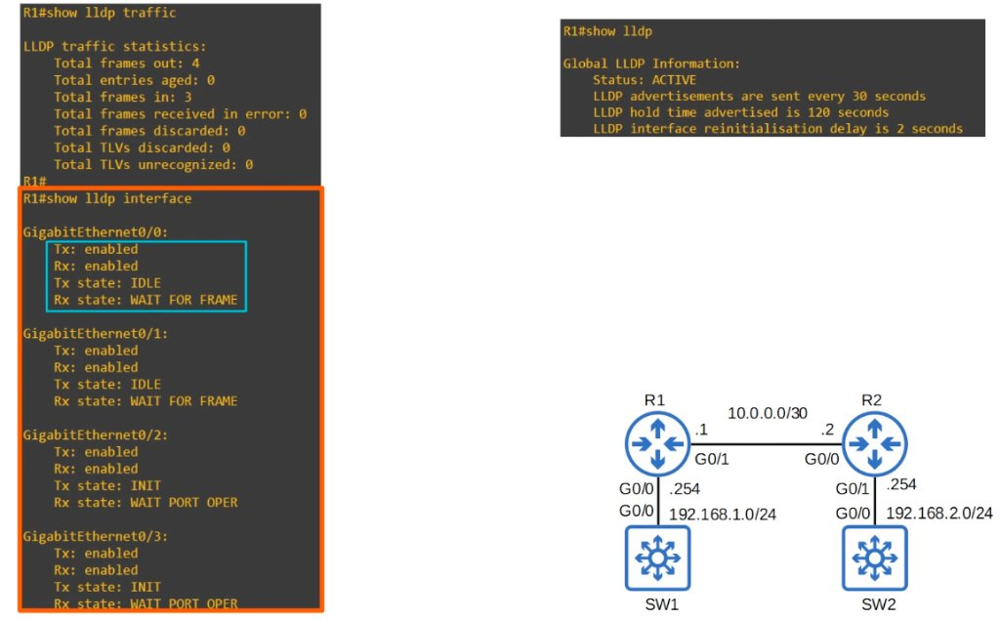
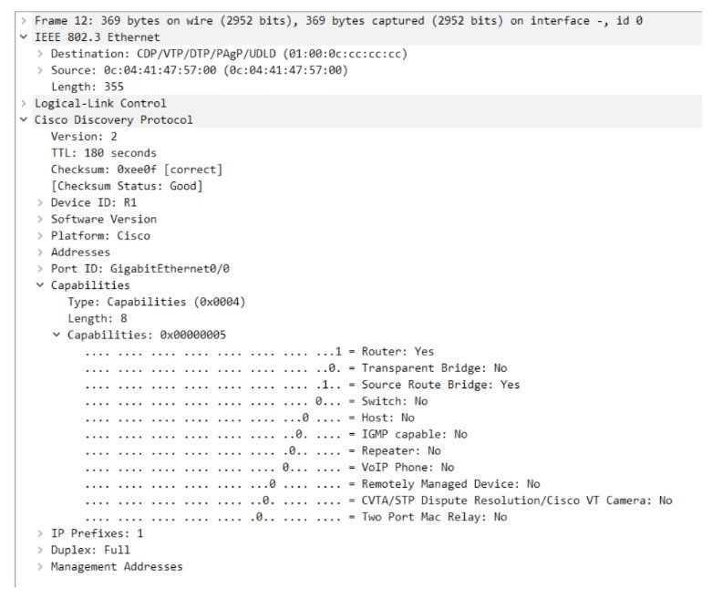
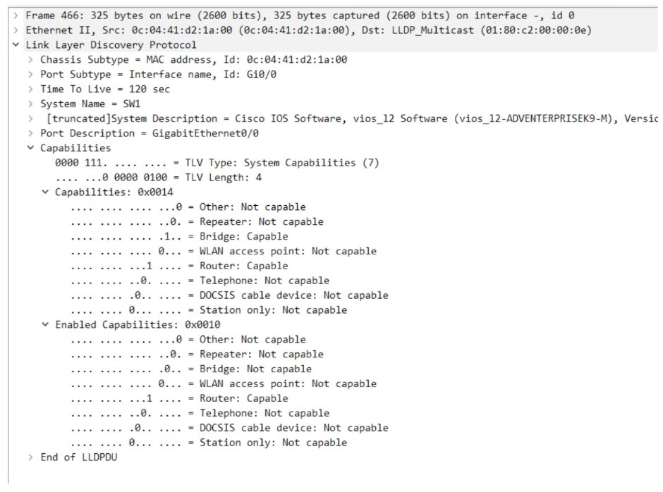

# Layer 2 Discovery Protocols (CDP & LLDP)

## Layer 2 Discovery Protocols

- Layer 2 discovery procols such as CDP and LLDP share information and discover information about neighboring (connected) devices
- The shared information includes host name, IP address, device type, etc.
- CDP is a Cisco proprietary protocol
- LLDP is an industry standard protocl (IEEE 802.1AB)
- Because they share information about the devices in the network, they can be considered a security risk and often not used; it is up to the network engineer/admin to decide if they want to use them in the network or not



## Cisco Discovery Protocol

- CDP is a Cisco proprietary protocol
- It is enabled on Cisco devices (routers, switches, firewalls, IP phones, etc) by default
- CDP messages are periodically sent to multicast MAC address 0100.0CCC.CCCC
- When a device receives a CDP message, it processes and discards the message; it does NOT forward it to other devices
- By default, CDP messsages are sent once every **60 seconds**
- By default, the CDP holdtime is **180 seconds**; if a message isn't received from a neighbor for 180 seconds, the neighbor is removed from the CDP neighbor table
- CDPv2 messages are sent by default



- _If CDP is not enabled on the device:_

```cisco
R1#show cdp
% CDP is not enabled
R1#
```

```cisco
R1#show cdp neighbors
Capability Codes: R - Router, T - Trans Bridge, B - Source Route Bridge
                  S - Switch, H - Host, I - IGMP, r - Repeater, P - Phone,
                  D - Remote, C - CVTA, M - Two-port Mac Relay

Device ID        Local Intrfce     Holdtme    Capability  Platform  Port ID
SW1              Gig 0/0           153              R S I           Gig 0/0
R2               Gig 0/1           146              R B             Gig 0/0

Total cdp entries displayed : 2
R1#
```

```cisco
R1#show cdp neighbors detail
-------------------------
Device ID: SW1
Entry address(es):
Platform: Cisco ,  Capabilities: Router Switch IGMP
Interface: GigabitEthernet0/0,  Port ID (outgoing port): GigabitEthernet0/0
Holdtime : 174 sec

Version :
Cisco IOS Software, vios_l2 Software (vios_l2-ADVENTERPRISEK9-M), Version 15.2(4.0.55)E, TEST ENGINEERING ESTG_WEEKLY BUILD, synced to  END_OF_FLO_ISP
Technical Support: http://www.cisco.com/techsupport
Copyright (c) 1986-2015 by Cisco Systems, Inc.
Compiled Tue 28-Jul-15 18:52 by sasyamal

advertisement version: 2
VTP Management Domain: ''
Native VLAN: 1
Duplex: full

-------------------------
Device ID: R2
Entry address(es):
  IP address: 10.0.0.2
Platform: Cisco ,  Capabilities: Router Source-Route-Bridge
Interface: GigabitEthernet0/1,  Port ID (outgoing port): GigabitEthernet0/0
Holdtime : 163 sec

Version :
Cisco IOS Software, IOSv Software (VIOS-ADVENTERPRISEK9-M), Version 15.6(2)T, RELEASE SOFTWARE (fc2)
Technical Support: http://www.cisco.com/techsupport
Copyright (c) 1986-2016 by Cisco Systems, Inc.
Compiled Tue 22-Mar-16 16:19 by prod_rel_team

advertisement version: 2
Duplex: full
Management address(es):
  IP address: 10.0.0.2


Total cdp entries displayed : 2
```

```cisco
R1#show cdp entry R2
-------------------------
Device ID: R2
Entry address(es):
  IP address: 10.0.0.2
Platform: Cisco ,  Capabilities: Router Source-Route-Bridge
Interface: GigabitEthernet0/1,  Port ID (outgoing port): GigabitEthernet0/0
Holdtime : 178 sec

Version :
Cisco IOS Software, IOSv Software (VIOS-ADVENTERPRISEK9-M), Version 15.6(2)T, RELEASE SOFTWARE (fc2)
Technical Support: http://www.cisco.com/techsupport
Copyright (c) 1986-2016 by Cisco Systems, Inc.
Compiled Tue 22-Mar-16 16:19 by prod_rel_team

advertisement version: 2
Duplex: full
Management address(es):
  IP address: 10.0.0.2
```

### CDP `show` commands summary

- `R1# show cdp`
  - shows basic information about CDP (timers, version)
- `R1# show cdp traffic`
  - displays how many CDP messages have been sent and received
- `R1# show cdp interface`
  - displays which interfaces CDP is enabled on
- `R1# show cdp neighbors`
  - lists CDP neighbors and some basic information about each neighbor
- `R1# show cdp neighbors detail`
  - lists each CDP neighbor with more detailed information
- `R1# show cdp entry name`
  - displays the same info as above, but for the specified neighbor only

### CDP Configuration Commands

- CDP is globally enabled by default
- CDP is also enabled on each interface by default
- To enable/disable CDP globally: `R1(config)# [no] cdp run`
- To enable/disable CDP on specific interfaces: `R1(config-if)# [no] cdp enable`
- Configure the CDP timer: `R1(config)# cdp timer seconds`
- Configure the CDP holdtime: `R1(config)# cdp holdtime seconds`
- Enable/disable CDPv2: `R1(config)# [no] cdp advertise-v2`

## Link Layer Discovery Protocol

- LLDP is an industry standard protocol (IEEE 802.1AB)
- It is usually disabled on Cisco devices by default, so it must be manually enabled
- A device can run CDP and LLDP at the same time
- LLDP messages are periodically sent to multicast MAC address `0180.C200.000E`
- When a device receives an LLDP message, it processes and discards the message; it does NOT forward it to other devices
- By default, LLDP messages are sent once every **30 seconds**
- By default, the LLDP holdtime is **120 seconds**
- LLDP has an additional timer called the 'reinitialization delay'; if LLDP is enabled (globally or on an interface), this timer will delay the actual initialization of LLDP; **2 seconds** by default

### LLDP Configuration Commands

- LLDP is usually globally disabled by default
- LLDP is also disabled on each interface by default
- To enable LLDP globally: `R1(config)# lldp run`
- To enable LLDP on specific interfaces (tx): `R1(config-if)# lldp transmit`
- To enable LLDP on a specific interface (rx): `R1(config-if)# lldp receive`
- Configure the LLDP timer: `R1(config)# lldp timer seconds`
- Configure the LLDP holdtime: `R1(config)# lldp holdtime seconds`
- Configure the LLDP reinit timer: `R1(config)# lldp reinit seconds`

---



```cisco
R1#show lldp neighbors
Capability codes:
    (R) Router, (B) Bridge, (T) Telephone, (C) DOCSIS Cable Device
    (W) WLAN Access Point, (P) Repeater, (S) Station, (O) Other

Device ID           Local Intf     Hold-time  Capability      Port ID
SW1                 Gi0/0          120                        Gi0/0
R2                  Gi0/1          120        R               Gi0/0

Total entries displayed: 2
```

```cisco
R1#show lldp neighbors detail
------------------------------------------------
Local Intf: Gi0/0
Chassis id: 0c04.41d2.1a00
Port id: Gi0/0
Port Description: GigabitEthernet0/0
System Name: SW1

System Description:
Cisco IOS Software, vios_l2 Software (vios_l2-ADVENTERPRISEK9-M), Version 15.2(4.0.55)E, TEST ENGINEERING ESTG_WEEKLY BUILD, synced to  END_OF_FLO_ISP
Technical Support: http://www.cisco.com/techsupport
Copyright (c) 1986-2015 by Cisco Systems, Inc.
Compi

Time remaining: 99 seconds
System Capabilities: B,R
Enabled Capabilities - not advertised
Management Addresses - not advertised
Auto Negotiation - not supported
Physical media capabilities - not advertised
Media Attachment Unit type - not advertised
Vlan ID: - not advertised

------------------------------------------------
Local Intf: Gi0/1
Chassis id: 0c04.418d.a400
Port id: Gi0/0
Port Description: GigabitEthernet0/0
System Name: R2

System Description:
Cisco IOS Software, IOSv Software (VIOS-ADVENTERPRISEK9-M), Version 15.6(2)T, RELEASE SOFTWARE (fc2)
Technical Support: http://www.cisco.com/techsupport
Copyright (c) 1986-2016 by Cisco Systems, Inc.
Compiled Tue 22-Mar-16 16:19 by prod_rel_team

Time remaining: 92 seconds
System Capabilities: B,R
Enabled Capabilities: R
Management Addresses:
    IP: 10.0.0.2
```

```cisco
R1#show lldp entry SW1
Capability codes:
    (R) Router, (B) Bridge, (T) Telephone, (C) DOCSIS Cable Device
    (W) WLAN Access Point, (P) Repeater, (S) Station, (O) Other
------------------------------------------------
Local Intf: Gi0/0
Chassis id: 0c04.41d2.1a00
Port id: Gi0/0
Port Description: GigabitEthernet0/0
System Name: SW1

System Description:
Cisco IOS Software, vios_l2 Software (vios_l2-ADVENTERPRISEK9-M), Version 15.2(4.0.55)E, TEST ENGINEERING ESTG_WEEKLY BUILD, synced to  END_OF_FLO_ISP
Technical Support: http://www.cisco.com/techsupport
Copyright (c) 1986-2015 by Cisco Systems, Inc.
Compi

Time remaining: 119 seconds
System Capabilities: B,R
Enabled Capabilities: R
Management Addresses - not advertised
Auto Negotiation - not supported
Physical media capabilities - not advertised
Media Attachment Unit type - not advertised
Vlan ID: - not advertised
```

### LLDP `show` commands summary

- `R1# show lldp`
  - shows basic information about LLDP (timers, version)
- `R1# show lldp traffic`
  - displays how many LLDP messages have been sent and received
- `R1# show lldp interface`
  - displays which interfaces LLDP tx/rx is enabled on
- `R1# show lldp neighbors`
  - lists LLDP neighbors and some basic information about each neighbor
- `R1# show lldp neighbors detail`
  - lists each LLDP neighbor with more detailed information
- `R1# show lldp entry name`
  - displays the same info as above, but for the specified neighbor only

## Wireshark Captures





## Quiz

1. Which of the following commands show the configured CDP timers? (select two)

_a) `R1#show cdp`_
_c) `R1#show cdp interface`_

2. Which of the following commands represent the default CDP state? (select two)

_c) `R1(config-if)#cdp enable`_
_d) `R1(config)#cdp timer 60`_

3. You issue the **`show lldp entry SW1`** command on R1. R1's neighbor SW1 is a multilayer switch. What do you expect to see in the 'system capabilities' field of the output?

_b) `System Capabilities: B,R`_

4. Which of the following statements about LLDP are true? (select two)

_b) Interface Tx and Rx operations are enabled separately._
_f) LLDP can be used to learn the OS version of a neighboring device._

5. Which interface on R2 is SW2 connected to?

```cisco
R2#show cdp neighbors
Capability Codes: R - Router, T - Trans Bridge, B - Source Route Bridge
                  S - Switch, H - Host, I - IGMP, r - Repeater, P - Phone,
                  D - Remote, C - CVTA, M - Two-port Mac Relay

Device ID        Local Intrfce     Holdtme    Capability  Platform  Port ID
SW4              Gig 0/2           131              R S I           Gig 0/3
SW2              Gig 0/1           173              R S I           Gig 0/0
SW3              Gig 0/3           179              R S I           Gig 0/2
R1               Gig 0/0           163              R B             Gig 0/1

Total cdp entries displayed : 4
R2#
```

_b) G0/1_

6. You issue the following command on your router:

```
RouterA#show cdp neighbors
```

_b) the interface on the neighboring device that is connected to RouterA_
_c) the device ID of the neighboring device_
_e) the interface on RouterA that is connected to the neighboring device_
_f) the capabilities and product number of the neighboring device_
