# NTP (Network Time Protocol)

## The importance of time

- All devices have an internal clock (routers, switches, your PC, etc)
- In Cisco IOS, you can view the time with the **`show clock`** command

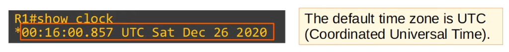

- If you use the **`show clock detail`** command, you can see the time source

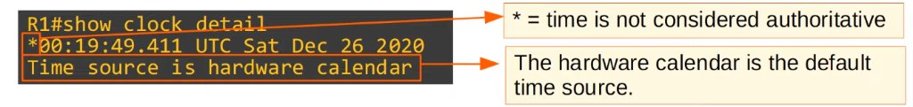

- The internal hardware clock of a device will drift over time, so it is not the ideal time source
- <u>The most important reason to have accurate time on a device is to have accurate logs for troubleshooting</u>
- **Syslog**, the protocol used to keep device logs, will be covered in a later video

## `show logging`

```cisco
R2#show logging
!output abbreviated!
*Dec 27 00:50:20.005: %OSPF-5-ADJCHG: Process 1, Nbr 192.168.122.192 on GigabitEthernet0/0 from LOADING to FULL, Loading Done
*Dec 27 01:06:38.653: %OSPF-5-ADJCHG: Process 1, Nbr 10.0.0.6 on GigabitEthernet0/1 from LOADING to FULL, Loading Done
*Dec 27 01:07:07.311: %OSPF-5-ADJCHG: Process 1, Nbr 10.0.0.6 on GigabitEthernet0/1 from LOADING to FULL, Loading Done
*Dec 27 01:08:29.924: %OSPF-5-ADJCHG: Process 1, Nbr 10.0.0.6 on GigabitEthernet0/1 from FULL to DOWN, Neighbor Down: Dead timer expired
*Dec 27 01:09:10.714: %OSPF-5-ADJCHG: Process 1, Nbr 10.0.0.6 on GigabitEthernet0/1 from LOADING to FULL, Loading Done

R2#show clock
*01:17:06.706 UTC Sun Dec 27 2020
```

```cisco
R3#show logging
!output abbreviated!
May 23 16:24:17.320: %OSPF-5-ADJCHG: Process 1, Nbr 10.0.0.5 on GigabitEthernet0/0 from LOADING to FULL, Loading Done
May 23 16:25:08.758: %OSPF-5-ADJCHG: Process 1, Nbr 10.0.0.5 on GigabitEthernet0/0 from FULL to DOWN, Neighbor Down: Interface down or detached
May 23 16:25:10.714: %LINK-5-CHANGED: Interface GigabitEthernet0/0, changed state to down
May 23 16:25:11.716: %LINEPROTO-5-UPDOWN: Line protocol on Interface GigabitEthernet0/0, changed state to down
May 23 16:26:14.976: %LINK-3-UPDOWN: Interface GigabitEthernet0/0, changed state to up
May 23 16:26:15.977: %LINEPROTO-5-UPDOWN: Line protocol on Interface GigabitEthernet0/0, changed state to up
May 23 16:26:20.618: %OSPF-5-ADJCHG: Process 1, Nbr 10.0.0.5 on GigabitEthernet0/0 from LOADING to FULL, Loading Done

R3#show clock
16:30:37.020 UTC Fri May 23 2008
```

## Manual Time Configuration

- You can manually configure the time on the device with the **`clock set`** command

```cisco
R2#clock set ?
  hh:mm:ss  Current Time

R2#clock set 14:30:00 ?
  <1-31>  Day of the month
  MONTH   Month of the year

R2#clock set 14:30:00 27 ?
  MONTH  Month of the year

R2#clock set 14:30:00 27 Dec ?
  <1993-2035>  Year

R2#clock set 14:30:00 27 Dec 2020 ?
  <cr>

R2#clock set 14:30:00 27 Dec 2020
R2#show clock detail
14:30:05.887 UTC Sun Dec 27 2020
Time source is user configuration
```

- Although the hardware calendar (built-in clock) is the default time-source, the hardware clock and software clock are separate and can be configured separately

## Hardware Clock (Calendar) Configuration

- You can manually configure the hardware clock with the **`calendar set`** command

```cisco
R2#calendar set 14:35:00 ?
  <1-31>  Day of the month
  MONTH   Month of the year

R2#calendar set 14:35:00 27 ?
  MONTH  Month of the year

R2#calendar set 14:35:00 27 Dec ?
  <1993-2035>  Year

R2#calendar set 14:35:00 27 Dec 2020 ?
  <cr>

R2#calendar set 14:35:00 27 Dec 2020
R2#show calendar
14:35:07 UTC Sun Dec 27 2020
```

- Typically you will want to synchronize the 'clock' and 'calendar'
- Use the command **`clock update-calendar`** to sync the calendar to the clock's time
- Use the command **`clock read-calendar`** to sync the clock to the calendar's time

```cisco
R2#show clock
14:38:14.301 UTC Sun Dec 27 2020
R2#show calendar
00:00:03 UTC Sun Dec 27 2020
R2#clock update-calendar
R2#show clock
14:38:22.181 UTC Sun Dec 27 2020
R2#show calendar
14:38:23 UTC Sun Dec 27 2020
```

```cisco
R2#show clock
00:00:15.788 UTC Mon Sep 6 1993
R2#show calendar
14:55:07 UTC Sun Dec 27 2020
R2#clock read-calendar
R2#show clock
14:55:12.522 UTC Sun Dec 27 2020
R2#show calendar
14:55:15 UTC Sun Dec 27 2020
```

## Configuring the Time Zone

- You can configure the time zone with the **`clock timezone`** command

```cisco
R2(config)#do show clock
15:13:33.985 UTC Sun Dec 27 2020
R2(config)#clock timezone ?
  WORD  name of time zone

R2(config)#clock timezone JST ?
  <-23 - 23>  Hours offset from UTC

R2(config)#clock timezone JST 9 ?
  <0-59>  Minutes offset from UTC
  <cr>

R2(config)#clock timezone JST 9
R2(config)#do show clock
00:13:45.414 JST Mon Dec 28 2020
R2(config)#do clock set 15:15:00 Dec 27 2020
R2(config)#do show clock
15:15:02.129 JST Sun Dec 27 2020
```

## Daylight Saving Time (Summer Time)

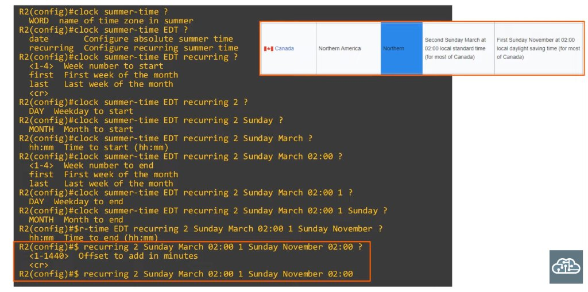

## Network Time Protocol

- Manually configuring the time on devices is not scalable
- The manually configured clocks will drift, resulting in inaccurate time
- NTP (Network Time Protocol) allows automatic syncing of time over a network

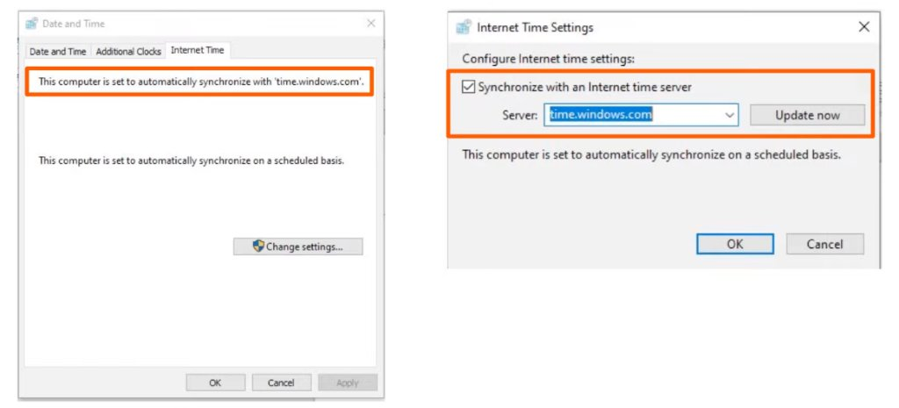

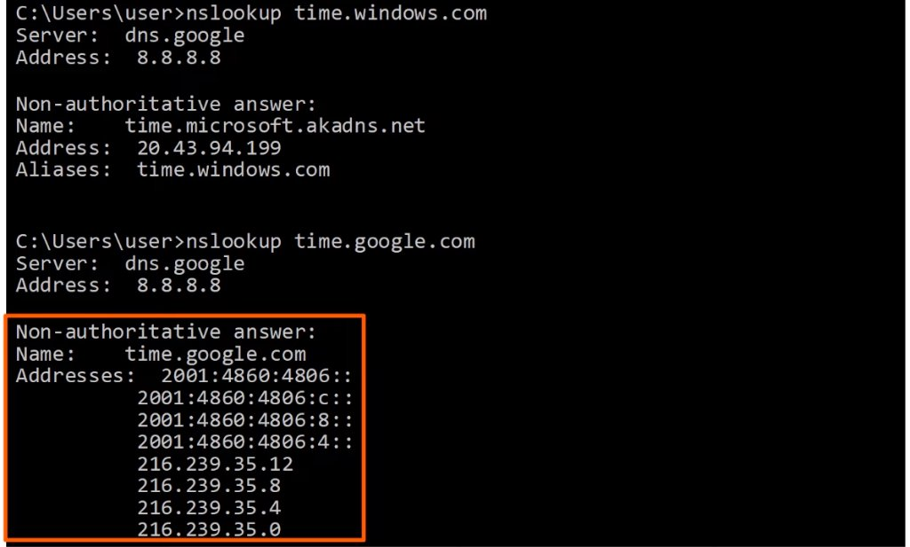

- NTP clients request the time from NTP servers
- A device can be an NTP server and an NTP client at the same time
- NTP allows accuracy of time within ~1 millisecond if the NTP server is in the same LAN, or within ~50 milliseconds if connecting to the NTP server over a WAN/the Internet
- Some NTP servers are 'better' than others; the 'distance' of an NTP server from the original **reference clock** is called **stratum**
- NTP uses UDP port 123 to communicate

### Reference Clocks

- A refeerence clock is usually a very accurate time device like an atomic clock or a GPS clock
- Reference clocks are **stratum 0** within the NTP hierarchy
- NTP servers directly connected to reference clocks are **stratum 1**

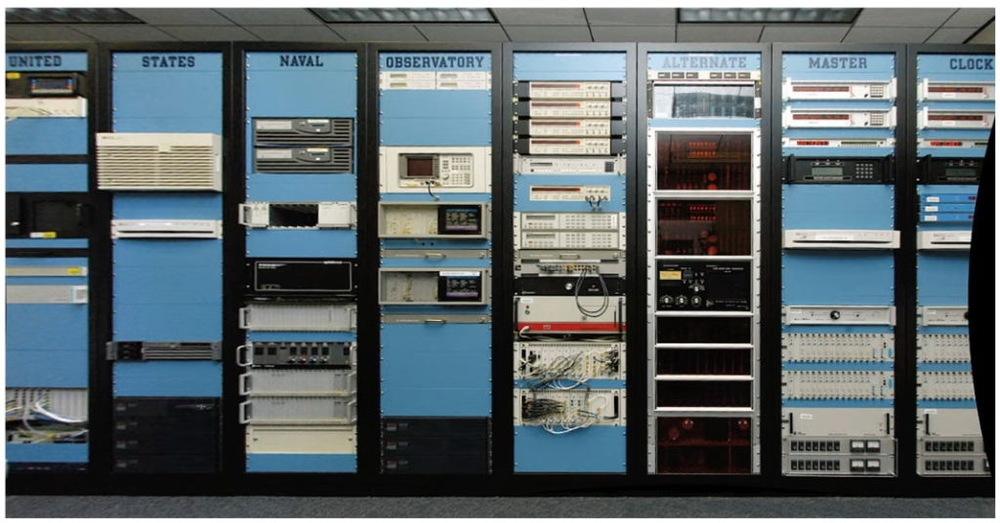

### NTP Hierarchy

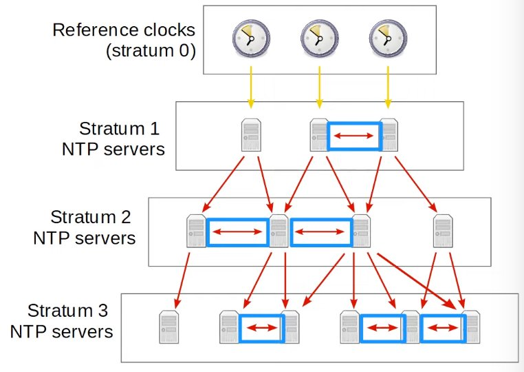

- Reference clocks are **stratum 0**
- **Stratum 1** NTP servers get their time from reference clocks
- **Stratum 2** NTP servers get their time from stratum 1 NTP servers
- **Stratum 3** NTP servers get their time from stratum 2 NTP servers
- **Stratum 15** is the maximum; anything above that is considered unreliable
- Devices can also 'peer' with devices at the same stratum to provide more accurate time
  - This is called 'symmetric active' mode
  - Cisco devices can operate in three NTP modes:
    - Server mode
    - Client mode
    - Symmetric active mode
- An NTP client can sync to multiple NTP servers
- NTP servers which get their time directly from reference clocks are also called **primary servers**
- NTP servers which get their time from other NTP servers are called **secondary servers**; they operate in server mode and client mode at the same time

### NTP Configuration

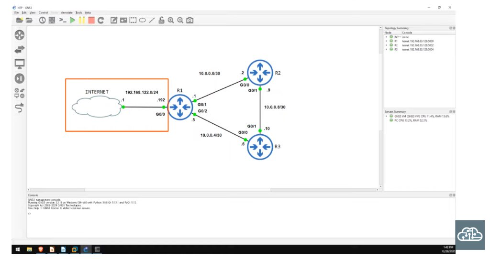

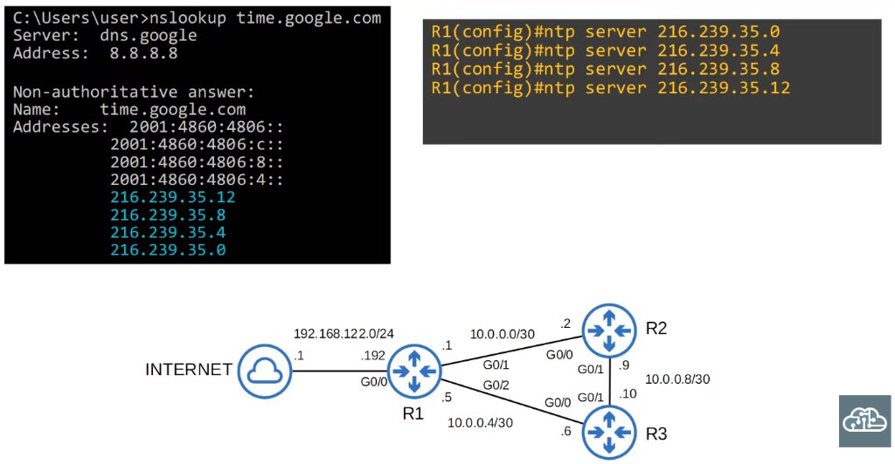

```cisco
R1#show ntp associations

  address         ref clock       st   when   poll reach  delay  offset   disp
*~216.239.35.0    .GOOG.           1     43     64    17 62.007 1401.54  0.918
+~216.239.35.8    .GOOG.           1     43     64    17 64.220 1416.65  0.939
+~216.239.35.4    .GOOG.           1     47     64    17 57.669 1402.11  0.916
+~216.239.35.12   .GOOG.           1     39     64    17 62.229 1409.03  0.960
 * sys.peer, # selected, + candidate, - outlyer, x falseticker, ~ configured
```

```cisco
R1#show ntp status
Clock is synchronized, stratum 2, reference is 216.239.35.12
nominal freq is 1000.0003 Hz, actual freq is 999.5003 Hz, precision is 2**14
ntp uptime is 295800 (1/100 of seconds), resolution is 1001
reference time is E393F0A9.1F758C5B (05:50:33.122 UTC Mon Dec 28 2020)
clock offset is 1343.7280 msec, root delay is 49.13 msec
root dispersion is 2275.31 msec, peer dispersion is 3.44 msec
loopfilter state is 'SPIK' (Spike), drift is 0.000499999 s/s
system poll interval is 64, last update was 173 sec ago.
```

- Because R1 is synchronizing its time to Google's NTP servers, it automatically becomes an NTP server itself (stratum level 1 higher than Google's NTP servers)
- Now other devices can synchronize their time to R1

```cisco
R1(config)#do show clock detail
06:56:32.315 UTC Mon Dec 28 2020
Time source is NTP
R1(config)#do show calendar
05:23:06 UTC Mon Dec 28 2020
R1(config)#clock timezone JST 9
R1(config)#ntp update-calendar
R1(config)#do show clock detail
15:57:33.078 JST Mon Dec 28 2020
Time source is NTP
R1(config)#do show calendar
15:57:36 JST Mon Dec 28 2020
```

- NTP uses only the UTC time zone; you must configure the appropiate time zone on each device
- The hardware clock tracks the date and time on the device even if it restarts, power is lost, etc.
- When the system is restarted, the hardware clock is used to initialize the software clock

```cisco
R1(config)#interface loopback0
R1(config-if)#ip address 10.1.1.1 255.255.255.255
R1(config-if)#exit
R1(config)#ntp source loopback0
```

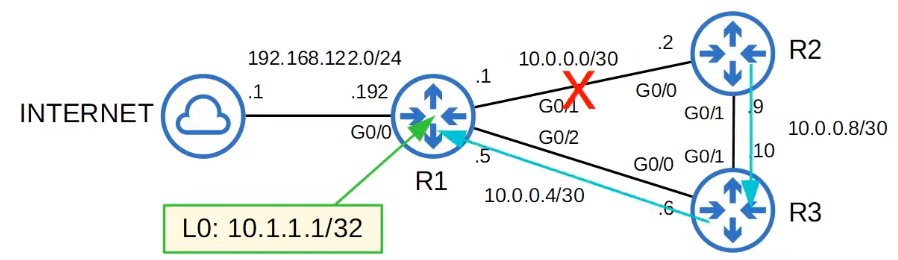

```cisco
R2(config)#ntp server 10.1.1.1
R2(config)#do show ntp associations

  address         ref clock       st   when   poll reach  delay  offset   disp
*~10.1.1.1        216.239.35.12    2      0     64     1  7.038 -13.128 3937.5
 * sys.peer, # selected, + candidate, - outlyer, x falseticker, ~ configured
R2(config)#do show ntp status
Clock is synchronized, stratum 3, reference is 10.1.1.1
...
```

```cisco
R3(config)#ntp server 10.1.1.1
R3(config)#ntp server 10.2.2.2
R3(config)#do show ntp associations

  address         ref clock       st   when   poll reach  delay  offset   disp
*~10.1.1.1        216.239.35.0     2      1     64     0  0.000   0.000 15937.
 ~10.2.2.2        10.1.1.1         3      1     64     0  0.000   0.000 15937.
 * sys.peer, # selected, + candidate, - outlyer, x falseticker, ~ configured
```

- Servers with lower stratum levels are preferred

### Configuring NTP server mode

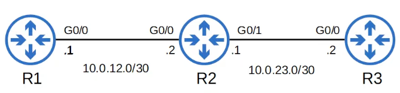

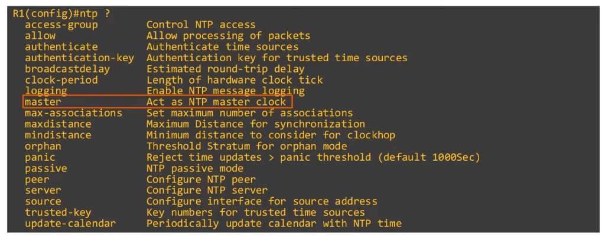

```cisco
R1(config)#ntp master ?
  <1-15>  Stratum number
  <cr>

R1(config)#ntp master
R1(config)#do show ntp associations

  address         ref clock       st   when   poll reach  delay  offset   disp
*~127.127.1.1     .LOCL.           7      2     16   377  0.000   0.000  0.292
 * sys.peer, # selected, + candidate, - outlyer, x falseticker, ~ configured
R1(config)#do show ntp status
Clock is synchronized, stratum 8, reference is 127.127.1.1
...
```

- The default stratum of the **ntp master** command is 8

```cisco
R2(config)#ntp server 10.0.12.1

R2(config)#do show ntp associations

  address         ref clock       st   when   poll reach  delay  offset   disp
*~10.0.12.1       127.127.1.1      8      2     64     1  5.263  62.494 187.64
 * sys.peer, # selected, + candidate, - outlyer, x falseticker, ~ configured
```

```cisco
R3(config)#ntp server 10.0.12.1

R3(config)#do show ntp associations

  address         ref clock       st   when   poll reach  delay  offset   disp
*~10.0.12.1       127.127.1.1      8     45     64    17 21.534 -21.440  0.976
 * sys.peer, # selected, + candidate, - outlyer, x falseticker, ~ configured
```

### Configuring NTP symmetric active mode

```cisco
R2(config)#ntp peer 10.0.23.2

R2(config)#do show ntp associations

  address         ref clock       st   when   poll reach  delay  offset   disp
*~10.0.12.1       127.127.1.1      8     60     64    17 24.040 206.682  0.987
 ~10.0.23.2       10.0.12.1        9     33     64     0  0.000   0.000 15937.
 * sys.peer, # selected, + candidate, - outlyer, x falseticker, ~ configured
```

```cisco
R3(config)#ntp peer 10.0.23.1

R3(config)#do show ntp associations

  address         ref clock       st   when   poll reach  delay  offset   disp
*~10.0.12.1       127.127.1.1      8     11     64    37 12.605  -7.406 63.575
 ~10.0.23.1       10.0.12.1        9      1     64     0  0.000   0.000 15937.
 * sys.peer, # selected, + candidate, - outlyer, x falseticker, ~ configured
```

### Configuring NTP Authentication

- NTP authentication can be configured, although it is optional
- It allows NTP clients to ensure they only sync to the intended servers
- To configure NTP authentication:
  - Enable NTP authentication: `ntp authenticate`
  - Create the NTP authentication key(s): `ntp authentication-key key-number md5 key`
  - Specify the trusted key(s): `ntp trusted-key key-number`
  - Specify which key to use for the server: `ntp server ip-address key key-number`
    - This command isn't needed on the server (R1)

```cisco
R1(config)#ntp authenticate
R1(config)#ntp authentication-key 1 md5 jeremysitlab
R1(config)#ntp trusted-key 1
```

```cisco
R2(config)#ntp authenticate
R2(config)#ntp authentication-key 1 md5 jeremysitlab
R2(config)#ntp trusted-key 1
R2(config)#ntp server 10.0.12.1 key 1
R2(config)#ntp peer 10.0.23.2 key 1
```

```cisco
R3(config)#ntp authenticate
R3(config)#ntp authentication-key 1 md5 jeremysitlab
R3(config)#ntp trusted-key 1
R3(config)#ntp server 10.0.12.1 key 1
R3(config)#ntp peer 10.0.23.1 key 1
```

## Quiz

1. Which of the following commands will cause the router to adjust its software clock to match the hardware clock?

_c) `R1#clock read-calendar`_

2. Which of the following commands can be used to configure the time zone of the device?

_d) `R1(config)#clock timezone name offset`_

3. Examine the output below. Which of the following commands was configured on R1?

```cisco
R1#show ntp associations

  address         ref clock       st   when   poll reach  delay  offset   disp
*~127.127.1.1     .LOCL.           8      2     16   377  0.000   0.000  0.292
 * sys.peer, # selected, + candidate, - outlyer, x falseticker, ~ configured
```

_a) `R1(config)#ntp master 9`_

4. Which of the following commands configures the router to operate in NTP client mode?

_c) `R1(config)#ntp server 216.239.35.0`_

5. Which of the following commands must be configured on an NTP client to enable NTP authentication? (select all that apply)

_c) `R1(config)#ntp authenticate`_
_d) `R1(config)#ntp authentication-key key-number md5 key`_
_f) `R1(config)#ntp trusted-key key-number`_
_g) `R1(config)#ntp server ip-address key key-number`_

6. Which of the following is enabled on a Cisco router when you issue the **`ntp server`** command from global configuration mode? (select the best answer)

_a) static client mode_
