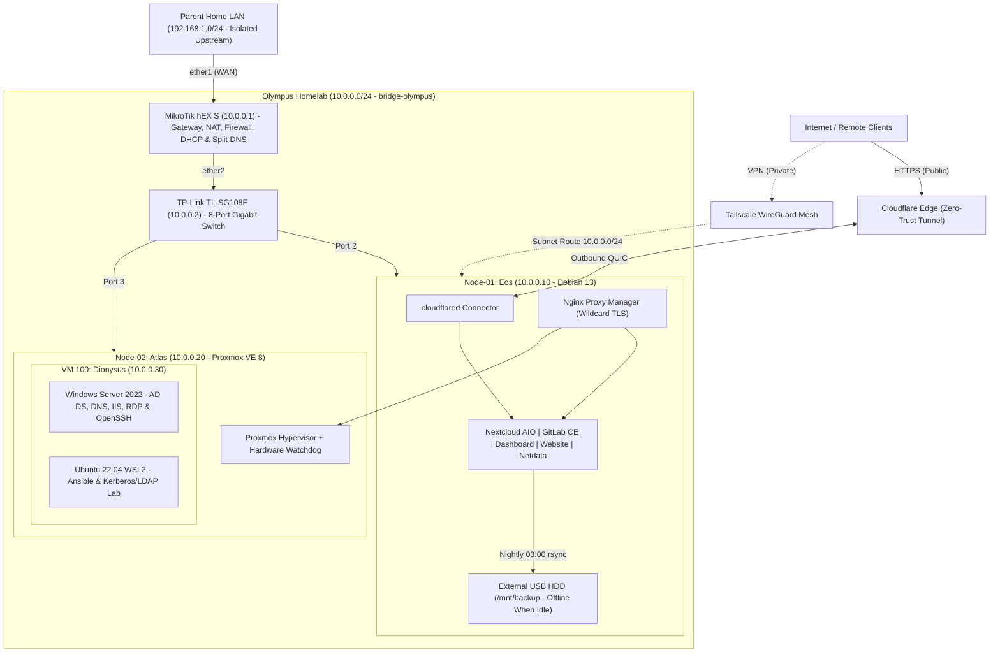

# Olympus Homelab


Documentation, infrastructure configurations, operational runbooks, incident post-mortems, and systems engineering study notes for **Olympus** — a self-hosted multi-node homelab built on repurposed and mini-PC hardware inside an isolated Gigabit subnet (`10.0.0.0/24`).

---

## Table of Contents

- [Architecture Overview](#architecture-overview)
- [Hardware & Node Inventory](#hardware--node-inventory)
- [Hosted Services & Access Model](#hosted-services--access-model)
- [Backups, Reliability & Hardening](#backups-reliability--hardening)
- [Repository Structure](#repository-structure)
- [Operations & Maintenance](#operations--maintenance)

---

## Architecture Overview

Olympus uses an **"Isolated Island"** network topology (`10.0.0.0/24`) behind a dedicated **MikroTik hEX S** router:

- **Strict Upstream Isolation:** Stateful RouterOS firewall rules allow outbound internet access via NAT on `ether1` while blocking lateral traffic from the homelab into the parent home LAN (`192.168.1.0/24`) and dropping all unsolicited inbound WAN traffic.
- **Zero Open Inbound Ports:** No port forwarding is configured on either the ISP router or the MikroTik gateway.
- **Split-Tier Access:**
  - **Public Tier:** Selected services (`Nextcloud` and `Personal Website`) are exposed through an outbound-only **Cloudflare Tunnel** (`cloudflared` over QUIC).
  - **Private Tier:** Internal dashboards, GitLab, hypervisor management, and infrastructure UIs remain strictly private—reachable on the local LAN or remotely via a **Tailscale Subnet Router** (`10.0.0.0/24`) with Split DNS (`*.home.olympus-luca.online`) and Let's Encrypt wildcard TLS via **Nginx Proxy Manager**.



---

## Hardware & Node Inventory

| Appliance / Node        | Hostname                       | IP Address  | OS / Firmware                             | Hardware Summary                                                                                                                                     | Primary Roles                                                                                    |
| :---------------------- | :----------------------------- | :---------- | :---------------------------------------- | :--------------------------------------------------------------------------------------------------------------------------------------------------- | :----------------------------------------------------------------------------------------------- |
| **Gateway Router**      | `MikroTik`                     | `10.0.0.1`  | RouterOS v7                               | MikroTik hEX S (`RB760iGS`), MT7621A 2C @ 880 MHz, 256 MB RAM, 16 MB Flash                                                                           | WAN NAT, Firewall isolation, DHCP (`.100–.200`), Static Split DNS                                |
| **Core Switch**         | `TL-SG108E`                    | `10.0.0.2`  | TP-Link Easy Smart                        | 8-Port Gigabit RJ45 (16 Gbps switching capacity, fanless)                                                                                            | Layer 2 Gigabit core switching                                                                   |
| **Node-01 (`Eos`)**     | `debian-eos`                   | `10.0.0.10` | Debian 13 (Trixie)                        | Repurposed ASUS X550LB, i3-4010U (2C/4T), 8 GB RAM, 240 GB SSD (`/`) + 750 GB HDD (`/srv`) + 465 GB USB HDD (`/mnt/backup`), built-in battery backup | Docker Host, Cloudflared, Tailscale Subnet Router, NPM, Nextcloud, GitLab, Nightly Backups       |
| **Node-02 (`Atlas`)**   | `atlas`                        | `10.0.0.20` | Proxmox VE 8.x                            | HP EliteDesk 800 G4 Mini (35W), i5-8500T (6C), 16 GB DDR4, 256 GB NVMe SSD                                                                           | Type-1 KVM/QEMU Hypervisor (`local` + `local-lvm`)                                               |
| **VM 100 (`Dionysus`)** | `windows-server-2022-dionysus` | `10.0.0.30` | Windows Server 2022 + Ubuntu 22.04 (WSL2) | 2 vCPU, 6 GB RAM, 70 GB VirtIO Disk, UEFI (OVMF) + TPM 2.0                                                                                           | Active Directory DC (`DIONYSUS`), AD DNS, IIS, RDP/SSH, Ansible Control Node & Kerberos/LDAP Lab |

---

## Hosted Services & Access Model

| Service                   | Host             | Endpoint                                     | Exposure Tier              | Description                                                                            |
| :------------------------ | :--------------- | :------------------------------------------- | :------------------------- | :------------------------------------------------------------------------------------- |
| **Nextcloud AIO**         | Node-01          | `https://nc.olympus-luca.online`             | Public (Cloudflare Tunnel) | Self-hosted cloud storage, macOS FileProvider sync, TOTP 2FA & per-user quotas         |
| **Personal Website**      | Node-01          | `https://web.olympus-luca.online`            | Public (Cloudflare Tunnel) | Containerized SPA served via NGINX with gzip & immutable asset caching                 |
| **Olympus Dashboard**     | Node-01          | `https://home.olympus-luca.online`           | Private (LAN / Tailscale)  | Central NGINX portal linking services and displaying nightly backup telemetry          |
| **GitLab CE**             | Node-01          | `https://gitlab.home.olympus-luca.online`    | Private (LAN / Tailscale)  | Self-hosted Git server (`:8085` Web, `:2222` SSH) & automated GitHub mirror            |
| **Nginx Proxy Manager**   | Node-01          | `https://npm.home.olympus-luca.online`       | Private (LAN / Tailscale)  | Reverse proxy & DNS-01 Let's Encrypt TLS termination (`*.home.olympus-luca.online`)    |
| **Netdata**               | Node-01          | `https://nd.home.olympus-luca.online`        | Private (LAN / Tailscale)  | Real-time CPU, RAM, disk I/O, thermal, and container monitoring                        |
| **Nextcloud AIO Panel**   | Node-01          | `https://nc-aio.home.olympus-luca.online`    | Private (LAN / Tailscale)  | Lifecycle & container orchestration console for Nextcloud AIO                          |
| **Proxmox VE Web UI**     | Node-02          | `https://pve.home.olympus-luca.online`       | Private (LAN / Tailscale)  | Hypervisor cluster management, VM console, and snapshot administration                 |
| **Active Directory / DC** | VM 100           | `dionysus.home.olympus-luca.online`          | Private (LAN / Tailscale)  | AD DS forest (`ad.home.olympus-luca.online`), DNS, IIS, RDP (`:3389`), OpenSSH (`:22`) |
| **Network Appliances**    | Gateway / Switch | `router` / `switch.home.olympus-luca.online` | Private (LAN / Tailscale)  | MikroTik WebFig/SSH (`10.0.0.1`) and TP-Link Easy Smart UI (`10.0.0.2`)                |

---

## Backups, Reliability & Hardening

### Automated Backup Pipeline

1. **Nightly Offline-Protected USB Snapshots (`03:00` Cron on Node-01):**
   - [`Node-01/backup/backup.sh`](Node-01/backup/backup.sh) rescans the USB/SCSI bus, mounts the external backup drive (`/mnt/backup`), places Nextcloud in maintenance mode, dumps PostgreSQL databases, and creates space-efficient `rsync --link-dest` snapshots with a **30-day rolling retention policy**.
   - Publishes run status to `backup-status.json` for the Olympus Dashboard via [`generate-status.sh`](Node-01/backup/generate-status.sh) and **automatically unmounts** the external drive on exit (`trap cleanup EXIT`) so backups remain offline when idle.
2. **Nightly GitHub-to-GitLab Mirror (`02:00` Cron on Node-01):**
   - [`Node-01/gitlab/backup-script.sh`](Node-01/gitlab/backup-script.sh) mirrors GitHub repositories directly onto `/srv` for local redundancy.
3. **Hypervisor & Network Config Archives:**
   - Pre-maintenance Proxmox snapshots (`qm snapshot`) and Zstandard-compressed `vzdump` VM archives replicated off-node to Node-01, alongside monthly RouterOS (`.backup`/`.rsc`) and switch (`.cfg`) exports.
4. **Workstation Cloud Sync (`20:00` Daily):**
   - Automated `rclone` sync from macOS `~/Documents` into Nextcloud after verifying endpoint readiness (`status.php`).

### System & Kernel Hardening Highlights

- **Storage Isolation:** Dedicated SSD LVM volume group (`vg_system`) for OS root `/` and separate SATA HDD volume group (`vg_data`) at `/srv` for Docker volumes, containerd layers, and repositories—eliminating multi-disk LVM failure domains.
- **NIC Hang Remediation (Node-02):** Resolved Intel `i219LM` (`e1000e`) hardware unit hangs on Proxmox by disabling PCIe ASPM (`pcie_aspm=off e1000e.SmartPowerDownEnable=0`), turning off hardware TSO/GSO/EEE offloading, and expanding RX/TX ring buffers to `4096`.
- **Fail-Safe Watchdog Recovery (Node-02):** Enabled the Intel PCH hardware watchdog (`iTCO_wdt`) and kernel panic auto-reboot (`kernel.panic = 10`, `kernel.panic_on_oops = 1`) to prevent unmonitored thermal or kernel lockups.
- **Container & Host Firewalling (Node-01):** Enforced host-level UFW paired with `ufw-docker` rules, non-root container execution where supported, `600`/`700` credential permissions, and global Docker JSON log rotation.

---

## Repository Structure

```text
homelab/
├── Networking/          # Isolated 10.0.0.0/24 setup, MikroTik RouterOS v7, switch & Split DNS logs
├── Node-01/             # Eos (Debian 13) build log, incident post-mortems & Docker stacks
│   ├── backup/          # Nightly rsync snapshot & dashboard status scripts
│   ├── dashboard/       # Olympus NGINX homelab portal & Compose stack
│   ├── gitlab/          # GitLab CE Compose deployment & GitHub mirror script
│   ├── nextcloud/       # Nextcloud All-in-One Compose deployment & notes
│   └── notes/           # Service configuration references (NGINX, etc.)
├── Node-02/             # Atlas (Proxmox VE 8) & Dionysus (Windows Server 2022 AD / WSL2 Ansible) logs
├── Experimental/        # Phase-0 prototype documentation (VirtualBox VMs & initial tests)
├── Learning/            # Hands-on labs & engineering notes:
│   ├── Docker/          # Docker Engine & Docker Compose
│   ├── GitHub/          # CI/CD & GitHub Actions workflows
│   ├── Kubernetes/      # Architecture, Networking, Helm, Prometheus & Grafana
│   ├── Linux/           # Rocky Linux administration
│   ├── Networking & Protocols/          # CCNA / Jeremy's IT Lab notes & packet labs
│   ├── Nokia Cloud AI RAN Summer Practice/ # Ansible, Cloud, Containers, DevOps, HPE iLO, SR-IOV, SRE
│   └── Windows/         # Windows Server 2022, AD DS, DNS, IIS & PowerShell administration
├── MAINTENANCE.md       # Ordered monthly, quarterly & semi-annual operational runbook
└── labels.html          # Printable physical hardware & port identification labels
```

### Key Documentation Links

- **[Networking Architecture & RouterOS Setup](Networking/README.md)** — Physical cabling, MikroTik bridge/NAT/firewall setup, switch configuration, and Tailscale Split DNS.
- **[Node-01 (`Eos`) Engineering Log](Node-01/README.md)** — Debian 13 LVM setup, Docker stack deployments, Cloudflare Tunnel, LVM recovery post-mortem, and performance tuning.
- **[Node-02 (`Atlas` & `Dionysus`) Engineering Log](Node-02/README.md)** — Proxmox VE installation, Windows Server 2022 Active Directory promotion, WSL2 Ansible/Kerberos integration lab, and hardware watchdog hardening.
- **[Monthly Maintenance Runbook](MAINTENANCE.md)** — End-to-end checklist for backup audits, security updates, SMART disk health, AD replication checks, and disaster recovery drills.
- **[Phase-0 Experimental Setup](Experimental/README.md)** — Early virtualization experiments prior to dedicated node deployment.

---

## Operations & Maintenance

Routine upgrades, health audits, and disaster recovery checks follow the strict execution order documented in **[`MAINTENANCE.md`](MAINTENANCE.md)**:

1. **Pre-Maintenance & Backup Verification** — Verify nightly USB snapshots, SQL dumps, GitHub mirrors, and Proxmox `vzdump` backups before touching packages.
2. **Network Layer & Remote Access Audit** — Check MikroTik flash/RAM health, firewall counters, Tailscale subnet routing, and `cloudflared` tunnel health.
3. **Node-01 Host & Container Stack Updates** — Audit LVM/SMART disk health, apply Debian security updates, and update Docker stacks (`Nextcloud AIO`, `GitLab CE`, `NPM`, `cloudflared`).
4. **Node-02 Hypervisor & VM 100 Updates** — Check NVMe SMART wearout, apply Proxmox VE updates, verify Active Directory health (`dcdiag` / `repadmin`), and patch Windows Server + WSL2.
5. **Post-Maintenance Sign-Off** — Validate end-to-end HTTPS reachability, TLS certificate expiry windows, and monitoring alerts.
